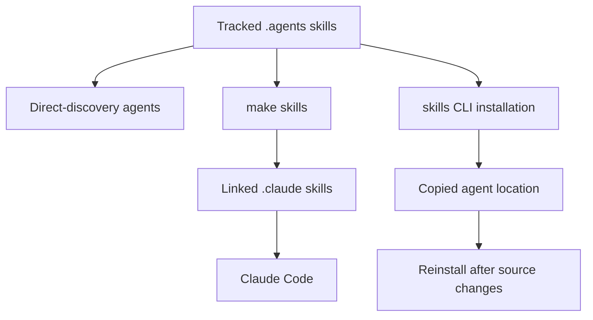
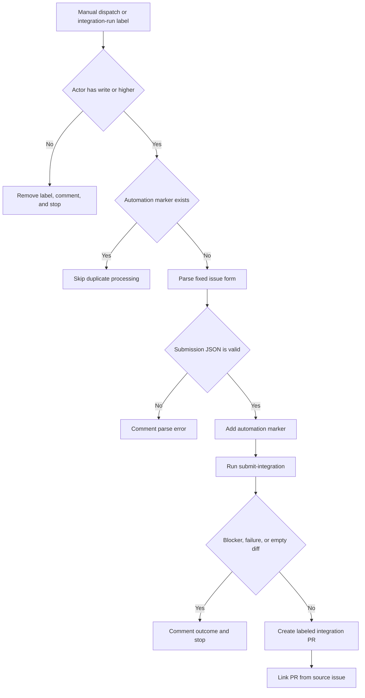

# Agent Instructions and Authoring Skills

The repository separates universal documentation rules from conditional procedures. `AGENTS.md` is the always-on contract; a skill in `.agents/skills/` supplies a focused workflow that an agent discovers through its request-oriented `description`. Read the root contract before non-trivial work, then load the narrowest skill that matches the task. Skills must link to global rules rather than duplicate them, so the policy cannot drift.

## Keep global invariants and procedures separate

`AGENTS.md` owns rules that apply to every documentation edit, including source verification, valid frontmatter and syntax, navigation, style, code-sample testing, and the prohibition on editing `build/`. It also identifies derivative Cursor and Copilot instruction surfaces that must be synchronized when their corresponding root-guide sections change.

A skill owns a multi-step procedure with decision points: adding or moving a page, editing an existing PR, reviewing a completed diff, restructuring a page family, extracting runnable samples, or processing an integration submission. This division keeps always-loaded context small and establishes one owner for each rule.

## Discover and distribute the canonical skills

The tracked `.agents/skills/<name>/SKILL.md` tree is the canonical source. Cursor, Codex, GitHub Copilot, Gemini CLI, OpenCode, Deep Agents, Droid, Kilo Code, and other compatible agents read it directly. Deep Agents Code resolves this project tree ahead of `.deepagents/skills/`, allowing the integration workflow to resolve `submit-integration` without a shim.

Claude Code is the exception: it reads the gitignored `.claude/skills/` directory. Reconcile its local links after cloning, pulling an added or renamed skill, or creating a worktree:

```bash
make skills
```

The target creates the directory, symlinks canonical skills, preserves an existing non-symlink personal entry, and removes stale symlinks. The links remain live as canonical files change. For agents that use another location, the `skills` CLI copies the local source, so rerun the installation after source changes:

```bash
npx skills add ./.agents/skills --skill '*' --agent <agent> --yes
```



This diagram distinguishes live Claude links from copied installations that can become stale.

## Route documentation work

The canonical tree currently has ten skills. The README and `AGENTS.md` catalog must agree exactly with that tree.

| Skill | Use it for | Key boundary |
| --- | --- | --- |
| `add-docs-page` | Adding, moving, renaming, or deleting a page | Owns source placement, navigation, redirects, factual verification, and the finished-prose review handoff. |
| `docs-edit` | Revising an existing page or an open PR | Uses the real PR head branch and diff; does not create a competing PR branch. |
| `docs-restructure` | Consolidating, splitting, retiring, or de-duplicating a page family | Selects one topic owner, then hands page lifecycle mechanics to `add-docs-page`. |
| `docs-team-voice` | Drafting or revising prose | Provides the editorial voice pass. |
| `docs-review` | Reviewing completed documentation changes | Reviews only the changed documentation and reports the rule behind each finding. |
| `docs-tooling-notion` | Changing tracked tooling, including skills | Records discovery-level tooling information in its correct Notion home before handoff. |
| `docs-code-samples` | Converting visible code into runnable external samples | Owns markers, harnesses, extraction, generated snippets, and sample validation. |
| `verify-against-source` | Verifying behavior, defaults, signatures, or sample facts | Finds the owning source and records any verification gap. |
| `submit-integration` | Processing a structured new integration issue | Unattended, best-effort listing preparation from untrusted form data. |
| `update-integrations-prs` | Maintaining an existing contributor integration PR | Interactive existing-PR maintenance and explicit push control. |

### Add pages, edit PRs, and review prose

A new page is incomplete until it has navigation. A moved, renamed, or deleted published page also needs redirects. `add-docs-page` directs authors to the `AGENTS.md` source-directory map, requires facts to be checked against product source rather than neighboring documentation, and calls for `docs-review` only after prose is complete. It skips the review handoff for a change with no prose, such as a redirect-only change.

Use `docs-edit` for a named PR or an in-place revision. For a same-repository PR, it requires a clean checkout of the actual head branch, confirms `HEAD` and its upstream, and reads the live PR diff rather than comparing against a potentially stale local `main`. For a cross-repository PR, `gh pr checkout <n>` configures the fork remote. Related pages are evidence for contradictions, duplication, and missing entry points, not evidence for factual behavior; keep related-page edits limited to corrections and pointers unless the work becomes a restructure. Generated outputs must be repaired through their generator or input, not edited directly.

`docs-review` operates on a PR, branch, current branch, or working tree. It resolves the target before inspection, narrows scope to changed `src/**/*.mdx` and `src/**/*.md` files, and never reviews `build/`. It runs Vale on the changed version and merge-base version to distinguish a new CI blocker from pre-existing debt. Because Vale does not scan all JSX component content or table cells, the reviewer also checks mechanical style rules in those regions. The remainder is a deliberately constrained review of changed hunks against the `AGENTS.md` structure and style rules; the report groups findings by file, cites the rule, and distinguishes merge blockers from suggestions.

## Author runnable code samples

Use `docs-code-samples` when visible reader code becomes an external sample. Reader-facing code stays in language-specific `:snippet-start:` / `:snippet-end:` regions; setup, cleanup, and assertions that readers should not see go in `:remove-start:` / `:remove-end:` regions. The complete source executes during validation, while extraction omits remove regions. A passing early exit before the visible body is not validation.


This flow requires executable sample code before presentation extraction.

Related Python snippets can generally share one source file. TypeScript and JavaScript snippets that duplicate imports or module-scope bindings must split into separate files. Test an affected source before extraction, then regenerate and inspect the output:

```bash
make test-code-samples FILES="src/code-samples/langchain/return-a-string.py"
make code-snippets
```

`make test-code-samples` accepts an explicit `FILES` list or discovers supported sources. `make code-snippets` writes ignored extraction intermediates, then regenerates committed MDX. CI assigns every top-level sample directory to either the OSS or LangSmith matrix leg and fails when a directory has no assignment.

## Maintain the skill library

Create a focused skill at `.agents/skills/<kebab-case-name>/SKILL.md`. Its frontmatter `name` must match the directory, and its description should use the vocabulary of a user request because discovery matches that description. Validate the canonical tree, not Claude's symlinked view:

```bash
claude plugin validate .agents/skills --strict
make test TEST_FILE=tests/unit_tests/test_skills.py
```

The structural tests check frontmatter, name and directory agreement, supported metadata keys, description bounds, referenced repository paths, referenced Make targets, and exact catalog agreement among the canonical tree, README, and `AGENTS.md`. Any tracked script, workflow, Make target, PR check, scheduled job, agent, skill, or MCP-server change also requires the `docs-tooling-notion` handoff before the pull request is handed off. That procedure gives a topic one Notion home, uses fetch-and-narrow-update safety, and maintains the discovery row and its source path.

## Distinguish integration submission paths

`submit-integration` handles a new structured issue without a conversation. It treats every supplied field as untrusted metadata, makes best-effort decisions, and writes `integration-submission-error.md` only when no reasonable listing is possible. It leaves all edits uncommitted and does not push, open a PR, or comment on GitHub.

`update-integrations-prs` handles an existing contributor PR. It identifies the relevant package and downloads, rebases on `upstream/main` without discarding contributor commits, places any conversion in a separate commit, asks before assuming package identity or a feature override, and does not push unless requested.

Both procedures apply the same eligibility threshold: at least 50K monthly PyPI or npm downloads, or a maintainer override, permits hosted MDX. A lower-download, non-featured integration is an external listing. Hosted pages and generated overview artifacts follow their prescribed templates and generation path rather than manual edits.

An external listing needs the language-and-component YAML row, downloads-table row, and alphabetically placed provider card. The card is one factual sentence of no more than 160 characters. Add `packages.yml` only for qualifying public packages; do not add navigation or redirects for pages that never shipped.

## Operate integration-submission automation safely

The workflow starts only from manual dispatch or an `integration-run` label event. It serializes work per issue and authorizes the triggering actor as a collaborator with `admin`, `maintain`, or `write` permission. An unauthorized label event removes the label, comments on the issue, and stops. The `integration-automation` label is the duplicate-processing and retry gate.

The job fetches the issue body and parses fixed issue-form headings into JSON. Optional blank, `n/a`, `none`, and `_No response_` values normalize to `null`; missing required sections, display name, component, docs URL, provider description, or a registry package needed by the selected language cause parsing to fail. The workflow passes valid parsed values to `submit-integration` only as untrusted listing metadata.



This flow keeps issue text from initiating privileged listing work without maintainer authorization and keeps human PR review as the final approval boundary.

The prompt requires measured downloads, working-tree edits left uncommitted, no push, no PR, and no GitHub comments from the agent. A blocker file, unsuccessful agent result, or empty staged and unstaged diff comments on the issue and creates no PR. With real edits, the workflow removes a local blocker file, mints a GitHub App token only after the agent step, creates `integration/issue-<number>`, labels it `integration`, assigns `npentrel`, and links the PR from the issue. No workflow step merges it. Retry agent-failure and no-change outcomes by removing `integration-automation` and applying `integration-run` again; parse-error instructions make marker removal conditional because parsing occurs before the marker is added.

## See also

- [GitHub Actions Integration Automation](/openwiki/integrations/github-actions.md)
- [Adding and Moving Documentation Pages](/openwiki/operations/adding-pages.md)
- [Local Tooling and Commands](/openwiki/operations/cli-tools.md)
- [Runnable Code Samples and Snippet Generation](/openwiki/workflows/code-sample-lifecycle.md)
