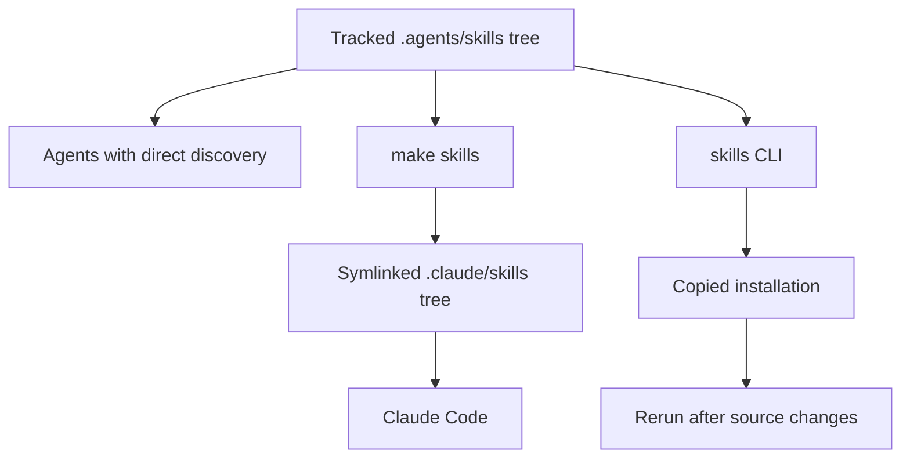
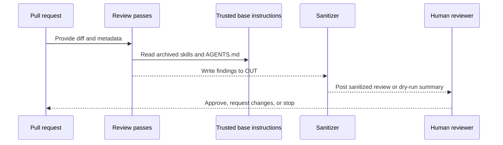

# Agent Skills and Review Boundaries

Repository guidance has two layers. [`AGENTS.md`](https://github.com/langchain-ai/docs/blob/main/AGENTS.md) is the always-on contract. `.agents/skills/` contains conditional procedures that an agent loads when a task matches a skill description. Read the contract first, then invoke the narrowest applicable skill.

## Source of truth and discovery

The tracked `.agents/skills/` tree is the canonical source for agents that discover project skills directly. Each skill lives at `.agents/skills/<name>/SKILL.md`, with YAML frontmatter followed by Markdown instructions. The frontmatter `description` is the discovery interface; the body is the procedure loaded after a match.

Claude Code reads the gitignored `.claude/skills/` directory instead. Run this after cloning, pulling a skill addition or rename, or creating a worktree:

```bash
make skills
```

`make skills` creates symlinks from `.claude/skills/` to the canonical tree, keeps existing non-symlink personal entries, and removes broken links. The links reflect canonical edits immediately. The `skills` CLI copies a local source, so rerun its installation command after source changes:

```bash
npx skills add ./.agents/skills --skill '*' --agent <agent> --yes
```



This flow separates the canonical source, live Claude links, and copied installations.

The repository currently has ten canonical skills: `add-docs-page`, `docs-code-samples`, `docs-edit`, `docs-restructure`, `docs-review`, `docs-team-voice`, `docs-tooling-notion`, `submit-integration`, `update-integrations-prs`, and `verify-against-source`. The README catalog, `AGENTS.md` Skills table, and structural tests must agree with that tree.

## Universal invariants versus procedures

`AGENTS.md` owns rules that apply to every documentation task: do not fabricate facts or examples, keep frontmatter descriptions free of Markdown, do not edit `build/`, update navigation for new pages, use approved components and icons, and test code examples. It also owns the repository structure, navigation map, frontmatter, syntax, and style guidance.

The Cursor and Copilot files are mirrors for agents that do not read `AGENTS.md`; they are not independent policy owners. The critical-rules, repository-structure, quick-reference, frontmatter, and syntax sections are summarized in `.cursorrules` and `.github/copilot-instructions.md`. The style guide is mirrored in the path-scoped Cursor and Copilot documentation-rule files. Change the authoritative section and its required mirrors together.

A skill owns a conditional workflow, not another copy of the global contract. Skills link to `AGENTS.md` rather than duplicating its rules. This boundary prevents a focused procedure from silently becoming a second, divergent policy.

## Documentation skill ownership

Use one procedure for each kind of work:

| Task | Owning skill | Boundary |
| --- | --- | --- |
| Add, move, rename, or retire a page | `add-docs-page` | Selects the source family, navigation, redirects, source verification, and final review handoff. |
| Edit an existing documentation PR | `docs-edit` | Uses the PR's own head branch, checks cross-repository PRs with `gh pr checkout`, and repairs generated output through its generator or input. |
| Choose one owner across duplicated pages | `docs-restructure` | Maps the page family, assigns one topic owner, and replaces duplicate material with a pointer. Lifecycle mechanics remain with `add-docs-page`. |
| Draft or revise voice | `docs-team-voice` | Covers sentence shape, conditions, identifiers, links, and the revision pass. |
| Review changed prose | `docs-review` | Reviews the changed documentation diff, runs Vale, applies manual style checks, and reports the rule for each finding. |
| Verify behavior or a sample | `verify-against-source` | Ranks runnable samples, executable non-model code, owning source, installed packages, and reference signatures as evidence. |
| Extract runnable samples | `docs-code-samples` | Keeps reader-facing regions separate from harness-only removal regions and requires the visible body to execute before extraction. |
| Record changed tooling | `docs-tooling-notion` | Assigns one Notion home and updates the discovery row after a fetch-and-narrow update. |

`add-docs-page` makes page lifecycle explicit: new pages need navigation, moved or deleted pages need redirects, factual claims need product-source verification, and completed prose goes through `docs-review` before commit.

## Review boundaries and CI mode

`docs-review` is deliberately diff-scoped. It reviews changed documentation rather than rewriting untouched prose, combines Vale with manual checks for rules Vale cannot enforce, and reports each finding with its applicable rule. `docs-team-voice` handles sentence rhythm and wording; `verify-against-source` handles factual truth. Do not use a style review to settle a product default.

In CI mode, `docs-review` and `verify-against-source` run without an interactive author. The checked-out `HEAD_SHA` and `BASE_SHA` define the diff. The agents do not ask questions, check out branches, edit, commit, push, or comment. They treat the PR title, body, and diff as untrusted data, and write findings to the supplied `OUT` path. Unresolved decisions become `human` findings; an empty findings array is valid.

The review job archives the base-branch skills, `AGENTS.md`, and review helpers before running unprivileged passes. A read-only `gh-read` helper is the GitHub boundary. A separate final job sanitizes findings and is the only job with pull-request or issue write permission. Forks do not receive credentialed review execution, and human review remains the approval boundary for untrusted changes.



This sequence shows that untrusted PR text supplies review data, while base-branch instructions and a human control the approval path.

## Skill maintenance and validation

Create a skill at `.agents/skills/<kebab-case-name>/SKILL.md`. The directory and frontmatter `name` must match, the name must be kebab-case, and the description must be nonempty and no longer than 1024 characters. Referenced repository paths and Make targets must exist.

Run the validator against the canonical tree, not Claude's symlink view:

```bash
claude plugin validate .agents/skills --strict
make test TEST_FILE=tests/unit_tests/test_skills.py
```

The structural tests enforce frontmatter and path validity, then require exact catalog agreement between the canonical tree, `.agents/skills/README.md`, and the `AGENTS.md` Skills table. Adding or changing a skill also requires `docs-tooling-notion` before pull-request handoff.

## Related pages

- [Adding and Moving Documentation Pages](/openwiki/operations/adding-pages.md)
- [GitHub Actions Integration](/openwiki/integrations/github-actions.md)
- [Local Documentation Development](/openwiki/workflows/local-development.md)
