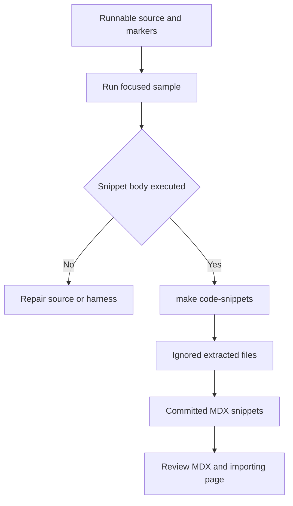
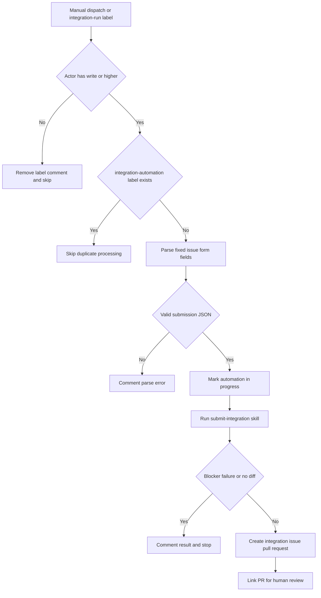

# Agent Instructions and Authoring Skills

The repository separates rules that apply to every task from procedures that apply only to a recognizable kind of work. `AGENTS.md` is the always-on contract. `.agents/skills/` contains focused procedures that agents discover from a skill's request-oriented `description` and load when the task matches. Read the root contract before a non-trivial change, then use the narrowest applicable skill rather than copying its workflow into another task.

## Keep universal rules in `AGENTS.md`

`AGENTS.md` owns repository-wide invariants: do not fabricate content, test code examples, do not edit `build/`, update navigation for new pages, and use valid frontmatter and documentation syntax. It also owns the style guide and navigation map. Four derivative instruction surfaces mirror parts of that contract: the Cursor and Copilot copies cover the critical rules, repository structure, quick reference, frontmatter, and syntax; the two path-scoped style files copy the style guide through product and feature-name capitalization. Update the relevant copies in the same pull request when changing one of those root-guide sections.

A skill owns conditional, multi-step work: placing a page, editing a live PR, restructuring a page family, extracting snippets, reviewing prose, opening a PR, or recording a tooling change. Skills link to `AGENTS.md` instead of repeating global policy. This keeps always-loaded context small and avoids silently divergent copies of the same rule.

## Discover and distribute the canonical skills

Each canonical skill is `.agents/skills/<name>/SKILL.md`: Agent Skills YAML frontmatter followed by Markdown instructions. Cursor, Codex, GitHub Copilot, Gemini CLI, OpenCode, Deep Agents, Droid, Kilo Code, and other supported agents discover the tracked tree directly. Deep Agents Code resolves this project path ahead of `.deepagents/skills/`, so the integration workflow can invoke `submit-integration` without a compatibility shim.

Claude Code deliberately has a different discovery boundary. It reads the gitignored `.claude/skills/` directory rather than `.agents/skills/`. Create or reconcile the local links after cloning, pulling an added or renamed skill, or creating a worktree:

```bash
make skills
```

The target creates `.claude/skills/`, links each canonical skill, preserves a non-symlink personal entry, and removes stale symlinks. Linked skills reflect canonical edits immediately. The `skills` CLI instead copies a local source, so rerun its installation command after source changes; `npx skills update` does not refresh that local copy.

```bash
npx skills add ./.agents/skills --skill '*' --agent <agent> --yes
```


This diagram distinguishes the live Claude links from a copied installation that can become stale.

## Route work to the skill that owns it

The catalog is duplicated in `.agents/skills/README.md` and the `AGENTS.md` Skills table. Its current skills are:

| Skill | Invoke when | Boundary and outcome |
| --- | --- | --- |
| `add-docs-page` | Adding, moving, renaming, or deleting a page | Owns source placement, frontmatter, navigation, redirects, anchor checks, verification, and the completed-prose review handoff. |
| `docs-edit` | Revising an existing page or named documentation PR | Uses the actual PR head branch and live diff; related-page changes stay limited to needed corrections or pointers. |
| `docs-restructure` | Consolidating, splitting, retiring, or de-duplicating a page family | Builds a duplication map and assigns one topic owner before passing page lifecycle mechanics to `add-docs-page`. |
| `docs-team-voice` | Drafting or revising prose | Supplies the editorial pass for conditions, defaults, identifiers, sentence length, links, and verified claims. |
| `docs-review` | Reviewing completed documentation changes | Reviews only changed documentation, combines Vale with style rules it cannot detect, and reports the rule behind each finding. |
| `open-docs-pr` | Opening a PR for finished changes with no existing PR | Branches from current `origin/main`, runs applicable gates, commits, opens and pushes the PR safely, and watches its checks. |
| `docs-code-samples` | Converting visible code to a runnable external sample | Owns marker conventions, executable harnesses, extraction, generated snippets, and sample-specific validation. |
| `verify-against-source` | Asserting behavior, defaults, signatures, or sample facts | Selects the strongest available evidence and the repository that owns the claim, then records verification gaps. |
| `docs-tooling-notion` | Adding or changing tracked tooling, including a skill | Records discovery-level tooling information in the correct Notion home before PR handoff. |
| `submit-integration` | Processing a structured new integration issue | CI-only, unattended creation of a best-effort listing from untrusted form data. |
| `update-integrations-prs` | Maintaining an existing contributor integration PR | Interactive branch maintenance, eligibility conversion, and explicit push control. |

`add-docs-page` treats a page as incomplete until it has its navigation entry; a move, rename, or deletion also needs redirects. It directs authors to the source-directory map in `AGENTS.md`, checks facts against product source rather than neighboring docs, and requires the prose review after finished prose. `open-docs-pr` is not a substitute for `docs-edit`: use it only when no PR exists. It starts a branch from freshly fetched `origin/main`, avoids bare pushes, records applicable gates in the PR description, and ends the description with a plain AI-disclosure sentence rather than a generated-attribution badge.

For a named PR, `docs-edit` requires a clean checkout of the actual head branch, verifies `HEAD` and its upstream, and uses `gh pr checkout <n>` for a cross-repository PR. Check factual documentation claims against implementation or their owning input, not against another documentation page. Generated changelogs, specifications, catalog snippets, and `build/` are outputs: repair their generator or upstream source.

When placement is the problem, `docs-restructure` maps duplicated topics across the page family and assigns one owner. Replace duplicate material with a pointer rather than moving or restyling it in place. `add-docs-page` then handles routes, redirects, anchors, build and link checks, and invokes `docs-review` after prose is complete.

## Author runnable code samples

Use `docs-code-samples` whenever code shown to readers becomes an external sample. Source files live below `src/code-samples/`; visible regions use language-appropriate `:snippet-start:` and `:snippet-end:` markers. Names must be unique, kebab-case, and end in the relevant language suffix, such as `-py`, `-js`, `-java`, `-kt`, `-go`, or `-sh`.

A runnable source and its rendered snippet have separate responsibilities. Keep reader-facing code inside a snippet region. Put fixture setup, cleanup, and assertions in a `:remove-start:` / `:remove-end:` region, preferably after the visible snippet. The runner executes the complete source, while extraction omits remove regions from the rendered result. Do not put a successful `SystemExit`, `process.exit`, or shell exit before the snippet: a passing process that did not execute visible imports, construction, or calls does not validate the sample.



This flow requires execution before presentation extraction and treats generated MDX as derived output.

Related Python snippets can generally share one file and test-only setup. TypeScript and JavaScript run every region in one module scope, so split them when imports or top-level bindings collide. Keep reader-visible imports inside the snippet and reserve remove-region imports for harness-only symbols.

Test the affected source before extraction, then regenerate and inspect the importing page and generated MDX:

```bash
make test-code-samples FILES="src/code-samples/langchain/return-a-string.py"
make code-snippets
```

`make code-snippets` extracts visible regions into gitignored `src/code-samples-generated/` and then generates committed MDX in `src/snippets/code-samples/`. `CODE_SNIPPET_SOURCES` limits the source extraction while iterating, but generation still consumes the intermediate set. Run `make lint` after writing a sample. Do not change `pyproject.toml` or hide a failing sample through a lint exclusion.

The runner uses an explicit `FILES` list or discovers supported Python, TypeScript, Java, Kotlin, Go, and shell files; `CODE_SAMPLE_PATHS` narrows either selection. CI partitions top-level sample directories into OSS and LangSmith matrix legs, and fails if a new directory is assigned to neither leg.

## Record tooling changes before handoff

A new or changed tracked script, GitHub Actions workflow, Make target, PR check, scheduled job, agent, skill, or MCP server automatically triggers `docs-tooling-notion`. Invoke it before handing off the pull request—not after merge and not only when someone asks.

The skill keeps the repository as the authoritative location for detailed procedures. It uses Notion for discovery-level information: route a topic to exactly one of five Docs Team pages, fetch before each update, make narrow `update_content` replacements, and fetch again after a timeout or asynchronous update before retrying. For a new workflow, script, skill, agent, MCP server, or git hook, query the parent Detailed list first, then add its discovery row. When tracked tooling moves or is renamed, update the row's `Source` field.

## Maintain the skill library

Create a focused skill at `.agents/skills/<kebab-case-name>/SKILL.md`. Its frontmatter `name` must match the directory, and its request-oriented `description` drives discovery. Validate the canonical tree rather than Claude's symlinked view:

```bash
claude plugin validate .agents/skills --strict
make test TEST_FILE=tests/unit_tests/test_skills.py
```

The structural tests require valid frontmatter, a matching kebab-case name, a nonempty bounded description, recognized frontmatter keys, and valid named repository paths and Make targets. They also require exact agreement among the canonical tree, `.agents/skills/README.md`, and the `AGENTS.md` Skills table. A skill change therefore updates both catalogs and triggers the tooling-documentation follow-up. Run `make skills` when local Claude links need reconciliation.

## Distinguish new submissions from existing PR maintenance

Both integration procedures use the same eligibility threshold, but their operating models differ. A new submission starts as structured issue JSON and `submit-integration` runs without a conversation. It measures downloads, makes best-effort listing decisions, and treats every form field, including URLs and descriptions, as untrusted metadata. It writes `integration-submission-error.md` only when no reasonable listing is possible, and leaves changes uncommitted for the workflow.

`update-integrations-prs` is for an existing contributor PR. Identify its package and downloads, rebase on `upstream/main` while retaining contributor commits, and put a conversion in a separate commit. Ask before assuming package identity or a feature override. Do not push unless requested; a requested rebase push uses `--force-with-lease`.

| Eligibility result | New issue automation | Existing integration PR |
| --- | --- | --- |
| At least 50K monthly downloads, or maintainer override | Create or retain hosted MDX from the matching template and remove a duplicate external YAML row. | Retain hosted MDX; an explicitly requested feature may set `highlight: true` in `packages.yml` and regenerate the overview. |
| Under 50K and not featured | Add only an external listing. | Remove hosted pages and convert the PR to an external listing. |

An external listing needs the appropriate YAML row, a downloads-table row, and an alphabetical provider card. Its body is one factual sentence no longer than 160 characters. Add `packages.yml` only for a qualifying public package and public `owner/repo`; do not add navigation or redirects for pages that never shipped, and do not hand-edit generated overview tables.

## Operate integration-submission automation safely

The integration-submission workflow runs only on manual dispatch or an `integration-run` label event. It serializes work per issue and authorizes the triggering actor as a maintainer or collaborator with `admin`, `maintain`, or `write` permission. An unauthorized label event removes the label, comments, and skips processing. An existing `integration-automation` label skips duplicate work and is the retry gate.

After authorization, the workflow obtains the issue body and parses fixed headings into JSON. Blank or `_No response_` optional values become `null`; missing required sections and a missing registry package for the selected language fail parsing. The parsed values remain untrusted and are passed to `submit-integration` only as listing metadata.



This flow shows that issue text cannot initiate a privileged listing without a maintainer and that the agent output still has workflow and human-review gates.

The prompt requires measured downloads, uncommitted working-tree edits, no push, no pull request, and no GitHub comments from the agent. A blocker file, unsuccessful agent result, or empty staged and unstaged diff comments on the issue and creates no PR. With real changes, the workflow removes a local blocker file, mints its GitHub App token after the agent step, creates the `integration/issue-<number>` PR, adds the `integration` label, assigns `npentrel`, and links the PR from the issue. It does not merge the PR; human review remains the approval boundary. To retry an agent or no-change outcome, remove `integration-automation` and have a maintainer apply `integration-run` again. A parse-error response makes that removal conditional because it may not have added the marker.

## See also

- [Adding and Moving Documentation Pages](/openwiki/operations/adding-pages.md)
- [Local Tooling and Commands](/openwiki/operations/cli-tools.md)
- [Quickstart](/openwiki/quickstart.md)
- [Runnable Code Samples and Snippet Generation](/openwiki/workflows/code-sample-lifecycle.md)
