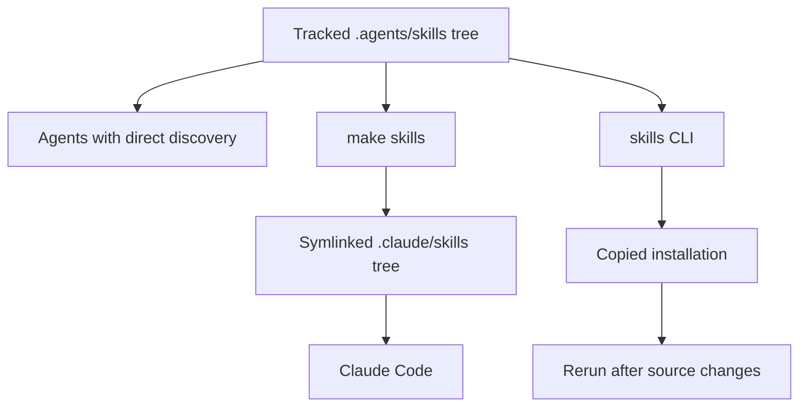
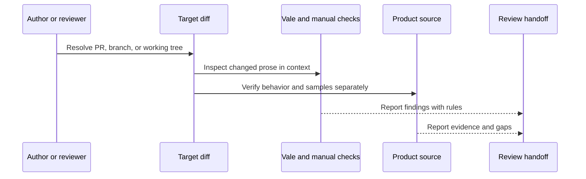

# Agent Skills and Review Boundaries

Repository guidance has two layers. [`AGENTS.md`](https://github.com/langchain-ai/docs/blob/main/AGENTS.md) is the always-on contract. `.agents/skills/` contains conditional procedures that an agent loads when a task matches a skill description. Read the contract first, then invoke the narrowest applicable skill.

## Source of truth and discovery

The tracked `.agents/skills/` tree is the canonical source for agents that discover project skills directly. Each skill lives at `.agents/skills/<name>/SKILL.md`. Its frontmatter `description` is the discovery interface; the body is the procedure loaded after a match.

Claude Code reads the gitignored `.claude/skills/` directory instead. Run this after cloning, pulling a skill addition or rename, or creating a worktree:

```bash
make skills
```

`make skills` creates symlinks from `.claude/skills/` to the canonical tree, keeps existing non-symlink personal entries, and removes broken links. The links reflect canonical edits immediately. The `skills` CLI copies a local source, so rerun its installation command after source changes:

```bash
npx skills add ./.agents/skills --skill '*' --agent <agent> --yes
```



This flow separates the canonical source, live Claude links, and copied installations.

The canonical tree currently contains eleven skills: `add-docs-page`, `docs-code-samples`, `docs-edit`, `docs-restructure`, `docs-review`, `docs-team-voice`, `docs-tooling-notion`, `submit-integration`, `update-example-models`, `update-integrations-prs`, and `verify-against-source`. The README catalog, `AGENTS.md` Skills table, and structural tests must agree with that tree.

## Universal invariants versus procedures

`AGENTS.md` owns rules that apply to every documentation task: do not fabricate facts or examples, keep frontmatter descriptions free of Markdown, do not edit `build/`, update navigation for new pages, use approved components and icons, and test code examples. It also owns repository structure, navigation, frontmatter, syntax, and style guidance.

`CLAUDE.md` only points agents to `AGENTS.md` for OpenWiki instructions. The Cursor and Copilot files mirror selected `AGENTS.md` sections for agents that do not read the root contract. The critical-rules, repository-structure, quick-reference, frontmatter, and syntax sections are summarized in `.cursorrules` and `.github/copilot-instructions.md`. The style guide is mirrored in the path-scoped Cursor and Copilot documentation-rule files. Change the authoritative section and its required mirrors together.

A skill owns a conditional workflow, not another copy of the global contract. Skills link to `AGENTS.md` rather than duplicating its rules. This boundary prevents a focused procedure from silently becoming a second, divergent policy.

## Documentation skill ownership

Use one procedure for each kind of work:

| Task | Owning skill | Boundary |
| --- | --- | --- |
| Add, move, rename, or retire a page | `add-docs-page` | Selects the source family, navigation, redirects, source verification, and final review handoff. |
| Edit an existing documentation PR or page | `docs-edit` | Uses the PR's own head branch, checks cross-repository PRs with `gh pr checkout`, and repairs generated output through its generator or input. |
| Choose one owner across duplicated pages | `docs-restructure` | Maps the page family, assigns one topic owner, and replaces duplicate material with a pointer. Lifecycle mechanics remain with `add-docs-page`. |
| Draft or revise voice | `docs-team-voice` | Covers sentence shape, conditions, identifiers, links, and the revision pass. |
| Review changed prose | `docs-review` | Reviews the changed documentation diff, runs Vale, applies manual style checks, and reports the rule for each finding. |
| Verify behavior or a sample | `verify-against-source` | Ranks runnable samples, executable non-model code, owning source, installed packages, and reference signatures as evidence. |
| Extract runnable samples | `docs-code-samples` | Keeps reader-facing regions separate from harness-only removal regions and requires the visible body to execute before extraction. |
| Record changed tooling | `docs-tooling-notion` | Assigns one Notion home and updates the discovery row after a fetch-and-narrow update. |

`add-docs-page` makes page lifecycle explicit: new pages need navigation, moved or deleted pages need redirects, factual claims need product-source verification, and completed prose goes through `docs-review` before commit.

## Review boundaries and CI mode

`docs-review` is deliberately diff-scoped. It reads the whole changed page and relevant sibling pages, reviews changed lines and existing content made wrong by the change, runs Vale, applies manual checks, and reports each finding with its applicable rule. `docs-team-voice` handles sentence rhythm and wording; `verify-against-source` handles factual truth. Do not use a style review to settle a product default.

The repository currently tracks no `.agents/skills/docs-review/ci-mode.md` and no CI workflow that invokes `docs-review` or `verify-against-source`. The supported procedure resolves a PR, branch, or current working-tree diff, and it uses `git fetch origin` plus checkout for named branch or PR reviews. It does not describe a CI-only `HEAD_SHA`/`BASE_SHA`/`OUT` contract. Do not treat the former CI-mode guidance as current repository behavior.



This sequence shows that prose quality and product truth are separate review paths that meet at handoff.

## Samples and source verification

Runnable samples belong under `src/code-samples/<product>/`. Keep related Python snippets in one file when possible. Split TypeScript or JavaScript files when imports or module-scope bindings would collide, because the entire file executes during `make test-code-samples`.

Keep reader-facing code between language-specific `:snippet-start:` and `:snippet-end:` markers. Put test-only harness code in `:remove-start:` and `:remove-end:` regions. The visible snippet body must execute before any exit or blocking-call guard. Test the source file before extraction:

```bash
make test-code-samples FILES="src/code-samples/langchain/return-a-string.py"
make code-snippets
```

`verify-against-source` ranks evidence in this order: run the sample, run the non-model portion, read the owning library source, check the installed package, then consult reference signatures. Record the file or symbol checked and identify what remains unverified, such as a model-dependent path or runtime-generated UI label. A sibling documentation page is not product evidence.

## Skill maintenance and validation

Create a skill at `.agents/skills/<kebab-case-name>/SKILL.md`. The directory and frontmatter `name` must match, the name must be kebab-case, and the description must be nonempty and no longer than 1024 characters. Referenced repository paths and Make targets must exist.

Run the validator against the canonical tree, not Claude's symlink view:

```bash
claude plugin validate .agents/skills --strict
make test TEST_FILE=tests/unit_tests/test_skills.py
```

The structural tests enforce frontmatter and path validity, then require exact catalog agreement between the canonical tree, `.agents/skills/README.md`, and the `AGENTS.md` Skills table. Adding or changing a skill also requires `docs-tooling-notion` before pull-request handoff. That procedure assigns the topic to one Notion home, uses `notion-fetch` before narrow `update_content` changes, and adds or updates the Detailed list row with the source path.

## Related pages

- [Adding and Moving Documentation Pages](/openwiki/operations/adding-pages.md)
- [GitHub Actions Integration](/openwiki/integrations/github-actions.md)
- [Code Sample Lifecycle](/openwiki/workflows/code-sample-lifecycle.md)
