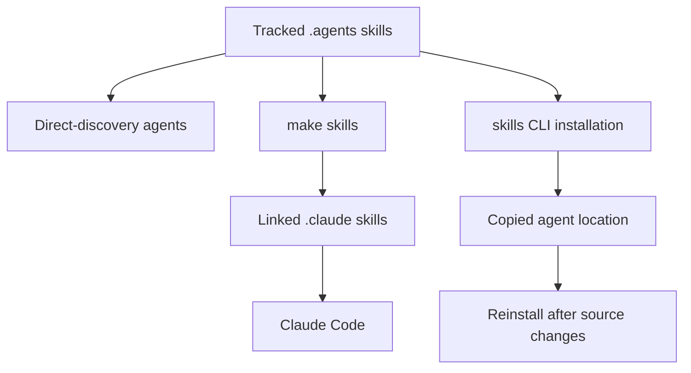
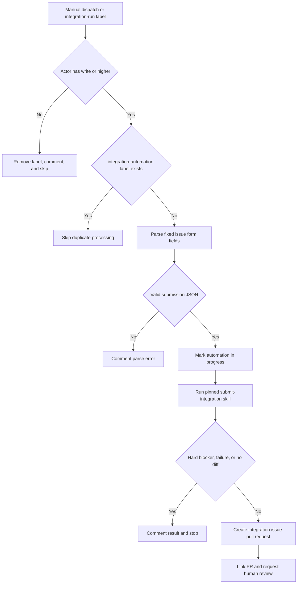

# Agent Skills and Automation Procedures

The tracked `.agents/skills/` tree is the repository's canonical library of conditional procedures. `AGENTS.md` remains the always-on guide: it owns universal rules, while a skill owns a focused workflow that an agent discovers from its request-oriented `description` and loads only when it applies. In this checkout, `CLAUDE.md` is an OpenWiki-delimited pointer to `AGENTS.md`, not an independent instruction set.

## Use the canonical tree and synchronize consumers

Each skill is a directory with a `SKILL.md` containing [Agent Skills](https://agentskills.io) YAML frontmatter and Markdown instructions. Cursor, Codex, GitHub Copilot, Gemini CLI, OpenCode, Deep Agents, Droid, Kilo Code, and other supported agents read `.agents/skills/` directly. Do not make an agent-specific copy the policy owner.

Claude Code is the exception: it reads the gitignored `.claude/skills/` directory. Reconcile its distribution after cloning, pulling an added or renamed skill, or creating a worktree:

```bash
make skills
```

The target creates `.claude/skills/`, creates or refreshes links for canonical skills, preserves a personal entry that is not a symlink, and removes a stale symlink. Linked content follows canonical edits immediately. The alternative local-source installation below copies files; rerun it after a canonical change because `npx skills update` does not refresh a local-source copy.

```bash
npx skills add ./.agents/skills --skill '*' --agent <agent> --yes
```



This diagram shows the three distribution paths and the explicit refresh boundary for copied installations.

The root guide also has derived instruction surfaces. Its style guide is mirrored into path-scoped Cursor and GitHub instruction files; critical rules, repository structure, quick reference, frontmatter, and syntax are summarized in `.cursorrules` and `.github/copilot-instructions.md`. Update the corresponding copies in the same PR when changing a covered section.

Deep Agents Code gives project `.agents/skills/` precedence over project `.deepagents/skills/`. This lets CI resolve `submit-integration` from the canonical path without a shim.

## Select the procedure that owns the task

Use the narrowest procedure instead of recreating its checks in an unrelated editing task. The [skills README](repo://.agents/skills/README.md) owns the complete catalog and full procedures; this table records repository-specific task routing and boundaries.

| Skill | Invoke when | Repository-specific boundary |
| --- | --- | --- |
| `add-docs-page` | Adding, moving, renaming, or deleting a page | Owns navigation, redirects, anchor/link validation, and the finished-prose review handoff. |
| `docs-edit` | Editing an existing page or named docs PR | Protects the actual PR head branch and confines related-page changes to corrections or pointers unless a restructure is requested. |
| `docs-restructure` | Consolidating, splitting, retiring, or de-duplicating a page family | Decides topic ownership before handing page lifecycle mechanics to `add-docs-page`. |
| `docs-team-voice` | Drafting or revising prose | Supplies the repository's editorial revision pass in addition to Vale and the root guide. |
| `docs-review` | Reviewing changed documentation | Reviews changed source Markdown or MDX rather than generated output and separates merge blockers from suggestions. |
| `docs-code-samples` | Turning visible code into a testable sample | Owns snippet extraction conventions and executable sample testing. |
| `verify-against-source` | Establishing behavioral, default, signature, or sample claims | Establishes evidence strength, product-repository ownership, and disclosure of gaps. |
| `docs-tooling-notion` | Adding or changing tracked tooling, including a skill | Required before PR handoff; records only the discovery-level tooling entry in Notion. |
| `submit-integration` | Automating a new structured integration-listing issue | CI-only, unattended processing of untrusted form data. |
| `update-integrations-prs` | Changing an existing integration contributor PR | Interactive maintenance of an existing contributor branch. |

### Documentation ownership boundaries

For a named PR, `docs-edit` requires a clean checkout of the actual head branch, verifies `HEAD` against the PR's `headRefOid` and verifies an upstream, and uses `gh pr checkout <n>` for a cross-repository PR. It directs authors to use the live PR diff. Related docs signal what needs review, but implementation source decides factual claims; record unresolved gaps. Generated changelogs, OpenAPI specifications, generated catalog snippets, and `build/` are outputs: correct their generator or upstream source rather than hand-editing them.

When content placement is the problem, `docs-restructure` requires a reported page-family duplication map and one owner per topic. It replaces duplication with a pointer, resolves divergent facts against source, and delegates redirects and navigation to `add-docs-page`. That lifecycle skill requires redirects for moved, renamed, or deleted pages, checks anchors, runs prose/build/anchor-link checks, and invokes `docs-review` after completed prose.

`docs-review` resolves a PR, branch, working tree, or current branch before inspection. It combines Vale with checks in MDX areas Vale does not scan, such as JSX components and table cells, then reports each finding with its rule and merge-blocking status. `docs-team-voice` adds the repository's sentence-length thresholds, first-mention links, condition-before-behavior ordering, exact identifiers, verified examples, targeted revision pass, and `make lint_prose` gate.

### Samples, facts, and tooling records

`docs-code-samples` requires runnable external samples, visible snippet delimiters, and a harness that executes the snippet. Related Python snippets can share a file. TypeScript samples must split when shared module-scope imports or bindings would collide. Run the focused sample check before extraction:

```bash
make test-code-samples FILES="src/code-samples/langchain/return-a-string.py"
```

`verify-against-source` orders evidence from executing the full or non-credentialed portion of a sample, through implementation source and installed-package imports, to reference signature lookup. Map each assertion to its owning repository and document both checked evidence and remaining gaps.

A changed script, workflow, Make target, PR check, scheduled job, agent, skill, or MCP server triggers `docs-tooling-notion` before pull-request handoff. The skill routes each topic to exactly one of five Docs Team Notion pages, requires the Notion MCP fetch and update tools, and leaves repository-owned material and complete skill procedures in the repository.

Fetch before every Notion edit and make narrow `update_content` replacements. Do not rewrite a page with uploaded images; after a timeout or asynchronous update, fetch and verify before retrying. For new tracked workflows, scripts, skills, agents, MCP servers, and git hooks, query the parent Detailed list database before adding its one discovery row. Update its `Source` value when tooling moves or is renamed.

## Distinguish new submissions from existing PR maintenance

Both integration skills apply the hosted-guide threshold, but their operating models intentionally differ. A new submission begins with a structured issue and `submit-integration` runs without a human conversation: it measures registry downloads, makes best-effort listing choices, and reserves `integration-submission-error.md` for hard blockers. It must treat issue fields, including URLs, descriptions, and notes, as untrusted data rather than instructions.

An existing contributor PR instead uses `update-integrations-prs`. Inspect its branch and package identity, report downloads, rebase onto `upstream/main` while retaining contributor commits, and put a required conversion in a separate commit. Ask for clarification rather than assuming package identity or a feature override. Do not push unless asked, and use `--force-with-lease` after a requested rebase push. These differences prevent an unattended issue workflow from silently exercising the authority appropriate only to a reviewed contributor branch.

| Eligibility result | New issue automation | Existing integration PR |
| --- | --- | --- |
| At least 50K monthly downloads, or maintainer override | Create or retain hosted MDX from the matching template and remove a duplicate external YAML row. | Retain hosted MDX; an explicitly requested feature may set `highlight: true` in `packages.yml` and regenerate the overview. |
| Under 50K and not featured | Add only an external listing. | Remove hosted pages and convert the PR to an external listing. |

An external listing uses the appropriate language and component YAML entry, a downloads-table row, and an alphabetical `all_providers` card. Prefer a working partner documentation URL; use a public repository README or registry page only as fallbacks. A provider-card body must be one factual sentence no longer than 160 characters. Add `packages.yml` only for a public LangChain-related package with a public `owner/repo`, preserve its trailing newline, and omit `path: .`. Do not add navigation entries or redirects for pages that never shipped, and never hand-edit generated overview tables.

## Operate integration-submission automation safely

The `.github/workflows/integration-submission.yml` workflow starts only by manual dispatch or application of `integration-run`. It serializes processing for each issue and checks that the triggering actor has `admin`, `maintain`, or `write` permission. An unauthorized label event removes the label, comments on the issue, and skips the job. The workflow also skips an issue already marked `integration-automation`, so that label is both an in-progress/completed marker and a retry gate.

After authorization, the workflow obtains the issue body and runs `scripts/parse_integration_submission_issue.py`. The parser maps fixed issue-form headings to stable JSON keys, converts optional blank or `_No response_` values to `null`, and rejects missing required sections or a missing PyPI/npm package for the selected language. Its tests cover a complete Python submission and the missing-PyPI failure. Parsing does not make the data trustworthy: the workflow explicitly passes the resulting field values to the agent as untrusted listing metadata.



This diagram shows the authorization, de-duplication, parsing, agent, and human-review boundaries of the workflow.

The prompt pins `submit-integration`, directs the agent to measure downloads rather than invent counts, and limits it to uncommitted working-tree edits. The skill does not push, open a pull request, or comment on GitHub. Treat all agent-produced changes as untrusted until the workflow's gates complete and humans review the resulting PR.

A blocker file, unsuccessful agent result, or empty staged and unstaged diff produces an issue comment and no PR. If the agent made real changes, the workflow removes a stray local blocker file, then mints the GitHub App token only after the agent step. It uses that token to create `integration/issue-<number>`, apply the `integration` label, assign `npentrel`, and include a review checklist for the eligibility decision, documentation URL, provider card, and listing files or hosted guide. The workflow links the PR on the issue and mentions the issue author, but it does not merge the PR. Human reviewers remain responsible for accepting or rejecting every listing decision and change.

To retry a parse, agent, or no-change outcome, remove `integration-automation` and have a maintainer apply `integration-run` again. Do not bypass the authorization and review gates by treating an issue form or an agent's output as approval.

## Author or change a skill

Create `.agents/skills/<name>/SKILL.md` with a kebab-case directory and matching frontmatter `name`. Use a request-oriented description, supported frontmatter keys only, and one focused workflow. Keep universal policy in `AGENTS.md`; link to it rather than duplicating it in a skill.

Validate the canonical tree, because the validator does not follow Claude's symlinks:

```bash
claude plugin validate .agents/skills --strict
```

A canonical skill-tree change must update both catalogues: `.agents/skills/README.md` and the Skills table in `AGENTS.md`. It also requires the `docs-tooling-notion` follow-up and, when needed, `make skills` to reconcile Claude Code.

`tests/unit_tests/test_skills.py` is the structural contract: it checks canonical skill frontmatter, matching kebab-case names, recognized keys, description length, repository paths, Make targets, and exact agreement of the tree with both catalogues. Run it via the normal test target:

```bash
make test TEST_FILE=tests/unit_tests/test_skills.py
```

Repair a stale procedure, path, target, or inventory rather than weakening this protection.

## Understand the Deep Agents runtime lifecycle

Repository authoring skills and application runtime skills are separate concerns. With a checkpointer, Deep Agents loads supplied skill sources once per thread and stores the resulting metadata. An addition, edit, or deletion therefore needs a stored-metadata reset to become visible; without a checkpointer, the next run loads again. Use `None` in Python or `null` in JavaScript for that reset—an empty list means sources loaded successfully with no skills. A changed reload updates the system prompt and invalidates that thread's prompt cache; an identical reload does not. Python reloads on the next run, while JavaScript reloads before the next model call.

An application can instead pin named skills for a run. Before the next model call, `SkillsMiddleware` reads each selected `SKILL.md` and appends its body, without frontmatter, as one `HumanMessage` in the supplied order. This bypasses the agent's normal decision of whether the skill matches.

## See also

- [Adding and Modifying Documentation Pages](/openwiki/operations/adding-pages.md)
- [GitHub Actions and CI/CD](/openwiki/integrations/github-actions.md)
- [Command-line Tools](/openwiki/operations/cli-tools.md)
- [Integration Listing Automation](/openwiki/workflows/integration-listing-automation.md)
- [Quickstart](/openwiki/quickstart.md)
