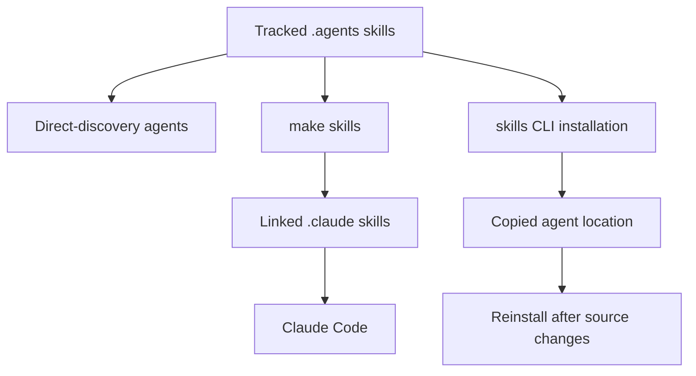
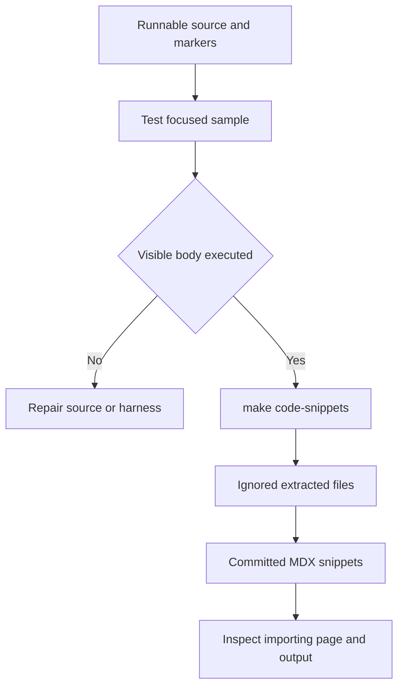
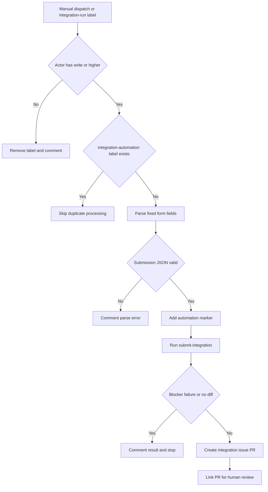

# Agent Instructions and Authoring Skills

The repository separates universal documentation constraints from conditional procedures. `AGENTS.md` is the always-on contract for manually authored content. The tracked `.agents/skills/` tree contains task-specific Agent Skills: an agent uses a skill's request-oriented `description` to decide whether to load its detailed workflow. Read the root contract first, then use the narrowest skill that matches the task.

## Universal constraints belong in `AGENTS.md`

`AGENTS.md` owns rules that apply to every documentation edit: do not fabricate examples or product facts, keep frontmatter descriptions free of Markdown, do not edit generated `build/` output, update `src/docs.json` when adding a page, use Tabler icons, and test code examples. It also owns the navigation map and style guide. Changes to its critical-rules, repository-structure, quick-reference, frontmatter, or syntax sections require synchronized Cursor and Copilot copies; the style-guide copy is separately path-scoped for documentation pages.

A skill owns a focused procedure with conditional steps, decisions, and validation. For example, page lifecycle work belongs in `add-docs-page`, an edit to an existing PR belongs in `docs-edit`, and source verification belongs in `verify-against-source`. Skills link back to the root contract rather than duplicating it, preventing divergent copies of global policy.

## Canonical tree and agent discovery

Every canonical skill is `.agents/skills/<name>/SKILL.md`, with Agent Skills YAML frontmatter followed by Markdown instructions. Agents such as Cursor, Codex, GitHub Copilot, Gemini CLI, OpenCode, and Deep Agents read this tracked tree directly. Deep Agents Code resolves it ahead of `.deepagents/skills/`, allowing the integration workflow to request `submit-integration` without a shim.

Claude Code reads the gitignored `.claude/skills/` directory instead. Run this after cloning, pulling a skill addition or rename, or creating a worktree:

```bash
make skills
```

The target creates the local directory, symlinks each canonical skill, leaves a non-symlink personal entry untouched, and removes broken symlinks. Those links reflect edits to the canonical skill immediately. By contrast, the `skills` CLI copies a local source; rerun its installation command when the canonical source changes.

```bash
npx skills add ./.agents/skills --skill '*' --agent <agent> --yes
```



This diagram distinguishes the live Claude links from a copied installation that can become stale.

## Current skill catalog

The canonical tree has ten skills. The table in `.agents/skills/README.md` and the `AGENTS.md` Skills table must list exactly this same set.

| Skill | Use it when | Primary outcome |
| --- | --- | --- |
| `add-docs-page` | Adding, moving, renaming, or deleting a page | Places the page, navigation, redirects, source verification, gates, and finished-prose review handoff. |
| `docs-code-samples` | Turning reader-visible code into an external runnable sample | Defines markers, harnesses, extraction, generated snippets, and sample validation. |
| `docs-edit` | Revising a page or an existing documentation PR | Works on the actual PR branch and diff; checks related pages and source evidence. |
| `docs-restructure` | Splitting, consolidating, retiring, or de-duplicating page families | Creates a duplication map, assigns one topic owner, and cuts duplicate content to pointers. |
| `docs-review` | Reviewing completed changed prose | Reviews the changed diff with Vale and style rules that automated checks miss. |
| `docs-team-voice` | Drafting or revising prose | Applies the house voice for sentence shape, links, defaults, conditions, and identifiers. |
| `docs-tooling-notion` | Adding or changing tracked tooling | Records discovery-level tooling information in the appropriate internal Notion location before handoff. |
| `submit-integration` | Processing a structured new integration issue | Produces an unattended, best-effort listing from untrusted form data for CI. |
| `update-integrations-prs` | Maintaining an existing contributor integration PR | Rebases, measures eligibility, and converts or retains the listing with explicit push control. |
| `verify-against-source` | Asserting a sample, signature, default, or behavior fact | Selects the owning product source or executable evidence and records verification gaps. |

### Documentation lifecycle boundaries

A new page is incomplete without navigation, and a moved or deleted page needs redirects. `add-docs-page` verifies factual claims against the product source and invokes `docs-review` only after prose is complete. `docs-edit` prevents creating a competing branch for an existing PR: it checks out the actual head branch, uses `gh pr checkout <n>` for cross-repository PRs, and reads the live PR diff. It treats generated artifacts—including `build/`—as outputs whose generator or upstream input must be fixed.

When the question is which page owns content, use `docs-restructure` before lifecycle mechanics. It maps the page family, selects one home per topic, and replaces duplicate sections with a pointer. `docs-team-voice` supplies the authoring pass; `docs-review` scopes its review to changed documentation, runs Vale, distinguishes base-branch debt from new violations, and reports the rule behind each finding.

`verify-against-source` is the factual boundary. It prefers, in order, a passing runnable sample, an executable non-model portion, the owning library source, an installed package, then a reference signature. A source repository owns product behavior; another documentation page is only another unverified claim.

## Runnable samples: test before extracting

`docs-code-samples` keeps complete, executable sources under `src/code-samples/`. Reader-visible code goes between language-appropriate `:snippet-start:` and `:snippet-end:` regions. Harness-only setup, cleanup, and assertions belong in `:remove-start:` and `:remove-end:` regions, which extraction strips. The visible body must execute before a successful exit; otherwise a passing runner proves only that the file parsed.

Related snippets can usually share a Python source file. TypeScript and JavaScript regions execute in one module scope, so use separate files when their imports or top-level bindings collide. Snippet names are unique, kebab-case, and carry the language suffix such as `-py`, `-js`, `-java`, `-kt`, `-go`, or `-sh`.



This flow requires successful execution before presentation extraction.

```bash
make test-code-samples FILES="src/code-samples/langchain/return-a-string.py"
make code-snippets
```

`make test-code-samples` uses `FILES` when supplied or discovers supported Python, TypeScript, Java, Kotlin, Go, and shell sources; `CODE_SAMPLE_PATHS` narrows either selection. `make code-snippets` extracts to gitignored `src/code-samples-generated/` and regenerates committed MDX in `src/snippets/code-samples/`. `CODE_SNIPPET_SOURCES` can limit extraction during iteration, but MDX generation reads the intermediate set. CI divides top-level sample directories between OSS and LangSmith matrix legs and fails if a new directory belongs to neither.

## Maintain and validate the library

Create one focused procedure at `.agents/skills/<kebab-case-name>/SKILL.md`. Its frontmatter `name` must exactly match the directory and its `description` must use request vocabulary, because that description drives discovery. Validate the canonical tree, not Claude's symlink view:

```bash
claude plugin validate .agents/skills --strict
make test TEST_FILE=tests/unit_tests/test_skills.py
```

The structural tests require a `SKILL.md` in each directory, matching kebab-case names, a nonempty bounded description, recognized frontmatter keys, valid referenced repository paths and Make targets, and exact agreement between the tree and both catalog tables. Adding or changing a skill also triggers the tooling-documentation procedure. Reconcile Claude links locally with `make skills` when needed.

## Tooling-documentation handoff

Any added or changed tracked script, GitHub Actions workflow, Make target, PR check, scheduled job, agent, skill, or MCP server requires `docs-tooling-notion` before pull-request handoff. The repository remains the detailed operational reference; Notion provides a discovery layer.

The procedure assigns each topic to one Notion home, searches the other homes to avoid duplicates, fetches before every narrow `update_content` change, and refetches after a timeout before retrying. New workflows, scripts, skills, agents, MCP servers, and git hooks require a Detailed list row; a move or rename updates its `Source` field.

## Integration listing procedures

The two integration skills share the eligibility threshold but serve different entrypoints. `submit-integration` processes a new issue submission without a human conversation. It treats all issue fields as untrusted metadata, measures downloads, makes best-effort decisions, leaves changes uncommitted, and writes `integration-submission-error.md` only when no reasonable listing is possible. `update-integrations-prs` maintains an existing contributor PR: it identifies package names and downloads, rebases on `upstream/main` while retaining contributor commits, places a conversion in a separate commit, asks before assuming package identity or a feature override, and does not push unless requested.

| Eligibility result | New issue automation | Existing contributor PR |
| --- | --- | --- |
| At least 50K monthly PyPI or npm downloads, or a maintainer override | Create or retain hosted MDX from the matching template and remove a duplicate external YAML row. | Retain hosted MDX; only an explicitly requested feature sets `highlight: true` and regenerates the overview. |
| Under 50K and not featured | Create an external listing only. | Remove hosted pages and convert to an external listing. |

An external listing requires the appropriate YAML row, downloads-table row, and alphabetical provider card. The card body is a factual sentence of at most 160 characters. Add `packages.yml` only for a qualifying public package and public source repository; do not hand-author generated overview tables, navigation entries, or redirects for pages that never shipped.

## Integration-submission automation

The `integration-submission` workflow runs only from manual dispatch or an `integration-run` label event. It serializes work per issue, authorizes the triggering actor as a collaborator with `admin`, `maintain`, or `write` permission, and removes an unauthorized label event. It skips an issue already marked `integration-automation`.

After authorization, the workflow obtains the issue body and invokes the parser. The parser maps fixed form headings to stable keys, normalizes blank optional values (including `_No response_`) to `None`, and rejects missing required fields or a missing registry package for the selected language. The resulting JSON remains untrusted metadata for `submit-integration`.



This flow shows the maintainer authorization, duplicate marker, and change gate between untrusted issue text and a reviewable pull request.

The workflow marks a valid parsed request before the agent runs. A blocker file, unsuccessful agent outcome, or empty staged and unstaged diff produces an issue comment without a PR. Retry those outcomes by removing `integration-automation` and having a maintainer apply `integration-run`; the parse-error instruction makes marker removal conditional because parsing may fail before it is added.

When the agent leaves real changes, the workflow deletes any local blocker file, mints a GitHub App token only after the agent step, creates an `integration/issue-<number>` pull request, labels it `integration`, assigns `npentrel`, and links it from the issue. The agent neither pushes, opens a PR, nor comments on GitHub. No workflow step merges the PR, so human review remains the approval boundary.

## See also

- [Adding and Moving Documentation Pages](/openwiki/operations/adding-pages.md)
- [Local Tooling and Commands](/openwiki/operations/cli-tools.md)
- [Runnable Code Samples and Snippet Generation](/openwiki/workflows/code-sample-lifecycle.md)
- [Integration Listing Automation](/openwiki/workflows/integration-listing-automation.md)
- [GitHub Actions](/openwiki/integrations/github-actions.md)
