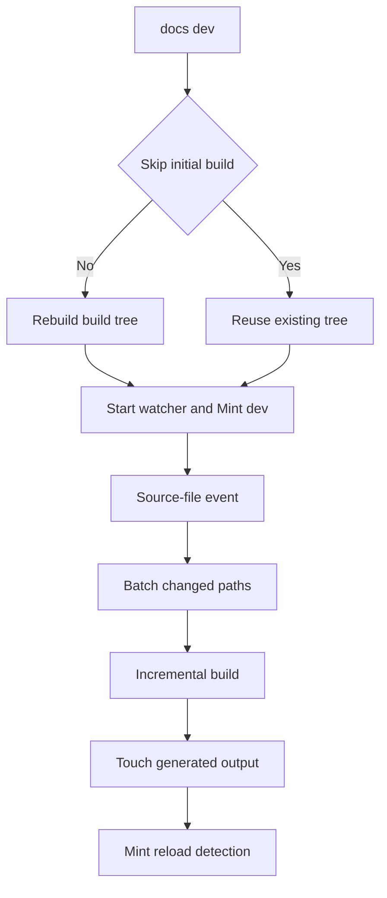
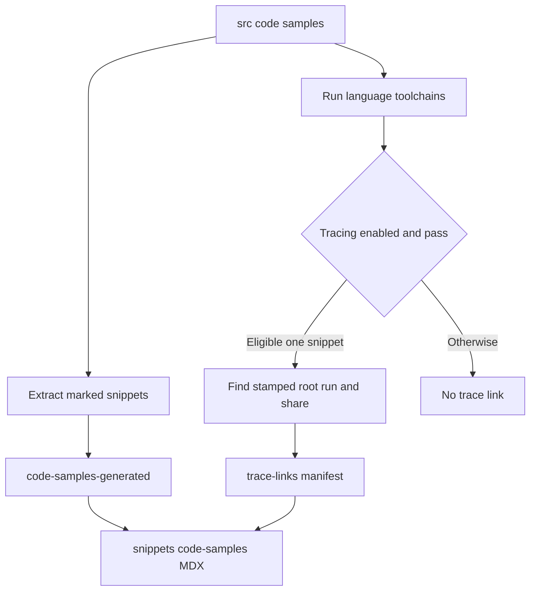

# Local Commands and Automation Tools

Author documentation in `src/`. The pipeline produces Mintlify input in `build/`; it is disposable output, not an authoring surface. **Never edit `build/`**: a full build removes and recreates it.

## Setup and command boundaries

The project registers `docs = "pipeline.cli:main"`. In a checkout, use `uv run pipeline <command>`; after installation, use `docs <command>`. The normal checkout entrypoints are `make build` and `make dev`, which run `npm install`, set `PYTHONPATH` to the checkout, and invoke the pipeline.

```bash
make install
make build
make dev
uv run pipeline migrate legacy/guide.md --dry-run
uv run pipeline mv old.mdx new.mdx --dry-run
```

`make install` runs `uv sync --all-groups`, installs local npm dependencies and the global Mint CLI, then runs `make skills`. The latter links `.agents/skills/*/` into `.claude/skills/`, retains personal non-symlink entries, and removes stale symlinks. `mint` is a separate global executable. See [Local Development](/openwiki/workflows/local-development.md) for environment setup.

| Need | Command | Input → output / boundary |
| --- | --- | --- |
| Reset generated site | `make build` or `docs build` | `src/` → regenerated `build/`; discards existing build output. |
| Preview changes | `make dev` or `docs dev` | source events → incremental output → Mint preview. |
| Check source references | `make check-cross-refs` | Validates source `@[ref]` references; does not render the site. |
| Check rendered links | `make broken-links-with-anchors` | Rebuilds, then checks the generated tree. |
| Run examples | `make test-code-samples` | Executes live programs which inherit caller credentials and service settings. |
| Refresh snippet MDX | `make code-snippets` | Samples → extraction intermediates → generated MDX. |

## Build and preview

### `make build` / `docs build`

`docs build` validates that `src/` exists, ensures `build/` exists, then delegates to `DocumentationBuilder`. Its full `build_all()` operation deletes and recreates `build/`, produces versioned Python and JavaScript documentation plus unversioned content, copies shared files, and copies npm snippet components. It returns 0 on success and 1 when `src/` is absent.

```bash
make build
# Direct equivalent
uv run pipeline build
```

The parser accepts `docs build --watch`, but `build_command()` ignores command arguments and builds once. Use `docs dev` for watch behavior.

### `make dev` / `docs dev`

Unless `--skip-build` is supplied, development performs that full build, then watches `src/` and launches `mint dev --port 3000` with `build/` as its working directory. `--skip-build` only reuses an existing tree and warns if it is missing; it does not establish a correct build itself.



*Development flow: the command establishes or reuses the generated tree, then serves it while the watcher batches source changes into incremental builds.*

The watcher ignores directories and temporary or backup files, deduplicates pending paths, and removes the corresponding source-relative output for a deleted source file. The dev command forwards Mint logs. An initial build failure, missing `mint`, nonzero Mint exit, or unexpectedly stopped watcher fails the command; Ctrl+C shuts down the watcher and terminates Mint (killing it after a five-second wait if needed). Run a full build after broad changes or when incremental output is suspect.

## Migration and source moves

These commands act on supplied source paths, never on `build/`. Use `--dry-run` before an operation that writes or moves files.

### `docs migrate <path>` and `docs migrate-docusaurus <path>`

`migrate` recursively selects notebooks, `.md`, and `.markdown` files. `migrate-docusaurus` also selects `.mdx` files and applies Docusaurus conversion. Both strip `.md`/`.mdx` suffixes from relative links after conversion. `--dry-run` prints converted output; `--output` writes to a specified file or directory while preserving directory-relative layout. Without output, Markdown is modified in place; an in-place notebook conversion writes `.md` and deletes the notebook.

A missing source path exits 1. A `ParseError` is reported for that file and the batch continues; unexpected exceptions include traceback context. Directory batches report their successes and failures.

### `docs mv <old_path> <new_path>`

The mover finds the Git root and scans `<root>/src` Markdown, MDX, and notebooks to rewrite inbound **relative** links. It preserves anchors and recalculates relative links inside a moved Markdown, MDX, or notebook file. `--dry-run` previews both sets of rewrites without writes or a move.

A real move creates destination directories, appends the absolute old/new paths to root-level `link_changes.jsonl`, rewrites inbound links, moves the file, and then updates its internal links. It does not update navigation, redirects, or prose mentions: reconcile those authored surfaces and run `make broken-links-with-anchors` afterward.

## Validation, export, and lint targets

`build` is phony. Consequently, `make broken-links`, `make broken-links-with-anchors`, `make check-openapi`, and `make export` all rebuild first. `make htmltest` instead consumes an existing export archive; it does not build.

| Target | Behavior and prerequisites |
| --- | --- |
| `make broken-links` | Runs `mint broken-links --check-redirects` from `build/`. It filters deployment-generated OpenAPI and standalone-snippet report noise, then fails only if filtered output still contains reported link entries. |
| `make broken-links-with-anchors` | Same check with `--check-anchors`; use after heading or fragment-link changes. |
| `make check-openapi` | Rebuilds, then runs Mint's OpenAPI check for `build/langsmith/agent-server-openapi.json`. |
| `make export` | Rebuilds then runs `mint export` in `build/`. It needs a Mint CLI with `export`, Node 20 or 22 rather than Node 25+, and an Enterprise Mintlify plan. `MINT_EXPORT_ARGS` can change export arguments. |
| `make htmltest` | Requires `htmltest`, `unzip`, and an existing `EXPORT_ZIP` (default `build/export.zip`). It unpacks under `HTMLTEST_UNPACK_DIR` and applies the external-URL configuration. `make export-htmltest` performs export then this check. |
| `make test` | Runs pytest with network sockets disabled except Unix sockets. Set `TEST_FILE` to narrow its default `tests/unit_tests` scope. |
| `make lint` | Checks Python formatting and linting with Ruff, types with `ty`, and spelling with `codespell src`. |
| `make format` / `make format-check` | Applies Ruff format/fixes, or checks formatting and lint without edits. |
| `make lint_md` / `make lint_md_fix` | Require `markdownlint`; lint Markdown or apply its fixes. |
| `make lint_prose` | Installs the Vale version selected from `.mise.toml` into `.bin/vale`, then lints `FILES` when set or `src/` otherwise, excluding code samples and node modules. |

Run Mint commands through these targets rather than from the repository root: the targets run them in `build/`, avoiding accidental parsing of checkout artifacts such as `.venv`.

## Runnable samples, generated snippets, and traces

`src/code-samples/` is the editable executable source. `src/code-samples-generated/` is an extraction intermediate, and `src/snippets/code-samples/` is generated MDX. Do not edit either generated directory as an authoring shortcut. See [Code Sample Lifecycle](/openwiki/workflows/code-sample-lifecycle.md) for marker syntax and sample design.



*Sample lifecycle: execution validates the source independently of snippet rendering; tracing is an optional successful-execution branch whose manifest is consumed on MDX generation.*

### Generate snippet MDX: `make code-snippets`

The target first extracts marked regions from supported Python, TypeScript, Java, Kotlin, Go, and shell files under `src/code-samples/` to `src/code-samples-generated/`, then generates importable MDX in `src/snippets/code-samples/`. A full extraction removes prior supported intermediate files before processing. Set `CODE_SNIPPET_SOURCES` to a space-separated list of eligible source files beneath `src/code-samples/` for a partial refresh; the extractor removes outputs for those sources only and rejects missing, out-of-tree, or unsupported selections.

Generation scans intermediate files, selects recognized language/ID suffix combinations, and adds the `View example trace` card only for a manifest entry matching that snippet ID. Review generated-MDX diffs after changing markers or sample content.

### Run samples: `make test-code-samples`

Run everything, or focus iteration with a space-separated `FILES` list:

```bash
make test-code-samples FILES="src/code-samples/langchain/return-a-string.py"
```

The runner supports `.py`, `.ts`, `.java`, `.kt`, `.go`, and `.sh`; it skips and warns for focused paths that are missing, unsupported, or outside `src/code-samples/`. An empty valid selection succeeds. It preserves the parent environment, so samples can use credentials and live services. Python uses `uv run python`; TypeScript uses `npx tsx`; Go uses `go run`; shell uses `bash`; Java and Kotlin use JBang with Java 21 defaults.

The default timeout is 1,200 seconds (`CODE_SAMPLE_TIMEOUT_SECONDS`). It uses four workers by default (`CODE_SAMPLE_JOBS`) while serializing known groups that share a LangSmith dataset or experiment fixture. Normal nonzero exits, missing tools, and timeouts fail the target. Detected LangSmith rate limits alone are retried up to five attempts by default, with 30-second incremental backoff capped at 120 seconds (`CODE_SAMPLE_RATE_LIMIT_ATTEMPTS` and `CODE_SAMPLE_RATE_LIMIT_DELAY_SECONDS`); a persistently rate-limited sample is reported as skipped, not failed.

### Refresh public trace links: `make update-code-sample-traces`

This target installs code-sample npm dependencies when present, sets `CODE_SAMPLE_TRACING=1`, defaults `LANGSMITH_PROJECT` to `docs-code-samples`, runs the selected samples, then runs `make code-snippets`. Publishing share URLs requires `LANGSMITH_API_KEY`; the output manifest is `src/code-samples/trace-links.json`.

For a successful single-snippet source, the runner stamps `LANGSMITH_DOCS_SNIPPET` with its sole snippet ID. The collector is lock-serialized, queries LangSmith root runs using that metadata stamp within the sample time window, excludes already claimed run IDs, creates or reuses a public URL, and records it in the manifest. This stamp-based match prevents parallel samples from claiming a neighboring run.

Sources with no marker receive no trace entry. Multi-snippet sources are recorded as skipped and their stale per-snippet entries are removed; split them into one snippet per source to publish a link. Trace lookup/share failures after an example succeeds are warnings, not sample-run failures. Review the manifest and generated MDX because this workflow can publish public URLs and can complete with missing trace cards.

## Remote audits

`python3 scripts/check_llms_urls.py [--base-url URL]` validates the **deployed** site rather than a local build. It crawls root `llms.txt` and nested `/_llms/` indexes, normalizes the listed page URLs, compares them with the served sitemap, and exits 1 when sitemap pages are missing. It retries dropped connections but not HTTP errors. The repository does not generate these index files; first rule out a custom `llms.txt` in the build, then report a served-index gap to Mintlify.

`uv run python scripts/check_onboarding_models.py` reports stale model IDs in the LangSmith in-product onboarding snippets named by `scripts/data/onboarding_models.yaml`; it never edits those snippets. By default it reads the configured GitHub repository and needs `GITHUB_TOKEN` or `GH_TOKEN` for authenticated access when necessary. Use `--repo-dir` to read a local checkout and `--output` to also write the report. It exits 0 when IDs are current, 1 when it finds outdated IDs, and 2 when its registry or input cannot be read.

## Focused completion sequence

1. Run the closest focused unit test for pipeline changes, for example `make test TEST_FILE=tests/unit_tests/test_watcher.py`.
2. For `@[ref]` edits, run `make check-cross-refs`.
3. For prose, run `make lint_prose FILES="src/path/page.mdx"`.
4. For a runnable example, run focused `make test-code-samples FILES="..."` with only its intended credentials/services.
5. After route, navigation, redirect, snippet, heading, or ordinary-link changes, run `make broken-links-with-anchors`.
6. Use `make export-htmltest` for separate exported-site external-link coverage.
