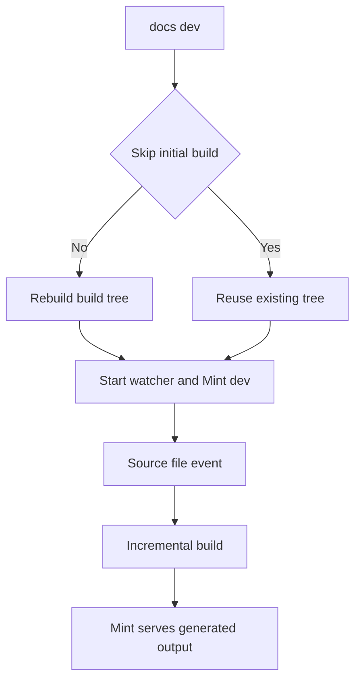
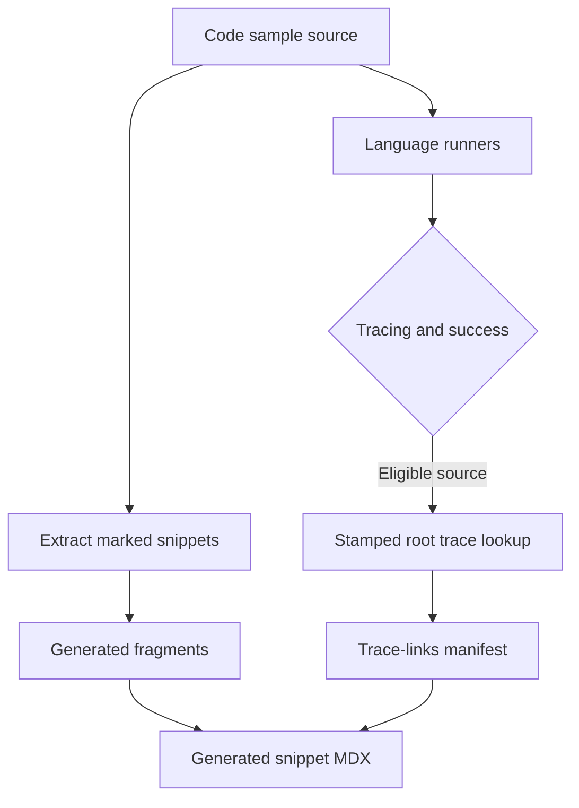

# Local Commands and CLI Tools

Author in `src/`, not `build/`. `build/` is disposable generated Mintlify input: a full build removes it before recreating site output. Run commands at the repository root unless a target changes directory. For Mint operations, use the Make targets or work from `build/`; invoking Mint from the checkout root can make it parse unrelated files such as `.venv` rather than the generated site.

## Bootstrap and command boundaries

The local baseline in `.mise.toml` is Node 22, Python 3.13, uv 0.9.26, Vale 3.17.1, prek, and Mint. With mise, start with `mise trust && mise install`; its postinstall installs prek’s pre-commit and pre-push hooks. The project requires Python `>=3.13.0,<4.0.0` and uv `>=0.9.26`. Node 22 is intentional: Mint does not support Node 25 or newer.

```bash
make install
```

`make install` synchronizes all uv groups, installs root npm dependencies, retries a global `mint@latest` install up to three times, and runs `make skills`. The latter links `.agents/skills/*` into `.claude/skills/`, preserving non-symlink personal entries and deleting stale symlinks. Re-run `make skills` after adding or renaming a repository skill.

There are two command layers:

- The project Python CLI transforms or edits source docs. `docs = "pipeline.cli:main"` is registered in `pyproject.toml`; use `uv run pipeline <command>` in this checkout or `docs <command>` after installation.
- The separately installed `mint` CLI serves, checks, and exports the generated tree. The relevant Make targets invoke it from `build/`.

| Intent | Entry point | Output or validation boundary |
| --- | --- | --- |
| Build generated docs | `make build` | `src/` → disposable `build/` |
| Preview source edits | `make dev` | pipeline watcher plus Mint server |
| Validate source references | `make check-cross-refs` | source `@[ref]` values |
| Validate rendered links and fragments | `make broken-links-with-anchors` | rebuilt `build/` |
| Check MDX component/syntax diagnostics | `make check-mdx` | rebuilt `build/` |
| Test pipeline code | `make test TEST_FILE=tests/unit_tests/...` | selected pytest path |
| Test an example | `make test-code-samples FILES="src/code-samples/..."` | selected runnable samples |

See [Cross-References](/openwiki/operations/cross-references.md), [Local Development](/openwiki/workflows/local-development.md), [Test Overview](/openwiki/testing/test-overview.md), and [Code Sample Lifecycle](/openwiki/workflows/code-sample-lifecycle.md) for the specialized workflows.

## Build and development server

`docs build` checks that `src/` exists, creates `build/` if needed, and delegates to `DocumentationBuilder`, returning 0 on success and 1 when the source directory is absent. `DocumentationBuilder.build_all()` then deletes and recreates the output directory, produces versioned and unversioned docs, copies shared files, and copies npm snippet components. Never make a manual fix only in `build/`.

Although the parser accepts `docs build --watch`, the build command does not consume that option: it builds once. Use `docs dev` for watch behavior. `make build` and `make dev` first run `npm install` and then invoke the pipeline with the repository on `PYTHONPATH`.



*Development flow: the pipeline owns generation of `build/`; Mint serves that tree.*

Unless `--skip-build` is passed, `docs dev` performs the full build, starts a `FileWatcher` for `src/`, and starts `mint dev --port 3000` in `build/`, forwarding its logs. `--skip-build` reuses an existing tree and only warns if none exists. A missing `mint`, a failed initial build, nonzero Mint exit, or unexpectedly stopped watcher ends the command unsuccessfully. Ctrl+C stops the watcher and terminates Mint, escalating to a kill after five seconds if needed.

## Migrate and move source documents

Use `--dry-run` before a source-writing command.

```bash
uv run pipeline migrate legacy/guide.md --dry-run
uv run pipeline mv old.mdx new.mdx --dry-run
```

`docs migrate <path>` recursively selects notebooks, Markdown, and `.markdown`; `docs migrate-docusaurus <path>` additionally selects MDX. Both can write in place or to `--output`; dry-run prints conversion instead. A per-file parse error is reported but does not stop the rest of a batch. In-place notebook conversion writes `.md` and removes the original notebook after successful conversion.

`docs mv <old_path> <new_path>` finds the Git root and scans `<root>/src` `.md`, `.mdx`, and `.ipynb` content. It updates relative inbound references while retaining anchors, and recalculates links inside the moved Markdown/MDX document or notebook. It also updates safe site-absolute routes in documentation and `src/docs.json` navigation entries and redirect destinations, never redirect sources. Ambiguous versioned routes and routes with no equivalent destination are warned about and left unchanged. Review the diff, then run `make broken-links-with-anchors`; prose references are outside the tool’s safe rewrite boundary.

## Generated-site validation and export

The Mint checks intentionally start from generated output. `build` is phony, and `make broken-links`, `make broken-links-with-anchors`, `make check-mdx`, `make check-openapi`, and `make export` rebuild first. `make htmltest` instead consumes an existing archive.

| Target | Operation and failure boundary |
| --- | --- |
| `make broken-links` | Runs `mint broken-links --check-redirects` in `build/`; fails only when a report still has indented link entries after filtering. |
| `make broken-links-with-anchors` | Adds `--check-anchors`; use after route, navigation, redirect, heading, or fragment changes. |
| `make check-mdx` | Runs `mint validate --no-build` for `unknown-component` and `foreign-syntax`, parses JSON diagnostics, and fails if any remain. |
| `make check-openapi` | Runs `mint openapi-check langsmith/agent-server-openapi.json` in `build/`. |
| `make export` | Requires `mint export`, Node 20 or 22, and an Enterprise Mintlify plan; rejects Node 25+, then exports in `build/`. Set `MINT_EXPORT_ARGS` for Mint arguments. |
| `make htmltest` | Requires `htmltest`, `unzip`, and `EXPORT_ZIP` (default `build/export.zip`); unpacks to `HTMLTEST_UNPACK_DIR` and checks configured external URLs. `make export-htmltest` runs export followed by this check. |

The broken-link filter discards whole standalone-snippet report sections, deployment-only OpenAPI and legacy-path noise, and, only for anchor checks, specified SmithDB migration anchor false positives. This is deliberately narrow: remaining indented report entries fail the target.

`make check-legacy-links` is a source policy check, not a Mint check. It scans authored `.md` and `.mdx` under `src/` (or supplied paths), rejects configured retired documentation hosts, permits the Helm repository exception, and directs authors to relative docs routes or `https://reference.langchain.com/`.

## Formatting, prose, and tests

- `make lint` runs Ruff format and lint checks, `ty`, and `codespell src`; `make format` applies Ruff fixes and `make format-check` is non-mutating.
- `make test` runs pytest with network sockets disabled except Unix sockets. Narrow it with `TEST_FILE`.
- `make lint_md` needs `markdownlint`; `make lint_md_fix` applies its fixes.
- `make lint_prose FILES="src/path/page.mdx"` installs/runs the `.mise.toml` Vale version and excludes `node_modules` and `src/code-samples`.

Vale is installed or reused at `.bin/vale`; the installer rejects invalid versions and may use `go install` if a release download fails. `.vale.ini` maps MDX to Markdown, skips frontmatter and fences, enables LangChain, proselint, Vale, and write-good at error severity, disables Vale spelling, and keeps a narrowly scoped provider-catalog exception.

## Runnable samples, snippet generation, and traces

`src/code-samples/` is executable source. `src/code-samples-generated/` is extracted intermediate content and `src/snippets/code-samples/` is generated MDX: do not hand-edit either generated directory.



*Extraction/rendering and execution are independent; trace cards are a best-effort post-success enrichment.*

`make code-snippets` extracts marked Python, TypeScript, Java, Kotlin, Go, and shell blocks from `src/code-samples/` to `src/code-samples-generated/`, then creates importable MDX in `src/snippets/code-samples/`. `CODE_SNIPPET_SOURCES` supports a partial refresh only for existing supported paths below the source root. Full extraction removes old supported intermediate files; partial extraction replaces only the selected source stems.

The generator appends a trace card only for a manifest entry. For eligible Python and TypeScript generic agent model values, it can render configured Deep Agents provider tabs. `KEEP MODEL`, provider-specific calls, and embedding model IDs prevent a value from becoming a tab target.

`make test-code-samples` installs the separate `src/code-samples/package.json` dependencies and invokes the runner. The runner discovers or accepts `FILES` for `.py`, `.ts`, `.java`, `.kt`, `.go`, and `.sh` files; it preserves the caller environment for credentials and services. Python uses the root uv project, TypeScript runs `npx tsx` from `src/code-samples/`, Go resolves that directory’s `go.mod`, shell uses Bash, and Java/Kotlin use JBang with Java 21.

Set `CODE_SAMPLE_PATHS` to directories below `src/code-samples/` to constrain either discovery or explicit `FILES`; invalid out-of-tree prefixes are ignored with a warning and an empty selection succeeds. The default is four workers, overrideable by `CODE_SAMPLE_JOBS`; configured groups sharing a LangSmith dataset or experiment fixture are serialized. Normal failures, missing tools, and timeouts fail. Detected LangSmith rate limits retry up to five times with configurable backoff; a sample still rate-limited afterward is skipped rather than failed.

`make update-code-sample-traces` enables `CODE_SAMPLE_TRACING=1`, defaults `LANGSMITH_PROJECT` to `docs-code-samples`, runs selected samples, then regenerates snippet MDX. It requires `LANGSMITH_API_KEY` to publish links. Only successful samples collect traces; collection is lock-serialized and claims run IDs so parallel samples cannot reuse them. A trace must be a root run stamped with that single snippet’s `LANGSMITH_DOCS_SNIPPET` metadata. No marker or unsafe ID yields no link; multi-snippet sources are recorded as skipped and old single-snippet entries removed. If no matching stamped root is found after a successful single-snippet run, its old entry is removed. Trace lookup/sharing errors warn without failing the sample suite.

## Remote audits and CI alignment

`python3 scripts/check_llms_urls.py [--base-url URL]` checks the served site, not `build/`: it crawls root and nested `llms.txt` indexes, compares reachable pages with the served sitemap, and exits 1 for sitemap URLs absent from the index. `uv run python scripts/check_onboarding_models.py` reads configured onboarding snippets from GitHub or `--repo-dir`, reports stale model IDs without editing, and exits 0 when current, 1 for stale IDs, or 2 when its registry/inputs cannot be read.

The reusable link job installs Python 3.13/test dependencies, Node 22, and cached Mint, then runs `make broken-links-with-anchors`, `make check-mdx`, and `make check-openapi`. The code-sample workflow tests all samples on scheduled/manual runs and changed eligible files on pull requests; its product matrix uses `CODE_SAMPLE_PATHS`, and only scheduled/manual OSS trace refreshes regenerate snippets when links changed. Match these targets locally instead of approximating their boundary with raw tools.
