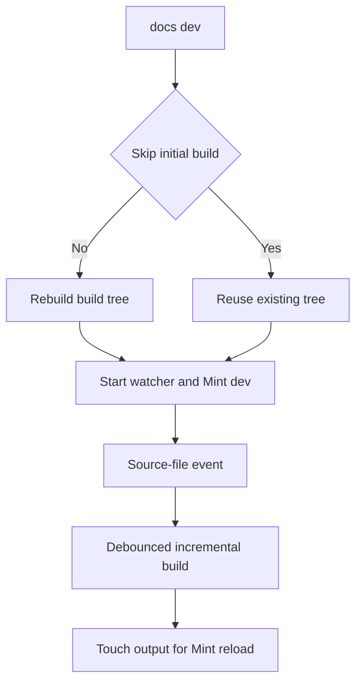
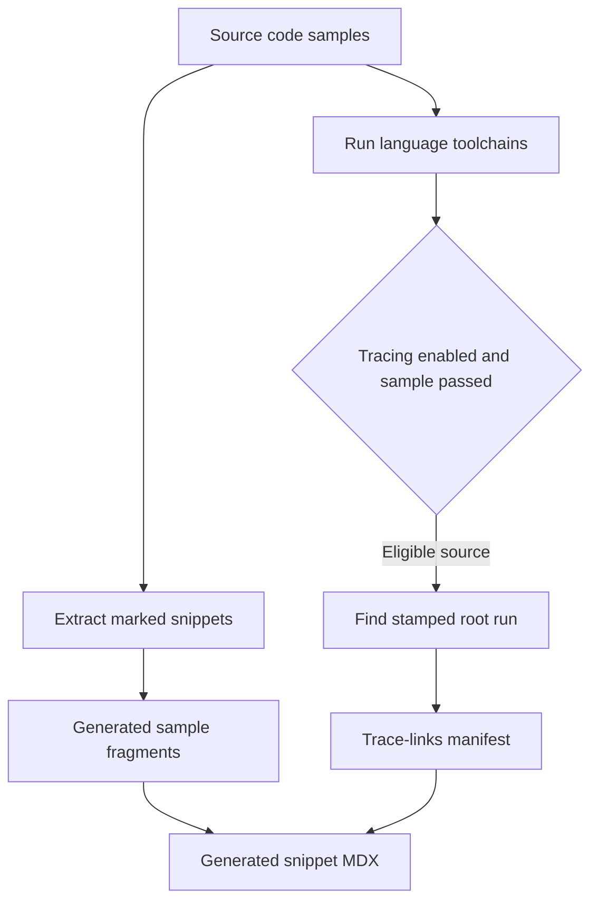

# Local Tooling and Commands

Author documentation in `src/`, not `build/`. The build directory is disposable Mintlify input: a full build deletes and recreates it. Run commands from the repository root unless a target changes directory. For Mintlify validation, prefer the supported Make targets; they rebuild and invoke Mint from `build/`. Do **not** invoke raw Mint validation from the repository root.

## Install the toolchain

`.mise.toml` defines the local baseline: Node 22, Python 3.13, uv 0.9.26, Vale 3.17.1, prek, and the Mint CLI. Start with `mise trust && mise install` when using mise. Its postinstall hook installs prek's pre-commit and pre-push hooks. Node 22 is intentional because Mintlify does not support Node 25 or newer. The Python project itself requires Python 3.13 or later, before Python 4, and uv 0.9.26 or later.

For a normal checkout, bootstrap with:

```bash
make install
```

This synchronizes all uv dependency groups, installs root Node dependencies (including the package that supplies snippet components), installs `mint@latest` globally with retries, and links repository agent skills into `.claude/skills/`. Re-run `make skills` after adding skills; it retains non-symlink personal entries and removes stale skill symlinks.

## Choose the command layer

Two CLIs have deliberately separate responsibilities:

- The repository's **Python documentation CLI** transforms source documentation and runs the source-to-build pipeline. The project registers `docs = "pipeline.cli:main"`; in a checkout use `uv run pipeline <command>`, or use `docs <command>` after installation.
- The separately installed **Mintlify CLI**, `mint`, serves, checks, and exports only generated site output. Make targets run its built-site operations from `build/`.

| Need | Preferred command | Scope |
| --- | --- | --- |
| Install dependencies and skills | `make install` | repository tooling |
| Rebuild generated documentation | `make build` | `src/` to `build/` |
| Preview edits | `make dev` | builder, watcher, and Mint server |
| Check source cross-references | `make check-cross-refs` | source `@[ref]` values |
| Check generated links and fragments | `make broken-links-with-anchors` | rebuilt `build/` tree |
| Run a focused pipeline test | `make test TEST_FILE=tests/unit_tests/test_watcher.py` | selected pytest path |
| Test a runnable example | `make test-code-samples FILES="src/code-samples/..."` | selected executable samples |

```bash
make build
make dev
uv run pipeline migrate legacy/guide.md --dry-run
uv run pipeline mv old.mdx new.mdx --dry-run
```

See [Mintlify](/openwiki/integrations/mintlify.md) for the generated-site boundary, [Local Development](/openwiki/workflows/local-development.md) for the contributor loop, [Code Sample Lifecycle](/openwiki/workflows/code-sample-lifecycle.md) for sample authoring, and [Test Overview](/openwiki/testing/test-overview.md) for test selection.

## Build and preview

### `make build` and `docs build`

`docs build` validates that `src/` exists, ensures `build/` exists, and delegates to `DocumentationBuilder`; it returns 0 on success and 1 on failure. `build_all()` clears the build tree, produces versioned and unversioned documentation, copies shared files, and copies npm snippet components. Manual changes under `build/` are therefore lost on a full build.

The parser accepts `docs build --watch`, but `build_command()` does not inspect that argument and builds once. Use `docs dev` for watching.

### `make dev` and `docs dev`

Unless `--skip-build` is supplied, development completes a full build, starts a watcher on `src/`, and launches `mint dev --port 3000` in `build/` with log forwarding. The watcher batches supported source changes for 0.2 seconds, incrementally rebuilds affected files, and touches output so Mint sees the update. `--skip-build` only reuses an existing build tree and warns if none exists.



*Development flow: the pipeline generates `build/`; Mint serves that generated tree.*

An initial-build failure, missing `mint`, a nonzero Mint exit, or an unexpectedly stopped watcher fails development. Ctrl+C shuts down the watcher and terminates Mint, killing it after five seconds if necessary. After broad structural changes, run a full build rather than relying on incremental output.

## Source migration and moves

These Python CLI commands act on source paths, never on generated output. Use `--dry-run` before a writing operation.

- `docs migrate <path>` recursively selects notebooks, Markdown, and `.markdown` files. `docs migrate-docusaurus <path>` also selects MDX. Both can print rather than write with `--dry-run`; parse failures are recorded per file so a batch continues.
- `docs mv <old_path> <new_path>` finds the Git root and scans `<root>/src` Markdown, MDX, and notebook content. It rewrites relative inbound links while preserving anchors and recalculates relative links inside the moved Markdown, MDX, or notebook file. `--dry-run` previews without writing.
- The move command also updates safe site-absolute routes in documentation and `src/docs.json` navigation entries and redirect destinations, while leaving redirect sources unchanged. Ambiguous versioned forms and forms without an equivalent destination are warned about and left unchanged. Review the diff and run `make broken-links-with-anchors` afterward; prose mentions cannot be safely rewritten.

## Generated-site checks and exports

`build` is phony. `make broken-links`, `make broken-links-with-anchors`, `make check-openapi`, and `make export` all depend on it, so each starts from a rebuilt generated tree. `make htmltest` instead validates an existing export archive.

| Target | What it does and where it runs |
| --- | --- |
| `make broken-links` | Runs `mint broken-links --check-redirects` from `build/`, filters known false positives, and fails only if reported link entries remain. |
| `make broken-links-with-anchors` | Same check with `--check-anchors`; use after headings, fragments, routes, redirects, navigation, or ordinary-link changes. |
| `make check-openapi` | Runs `mint openapi-check langsmith/agent-server-openapi.json` from `build/`. |
| `make export` | Checks for `mint export`, rejects Node 25+, and runs `mint export` in `build/`. It needs Node 20 or 22 and an Enterprise Mintlify plan; set `MINT_EXPORT_ARGS` for Mint arguments. |
| `make htmltest` | Requires `htmltest`, `unzip`, and an existing `EXPORT_ZIP` (default `build/export.zip`), unpacks it under `HTMLTEST_UNPACK_DIR`, and uses the external-URL configuration. `make export-htmltest` runs export then this check. |

The broken-link filter removes complete standalone snippet report sections because those links resolve only when imported, plus deployment-only OpenAPI and legacy-path reports. With `--check-anchors`, it also removes specified SmithDB migration anchor false positives. Remaining indented link reports are failures. This filtering and working-directory behavior are why the Make targets, rather than root-level raw Mint, are the supported checks.

## Linting, formatting, and focused tests

- `make lint` runs Ruff formatting and lint checks, `ty`, and `codespell src`. `make format` applies Ruff fixes; `make format-check` is non-mutating.
- `make test` runs pytest with network sockets disabled except Unix sockets. Narrow it with `TEST_FILE`, for example `make test TEST_FILE=tests/unit_tests/tools/test_move_files.py`.
- `make lint_md` requires `markdownlint`; `make lint_md_fix` applies its fixes.
- `make lint_prose [FILES="src/path/page.mdx"]` installs and executes the pinned Vale binary. It excludes `node_modules` and `src/code-samples` from its target set.

Vale's canonical version is the `vale` value in `.mise.toml`; the Makefile and installer derive their version from that pin. `scripts/install-vale.sh` accepts only a semantic version, reuses a matching Vale already on `PATH`, otherwise downloads the OS- and architecture-specific release to `.bin/vale`, and falls back to `go install` if download fails.

`.vale.ini` sets `.github/vale/styles` as the styles path, treats only error-level alerts as failures, skips frontmatter, and maps MDX to Markdown. Markdown and MDX use the LangChain, proselint, Vale, and write-good style sets while ignoring fenced code blocks. It enables the repository's LangChain accessibility, terminology, grammar, and clarity rules, disables Vale spelling, and contains an explicit per-file rule disablement for the provider catalog; do not generalize that exception to ordinary content.

## Runnable samples, snippets, and trace cards

`src/code-samples/` is executable source. `src/code-samples-generated/` is an extraction intermediate and `src/snippets/code-samples/` is generated MDX; do not hand-edit either generated directory.



*Snippet rendering and sample execution are independent. Trace publication is a best-effort post-success operation that can add cards to generated MDX.*

### Dependencies and generation

`make test-code-samples` installs the shared Node dependencies in `src/code-samples/package.json` when that file exists. That manifest supplies `tsx` and the TypeScript sample ecosystem, including LangChain, LangGraph, LangSmith, provider integrations, and related runtime packages. Python samples run against the root uv project; Go samples resolve the shared `src/code-samples/go.mod`; Java and Kotlin samples use JBang with Java 21. Update the relevant shared dependency manifest and lockfile when an example gains a dependency rather than adding a per-sample installation step.

`make code-snippets` extracts marked regions from supported Python, TypeScript, Java, Kotlin, Go, and shell sources under `src/code-samples/` into `src/code-samples-generated/`, then generates importable MDX in `src/snippets/code-samples/`. A full extraction removes earlier supported intermediate files. Set `CODE_SNIPPET_SOURCES` to a space-separated list of existing supported paths below `src/code-samples/` to refresh only selected source stems; missing, out-of-tree, and unsupported selections fail.

Generation reads the trace-links manifest and adds a `View example trace` card only for a recorded snippet ID. Review generated MDX after changing source content or markers.

### Sample execution and traces

`make test-code-samples` runs all eligible `.py`, `.ts`, `.java`, `.kt`, `.go`, and `.sh` files, or a space-separated `FILES` selection. It preserves the caller environment for credentials and live services. Python uses `uv run python`; TypeScript uses `npx tsx`; Go uses `go run`; shell uses `bash`; Java and Kotlin use JBang with Java 21 defaults.

The default timeout is 1,200 seconds. The runner uses four workers by default, accepts `CODE_SAMPLE_JOBS`, and serializes configured groups sharing LangSmith datasets or experiment fixtures. Normal nonzero exits, missing tools, and timeouts fail. Detected LangSmith rate limits retry up to five times by default with configurable backoff capped at 120 seconds; a persistently rate-limited sample is skipped rather than failed.

`make update-code-sample-traces` sets `CODE_SAMPLE_TRACING=1`, defaults `LANGSMITH_PROJECT` to `docs-code-samples`, executes selected samples, and regenerates snippet MDX. Publishing trace links requires `LANGSMITH_API_KEY`.

Only successful samples attempt trace collection. For an eligible single-snippet source, the runner stamps `LANGSMITH_DOCS_SNIPPET`; collection is lock-serialized, excludes previously claimed run IDs, and polls for a matching stamped root run in the sample window before creating or reusing its public share URL. A source with no marker or unsafe ID has no trace link. Multi-snippet sources are recorded as skipped and stale single-snippet entries are removed. If a successful single-snippet sample has no matching run, its old manifest entry is removed rather than retained. Trace lookup or sharing errors warn and do not fail the suite.

## Remote audits and completion sequence

`python3 scripts/check_llms_urls.py [--base-url URL]` validates the deployed site, not `build/`: it crawls root and nested `llms.txt` indexes, compares reachable pages with the served sitemap, and exits 1 after reporting sitemap pages absent from the index.

`uv run python scripts/check_onboarding_models.py` reports rather than edits stale model IDs in configured onboarding snippets. It reads GitHub by default, using `GITHUB_TOKEN` or `GH_TOKEN` when available, or a checkout with `--repo-dir`; it exits 0 when current, 1 for stale IDs, and 2 when its registry or inputs cannot be read.

For a focused change, run only the checks it exercises: a selected `make test`, `make check-cross-refs` for `@[ref]` edits, `make lint_prose FILES="..."` for prose, targeted sample execution for a runnable example, and `make broken-links-with-anchors` for rendered navigation or link changes. Use `make export-htmltest` when exported-site external-link coverage is needed.
