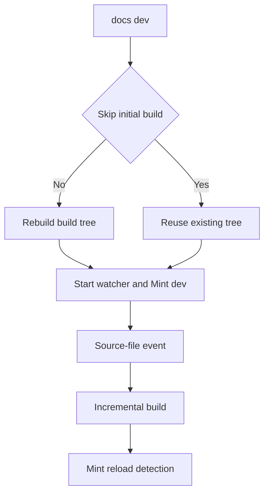
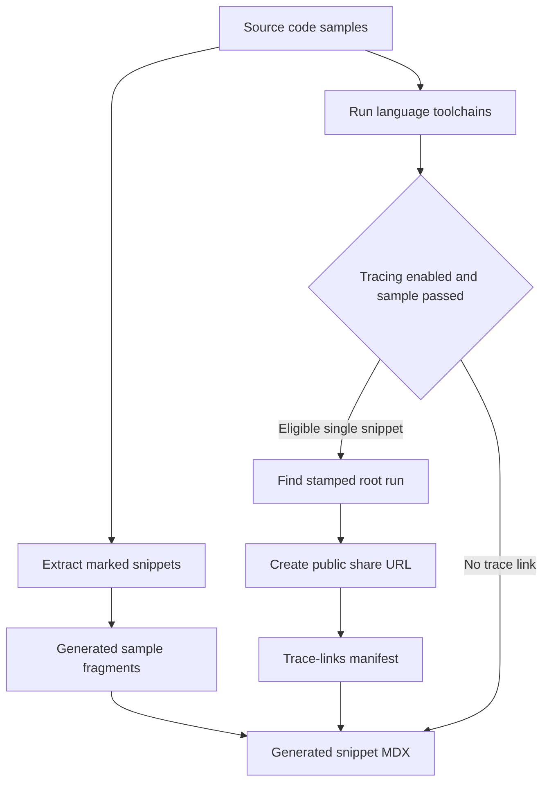

# Developer CLI Tools and Make Targets

Author documentation in `src/`. The pipeline produces Mintlify input in `build/`; it is disposable output, not an authoring surface. **Do not edit `build/`**: every full build removes and recreates it.

## Two CLIs and the usual entrypoints

There are two distinct command-line interfaces:

- **Python documentation CLI:** the project script `docs = "pipeline.cli:main"`. In a checkout, invoke it as `uv run pipeline <command>`; after installation, invoke `docs <command>` (or `uv run docs <command>`).
- **Mintlify CLI:** the separately installed global `mint` executable. It serves, checks, and exports the *generated* site. `make install` installs it with `npm install -g mint@latest`; Make targets deliberately run Mint from `build/`.

```bash
make install
make build
make dev
uv run pipeline migrate legacy/guide.md --dry-run
uv run pipeline mv old.mdx new.mdx --dry-run
```

`make install` runs `uv sync --all-groups`, installs local npm dependencies and the Mint CLI, then runs `make skills`. That target links `.agents/skills/*/` into `.claude/skills/`, retains non-symlink personal entries, and removes stale symlinks.

| Need | Command | Boundary |
| --- | --- | --- |
| Rebuild generated site | `make build` or `docs build` | `src/` → regenerated `build/` |
| Preview source changes | `make dev` or `docs dev` | Python watcher and builder → Mint server |
| Check source references | `make check-cross-refs` | Source only; resolves `@[ref]` references |
| Check rendered links | `make broken-links-with-anchors` | Rebuilds, then checks from `build/` |
| Execute examples | `make test-code-samples` | Runs live sample programs with the caller environment |
| Refresh reusable snippets | `make code-snippets` | Sample source → extraction intermediate → generated MDX |

See [Local Development](/openwiki/workflows/local-development.md) for setup, [Mintlify](/openwiki/integrations/mintlify.md) for the site boundary, and [Code Sample Lifecycle](/openwiki/workflows/code-sample-lifecycle.md) for snippet markers.

## Build and preview

### `make build` / `docs build`

`docs build` requires `src/`, ensures `build/` exists, and delegates to `DocumentationBuilder`. `build_all()` then deletes and recreates the build tree, creates versioned Python and JavaScript output plus unversioned content, copies shared files, and copies npm snippet components. It returns 0 on success and 1 if `src/` is absent. Thus, manual changes below `build/` cannot survive a full build.

```bash
make build
# Direct Python CLI invocation
uv run pipeline build
```

The parser accepts `docs build --watch`, but the build command does not use that option: it performs one build. Use `docs dev` for watching.

### `make dev` / `docs dev`

Unless `--skip-build` is supplied, development first runs the full build. It then creates a `FileWatcher` for `src/` and starts `mint dev --port 3000` with `build/` as its working directory, forwarding Mint output until interruption or an abnormal process exit. `--skip-build` only reuses the tree already present and warns when it is absent.



*Development flow: `docs dev` establishes or reuses generated output, then watches source while Mint serves `build/`.*

A failed initial build, missing `mint`, nonzero Mint exit, or unexpectedly stopped watcher fails development. On Ctrl+C, the command shuts down the watcher and terminates Mint, killing it after a five-second wait if necessary. Run a full build after broad changes or whenever incremental output is suspect.

## Migration and source moves

These Python CLI commands act on supplied source paths, not `build/`. Use `--dry-run` before any writing operation.

### `docs migrate <path>` and `docs migrate-docusaurus <path>`

`migrate` recursively selects notebooks, Markdown, and `.markdown` files. `migrate-docusaurus` additionally selects MDX and applies Docusaurus conversion. Both remove `.md` and `.mdx` suffixes from relative links in converted content. `--dry-run` prints instead of writing; `--output` writes to a file or preserves a directory input's relative layout. Without output, Markdown is updated in place; in-place notebook conversion writes `.md` and deletes the notebook.

A missing input exits 1. A parse error is reported for that file while the batch continues; unexpected exceptions include traceback context.

### `docs mv <old_path> <new_path>`

The move tool discovers the Git root and scans `<root>/src` `.md`, `.mdx`, and `.ipynb` files. It rewrites relative inbound links and site-absolute Markdown or MDX links and `href` attributes whose routes reach the old file, preserving anchors. It also updates matching navigation values and redirect **destinations** in `src/docs.json` (never redirect `source` values), then recalculates internal relative links in a moved Markdown/MDX file or notebook. To avoid changing an ambiguous route, it leaves a route form unchanged when the destination has no equivalent form or an unversioned language-specific route is shadowed by another page. `--dry-run` previews every proposed link and `docs.json` change without writes or a move.

A real move appends absolute old/new paths to root-level `link_changes.jsonl`, creates destination directories, applies the discovered rewrites, moves the file, and then updates links inside it. It cannot infer prose mentions or intended compatibility policy: review route-family semantics, redirects, and navigation after the automated update, then run `make broken-links-with-anchors`.

## Generated-site validation and quality targets

`build` is phony. `make broken-links`, `make broken-links-with-anchors`, `make check-openapi`, and `make export` therefore rebuild before their Mint operation. `make htmltest` instead checks an existing export archive.

| Target | Behavior, working directory, and failure conditions |
| --- | --- |
| `make broken-links` | Runs `mint broken-links --check-redirects` from `build/`. It filters deployment-generated OpenAPI and standalone-snippet noise, failing only if remaining output has reported link entries. |
| `make broken-links-with-anchors` | The same generated-site check with `--check-anchors`; use after heading or fragment-link changes. |
| `make check-openapi` | Rebuilds, then runs `mint openapi-check langsmith/agent-server-openapi.json` from `build/`. |
| `make export` | Rebuilds, verifies a Mint CLI with `export`, rejects Node 25+, then runs `mint export` in `build/`. It requires Node 20 or 22 and an Enterprise Mintlify plan. `MINT_EXPORT_ARGS` changes Mint arguments. |
| `make htmltest` | Requires `htmltest`, `unzip`, and `EXPORT_ZIP` (default `build/export.zip`); it unpacks under `HTMLTEST_UNPACK_DIR` and applies the external-URL configuration. `make export-htmltest` runs export then this check. |
| `make test` | Runs pytest with network sockets disabled except Unix sockets. Set `TEST_FILE` to narrow the default `tests/unit_tests` scope. |
| `make lint` | Checks Ruff formatting/lint, `ty`, and `codespell src`. `make format` applies Ruff fixes; `make format-check` only checks. |
| `make lint_md` / `make lint_md_fix` | Require `markdownlint` and lint Markdown, optionally applying fixes. |
| `make lint_prose` | Installs the Vale version selected in `.mise.toml` into `.bin/vale`, then lints `FILES` or `src/`, excluding sample and node-module paths. |

Run Mint through these targets—or manually from `build/`—rather than from the repository root. Mint parsing at the root can encounter checkout artifacts such as `.venv` instead of only the generated site.

## Runnable samples, generated snippets, and public traces

`src/code-samples/` is editable executable source. `src/code-samples-generated/` is an extraction intermediate, and `src/snippets/code-samples/` is generated MDX. Do not edit the generated directories as an authoring shortcut.



*Sample execution is independent from snippet rendering. Trace publication is a best-effort post-success path whose manifest affects generated MDX.*

### Generate snippet MDX: `make code-snippets`

The target extracts marked regions from supported Python, TypeScript, Java, Kotlin, Go, and shell files under `src/code-samples/` to `src/code-samples-generated/`, then writes importable MDX to `src/snippets/code-samples/`. A full extraction removes prior supported intermediate files first. Set `CODE_SNIPPET_SOURCES` to a space-separated set of eligible sources below `src/code-samples/` for a partial refresh; invalid, missing, out-of-tree, and unsupported selections fail extraction.

Generation recognizes configured language/ID suffix combinations and adds the `View example trace` card only when `trace-links.json` has an entry for that snippet ID. Review generated-MDX diffs after changing sample content or markers.

### Run samples: `make test-code-samples`

Use all samples, or focus a change with a space-separated `FILES` list:

```bash
make test-code-samples FILES="src/code-samples/langchain/return-a-string.py"
```

The runner supports `.py`, `.ts`, `.java`, `.kt`, `.go`, and `.sh`; focused paths that are missing, unsupported, or outside `src/code-samples/` are warned and skipped. An empty valid selection succeeds. It preserves the parent environment so samples can use credentials and live services. Python runs via `uv run python`; TypeScript uses `npx tsx`; Go uses `go run`; shell uses `bash`; Java and Kotlin use JBang with Java 21 defaults.

The default timeout is 1,200 seconds (`CODE_SAMPLE_TIMEOUT_SECONDS`). It defaults to four workers and accepts `CODE_SAMPLE_JOBS`; known groups sharing a LangSmith dataset or experiment fixture are serialized. Ordinary nonzero exits, missing tools, and timeouts fail the target. Detected LangSmith rate limits are retried up to five attempts by default with incremental backoff capped at 120 seconds (`CODE_SAMPLE_RATE_LIMIT_ATTEMPTS` and `CODE_SAMPLE_RATE_LIMIT_DELAY_SECONDS`); persistent rate limiting is reported as skipped, not failed.

### Refresh trace links: `make update-code-sample-traces`

This target installs code-sample npm dependencies when present, sets `CODE_SAMPLE_TRACING=1`, defaults `LANGSMITH_PROJECT` to `docs-code-samples`, executes the selected samples, and runs `make code-snippets`. The intended publication workflow requires `LANGSMITH_API_KEY`; its manifest is `src/code-samples/trace-links.json`.

A successful example **does not prove that a trace was published**. Only successful samples are considered for collection, and a source must contain exactly one safe snippet ID. The runner stamps that ID as `LANGSMITH_DOCS_SNIPPET`; under a lock, the collector polls LangSmith for a root run with the matching metadata stamp in the sample time window, excludes already claimed run IDs, and then creates or reuses a public share URL. This prevents parallel samples from claiming one another's runs.

No marker or an unsafe ID produces no trace link. A multi-snippet source is recorded as skipped and stale per-snippet entries are removed. If no stamped root run is found after a successful single-snippet execution, a previous link is removed rather than reused. Trace lookup, sharing, or manifest failures warn and continue rather than failing the sample suite. Review the manifest and generated MDX: a successful target can legitimately leave a sample without a public trace card.

## Remote audits

`python3 scripts/check_llms_urls.py [--base-url URL]` checks the **deployed** site, not a local build. It crawls root `llms.txt` and nested indexes, normalizes listed page URLs, compares them with the served sitemap, and exits 1 after listing sitemap pages missing from the index. It retries dropped connections but not HTTP errors. The repository does not generate those indexes; rule out a custom `llms.txt` in the build, then report a served-index gap to Mintlify.

`uv run python scripts/check_onboarding_models.py` reports stale model IDs in LangSmith onboarding snippets selected by `scripts/data/onboarding_models.yaml`; it does not edit them. By default it reads the configured GitHub repository and can use `GITHUB_TOKEN` or `GH_TOKEN`; use `--repo-dir` for a checkout and `--output` to write the report. It exits 0 when current, 1 when stale IDs are found, and 2 if the registry or inputs cannot be read.

## Focused completion sequence

1. Run a focused pipeline test, for example `make test TEST_FILE=tests/unit_tests/test_watcher.py`.
2. For `@[ref]` edits, run `make check-cross-refs`.
3. For prose, run `make lint_prose FILES="src/path/page.mdx"`.
4. For a runnable example, run focused `make test-code-samples FILES="..."` with only intended credentials and services.
5. After route, navigation, redirect, snippet, heading, or ordinary-link changes, run `make broken-links-with-anchors`.
6. Use `make export-htmltest` for separate exported-site external-link coverage.
