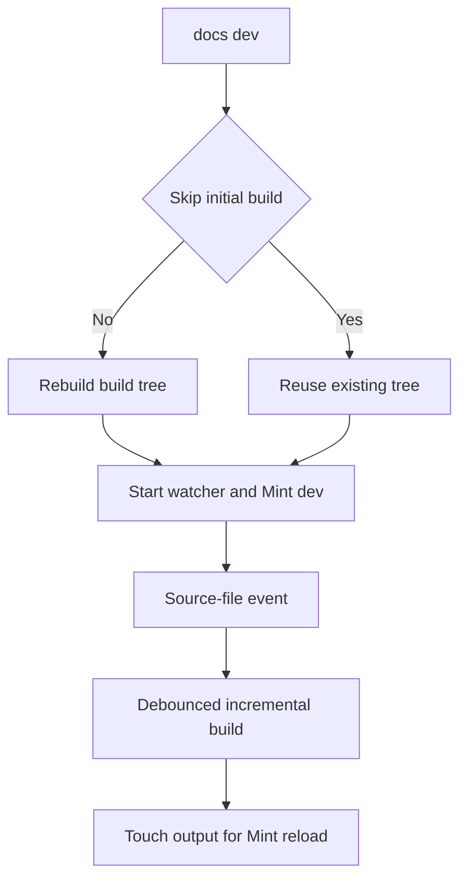
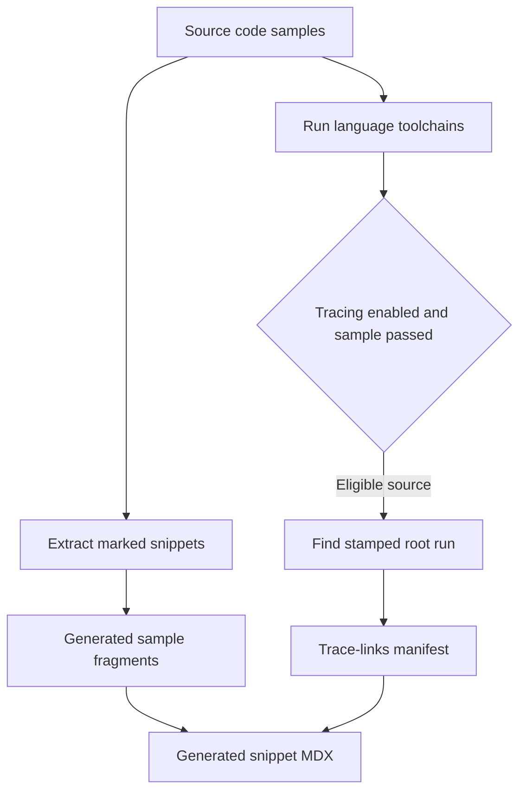

# Local Tooling and Commands

Author documentation in `src/`, not `build/`. The build directory is Mintlify input generated from source and is disposable: a full build deletes and recreates it. Use commands from the repository root unless a target explicitly changes directory. In particular, use the supported Make targets for Mintlify validation; they rebuild first and run Mint from `build/`. Do **not** run raw Mintlify validation from the repository root.

## Install the toolchain

`.mise.toml` records the local baseline: Python 3.13, uv 0.9.26, Node 22, prek, Vale 3.17.1, and the `mint` npm package. Start with `mise trust && mise install` when using mise; Node 22 is intentional because Mintlify does not support Node 25 or newer. `pyproject.toml` requires Python 3.13 or later (before Python 4) and uv 0.9.26 or later.

For a normal checkout, the supported bootstrap is:

```bash
make install
```

It synchronizes every uv dependency group, installs root Node dependencies (including the package that supplies snippet components), installs `mint@latest` globally with retries, and links repository agent skills into `.claude/skills/`. Re-run `make skills` after adding skills; it preserves non-symlink personal entries and removes stale skill symlinks.

## Choose the right command layer

Two CLIs have deliberately separate responsibilities:

- The repository's **Python documentation CLI** owns source transformations and the source-to-build pipeline. The project registers `docs = "pipeline.cli:main"`; in a checkout use `uv run pipeline <command>`, or use `docs <command>` after installation.
- The separately installed **Mintlify CLI**, `mint`, serves, validates, and exports only the generated site. Make targets invoke its built-site operations from `build/`.

| Need | Preferred command | Scope |
| --- | --- | --- |
| Install dependencies and skills | `make install` | repository tooling |
| Rebuild generated documentation | `make build` | `src/` to `build/` |
| Preview edits | `make dev` | builder, watcher, and Mint server |
| Check source cross-references | `make check-cross-refs` | source `@[ref]` values |
| Check generated links and fragments | `make broken-links-with-anchors` | rebuilt `build/` tree |
| Run a focused pipeline test | `make test TEST_FILE=tests/unit_tests/test_watcher.py` | selected pytest path |
| Test a runnable example | `make test-code-samples FILES="src/code-samples/..."` | selected executable samples |

```bash
make build
make dev
uv run pipeline migrate legacy/guide.md --dry-run
uv run pipeline mv old.mdx new.mdx --dry-run
```

See [Build System](/openwiki/architecture/build-system.md) for pipeline architecture, [Mintlify](/openwiki/integrations/mintlify.md) for the generated-site boundary, [Local Development](/openwiki/workflows/local-development.md) for routine setup, and [Test Overview](/openwiki/testing/test-overview.md) for test selection.

## Build and preview

### `make build` and `docs build`

`docs build` validates that `src/` exists, ensures `build/` exists, and delegates to `DocumentationBuilder`; it returns 0 on success and 1 when the source directory is absent. `build_all()` then clears the build tree, produces versioned Python and JavaScript documentation plus unversioned content, copies shared files, and copies npm snippet components. A full build therefore discards every manual build-tree change.

The parser accepts `docs build --watch`, but `build_command()` does not inspect that argument: it builds once. Use `docs dev` for watching.

### `make dev` and `docs dev`

Unless `--skip-build` is supplied, development first completes a full build. It starts a watcher on `src/`, launches `mint dev --port 3000` with `build/` as its working directory, and forwards Mint output. The watcher batches supported source changes for 0.2 seconds, rebuilds affected files, and touches built output so Mint sees the update. `--skip-build` only reuses an existing build tree and warns if none exists.



*Development flow: the pipeline owns generation and Mint serves the resulting `build/` tree.*

An initial-build failure, missing `mint`, a nonzero Mint exit, or an unexpectedly stopped watcher makes development fail. Ctrl+C shuts down the watcher and terminates Mint, killing it after five seconds if needed. Run a full build after broad structural changes if incremental output is suspect.

## Source migration and moves

These Python CLI commands act on source paths, never on generated output. Use `--dry-run` before a writing operation.

- `docs migrate <path>` recursively selects notebooks, Markdown, and `.markdown` files. `docs migrate-docusaurus <path>` also selects MDX. Both can print instead of write with `--dry-run`; `--output` writes to a file or preserves a directory input's relative layout. Parse failures are recorded per file so the rest of a batch continues. An in-place notebook migration writes Markdown and removes the original notebook.
- `docs mv <old_path> <new_path>` finds the Git root, scans `<root>/src` Markdown, MDX, and notebook content, and rewrites relative inbound links while preserving anchors. It recalculates the moved Markdown/MDX file's or notebook's internal relative links, previews without writes in dry-run mode, and records real moves in root-level `link_changes.jsonl`.
- The move command also maps safe site-absolute routes. It updates documentation links, `src/docs.json` navigation entries, and redirect destinations, while leaving redirect sources unchanged. Ambiguous versioned forms and forms without an equivalent destination are warned about and deliberately left untouched. It cannot update prose mentions: review the diff and run `make broken-links-with-anchors` afterward.

## Generated-site checks and exports

`build` is phony. `make broken-links`, `make broken-links-with-anchors`, `make check-openapi`, and `make export` all depend on it, so each starts from a rebuilt generated tree. `make htmltest` instead checks an existing export archive.

| Target | What it does and where it runs |
| --- | --- |
| `make broken-links` | Runs `mint broken-links --check-redirects` from `build/`, filters known false positives, and fails only if remaining output contains reported link entries. |
| `make broken-links-with-anchors` | Same check with `--check-anchors`; use after headings, fragments, routes, redirects, navigation, or ordinary-link changes. |
| `make check-openapi` | Runs `mint openapi-check langsmith/agent-server-openapi.json` from `build/`. |
| `make export` | Checks for `mint export`, rejects Node 25+, and runs `mint export` in `build/`. It needs Node 20 or 22 and an Enterprise Mintlify plan; set `MINT_EXPORT_ARGS` for Mint arguments. |
| `make htmltest` | Requires `htmltest`, `unzip`, and an existing `EXPORT_ZIP` (default `build/export.zip`), unpacks it under `HTMLTEST_UNPACK_DIR`, and uses the external-URL configuration. `make export-htmltest` runs export then this check. |

The broken-link filter removes complete standalone snippet report sections because snippet links resolve only when imported, plus deployment-only OpenAPI and legacy-path reports. With `--check-anchors`, it also removes the specified SmithDB migration and environment-variable anchor false positives. All other indented link reports remain failures. This is why the Make target, rather than root-level raw Mint, is the reliable local check.

## Linting, formatting, and targeted tests

- `make lint` runs Ruff format and lint checks, `ty`, and `codespell src`. `make format` applies Ruff formatting and fixes; `make format-check` is non-mutating.
- `make test` runs pytest with network sockets disabled except Unix sockets. Narrow it with `TEST_FILE`, for example `make test TEST_FILE=tests/unit_tests/tools/test_move_files.py`.
- `make lint_md` requires `markdownlint`; `make lint_md_fix` applies its fixes.
- `make lint_prose [FILES="src/path/page.mdx"]` installs then executes the pinned Vale binary. It excludes `node_modules` and `src/code-samples` from the target set.

Vale's canonical version is the `vale` value in `.mise.toml`; the Makefile and installer read that pin rather than maintaining another version. `scripts/install-vale.sh` accepts only a semantic version, reuses a matching Vale already on `PATH`, otherwise downloads the OS/architecture-specific release into `.bin/vale`, and falls back to `go install` if the download fails. This makes the repository-local binary take precedence over a different system Vale and keeps prose checks reproducible.

## Runnable samples, snippets, and trace cards

`src/code-samples/` is executable source. `src/code-samples-generated/` is an extraction intermediate and `src/snippets/code-samples/` is generated MDX; do not hand-edit either generated directory.



*Snippet rendering and sample execution are independent; trace publication is a best-effort post-success operation that can add cards to generated MDX.*

### Snippet generation

`make code-snippets` extracts marked regions from supported Python, TypeScript, Java, Kotlin, Go, and shell sources under `src/code-samples/` into `src/code-samples-generated/`, then generates importable MDX in `src/snippets/code-samples/`. A full extraction removes earlier supported intermediate files. Set `CODE_SNIPPET_SOURCES` to a space-separated list of existing supported paths below `src/code-samples/` to refresh only selected source stems; missing, out-of-tree, and unsupported selections fail.

Generation reads the trace-links manifest and adds a `View example trace` card only for a recorded snippet ID. Review generated MDX after changing sample content or markers.

### Sample execution and traces

`make test-code-samples` installs `src/code-samples` Node dependencies when present and runs all eligible `.py`, `.ts`, `.java`, `.kt`, `.go`, and `.sh` files, or a space-separated `FILES` selection. It preserves the caller environment for credentials and live services. Python uses `uv run python`; TypeScript uses `npx tsx`; Go uses `go run`; shell uses `bash`; Java and Kotlin use JBang with Java 21 defaults.

The default timeout is 1,200 seconds. The runner uses four workers by default, accepts `CODE_SAMPLE_JOBS`, and serializes configured groups sharing LangSmith datasets or experiment fixtures. Normal nonzero exits, missing tools, and timeouts fail. Detected LangSmith rate limits retry up to five times by default with configurable incremental backoff capped at 120 seconds; a persistently rate-limited sample is skipped rather than failed.

`make update-code-sample-traces` sets `CODE_SAMPLE_TRACING=1`, defaults `LANGSMITH_PROJECT` to `docs-code-samples`, executes selected samples, and regenerates snippet MDX. Publishing links requires `LANGSMITH_API_KEY`.

Only successful samples attempt trace collection. For an eligible single-snippet source, the runner stamps `LANGSMITH_DOCS_SNIPPET`; collection is lock-serialized, excludes previously claimed run IDs, and polls for a matching stamped root run in the sample window before creating or reusing its public share URL. A source with no marker or an unsafe ID has no trace link. Multi-snippet sources are recorded as skipped and stale single-snippet entries are removed. If a successful single-snippet sample has no matching run, its old manifest entry is removed rather than retained. Trace lookup or sharing errors warn and do not fail the suite.

## Remote audits and a focused completion sequence

`python3 scripts/check_llms_urls.py [--base-url URL]` validates the deployed site, not `build/`: it crawls root and nested `llms.txt` indexes, compares reachable pages with the served sitemap, and exits 1 after reporting sitemap pages absent from the index.

`uv run python scripts/check_onboarding_models.py` reports rather than edits stale model IDs in configured onboarding snippets. It reads GitHub by default (using `GITHUB_TOKEN` or `GH_TOKEN` when available) or a checkout with `--repo-dir`; it exits 0 when current, 1 for stale IDs, and 2 when registry or inputs cannot be read.

For a focused change, run only the checks the change exercises: a selected `make test`, `make check-cross-refs` for `@[ref]` edits, `make lint_prose FILES="..."` for prose, targeted sample execution for a runnable example, and `make broken-links-with-anchors` for any rendered navigation or link change. Use `make export-htmltest` when exported-site external-link coverage is needed.
