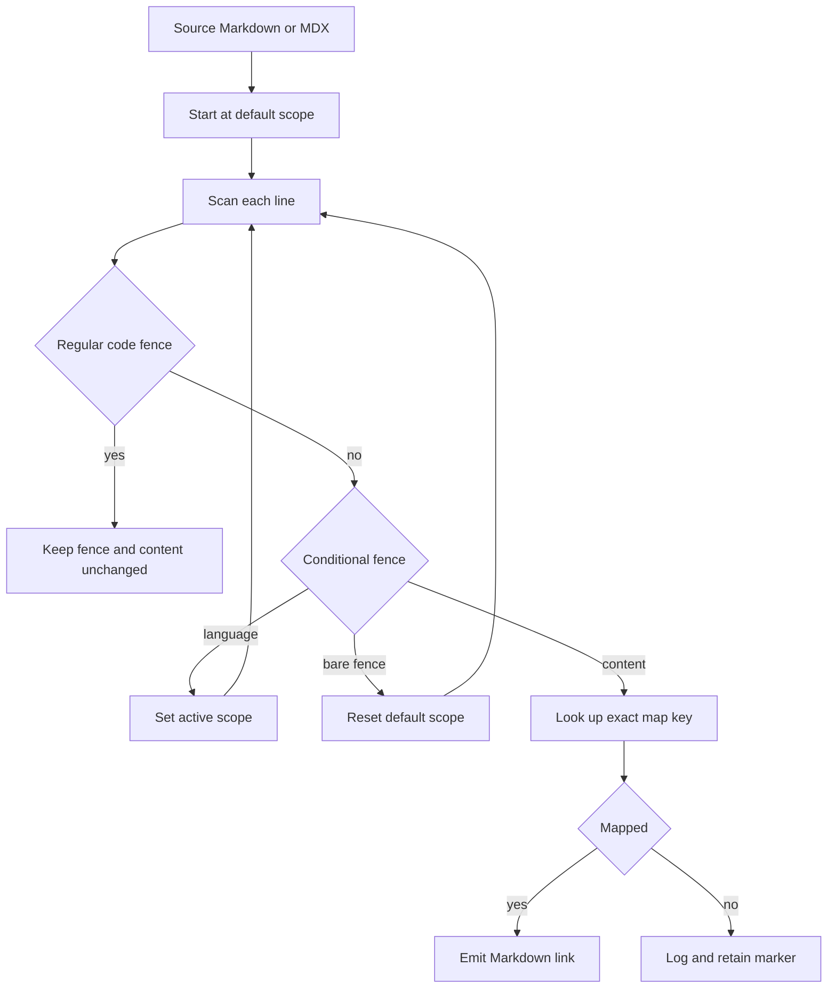

# Cross-References and Links

Documentation has two link layers with different owners. `@[ref]` is source-level Markdown/MDX syntax for a semantic API-reference link; preprocessing resolves it through `pipeline/preprocessors/link_map.py`. Ordinary Markdown, HTML, navigation, redirects, and anchors are routes in the generated Mintlify site. Do not use a hard-coded API URL where a scoped semantic reference is appropriate, and do not expect a cross-reference-map check to validate a site route.

## Use the right validation boundary

| Change | Command | What it establishes | What it does not establish |
| --- | --- | --- | --- |
| `@[...]` reference or `LINK_MAPS` entry | `make check-cross-refs` | Every eligible source reference resolves in every applicable source scope. | Whether a built route, anchor, redirect, or external destination renders successfully. |
| Ordinary link, route, redirect, or navigation | `make broken-links` | Mintlify can resolve rendered links and redirect destinations in `build/`. | Anchor validity or whether authored semantic reference names exist in their local map. |
| Link containing `#anchor`, heading change, or anchor-sensitive redirect | `make broken-links-with-anchors` | The preceding rendered checks plus anchors. | Source semantic-map completeness. |

`make broken-links` and `make broken-links-with-anchors` build first, run `mint broken-links` in `build/`, and enable redirect checks; the latter adds `--check-anchors`. Their filtered reports intentionally exclude standalone snippets and deployment-time OpenAPI surfaces that cannot be resolved from the local generated tree. A passing check is therefore not a substitute for the other category. See [Mintlify Integration](/openwiki/integrations/mintlify.md) for those rendered-site boundaries.

## Author scoped API references

Outside a regular fenced code block, the resolver recognizes these forms:

```markdown
Use @[StateGraph] to define a graph.
Read @[the graph reference][StateGraph].
Pass @[`StateGraph`] to make code formatting part of the link text.
```

<!-- openwiki: broken internal link [url] file "url" does not exist. Fix the href or restore the target, then delete this comment. -->
<!-- openwiki: broken internal link [url] file "url" does not exist. Fix the href or restore the target, then delete this comment. -->
A successful lookup emits `[title](url)`. The first form uses the map key as its title; the second uses the supplied title; and the simple backticked form emits ``[`StateGraph`](url)``. A custom title may use a backticked lookup name, but that does not add backticks to the custom title.

To document the syntax itself, escape the marker:

```markdown
Write \@[StateGraph] when documenting the syntax.
```

The resolver does not transform an escaped marker, then removes the escape in its final pass. The rendered text is literal `@[StateGraph]`.

### Resolution lifecycle

`preprocess_markdown()` selects its target language from its explicit argument, otherwise `TARGET_LANGUAGE`, otherwise `python`. That target is also the default reference scope unless `default_scope` is provided. It resolves references before CTA UTM decoration and conditional rendering, because it must see language fences before conditional rendering removes a branch.



The diagram shows the line-oriented source pass, which runs before conditional rendering selects content for one target.

A `:::python` or `:::js` line sets the active scope for later lines; a bare `:::` resets it to the default. Conditional fences remain until the later renderer consumes the supported branch. The resolver accepts any word as a scope label, but an unsupported scope has no flattened map and so cannot resolve normal names; author only the supported `python` and `js` scopes. Lookups are exact, including case. Repair a moved API destination in the map rather than replacing semantic references across consumer pages.

MCP documentation illustrates the intended split. Both maps contain `MCPAdapter`, but Python uses `MCPAdapter.list_tools` and JavaScript uses `MCPAdapter.listTools`. Put those method references in the corresponding `:::python` or `:::js` branch. Do not put a language-only alias in unfenced shared OSS prose: that prose is validated for both maps.

`global` is not an authoring scope. If it reaches the resolver, it logs an error and falls back to Python; a combined global resolver is not implemented.

### Code-fence boundary and failure behavior

The resolver detects a stripped line beginning with at least three backticks or tildes and toggles an in-code state on every match. It leaves both the marker and enclosed content untouched; thus conditional-looking content in a code sample cannot alter scope. This is deliberately a simple toggle, not full CommonMark delimiter matching: mismatched marker character or length can close a fence, while an unclosed recognized fence leaves the remaining file untransformed. Keep fences balanced.

An absent map key is non-fatal during a build. The resolver logs an info-level message with file, line, name, and active scope and leaves the original marker verbatim. Treat that as a documentation defect and use the source validator below; do not rely on the build continuing.

## Own destinations in the link map

`LINK_MAPS` is the editable registry. Each entry provides a `scope`, `host`, and `links` dictionary. At import time `_enumerate_links()` forms `SCOPE_LINK_MAPS` for Python and JS: relative values receive that entry's host, while values beginning with `http` remain absolute. Multiple entries can contribute to one scope, and the same key may intentionally resolve to different URLs in each scope.

To add or repair an API reference:

1. Determine the intended reference destination and language scope or scopes.
2. Add the exact author-facing key to the applicable `LINK_MAPS` entry in `pipeline/preprocessors/link_map.py`. Prefer a path relative to that entry's host.
3. For unfenced shared `oss/` content, add an alias to both maps if the same authored name must work in both builds. Otherwise fence the language-specific use.
4. Run `make check-cross-refs` and the focused tests.

Cross-reference resolution is separate from output-route rewriting. After preprocessing, language-targeted builds rewrite ordinary absolute `/oss/...` Markdown and HTML links with the target prefix. Already prefixed routes and the language-agnostic Deep Agents Code and OpenWiki paths stay unchanged. Use ordinary links for documentation routes and `@[Name]` only for mapped API destinations. Shared snippets are similarly emitted as Python and JavaScript copies; versioned importers are redirected to the matching copy, while the unversioned default is Python-targeted.

## Source-scope cross-reference gate

```bash
make check-cross-refs
```

The target runs `scripts/check_cross_refs.py` over `.md` and `.mdx` beneath `src/`. It prints every unresolved source-relative file, line, reference name, and scopes, then exits 1; no errors exits 0. CI installs the test dependency group and runs this gate.

The checker selects scopes from the source path:

| Location | Required scope for an unfenced reference |
| --- | --- |
| `oss/python/` | `python` |
| `oss/javascript/` | `js` |
| Other `oss/` content | both `python` and `js` |
| Non-OSS content | `python` |

A supported `:::python` or `:::js` fence narrows checking to that scope. A bare or unsupported conditional fence restores the path-derived defaults. Shared unfenced OSS content must resolve in **all** applicable maps, not merely one.

The checker reuses the resolver's reference and code-fence patterns. It skips `snippets/code-samples/`, paths containing `node_modules`, escaped markers, and content inside recognized regular fences; invalid UTF-8 files produce a warning and are skipped. Consequently, an unclosed fence excludes the rest of a file from this check too. Escape deliberately literal examples or place them in a recognized code fence.

## Move routes and preserve redirects

Use the pipeline mover for a documentation file move, beginning with a preview:

```bash
uv run pipeline mv src/old-page.mdx src/new-location/page.mdx --dry-run
```

The mover finds the repository and `src/` root, scans Markdown/MDX plus Markdown cells in notebooks, and returns the planned changes without writes in dry-run mode. In a real run it rewrites relative links pointing at the old file, route-form Markdown and `href` links, navigation entries and redirect **destinations** in `src/docs.json`, then moves the file and recomputes its own relative links. It preserves URL fragments when it rewrites a link and appends the move pair to `link_changes.jsonl` at the Git root.

Route rewriting is conservative. It preserves a route's language form where possible, understands shared and language-specific OSS routes, and leaves an ambiguous unversioned language-specific route or a form unavailable at the destination unchanged with a warning. It does not rewrite redirect sources, because those are compatibility URLs that must remain live. Review every dry-run warning and diff; then update navigation and add a redirect when users need the old public route.

The pull-request redirect workflow independently compares the base and head `src/docs.json`. It fails if a navigation page has no corresponding `.mdx` or `.md` source, or if a removed navigation page no longer has source and lacks a redirect in the head configuration. Redirect matching accepts leading-slash and extension variants and supports `:path*` prefix wildcards. A page removed from navigation but whose source remains is still reachable and does not require a redirect under this gate.

After a move, run the rendered Mintlify command that fits the change—normally `make broken-links-with-anchors` when fragments may have changed—and inspect the generated route and redirect. The mover updates references; it cannot prove Mintlify rendering, anchors, or a chosen redirect destination are valid.

## Focused checks and troubleshooting

When changing the resolver, map, fence behavior, mover, or checker, run:

```bash
uv run pytest tests/unit_tests/test_handle_auto_links.py tests/unit_tests/test_check_cross_refs.py tests/unit_tests/tools/test_move_files.py tests/unit_tests/test_check_removed_pages_redirects.py -vv
make check-cross-refs
```

Also run `make broken-links` or `make broken-links-with-anchors` for site routes, redirects, and anchors. The autolink tests cover fence protection, escapes, conditional-looking code, and unclosed fences. The checker tests cover path-derived scopes, shared-OSS all-scope checks, titled and backticked forms, multiple references, and exclusions. Mover and redirect tests cover dry-run/non-writing behavior, source and route updates, links in moved files, worktrees, and redirect/page-existence decisions.

| Symptom | Action |
| --- | --- |
| Literal `@[Name]` plus an info log after preprocessing | Correct the exact key, choose the intended scope, or add the scoped map entry. |
| Shared OSS reference fails source validation | Add a compatible key to both maps or put the language-specific use in a language fence. |
| Later markers were not resolved or checked | Find and close an earlier regular code fence. |
| A route move leaves a link unchanged | Inspect mover warnings; it intentionally avoids ambiguous or unavailable language-route forms. Update that route deliberately. |
| A removed page fails redirect CI | Add a `redirects` entry in `src/docs.json`, unless retaining the source is the intended reachable route. |
| Mintlify passes but a symbolic name fails | Run `make check-cross-refs`; rendered checks and map validation are separate gates. |
| Source checks pass but an anchor or redirect fails | Run `make broken-links-with-anchors` against a fresh build and repair the rendered route configuration. |

For ordering and conditional behavior, see [Documentation Preprocessing](/openwiki/concepts/preprocessing.md). For route families, see [Versioning](/openwiki/concepts/versioning.md). For page authoring, see [Adding and Modifying Documentation Pages](/openwiki/operations/adding-pages.md). For conditional-focused coverage, see [Conditional Rendering Tests](/openwiki/testing/conditional-rendering.md).
