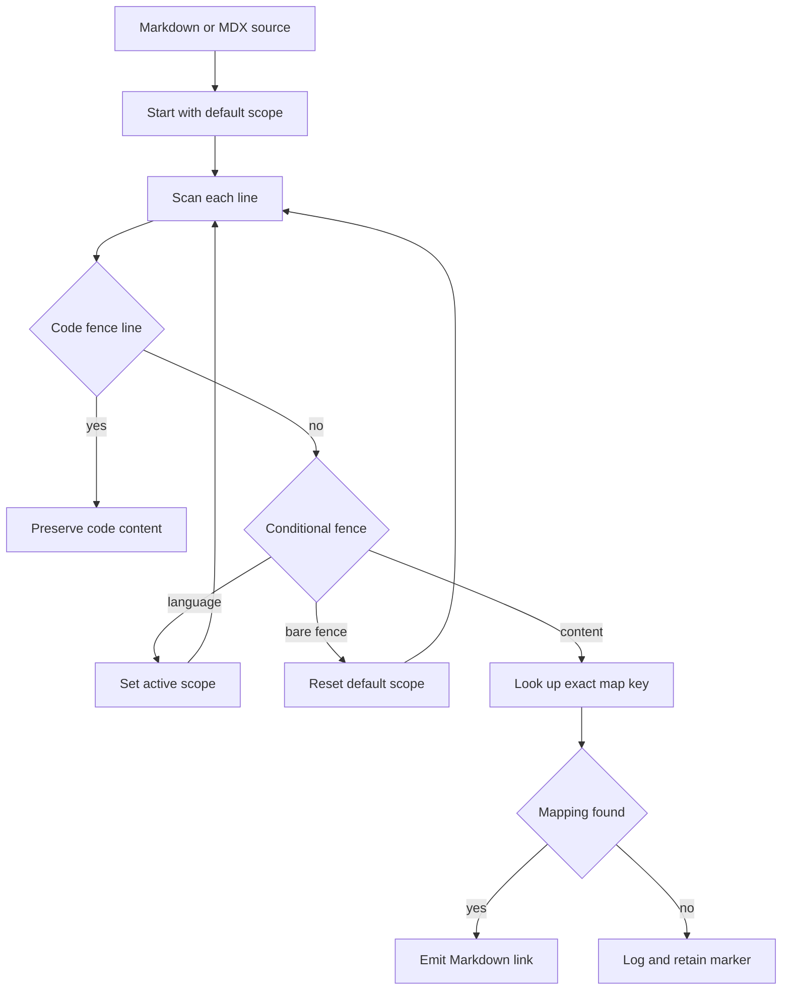

# Cross-References and API Links

`@[Name]` is source-level Markdown/MDX syntax for an API-reference link. Rather than hard-coding a reference URL in every consumer page, authors use a semantic name and the preprocessing pipeline resolves that name in the active language scope. The link map owns API destinations; use ordinary Markdown or HTML links for documentation-site routes.

## Author a semantic reference

Outside a regular fenced code block, use one of these forms:

```markdown
Use @[StateGraph] to define a graph.
Read @[the graph reference][StateGraph].
Pass @[`StateGraph`] to make code formatting part of the link text.
```

<!-- openwiki: broken internal link [url] file "url" does not exist. Fix the href or restore the target, then delete this comment. -->
<!-- openwiki: broken internal link [url] file "url" does not exist. Fix the href or restore the target, then delete this comment. -->
A successful lookup produces `[title](url)`. The simple form uses the map key as its title, the titled form uses the supplied title, and the backticked simple form produces ``[`StateGraph`](url)``. A backticked lookup key in a titled form selects the same map key but does not add backticks to the supplied title.

To show the syntax literally, escape the marker:

```markdown
Write \@[StateGraph] when documenting the syntax.
```

The resolver leaves an escaped marker unlinked, then removes the escape during its final pass, so readers see literal `@[StateGraph]`.

## Resolution order and language scope

`preprocess_markdown()` uses its `target_language` argument, then `TARGET_LANGUAGE`, then `python`; unless the caller provides `default_scope`, that target is the initial reference scope. It resolves references before CTA UTM decoration and conditional rendering, while language fences are still available to select a map. Conditional rendering then retains the matching `:::python` or `:::js` block and removes the other supported language block.



This shows the line-oriented reference pass, which runs before conditional rendering removes language-specific content.

A `:::python` or `:::js` line changes the active scope for following lines; a bare `:::` resets it to the default scope. Scope labels are normalized to lowercase. Use the supported `python` and `js` labels: only those scopes have flattened maps. Keys are exact, including case.

Language fences allow the same authored key to resolve to different destinations in each language branch. They also make language-only names safe: add an alias to both maps only when the same unfenced shared content must work in both builds. For example, the maps share `MCPAdapter`, but use `MCPAdapter.list_tools` for Python and `MCPAdapter.listTools` for JavaScript. Place each method reference in its corresponding language fence.

`global` is not an authoring scope. If it reaches the resolver, it logs an error and falls back to the Python map; a combined global resolver is not implemented.

### Fence and failure boundaries

The resolver does not transform markers in code fences that begin with at least three backticks or tildes. Code-fence state takes precedence over conditional fences, so a `:::js`-looking line in an example cannot change the active scope. The implementation toggles state for every matching fence line rather than matching opening and closing delimiters. Keep fences balanced: an unclosed recognized fence leaves the rest of the document untransformed.

A missing key is non-fatal during preprocessing. The resolver writes an info-level log with the file, line, name, and active scope, then keeps the original marker in the output. Treat this as a source defect and run the semantic-reference validator rather than relying on a successful build.

## Maintain the scoped API map

`pipeline/preprocessors/link_map.py` is the repository-owned registry for semantic API destinations. Each `LINK_MAPS` entry contains a `scope`, a `host`, and a `links` dictionary. At import time, `_enumerate_links()` assembles entries into `SCOPE_LINK_MAPS` by scope and prefixes each relative destination with its entry host. Multiple API hosts can therefore contribute to one language scope, and one key can point to different destinations by language.

To add or correct a mapping:

1. Identify the author-facing key and intended scope or scopes.
2. Add or correct that exact key in the appropriate `LINK_MAPS` dictionary. Prefer a path relative to the entry's `host`.
3. For unfenced content in shared `src/oss/`, ensure the key exists in both maps. Otherwise, put a language-specific use in a `:::python` or `:::js` block.
4. Run `make check-cross-refs`; run focused tests when changing resolver, map, or scope behavior.

Correct an API move in the map instead of replacing the semantic key across consumer pages. The map is appropriate when the author is naming an SDK/API symbol and this repository owns the stable semantic alias. It is not a route registry: use an ordinary link for a documentation page, redirect, or anchor. For external reference-site ownership and generated API-reference boundaries, see [Reference Documentation Boundaries](/openwiki/integrations/reference-docs.md).

## Validate source semantic references

Run:

```bash
make check-cross-refs
```

This is a **source-level semantic-reference check**, not a rendered-site link check. The target invokes `scripts/check_cross_refs.py` over Markdown and MDX under `src/`. It reports unresolved source-relative file, line, reference name, and applicable scopes, then exits with status 1. CI installs the test dependency group and runs this target.

The checker derives its default scopes from the source path:

| Location | Required scope for an unfenced reference |
| --- | --- |
| `oss/python/` | `python` |
| `oss/javascript/` | `js` |
| Other `oss/` content | `python` and `js` |
| Non-OSS content | `python` |

A `:::python` or `:::js` fence narrows validation to that scope. A bare or unsupported conditional fence restores the path-derived defaults. Therefore, an unfenced reference in shared OSS content must exist in **every** applicable map, not merely one.

The checker shares the resolver's reference and code-fence patterns. It skips `snippets/code-samples/`, paths containing `node_modules`, escaped references, and content inside recognized code fences. It warns and skips files that are not valid UTF-8. As with preprocessing, an unclosed recognized code fence excludes the remainder of that file from checking.

## Run the right check

Use `make check-cross-refs` to establish that source `@[Name]` markers have applicable local-map entries. It does not test whether an emitted site route, redirect, anchor, or external destination is reachable.

Use `make broken-links` for the separate **rendered-site link check**. It builds the documentation, runs Mintlify over `build/`, and checks redirects; `make broken-links-with-anchors` additionally checks anchors. A passing rendered-site check does not prove that every semantic marker is present in the local scoped map.

For focused coverage after changing resolver, map, or checker behavior, run:

```bash
uv run pytest tests/unit_tests/test_handle_auto_links.py tests/unit_tests/test_check_cross_refs.py -vv
make check-cross-refs
```

The resolver tests cover replacement, escapes, code-fence protection, conditional-looking content inside code, and unclosed fences. The checker tests cover path-derived scopes, shared-OSS all-scope requirements, titled and backticked forms, multiple references on a line, and exclusions.

| Symptom | Action |
| --- | --- |
| Literal `@[Name]` remains after preprocessing | Correct the exact key, select the intended scope, or add the scoped map entry. |
| Shared OSS content fails validation | Add a compatible key to both maps, or fence the language-specific use. |
| Later references are neither resolved nor checked | Locate and close an earlier regular code fence. |
| A site route or anchor fails while map validation passes | Run the appropriate rendered-site link check and repair the generated-route link or redirect. |
| Mintlify passes but a symbolic name fails | Run `make check-cross-refs` and repair the map or source name. |

For pipeline order, see [Preprocessing and Link Resolution](/openwiki/concepts/preprocessing.md). For source-family language variants, see [Language Variants and Route Ownership](/openwiki/concepts/versioning.md). When adding a page that uses cross-references, see [Adding and Moving Documentation Pages](/openwiki/operations/adding-pages.md).
