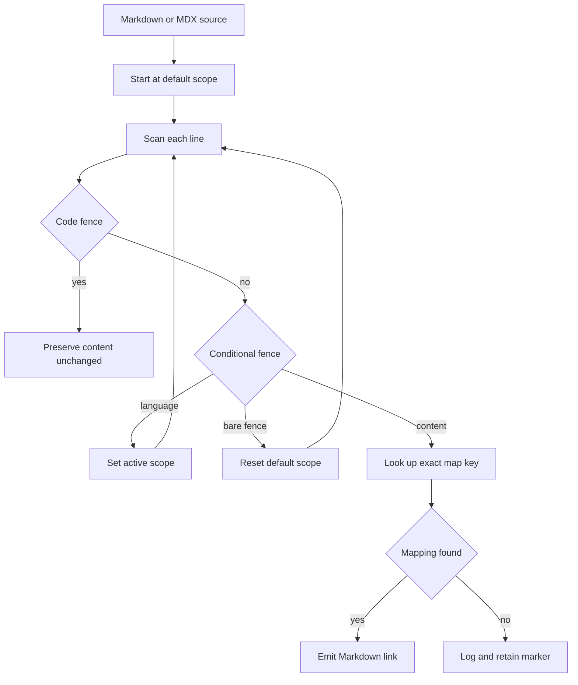

# Cross-References and API Links

`@[Name]` is source-level Markdown/MDX syntax for an API-reference link. Rather than hard-coding a reference URL in every consumer page, authors use a semantic name and the preprocessing pipeline resolves that name in the active language scope. The map is the owner of API destinations; ordinary Markdown and HTML links remain the right mechanism for documentation routes.

## Author a reference

Outside a regular fenced code block, use one of these forms:

```markdown
Use @[StateGraph] to define a graph.
Read @[the graph reference][StateGraph].
Pass @[`StateGraph`] to make code formatting part of the link text.
```

<!-- openwiki: broken internal link [url] file "url" does not exist. Fix the href or restore the target, then delete this comment. -->
<!-- openwiki: broken internal link [url] file "url" does not exist. Fix the href or restore the target, then delete this comment. -->
A successful lookup produces `[title](url)`. The simple form uses the map key as its title, the titled form uses the supplied title, and the backticked simple form produces ``[`StateGraph`](url)``. A backticked lookup name in the titled form selects the same map key but does not add backticks to the supplied title.

To show the syntax literally, escape the marker:

```markdown
Write \@[StateGraph] when documenting the syntax.
```

The resolver leaves an escaped marker unlinked, then removes the escape during its final pass, so readers see literal `@[StateGraph]`.

## Understand resolution and scope

`preprocess_markdown()` chooses `target_language` from its argument, otherwise `TARGET_LANGUAGE`, otherwise `python`. Unless the caller supplies `default_scope`, that target is also the initial reference scope. It resolves autolinks before CTA UTM decoration and conditional rendering, so language fences are still available when it selects a map.



This line-oriented pass resolves references before conditional rendering selects the target-language branch.

A `:::python` or `:::js` line changes the active scope for following lines. A bare `:::` resets it to the default scope. Scope labels are normalized to lowercase, but only `python` and `js` have flattened maps. Use those supported labels; an unsupported scope cannot resolve ordinary names. Keys are exact, including case.

Language fences let the same authored key resolve to a different destination in each language branch. They also make language-only names safe: add an alias to both maps only when the same unfenced shared content must work in both builds. For example, the maps share `MCPAdapter` but use `MCPAdapter.list_tools` for Python and `MCPAdapter.listTools` for JavaScript; the MCP guides use these names in their corresponding language fences. Put each method name in its corresponding language fence.

`global` is not an authoring scope. If it reaches the resolver, the resolver logs an error and falls back to the Python map; a combined global resolver is not implemented.

### Fence and failure boundaries

The resolver does not transform markers in code fences that begin with at least three backticks or tildes. Code-fence state takes precedence over conditional fences, so a `:::js`-looking line in an example cannot change the active scope. The implementation toggles state for every matching fence line rather than matching opening and closing delimiters fully. Keep fences balanced: an unclosed recognized fence leaves the rest of the document untransformed.

A missing key is non-fatal during preprocessing. The resolver writes an info-level log containing the file, line, name, and active scope, then keeps the original marker in the output. Treat this as a source defect and run the source validator rather than relying on a successful build.

## Maintain the scoped map

`pipeline/preprocessors/link_map.py` is the editable registry. Each `LINK_MAPS` entry contains a `scope`, a `host`, and a `links` dictionary. At import time, `_enumerate_links()` combines all entries for each supported scope into `SCOPE_LINK_MAPS`: it prefixes relative values with their entry's host and preserves values starting with `http` as absolute URLs. This permits several API hosts to contribute to one language scope and permits the same key to have language-specific URLs.

To add or correct a mapping:

1. Identify the author-facing key and the intended scope or scopes.
2. Add or correct that exact key in the appropriate `LINK_MAPS` dictionary. Prefer a path relative to that entry's `host`.
3. For unfenced content in shared `src/oss/`, ensure the key exists in both maps. Otherwise, place a language-specific use in a `:::python` or `:::js` block.
4. Run `make check-cross-refs`, then run focused tests when changing resolver, mapping, or scope behavior.

Correct an API move in the map instead of replacing the semantic key across consumer pages. Use normal Markdown or HTML links for site routes; API maps do not own those routes.

## Validate source references

Run:

```bash
make check-cross-refs
```

The target invokes `scripts/check_cross_refs.py` for Markdown and MDX under `src/`. It reports each unresolved source-relative file, line, reference name, and applicable scopes, and exits with status 1 when any are missing. CI installs the test dependency group and runs this target.

The checker derives default scopes from the source path:

| Location | Required scope for an unfenced reference |
| --- | --- |
| `oss/python/` | `python` |
| `oss/javascript/` | `js` |
| Other `oss/` content | `python` and `js` |
| Non-OSS content | `python` |

A `:::python` or `:::js` fence narrows validation to that scope. A bare or unsupported conditional fence restores the path-derived default. Therefore an unfenced reference in shared OSS content must be present in **every** applicable map, not merely one.

The checker uses the resolver's reference and code-fence patterns. It skips `snippets/code-samples/`, paths containing `node_modules`, escaped references, and content inside recognized code fences. Invalid UTF-8 files are warned about and skipped. As with preprocessing, an unclosed recognized code fence excludes the remainder of that file from checking.

## Run the right checks

Use `make check-cross-refs` for semantic map names. It is distinct from rendered-site checking: `make broken-links` builds the documentation and runs Mintlify over `build/`, while `make broken-links-with-anchors` additionally checks anchors. A source map check cannot establish that a site route, redirect, or anchor renders; a passing Mintlify check cannot establish that every `@[Name]` exists in the local scoped map.

For focused coverage after a resolver, map, or checker change, run:

```bash
uv run pytest tests/unit_tests/test_handle_auto_links.py tests/unit_tests/test_check_cross_refs.py -vv
make check-cross-refs
```

The resolver tests cover replacement, escapes, code-fence protection, conditional-looking content inside code, and unclosed fences. The checker tests cover path-derived scopes, shared OSS all-scope requirements, titled and backticked forms, multiple references on a line, and exclusions.

| Symptom | Action |
| --- | --- |
| Literal `@[Name]` remains after preprocessing | Correct the exact key, select the intended scope, or add the scoped map entry. |
| Shared OSS content fails validation | Add a compatible key to both maps, or fence the language-specific use. |
| Later references are neither resolved nor checked | Locate and close an earlier regular code fence. |
| A site route or anchor fails while map validation passes | Run the appropriate `broken-links` target and repair the generated-route link or redirect. |
| Mintlify passes but a symbolic name fails | Run `make check-cross-refs` and repair the map or source name. |

For preprocessing order and conditional rendering, see [Documentation Preprocessing](/openwiki/concepts/preprocessing.md). For API-reference ownership, see [Reference Documentation](/openwiki/integrations/reference-docs.md). For test-suite guidance, see [Test Overview](/openwiki/testing/test-overview.md). For language-versioned source and output behavior, see [Versioned Content](/openwiki/workflows/versioned-content.md).
