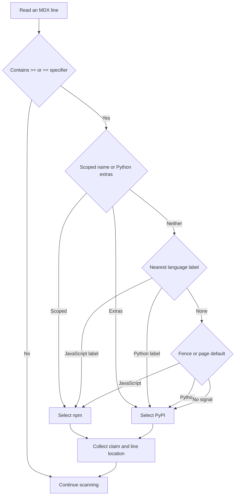
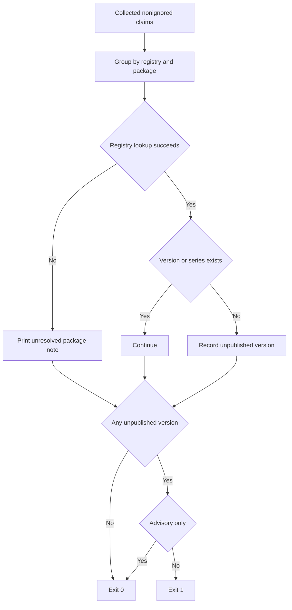

# Validate Package Version Claims

The version-claim checker verifies a narrow, reader-facing documentation contract: every checked package version named with `>=` or `==` has been published on the appropriate registry. It prevents installation instructions from naming a release that a resolver cannot obtain, without attempting to determine the correct feature-introduction version. Use it after changing an authored MDX page that includes a package specifier.

The checker reads authored `src/**/*.mdx` pages, not generated output. It recognizes unscoped and npm-scoped package names, optional Python extras, and versions made of alphanumeric components and dots. For example, it can collect `langchain>=1.3.2`, `langsmith[livekit]>=0.11.2`, and `@langchain/langgraph>=1.4.0`. It intentionally does not treat a sentence-ending period as part of the version.

## Run the focused check

Run the checker from the repository root. Supply the pages you changed to avoid querying packages outside the edit:

```bash
uv run python scripts/check_version_claims.py --files src/path/to/page.mdx
```

Without `--files`, it recursively checks every `.mdx` page under `src/`. With `--files`, it retains only existing `.mdx` inputs; an empty applicable selection prints `no .mdx files to check` and succeeds. The optional `--advisory-only` mode reports unpublished versions but exits successfully, which is useful when inspecting existing content without making the result a gate.

The pull-request workflow applies the focused form automatically. It runs only when authored MDX, the checker, its ignore configuration, or the workflow changes. After checkout with full history, it finds the merge base with the pull request base branch and passes changed MDX files under `src/` to the script. If there are no such files, it skips Python setup and registry requests. The job is read-only, runs on Ubuntu with a 10-minute timeout, and uses Python 3.13 through the repository’s `uv_setup` action.

## Resolve the registry before validating

The same bare package can exist on both registries with unrelated release lines, so registry routing is part of the correctness contract. For every matched specifier, the checker applies the following precedence, stopping at the first applicable signal:

1. An `@scope/` prefix selects npm because it is npm-only syntax.
2. Python extras such as `[livekit]` select PyPI because extras are Python package syntax.
3. The nearest recognized language label on the same line selects its ecosystem. Python/PyPI and JavaScript, TypeScript, Node, or npm labels are considered only within 40 characters; the closest label wins.
4. An enclosing `:::python` or `:::js` conditional fence selects PyPI or npm, respectively.
5. A path containing `/python/` or `/javascript/` selects PyPI or npm. The flat JavaScript-only page `src/langsmith/trace-with-vercel-ai-sdk.mdx` is also an npm override.
6. With no signal, PyPI is the default because bare documentation specifiers are normally Python packages.

A language label has priority over a fence or page path. This lets one unfenced line correctly name both SDKs, while an explicit conditional fence still overrides the language implied by the page’s directory. The parser resets the active fence at a closing `:::` marker, so later specifiers use the remaining precedence rules.



*Specifier discovery uses syntax first, then local language context, before falling back to PyPI.*

The checker groups duplicate claims while preserving every `file:line` location for diagnostics. It validates both exact pins and minimum floors. A shortened floor such as `langchain>=1.1` is considered published when the registry has any `1.1.*` release; it does not incorrectly match a different series such as `1.14.*`.

## Interpret lookup and publication results

After filtering ignored specifiers, the checker makes at most one registry lookup per `(ecosystem, package)` pair, concurrently with up to eight workers. It fetches PyPI’s package JSON or npm’s package document, takes the complete release/version map and latest release, and compares each requested version against the published releases.

Only allowlisted package-name shapes are interpolated into registry URLs. Invalid package names do not reach the network. Network errors, timeouts, malformed registry data, unavailable packages, and missing expected registry fields produce an unresolved lookup rather than an unpublished-version finding.



*An unavailable registry is reported as uncertainty; a successful lookup that lacks the named release is the blocking failure.*

This distinction is intentional. A registry outage, private package, or temporary lookup problem does not make CI fail. In contrast, a successfully resolved package that lacks the named version is reported with its registry, latest release, and up to five documentation locations, then fails normally. If no blocking findings occur, the checker reports that every version exists on its registry.

## Manage standing exceptions

`scripts/version_claims_ignore.cfg` contains exact specifier strings that must not be checked. Blank lines and `#` comments, including trailing comments, are discarded; no ecosystem prefix is part of an entry. Filtering occurs before any registry lookup.

Use an ignore entry only when the prose specifier is deliberately unresolvable, and document the reason beside it. Current examples include `0.0.1` floors that mean “any release” for OpenTelemetry packages and a placeholder package in a configuration-shape example. Prefer correcting an erroneous version instead of adding an exception. Keep the `.cfg` extension: the configuration explains that Dependabot treats `.txt` files as requirements and might rewrite the literal specifier, breaking an exact ignore match.

## Keep the checker within its boundary

Publication existence is not feature compatibility. A published minimum can still be too low, too high, intentionally capped below a major version, or unsuitable for a particular feature. Authors must establish and maintain a feature floor from the relevant SDK or product evidence; the checker must not automatically bump it to a current or latest release.

Use the standard prose form such as “version 1.3.2 or later” for a narrative minimum, and reserve a literal `package>=1.3.2` form for install syntax or other package-specifier contexts. The checker validates only the literal `>=` and `==` claims it recognizes; it does not validate general prose version statements.

## Extend and test safely

Change parsing or routing only with focused coverage in `tests/unit_tests/test_check_version_claims.py`. The suite protects routing precedence for scoped names, extras, inline labels, fences, path defaults, and the JavaScript-only override; it also covers pins, repeated line locations, truncated release-series matching, ignores, unsafe names, registry failures, and representative PyPI/npm payloads.

When changing the workflow, checker, or configuration, test the smallest affected behavior first, then run the checker against a representative MDX file. Keep the CI contract focused on changed authored MDX and publication existence: expanding it into automatic floor selection or treating registry unavailability as a failing version claim would change its operational semantics.

## See also

- [Documentation Routes and Language Versioning](/openwiki/concepts/versioning.md)
- [GitHub Actions and CI Automation](/openwiki/integrations/github-actions.md)
- [Developer Commands and CLI Tools](/openwiki/operations/cli-tools.md)
- [Repository Wiki Quickstart](/openwiki/quickstart.md)
- [Testing Overview](/openwiki/testing/test-overview.md)
