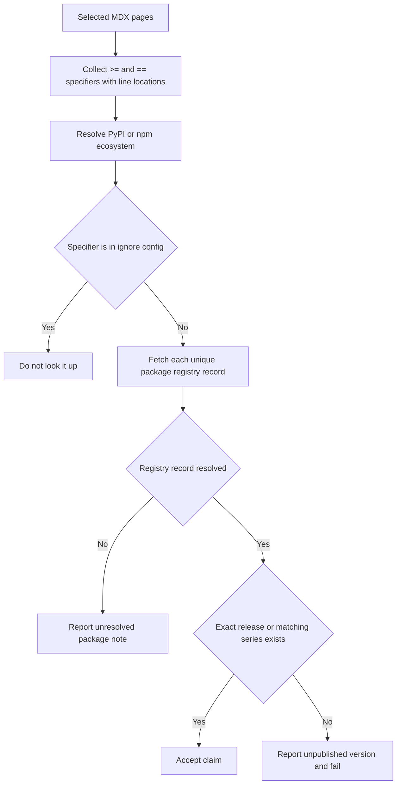

# Published Package Version Claims

The version-claim check protects a narrow but important documentation promise: a package version named in an authored MDX page must have been published to the registry appropriate to that claim. It validates existence, not whether a stated minimum is the correct feature floor. Authors retain responsibility for establishing the feature requirement, and should not increase a floor merely because a newer release is available.

The checker is deliberately scoped to package specifiers, rather than general version prose. It recognizes a lowercase package name with an optional npm `@scope/` prefix or Python extras suffix, followed by `>=` or `==` and a numeric-leading version. A sentence-ending period is not considered part of the version. It scans every line of the selected MDX text, including lines in code examples; the only parser state it maintains is whether an exact `:::python` or `:::js` fence is open. A closing `:::` restores the unfenced context.

## Understand the validation flow



*The checker fails only a claim whose selected registry resolves successfully and lacks the named release; registry lookup failures remain diagnostic notes.*

Claims are deduplicated by ecosystem, package, operator, and version for lookup and reporting, while retaining all `file:line` locations for an invalid repeated claim. Registry requests are made concurrently for unique ecosystem/package pairs, with at most eight workers and a 30-second request timeout.

### Resolve the ecosystem predictably

A bare package name can be present on both registries, so registry choice follows this fixed precedence:

1. An `@scope/` prefix selects **npm**.
2. A Python extras suffix such as `[extra]` selects **PyPI**.
3. The closest recognized language label on the same line selects the ecosystem. Labels can occur before or after the specifier, must be fewer than 40 characters away, and the nearest label wins.
4. An enclosing `:::python` selects PyPI; an enclosing `:::js` selects npm.
5. In the absence of a stronger signal, a path containing `/python/` selects PyPI, and one containing `/javascript/` selects npm. One configured flat LangSmith page is also treated as npm-only.
6. The fallback is **PyPI**.

This ordering means an explicit package syntax cannot be overridden by prose, and a nearby per-claim label can distinguish two SDK claims on one unfenced line. Conversely, a label too far away is treated as belonging to a different clause. A fence outranks the page path but not nearby labeling or package syntax.

## Check publication rather than compatibility

For PyPI, the checker retrieves the package JSON from `https://pypi.org/pypi/<package>/json` and reads its release keys and current `info.version`. For npm, it retrieves `https://registry.npmjs.org/<package>` and reads the version-map keys and `dist-tags.latest`. Package names must satisfy ecosystem-specific allowlists before they can be interpolated into either URL; invalid names are not fetched. Scoped npm names are URL encoded without allowing an unescaped slash.

A claim passes when its complete version is a published release. A shortened version also passes when a published release begins with that version plus a dot, so a series-level floor is accepted without matching unrelated longer numeric prefixes. The latest version is displayed only to help diagnose an unpublished claim; it does not change the floor.

A failed network request, timeout, malformed registry response, missing expected registry fields, unsafe package name, or unavailable/private package yields an **unresolved** package note instead of an unpublished-version finding. This fail-open behavior prevents registry outages from blocking documentation work. In contrast, a successful lookup that lacks the claimed version prints the ecosystem, specifier, latest version, and up to five source locations, then exits nonzero unless advisory mode is active.

## Maintain explicit exceptions

`scripts/version_claims_ignore.cfg` contains standing exceptions for specifier strings that are intentionally unresolvable. The checker removes comments beginning with `#`, ignores blank lines, and compares each remaining entry exactly to the unqualified `package operator version` string. An exception is therefore not ecosystem-specific and is applied before registry lookup.

Use an exception only when the authored value is deliberate, such as an any-release floor that is not an actual release or a placeholder package in an illustrative configuration. Add a reason in a trailing comment and prefer correcting an erroneous documentation claim. Keep this file as `.cfg`: its comments identify an existing Dependabot behavior that would rewrite a `.txt` requirements-like file and break the exact matching contract. A missing ignore file is valid and means that no exceptions apply.

## Run the checker locally and in automation

From the repository root, run a complete sweep or supply the MDX pages to check:

```bash
uv run python scripts/check_version_claims.py
uv run python scripts/check_version_claims.py --files src/langsmith/evaluators.mdx
uv run python scripts/check_version_claims.py --advisory-only
```

Without `--files`, the command recursively checks `src/**/*.mdx`. With `--files`, it silently retains only existing `.mdx` files; if none remain, it reports that there are no MDX files to check and succeeds. `--advisory-only` preserves findings in output but always returns zero, which is appropriate for observation rather than a merge gate.

The **Check version claims** workflow is a read-only pull-request gate with a 10-minute job timeout and `contents: read` permission. It runs when an MDX file below `src/`, the checker, its ignore configuration, or the workflow itself changes. Checkout fetches full history, then the workflow finds the merge-base with the pull request base branch and passes changed `src/` MDX paths from the accepted diff statuses to `--files`. If the diff contains no matching MDX files, the job succeeds without setting up Python. Otherwise it uses the repository uv setup with Python 3.13 and blocks the pull request on an unpublished version.

The changed-page gate intentionally does not revalidate unchanged documentation. The scheduled external-version workflow complements it with a full-repository `--advisory-only` sweep, writes its output to the GitHub Actions job summary, and does not turn the scheduled run red when an upstream release no longer resolves.

## Preserve the contract with focused tests

`tests/unit_tests/test_check_version_claims.py` isolates the parser and network boundary rather than querying live registries. Its cases establish the important precedence and recovery rules:

- Scope and extras syntax, sentence punctuation, language fences and fence closure, nearby labels, page paths, and the JavaScript-only page override select the expected registry.
- Exact pins are collected, repeated occurrences retain every line number, and abbreviated series values match only releases in that series.
- Ignore-file comment handling and a missing ignore file behave as configuration, not errors.
- Unsafe package names never reach the request function, and timeouts are unresolved rather than false nonexistent-version failures.
- Stubbed PyPI and npm payloads prove extraction of published versions and each registry's displayed latest release.

When changing matching syntax, routing precedence, or failure behavior, update these focused tests before relying on the pull-request gate. Use the full command only when the change also affects the corpus of authored claims or the ignore configuration.

## See also

- [Documentation routes and language versioning](/openwiki/concepts/versioning.md)
- [GitHub Actions and CI automation](/openwiki/integrations/github-actions.md)
- [Adding and moving documentation pages](/openwiki/operations/adding-pages.md)
- [Testing overview](/openwiki/testing/test-overview.md)
