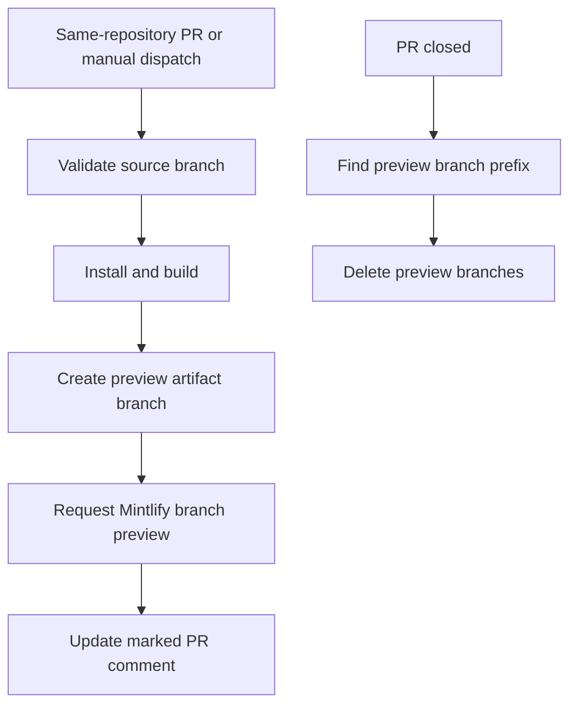

# Repository Wiki Quickstart

This repository owns the authored documentation and build pipeline for [docs.langchain.com](https://docs.langchain.com). Start with the durable input, not a rendered route: a sidebar item, deployment-generated endpoint, table, snippet, or file in `build/` can be output owned elsewhere.

## Route the task first

`AGENTS.md` is the repository-wide authoring contract: edit manually authored `src/` content, keep frontmatter descriptions free of Markdown, use Tabler icons, test examples, add new pages to `src/docs.json`, and never edit `build/`. Task-specific procedures live in `.agents/skills/`; run `make skills` in each Claude Code worktree to link them into `.claude/skills/`. A change to a script, workflow, Make target, check, scheduled job, or skill also needs the `docs-tooling-notion` follow-up before PR handoff.

| Request | Durable owner or entrypoint | Read next |
| --- | --- | --- |
| Add, move, or revise a page, asset, sidebar entry, or redirect | The applicable `src/` subtree and `src/docs.json` | [Repository Source Map](/openwiki/architecture/source-map.md), [Documentation Route and Language Versioning](/openwiki/concepts/versioning.md) |
| LangSmith agent-based-workspace model, registration, environments, trace routing, compatibility project, observability quickstart, or integration guidance | Authored `src/langsmith/*.mdx` and the shared `src/snippets/langsmith/` or `src/snippets/` owner | [LangSmith Agent and Observability Documentation Changes](/openwiki/workflows/langsmith-agent-documentation.md) |
| LangSmith agent-registration display code | Marked executable `src/code-samples/langsmith/create-an-agent.py` | [Runnable Code Samples and Snippet Generation](/openwiki/workflows/code-sample-lifecycle.md) |
| LangSmith REST endpoint reference | `src/langsmith/langsmith-platform-openapi.json`, its refresh process, and the `src/docs.json` OpenAPI declaration | [LangSmith Agent and Observability Documentation Changes](/openwiki/workflows/langsmith-agent-documentation.md) |
| Determine an emitted route or language variant | Source family first; `src/docs.json` separately projects navigation and redirects | [Documentation Route and Language Versioning](/openwiki/concepts/versioning.md) |
| Build, preprocessing, watcher, or CLI behavior | `pipeline/`, `scripts/`, and `Makefile` | [Repository Source Map](/openwiki/architecture/source-map.md) |
| Runnable tutorial or displayed code extract | `src/code-samples/` | [Runnable Code Samples and Snippet Generation](/openwiki/workflows/code-sample-lifecycle.md) |
| Integration listing, provider card, package data, or generated integration table | Hosted `integration:` frontmatter, `scripts/data/integration_external_docs.yaml`, `packages.yml`, or their generators | [Integration Listing Automation](/openwiki/workflows/integration-listing-automation.md) |
| CI, scheduled automation, preview, or workflow permissions | `.github/workflows/` plus the invoked command or script | [GitHub Actions and CI Automation](/openwiki/integrations/github-actions.md) |
| SDK API reference at `reference.langchain.com` | External reference-site process | Do not search this repository for an SDK-reference generator or output. |

## Source, navigation, and generated-output boundaries

`src/docs.json` is the Mintlify site-configuration and navigation source of truth, but it does not determine a file's owner or cause the builder to emit a page. Navigation labels can span source families: **Build** mixes OSS and LangSmith content, **No-code agents** is sourced from Fleet, and **Deep Agents Code** is a Products and setup item. Choose the source directory and resulting route family first, then update the menu entry and any compatibility redirect.

A clean build deletes and recreates `build/`. Most OSS source becomes Python and JavaScript variants; OpenWiki and Deep Agents Code are deliberate unversioned exceptions; ordinary LangSmith content is unversioned; and Managed Deep Agents produces Python and JavaScript variants. Generated output is useful to inspect but is never an authoring surface.

| Surface encountered | Change instead | Follow-through |
| --- | --- | --- |
| `build/` | Authored `src/`, site configuration, or pipeline code | Rebuild or preview; a clean build removes output edits. |
| `src/oss/python/integrations/providers/overview.mdx` | `packages.yml` or `pipeline/tools/partner_pkg_table.py` | Regenerate with `uv run python pipeline/tools/partner_pkg_table.py`; CI rejects drift. |
| `src/code-samples-generated/` | Executable source in `src/code-samples/` | Test the source, then run `make code-snippets`. |
| `src/snippets/code-samples/` | Marked executable source in `src/code-samples/` | Regenerate and commit the rendered MDX; do not use it as primary input. |
| `src/snippets/langsmith/` or other authored shared snippets | The shared snippet when the statement is reused | Review every consuming LangSmith guide. |
| LangSmith agent REST endpoint pages under `/langsmith/smith-api/` | The committed OpenAPI input and its refresh process | Verify a preview or deployed site; Mintlify creates endpoint pages at deployment. |
| Agent Server, Control Plane, or LangSmith REST endpoint pages | Their `src/docs.json` declaration and committed or remote OpenAPI source | Mintlify creates endpoint pages at deployment, not in local `build/`. |
| Integration download tables | Hosted-guide frontmatter or `scripts/data/integration_external_docs.yaml` | Validate URLs, then regenerate with `scripts/refresh_integration_downloads.py`. |

For shared OSS content, an unfenced `@[ref]` must resolve in both language scopes. Place SDK-only names in `:::python` or `:::js` blocks and run `make check-cross-refs`.

## LangSmith agent and observability changes

The agent-based-workspace documentation is a connected source cluster, not a single page. Use `agents.mdx` for the agent/environment model and identifier versus display-name distinction; `create-an-agent.mdx` for registration and compatibility-project retrieval; and `log-traces-to-agent.mdx` for SDK, environment-variable, and OTLP routing. Keep the observability quickstart, reusable tracing snippets, and framework-integration pages aligned when their shared prerequisite or destination rules change. The narrow workflow page maps the connected consumers, including resolver and OpenTelemetry guidance.

`src/docs.json` separately places `langsmith/create-an-agent` in **Products and setup → LangSmith setup → Overview → Agent-based workspaces** and `langsmith/observability-quickstart` in the Monitor navigation. A new, moved, or renamed guide needs an explicit navigation and redirect decision; prose changes normally do not.

The registration guide imports two generated fragments, `create-agent-py.mdx` and `agent-environment-project-py.mdx`. Their durable source is `src/code-samples/langsmith/create-an-agent.py`: its two marked regions demonstrate `Client.agents.create` and retrieval of the selected environment's compatibility session values. Hidden regions start a loopback `ThreadingHTTPServer`, patch the SDK environment, and assert the documented POST then GET requests, so this is a deterministic local SDK fixture rather than a credentialed agent-creation call. Change the visible SDK calls, fixture schema/assertions, marker IDs, generated fragments, and importing guide together.

```bash
make test-code-samples FILES="src/code-samples/langsmith/create-an-agent.py"
make code-snippets
```

Use `make lint_prose FILES="src/langsmith/..."` for authored LangSmith prose. Add `make broken-links-with-anchors` when routes, navigation, imports, links, or anchors change. A local fixture pass proves request construction and response handling, not production credentials or service mutation; use a credentialed representative sample only when a change crosses that remote boundary.

## Runnable samples: source, execution, then presentation

A runnable program under `src/code-samples/` is the source of truth. `make test-code-samples` executes selected samples; `make code-snippets` first extracts marked regions into the ignored `src/code-samples-generated/` intermediate and then generates committed MDX under `src/snippets/code-samples/`.

`src/code-samples/deepagents/rag-deep.py` illustrates the boundary. Its `:snippet-start:` / `:snippet-end:` regions yield reader-facing tutorial fragments while `:remove-start:` / `:remove-end:` sections retain the credential gate, setup, long instructions, and assertions in the executable program but omit them from the extracted fragment. The program exits successfully with a skip message when `OPENAI_API_KEY` is absent; run it with that key to exercise its live retrieval, embedding, and agent path.

The dedicated workflow skips fork pull requests because credentialed samples need repository secrets. Same-repository PRs run changed supported sample files; manual and monthly scheduled runs execute all samples with tracing enabled. A trace refresh can regenerate snippet MDX and update the standing trace-refresh PR only after the guarded full-run conditions succeed; it is not a substitute for a successful sample run.

## Local development and proportionate validation

The project requires Python 3.13 or later. Run `make install` to synchronize Python dependency groups, install project npm dependencies and the global Mintlify CLI, and link skills. `make dev` builds unless `--skip-build` is supplied, watches `src/`, and starts `mint dev --port 3000` from `build/`; it stops rather than serving stale output if the initial build fails. Open <http://localhost:3000> after startup.

The installed `docs` console script dispatches to the pipeline CLI; Make wraps the normal build and development commands. `mint` is the separate Mintlify CLI used against generated output.

| Changed contract | Proportionate local check |
| --- | --- |
| Pipeline, generator, helper, or CLI behavior | `make test TEST_FILE=tests/unit_tests/path_or_test.py`; add `make lint` for tooling changes. |
| New or moved route, navigation, redirect, link, or anchor | `make broken-links-with-anchors` |
| Shared or conditional `@[ref]` source | `make check-cross-refs` |
| Focused prose page | `make lint_prose FILES="src/path/to/page.mdx"` |
| Agent Server OpenAPI input | `make check-openapi` |
| Runnable sample or its markers | `make test-code-samples FILES="src/code-samples/..."`, then `make code-snippets` |
| External integration listing URL | `uv run python scripts/refresh_integration_downloads.py --check-docs-urls` |
| Provider overview input or generator | `uv run python pipeline/tools/partner_pkg_table.py` and review the diff |

`make test` runs pytest with Internet sockets disabled except Unix sockets. Core CI runs on pull requests, pushes to `main`, and manual dispatch. It calls test, lint, and built-document checks and separately detects merge-conflict markers, source cross-reference failures, unsafe external integration URLs, and provider-overview drift. Built link validation rebuilds first and checks links, anchors, and redirects; it also runs the Agent Server OpenAPI check.

## Preview deployment is an artifact handoff

A Mintlify preview is not another source tree. For a same-repository pull request, `create-preview-branch.yml` validates the source branch, runs `make install` and `make build`, writes generated `build/` files to a collision-resistant `preview-...` branch, then asks Mintlify to deploy that branch. Fork pull requests do not take the write- and secret-dependent path.



*Preview creation hands a generated branch to Mintlify; PR closure takes a separate guarded cleanup path.*

The workflow validates permitted branch characters and length before checkout. Its preview name combines a sanitized source-prefix, timestamp, and short commit SHA, verifies remote uniqueness, and force-adds `build/`; a collision is a failure to retry, not a branch to overwrite. The Mintlify request requires the generated branch plus `MINTLIFY_API_KEY` and `MINTLIFY_PROJECT_ID`; malformed responses or a response without usable status or preview URL fail the job. A marker lets later runs update one PR comment rather than repeatedly notifying subscribers. On close, cleanup recomputes the sanitized prefix and refuses to delete any branch outside the `preview-` namespace.

## Integration metadata

Integration discovery combines hosted-guide `integration:` frontmatter with third-party records in `scripts/data/integration_external_docs.yaml`. The YAML owns external rows; its `docs_url` is rendered as a link, so validate it before regeneration. It accepts `https://`, `http://`, or a site-relative path with one leading slash, rather than protocol-relative or executable schemes. The provider overview has a different owner: CI regenerates it from `packages.yml` and rejects a changed result.

For the full policy, eligibility rules, scheduling, and generated-output contracts, use [Integration Listing Automation](/openwiki/workflows/integration-listing-automation.md) rather than editing a table row.

## Continue by domain

- [Repository Source Map](/openwiki/architecture/source-map.md): durable ownership, generated surfaces, and deployment boundaries.
- [Documentation Route and Language Versioning](/openwiki/concepts/versioning.md): source classification, route variants, menus, and redirects.
- [LangSmith Agent and Observability Documentation Changes](/openwiki/workflows/langsmith-agent-documentation.md): connected agent, environment, trace-routing, integration, sample, and REST-reference changes.
- [Runnable Code Samples and Snippet Generation](/openwiki/workflows/code-sample-lifecycle.md): marker syntax, local fixtures, rendering, tracing, and CI.
- [Testing and Validation Overview](/openwiki/testing/test-overview.md): validation boundaries and failure triage.
- [GitHub Actions and CI Automation](/openwiki/integrations/github-actions.md): CI gates, preview branches, publication, and credentialed sample automation.
