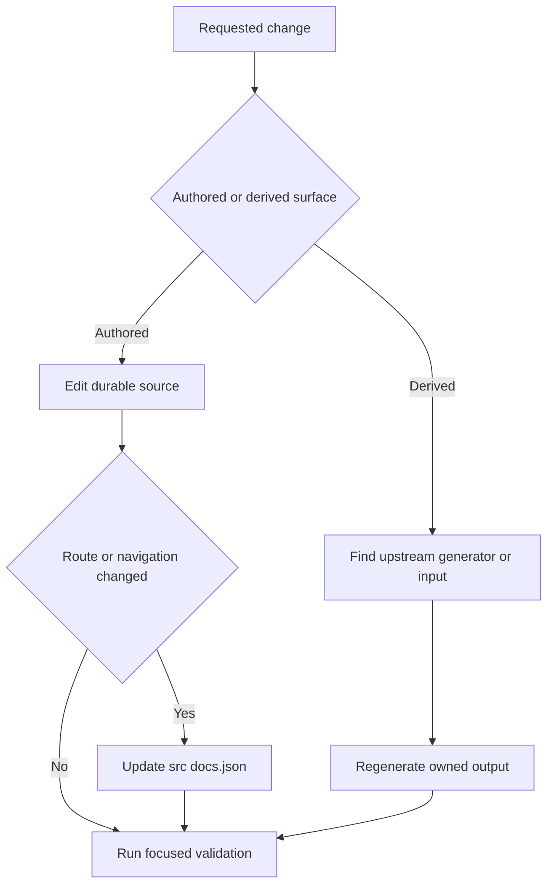

# Repository Wiki Quickstart

This repository builds the Mintlify site at [docs.langchain.com](https://docs.langchain.com) from authored inputs under `src/`. Start with the durable owner, not the rendered result. **Build output is not an authoring surface:** do not edit `build/`, preview branches, deployment-created endpoint pages, or other generated views. The generated SDK reference at [reference.langchain.com](https://reference.langchain.com/python/) is built outside this repository.

## Route the task

| If the change concerns... | Durable owner and safe action | First meaningful validation |
| --- | --- | --- |
| Page prose, frontmatter, images, reusable MDX, or an authored example | Edit the owning content below `src/`: `src/oss/`, `src/langsmith/`, `src/snippets/`, or `src/code-samples/`. | `make lint_prose FILES="src/path/to/page.mdx"`; execute a changed runnable sample. |
| Navigation, a redirect, site settings, or an OpenAPI declaration | Edit `src/docs.json`; source directories determine ownership, while this file determines reader-facing navigation. | `make broken-links-with-anchors` for route, redirect, or anchor changes. |
| Shared OSS language behavior | Keep shared content under `src/oss/`; use `:::python` and `:::js` only for target-specific content. | `make check-cross-refs`, then a generated-site check when routes or navigation change. |
| Build, preprocessing, route selection, or watcher behavior | Change `pipeline/` and its focused unit tests. | The owning `tests/unit_tests/test_*.py`, then `make test`; rebuild for output changes. |
| Provider overview | Change `packages.yml` or `pipeline/tools/partner_pkg_table.py`, regenerate `src/oss/python/integrations/providers/overview.mdx`, and commit it. | `uv run python pipeline/tools/partner_pkg_table.py`. |
| Runnable display snippet | Change and test the program in `src/code-samples/`, then regenerate display artifacts. | `make test-code-samples FILES="src/code-samples/..."`, then `make code-snippets`. |
| Mintlify-generated OpenAPI endpoints | Change the declared specification or its refresh process, not an endpoint page. | `make check-openapi` when changing the Agent Server input. |
| Workflow, CI gate, preview, scheduled writer, or secret-bearing integration | Change `.github/workflows/`, the invoked command, and focused tests or checks together. | The narrow invoked command locally; use CI for credentialed or write-capable boundaries. |
| External SDK API reference | Do not look for a local reference build. Use the repository's reference-documentation issue template to route a defect. | N/A: this repository does not own that build. |

This routing flow separates authored inputs from derived artifacts before validation begins.

## Establish ownership before editing

`AGENTS.md` is the always-applicable authoring contract for manual `src/` content: descriptions in frontmatter contain no Markdown, pages added to the site need `src/docs.json` navigation, icons are Tabler icons, and examples must be tested. It also distinguishes repository-wide rules from task-specific procedures in `.agents/skills/`. Run `make skills` in each Claude Code worktree to link those canonical skills into `.claude/skills/`. A change to a script, workflow, Make target, PR check, scheduled job, or skill requires the `docs-tooling-notion` follow-up before PR handoff.

The build reconstructs `build/`: `DocumentationBuilder` clears it, creates Python and JavaScript OSS variants, emits unversioned OpenWiki and Deep Agents Code content, builds LangSmith and Managed Deep Agents variants, then copies shared files. OpenWiki and Deep Agents Code are intentional unversioned OSS exceptions. Treat the generated tree as an inspection and validation artifact, never as a competing source of truth.

Generated content committed under `src/` still has an upstream owner:

- The provider overview is generated from package metadata and its generator; CI regenerates it and rejects a diff.
- `src/code-samples/` owns runnable programs. `src/code-samples-generated/` and `src/snippets/code-samples/` are outputs of extraction and MDX generation.
- Mintlify creates Agent Server, Control Plane, and LangSmith REST endpoint pages at deployment time. They are absent from local `build/` output.
- A Mintlify preview is a write-capable deployment artifact, not source. It is limited to same-repository pull requests or manual dispatch, pushes a deterministic `preview-` branch containing `build/`, and cleanup refuses to delete non-preview branches.

## Choose the smallest validation boundary

Use the check that proves the changed contract; do not substitute a broad build for a focused test, or a source-only check for rendered-site behavior.

| Change boundary | Start here | What it proves |
| --- | --- | --- |
| Python pipeline, generator, or parser | Owning unit test, then `make test` | Deterministic transformation behavior. |
| Authored prose | `make lint_prose FILES="src/path/to/page.mdx"` | Prose style, not factual correctness or rendered routes. |
| Shared `@[reference]` or conditional language content | `make check-cross-refs` | References resolve in the applicable source-language scope. |
| Navigation, redirects, links, anchors, or MDX components | `make broken-links-with-anchors` and, if appropriate, `make check-mdx` | The regenerated Mintlify tree resolves routes, redirects, and anchors. |
| Agent Server OpenAPI specification | `make check-openapi` | The generated build's Agent Server specification is valid. |
| Runnable sample or snippet markers | Execute the selected sample, then `make code-snippets` | The durable program runs and generated snippet output is refreshed. |
| Package `>=` or `==` claim | `uv run python scripts/check_version_claims.py --files src/path/to/page.mdx` | The literal named release exists in its routed registry, not that it is the right feature minimum. |

`make test` runs pytest against `tests/unit_tests` with network sockets disabled except Unix sockets. Core CI runs on pushes to `main`, pull requests, and manual dispatch. It invokes reusable test, lint, and link validation, and also checks merge-conflict markers, source cross-references, integration documentation URL schemes, and provider-overview drift. CI is the broader boundary; credentialed sample runs and write-capable automation may be unavailable for fork pull requests.

## Continue by domain

- [Documentation Build System](/openwiki/architecture/build-system.md): full and incremental generation, preprocessing, route families, and output boundaries.
- [Repository Source Map](/openwiki/architecture/source-map.md): ownership for authored inputs, generators, automation, tests, and external services.
- [Documentation Routes and Language Versioning](/openwiki/concepts/versioning.md): source-family selection, language variants, conditional fences, navigation, and redirects.
- [Adding, Moving, and Retiring Documentation Pages](/openwiki/operations/adding-pages.md): page lifecycle, frontmatter, navigation, redirects, and focused checks.
- [Testing Overview](/openwiki/testing/test-overview.md): deterministic, generated-site, networked, and CI-only validation boundaries.
- [GitHub Actions and CI Automation](/openwiki/integrations/github-actions.md): read-only checks, secrets and fork boundaries, previews, scheduled writers, and publication.
