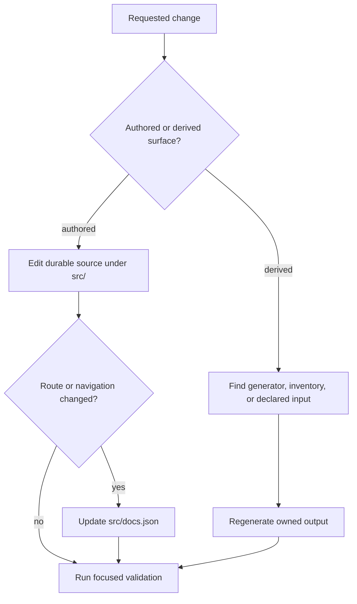

# Repository Wiki Quickstart

This repository authors the Mintlify documentation site at [docs.langchain.com](https://docs.langchain.com). Work from the durable source, not from the visible result: `build/`, generated tables and snippets, deployment-created OpenAPI pages, preview branches, and the external SDK reference each have different ownership. The generated SDK reference at [reference.langchain.com](https://reference.langchain.com/python/) is built outside this repository.

## Route the task

| If the change concerns... | Start at | Then read |
| --- | --- | --- |
| An authored page, asset, snippet consumer, navigation entry, redirect, or site setting | The owning content under `src/` and `src/docs.json` | [Repository Source Map](/openwiki/architecture/source-map.md) and [Documentation Routes and Language Versioning](/openwiki/concepts/versioning.md) |
| A source-family or route decision—OSS Python/JavaScript, unversioned OpenWiki or Deep Agents Code, LangSmith, or Managed Deep Agents | The source family and its navigation entry | [Documentation Routes and Language Versioning](/openwiki/concepts/versioning.md) |
| A literal `package>=version` or `package==version` claim in MDX | The authored MDX and `scripts/check_version_claims.py` | [Validate Package Version Claims](/openwiki/operations/version-claims.md) |
| LangSmith Agent Registry, environments, trace routing, OTLP guidance, or Managed Deep Agents local development | The corresponding `src/langsmith/` page and runnable sample | [LangSmith Agent and Observability Documentation Changes](/openwiki/workflows/langsmith-agent-documentation.md) |
| Public LangSmith or deployment egress IPs | `src/langsmith/egress-ip-addresses.json` | [Maintain the LangSmith Egress IP Inventory](/openwiki/workflows/egress-ip-inventory.md) |
| A generated provider overview, code snippet, or OpenAPI reference | Its generator or declared source—not the generated view | [Repository Source Map](/openwiki/architecture/source-map.md), [Testing Overview](/openwiki/testing/test-overview.md), or [Reference Documentation Boundaries](/openwiki/integrations/reference-docs.md) |
| A workflow, CI check, preview, scheduled writer, secret-bearing sample run, or publication path | `.github/workflows/` and the command it invokes | [GitHub Actions and CI Automation](/openwiki/integrations/github-actions.md) |

`AGENTS.md` is the repository-wide authoring contract. It applies to manually authored `src/` content: do not edit `build/`; use Markdown-free frontmatter descriptions and Tabler icons; add pages to `src/docs.json`; and test examples. Procedures that apply only to a task live in `.agents/skills/`. Run `make skills` in each Claude Code worktree to link them into `.claude/skills/`. A change to a script, workflow, Make target, PR check, scheduled job, or skill also requires the `docs-tooling-notion` follow-up before PR handoff.

## Find the durable owner

*Generated output is evidence to review, not an alternative authoring surface.*

| Surface encountered | Owner and safe action |
| --- | --- |
| Page prose, images, reusable MDX, and styling | Edit the appropriate `src/` source. Navigation labels can differ from source directory names. |
| Navigation, site configuration, redirects, and OpenAPI declarations | Update `src/docs.json`; a new page is not discoverable until its navigation is updated. |
| Shared OSS content | Start below `src/oss/`. Most content builds into Python and JavaScript variants; unfenced shared `@[ref]` references must resolve in both scopes. Use `:::python` or `:::js` for one-language API names and run `make check-cross-refs`. |
| OpenWiki and Deep Agents Code | Use `src/oss/openwiki/` or `src/oss/deepagents/code/`. They are unversioned output exceptions. |
| LangSmith and Managed Deep Agents | Use the owning `src/langsmith/` page. LangSmith is ordinarily unversioned, while Managed Deep Agents produces language variants. |
| `build/` | Do not edit it. `DocumentationBuilder` clears and rebuilds it from source, transformations, and shared files. |
| `src/oss/python/integrations/providers/overview.mdx` | Change `packages.yml` or `pipeline/tools/partner_pkg_table.py`, regenerate with `uv run python pipeline/tools/partner_pkg_table.py`, and commit the result. CI rejects drift. |
| `src/code-samples-generated/` or `src/snippets/code-samples/` | Edit marked runnable source under `src/code-samples/`, execute it, then run `make code-snippets`. |
| Egress tables in `cloud.mdx` or `cloud-platform-features.mdx` | Change `src/langsmith/egress-ip-addresses.json`, then run `uv run python scripts/generate_egress_ip_tables.py`. The generator validates public IPv4 `/32` inventory entries, refreshes the content-derived version and both marked tables, and `--check` detects drift without writing. |
| Agent Server, Control Plane, or LangSmith REST endpoint pages | Change the declared OpenAPI input or refresh process. Mintlify creates endpoint pages during deployment, so they are absent from local `build/`. |
| `reference.langchain.com` | Use the external reference-documentation process; report problems with this repository's reference-docs issue template. |

## Develop, validate, and interpret CI

Python 3.13 or later is required. `make install` synchronizes all Python dependency groups, installs project npm dependencies and the global Mintlify CLI, and links skills. `make dev` performs an initial build unless `--skip-build` is passed, watches `src/`, and serves `build/` through `mint dev --port 3000`; it exits instead of serving stale output if the initial build fails.

| Change boundary | First meaningful command |
| --- | --- |
| Prose | `make lint_prose FILES="src/path/to/page.mdx"` |
| Package specifier in authored MDX | `uv run python scripts/check_version_claims.py --files src/path/to/page.mdx` |
| Navigation, routes, redirects, links, or anchors | `make broken-links-with-anchors` |
| Shared or conditional cross-reference | `make check-cross-refs` |
| Pipeline, generator, or inventory behavior | Its focused unit test; for egress tables also `uv run python scripts/generate_egress_ip_tables.py --check` |
| Runnable sample or extraction marker | `make test-code-samples FILES="src/code-samples/..."`, then `make code-snippets` |
| Agent Server OpenAPI input | `make check-openapi` |

The version-claim checker verifies publication existence, not feature compatibility. It recognizes literal `>=` and `==` specifiers, selects PyPI or npm from package syntax and nearby language context, and reports registry lookup failures as unresolved notes. A successful lookup that lacks the claimed version fails; a valid but too-low feature floor is still an authoring problem. The PR workflow limits this networked, read-only check to changed authored MDX and skips registry work when no relevant files changed.

`make test` runs pytest against `tests/unit_tests` with network sockets disabled except Unix sockets. Core CI runs on pull requests, pushes to `main`, and manual dispatch; it invokes test, lint, and generated-site link checks and separately checks merge markers, source cross-references, integration documentation URL schemes, and generated provider-overview drift. Local checks give fast feedback; CI supplies the broader generated-site and credentialed boundaries.

Preview and publication outputs are not source. Mintlify preview creation is restricted to same-repository pull requests or manual dispatch because it builds documentation and pushes a `preview-` branch; fork PRs do not receive that write-capable path. Preview cleanup refuses to delete a non-`preview-` branch. Treat a skipped fork preview or credentialed sample run as absent coverage, not a pass.

## Continue by domain

- [Repository Source Map](/openwiki/architecture/source-map.md): durable owners, generator boundaries, and publication surfaces.
- [Documentation Routes and Language Versioning](/openwiki/concepts/versioning.md): source families, language variants, and route behavior.
- [Validate Package Version Claims](/openwiki/operations/version-claims.md): registry routing, failures, exceptions, and focused invocation.
- [LangSmith Agent and Observability Documentation Changes](/openwiki/workflows/langsmith-agent-documentation.md): registry, environments, agent routing, OTLP, samples, and Managed Deep Agents.
- [Maintain the LangSmith Egress IP Inventory](/openwiki/workflows/egress-ip-inventory.md): inventory schema, table generation, and public artifact lifecycle.
- [Testing Overview](/openwiki/testing/test-overview.md): choose focused, generated-site, and CI-only validation.
- [GitHub Actions and CI Automation](/openwiki/integrations/github-actions.md): permissions, previews, scheduled writers, secrets, and publication.
