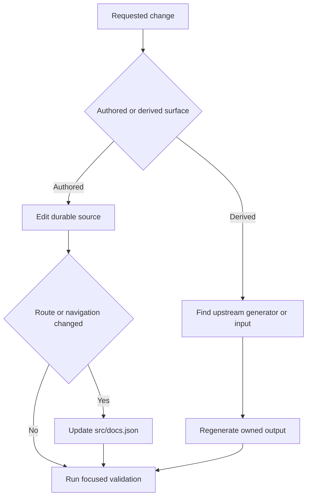

# Repository Wiki Quickstart

This repository builds the Mintlify site [docs.langchain.com](https://docs.langchain.com) from authored inputs under `src/`. Begin with the durable owner, not the rendered result. `build/`, preview branches, deployment-created endpoint pages, and other generated views are inspection or deployment artifacts, not authoring surfaces. The generated SDK reference at [reference.langchain.com](https://reference.langchain.com) is built outside this repository; use the repository's reference-documentation issue template for defects there.

## Route the change

| Change concerns | Durable owner | Start with |
| --- | --- | --- |
| Page prose, frontmatter, images, reusable MDX, or an authored example | Manual content below `src/`: usually `src/oss/`, `src/langsmith/`, `src/snippets/`, or `src/code-samples/` | [Adding and moving pages](/openwiki/operations/adding-pages.md), then focused prose or sample validation |
| Navigation, redirects, site settings, or an OpenAPI declaration | `src/docs.json` or the owning specification/refresh workflow | [Versioning and navigation](/openwiki/concepts/versioning.md) and [Mintlify integration](/openwiki/integrations/mintlify.md) |
| Build, preprocessing, route selection, or watcher behavior | `pipeline/` and its focused tests | [Build system](/openwiki/architecture/build-system.md), then the owning `tests/unit_tests/test_*.py` |
| Provider overview or another generated file | Its metadata and generator, not the output | [Testing overview](/openwiki/testing/test-overview.md); regenerate and inspect the diff |
| Runnable sample or display snippet | Program in `src/code-samples/`; extraction outputs are derived | [Code sample lifecycle](/openwiki/workflows/code-sample-lifecycle.md), then `make test-code-samples` and `make code-snippets` |
| Workflow, CI gate, preview, scheduled writer, or secret-bearing integration | `.github/workflows/`, invoked command, and focused checks together | [GitHub Actions integration](/openwiki/integrations/github-actions.md) |
| Local edit, build, preview, or command selection | `Makefile`, `pipeline`, and source content | [Local development](/openwiki/workflows/local-development.md) and [CLI tools](/openwiki/operations/cli-tools.md) |
| OpenWiki documentation update | `openwiki/` page and its evidence-backed claims | This page's route map; the scheduled updater opens a PR for `openwiki/` changes |

This flow separates authored inputs from derived artifacts before validation begins.

## Keep the ownership boundaries straight

`src/` is the manually authored documentation and site-configuration boundary. `src/docs.json` is the Mintlify navigation and site-configuration source of truth; add a page there when adding it to the site. Source directory and navigation are related but not identical: lifecycle menus can combine OSS and LangSmith content, so locate ownership by source path before choosing a menu. Shared OSS content normally emits Python and JavaScript routes; OpenWiki and Deep Agents Code are deliberate unversioned exceptions.

`pipeline/` is the Python build system and preprocessing layer. It reconstructs `build/`, rather than accepting edits made there: `DocumentationBuilder` clears the tree and emits Python and JavaScript OSS variants, unversioned OpenWiki and Deep Agents Code content, LangSmith content, Managed Deep Agents variants, and shared files. Read [Build and preprocessing architecture](/openwiki/architecture/build-system.md) for route families, preprocessing order, watcher limits, and failure boundaries.

`scripts/` owns focused generators and checks; `tests/` owns deterministic pipeline and tooling tests. A generated file still has an upstream owner. In particular, CI regenerates `src/oss/python/integrations/providers/overview.mdx` from `packages.yml` and `pipeline/tools/partner_pkg_table.py` and rejects drift. Likewise, `src/code-samples/` contains runnable programs, while `src/code-samples-generated/` and `src/snippets/code-samples/` are produced by extraction and MDX-generation scripts. Mintlify creates Agent Server, Control Plane, and LangSmith REST endpoint pages at deployment time, so those endpoint pages are absent from local `build/` output.

`AGENTS.md` is the repository-wide authoring contract: descriptions in frontmatter contain no Markdown, new pages need `src/docs.json` navigation, icons are Tabler icons, and examples must be tested. Task-specific procedures live in `.agents/skills/`; `make skills` links that tree into `.claude/skills/` for Claude Code. Changes to scripts, workflows, Make targets, PR checks, scheduled jobs, or skills also require the `docs-tooling-notion` documentation follow-up before handoff.

## Choose the smallest meaningful check

Use the check that proves the changed contract; a broad build does not replace a focused test, and a source-only check does not prove rendered routes.

| Changed boundary | First check | What it proves |
| --- | --- | --- |
| Python pipeline, parser, builder, or generator | Owning unit test, then `make test` | Deterministic transformation behavior; `make test` runs pytest with network sockets disabled except Unix sockets |
| Authored prose | `make lint_prose FILES="src/path/to/page.mdx"` | Vale prose style, not facts or route rendering |
| Shared `@[reference]` content | `make check-cross-refs` | Source references resolve in their applicable language scope |
| Navigation, redirects, links, anchors, or MDX components | `make broken-links-with-anchors` and, when needed, `make check-mdx` | Built routes, redirects, anchors, and component/syntax validity |
| Agent Server OpenAPI input | `make check-openapi` | The built specification passes Mint's OpenAPI check |
| Runnable sample or snippet markers | Execute the selected sample, then `make code-snippets` | The durable program runs and derived snippet output is refreshed |
| Package `>=` or `==` claim | `uv run python scripts/check_version_claims.py --files src/path/to/page.mdx` | The named release exists in its routed registry |

Core CI runs on pushes to `main`, pull requests, and manual dispatch. It invokes reusable test, lint, and link checks, and separately checks merge-conflict markers, source cross-references, integration documentation URL schemes, and provider-overview drift. Credentialed sample runs and write-capable automation may be unavailable for fork pull requests. See [Testing and validation overview](/openwiki/testing/test-overview.md) for the full boundary map.

## Operational boundaries

Use `make install`, `make build`, and `make dev` for the normal local loop; the latter builds, watches `src/`, and serves `build/` through Mintlify. Use a full build after navigation, deletion, package, shared-file, or cross-file changes because incremental watching does not reconstruct every route or overlay. The [CLI tools](/openwiki/operations/cli-tools.md) page owns command contracts; [Local development](/openwiki/workflows/local-development.md) owns the edit-to-preview sequence.

Mintlify preview creation is write-capable only for same-repository pull requests or manual dispatch. It builds documentation, pushes a deterministic `preview-` branch containing `build/`, and cleanup refuses to delete a branch without that prefix. Treat the branch as deployment output, not source. The OpenWiki update workflow runs on a weekly schedule or manual dispatch, uses full git history, runs `openwiki code --update --print`, and opens an update PR containing `openwiki/`, `AGENTS.md`, and the updater workflow.

## Continue by domain

- [Build and preprocessing architecture](/openwiki/architecture/build-system.md): pipeline control flow, route families, preprocessing, incremental limits, and failure semantics.
- [Repository source map](/openwiki/architecture/source-map.md): ownership across Mintlify content, pipeline, scripts, samples, tests, metadata, and external services.
- [Versioning and navigation](/openwiki/concepts/versioning.md): language/version route selection, redirects, lifecycle menus, and unversioned exceptions.
- [Adding and moving pages](/openwiki/operations/adding-pages.md): source placement, frontmatter, navigation, redirects, snippets, and page verification.
- [Agent skills and review boundaries](/openwiki/operations/agent-skills.md): skill discovery, Claude links, and trusted authoring procedures.
- [GitHub Actions integration](/openwiki/integrations/github-actions.md): CI, permissions, secrets, previews, scheduled writers, and publication boundaries.
- [Mintlify integration](/openwiki/integrations/mintlify.md): authored source, `docs.json`, build/export output, redirects, and link validation.
- [Reference documentation integration](/openwiki/integrations/reference-docs.md): external API reference, OpenAPI sources, and link-map boundaries.
- [Testing and validation overview](/openwiki/testing/test-overview.md): unit, static, generated-site, sample, and CI-only checks.
- [Local documentation development](/openwiki/workflows/local-development.md): supported install, build, watch, preview, and handoff loop.
- [Code sample lifecycle](/openwiki/workflows/code-sample-lifecycle.md): execution, tracing, extraction, and generated MDX.
