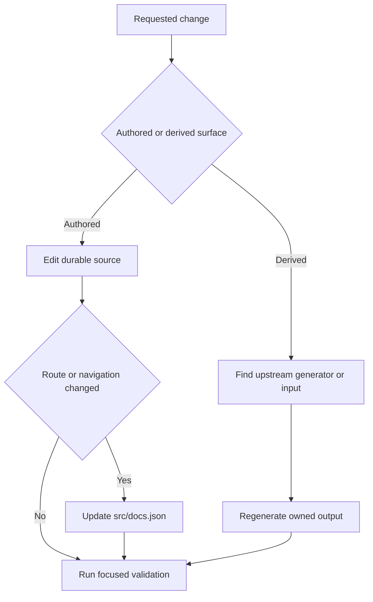

# Repository Wiki Quickstart

This repository builds the Mintlify site [docs.langchain.com](https://docs.langchain.com) from authored inputs under `src/`. Begin with the durable owner, not the rendered result. `build/`, preview branches, deployment-created endpoint pages, and other generated views are inspection or deployment artifacts, not authoring surfaces. The generated SDK reference at [reference.langchain.com](https://reference.langchain.com) is built outside this repository; use the repository's reference-documentation issue template for defects there.

## Route the change

| Change concerns | Durable owner | Start with |
| --- | --- | --- |
| Page prose, frontmatter, images, reusable MDX, or an authored example | Manual content below `src/`: usually `src/oss/`, `src/langsmith/`, `src/snippets/`, or `src/code-samples/` | [Adding and moving pages](/openwiki/operations/adding-pages.md), then focused prose or sample validation |
| Navigation, redirects, site settings, or an OpenAPI declaration | `src/docs.json` or the owning specification/refresh workflow | [Versioning and navigation](/openwiki/concepts/versioning.md) and [Mintlify integration](/openwiki/integrations/mintlify.md) |
| Build, preprocessing, route selection, or watcher behavior | `pipeline/` and its focused tests | [Build and preprocessing architecture](/openwiki/architecture/build-system.md), then [builder tests](/openwiki/testing/builder-tests.md) |
| Provider overview or another generated file | Its metadata and generator, not the output | [Testing and validation overview](/openwiki/testing/test-overview.md); regenerate and inspect the diff |
| Runnable sample or display snippet | Program in `src/code-samples/`; extraction outputs are derived | [Code sample lifecycle](/openwiki/workflows/code-sample-lifecycle.md), then `make test-code-samples` and `make code-snippets` |
| Workflow, CI gate, preview, scheduled writer, or secret-bearing integration | `.github/workflows/`, invoked command, and focused checks together | [GitHub Actions integration](/openwiki/integrations/github-actions.md) |
| Release coverage, evidence research, or documentation handoff | `docs-release-watch/` registry, product skill, schedule, and guarded delivery tools | [Release-watch workflow](/openwiki/workflows/release-watch.md) |
| Local edit, build, preview, or command selection | `Makefile`, `pipeline`, and source content | [Local development](/openwiki/workflows/local-development.md) and [CLI tools](/openwiki/operations/cli-tools.md) |
| Cross-reference or package-version assertion | Reference maps and version-check tooling | [Cross-reference resolution](/openwiki/operations/cross-references.md) or [version claim validation](/openwiki/operations/version-claims.md) |
| OpenWiki documentation update | `openwiki/` page and its evidence-backed claims | This page's route map; keep it current when wiki pages are added, removed, moved, or materially regrouped |

This flow separates authored inputs from derived artifacts before validation begins.

## Keep the ownership boundaries straight

`src/` is the manually authored documentation and site-configuration boundary. `src/docs.json` is the Mintlify navigation and site-configuration source of truth; add a page there when adding it to the site. Source directory and navigation are related but not identical: lifecycle menus can combine OSS and LangSmith content, so locate ownership by source path before choosing a menu. Shared OSS content normally emits Python and JavaScript routes; OpenWiki and Deep Agents Code are deliberate unversioned exceptions.

`pipeline/` is the Python build system and preprocessing layer. It reconstructs `build/`, rather than accepting edits made there: `DocumentationBuilder` clears the tree and emits Python and JavaScript OSS variants, unversioned OpenWiki and Deep Agents Code content, LangSmith content, Managed Deep Agents variants, shared files, and npm snippet components. Read [Build and preprocessing architecture](/openwiki/architecture/build-system.md) for route families, preprocessing order, watcher limits, and failure boundaries.

`scripts/` owns focused generators and checks; `tests/` owns deterministic pipeline and tooling tests. A generated file still has an upstream owner. In particular, CI regenerates `src/oss/python/integrations/providers/overview.mdx` from `packages.yml` and `pipeline/tools/partner_pkg_table.py` and rejects drift. Likewise, `src/code-samples/` contains runnable programs, while `src/code-samples-generated/` and `src/snippets/code-samples/` are produced by extraction and MDX-generation scripts. Mintlify creates Agent Server, Control Plane, and LangSmith REST endpoint pages at deployment time, so those endpoint pages are absent from local `build/` output.

`docs-release-watch/` is a separately deployed Managed Deep Agent, not part of the Mintlify build. Its registry and product skills define release coverage; its research phase gathers source and release evidence, while guarded write tools prepare one Linear issue and one draft documentation PR per evidenced feature. It does not merge or publish docs. The resulting same-repository PR is labeled `release-watch-agent`; `sync-linear-issue-from-pr.yml` uses that label and the PR's `Closes DOC-N` link to synchronize Linear lifecycle state.

`AGENTS.md` is the repository-wide authoring contract: descriptions in frontmatter contain no Markdown, new pages need `src/docs.json` navigation, icons are Tabler icons, and examples must be tested. Task-specific procedures live in `.agents/skills/`; `make skills` links that tree into `.claude/skills/` for Claude Code. Changes to scripts, workflows, Make targets, PR checks, scheduled jobs, or skills also require the `docs-tooling-notion` documentation follow-up before handoff.

## Choose the smallest meaningful check

Use the check that proves the changed contract; a broad build does not replace a focused test, and a source-only check does not prove rendered routes.

| Changed boundary | First check | What it proves |
| --- | --- | --- |
| Python pipeline, parser, builder, or generator | Owning unit test, then `make test` | Deterministic transformation behavior; `make test` runs pytest with network sockets disabled except Unix sockets |
| Authored prose | `make lint_prose FILES="src/path/to/page.mdx"` | Vale prose style, not facts or route rendering |
| Shared `@[reference]` content | `make check-cross-refs` | Source references resolve in their applicable language scope |
| Navigation, redirects, links, anchors, or MDX components | `make broken-links-with-anchors` and, when needed, `make check-mdx` | Built routes, redirects, anchors, and component/syntax validity |
| Agent Server OpenAPI input | `make check-openapi` | The built specification passes Mint's OpenAPI check |
| Runnable sample or snippet markers | Execute the selected sample, then `make code-snippets` | The durable program runs and derived snippet output is refreshed |
| Package `>=` or `==` claim | `uv run python scripts/check_version_claims.py --files src/path/to/page.mdx` | The named release exists in its routed registry |
| Release-watch evidence or edit logic | `uv run pytest docs-release-watch/tests/test_evidence.py` | Evidence shape, source matching, safe edits, stale-base handling, and failure-section behavior |

`make code-snippets` first extracts Bluehawk-compatible markers from `src/code-samples/` and then generates imported MDX. `generate_code_snippet_mdx.py` can expand Deep Agents Python and TypeScript snippets into provider `CodeGroup` tabs, while preserving provider-specific embedding and chat model arguments; do not hand-edit either generated tree. `make test-code-samples` supports `FILES`, `CODE_SAMPLE_PATHS`, and concurrent `CODE_SAMPLE_JOBS` (default 4); samples sharing a LangSmith fixture remain serialized.

Core CI runs on pushes to `main`, pull requests, and manual dispatch. It invokes reusable test, lint, and link checks, and separately checks merge-conflict markers, source cross-references, integration documentation URL schemes, and provider-overview drift. See [Testing and validation overview](/openwiki/testing/test-overview.md) for the full boundary map and [GitHub Actions integration](/openwiki/integrations/github-actions.md) for permissions and fork/secret boundaries.

## Operational boundaries

Use `make install`, `make build`, and `make dev` for the normal local loop; the latter builds, watches `src/`, and serves `build/` through Mintlify. The Python `docs` CLI is installed by `uv sync` from the `docs = "pipeline.cli:main"` entry point; Mintlify's separate `mint` CLI performs local link, export, and validation commands. Use a full build after navigation, deletion, package, shared-file, or cross-file changes because incremental watching does not reconstruct every route or overlay. The [CLI tools](/openwiki/operations/cli-tools.md) page owns command contracts; [Local development](/openwiki/workflows/local-development.md) owns the edit-to-preview sequence.

Mintlify preview creation is write-capable only for same-repository pull requests or manual dispatch. It builds documentation, pushes a deterministic `preview-` branch containing `build/`, and cleanup refuses to delete a branch without that prefix. Treat the branch as deployment output, not source.

## Continue by domain

### Architecture and concepts

- [Build and preprocessing architecture](/openwiki/architecture/build-system.md): pipeline control flow, route families, preprocessing, incremental limits, and failure semantics.
- [Repository source map](/openwiki/architecture/source-map.md): ownership across Mintlify content, pipeline, scripts, samples, tests, metadata, release-watch, and external services.
- [Documentation preprocessing](/openwiki/concepts/preprocessing.md): autolinks, snippets, language-specific links, frontmatter, and generated content.
- [Versioning and navigation](/openwiki/concepts/versioning.md): language/version route selection, redirects, lifecycle menus, and unversioned exceptions.

### Integrations and operations

- [GitHub Actions integration](/openwiki/integrations/github-actions.md): CI, permissions, secrets, previews, scheduled writers, and publication boundaries.
- [Mintlify integration](/openwiki/integrations/mintlify.md): authored source, `docs.json`, build/export output, redirects, and link validation.
- [NPM snippet components](/openwiki/integrations/npm-snippets.md): package-owned components, installation, and build copying.
- [Reference documentation integration](/openwiki/integrations/reference-docs.md): external API reference, OpenAPI sources, and link-map boundaries.
- [Adding and moving pages](/openwiki/operations/adding-pages.md): source placement, frontmatter, navigation, redirects, snippets, and page verification.
- [Agent skills and authoring rules](/openwiki/operations/agent-skills.md): skill discovery, mirrored instructions, Claude links, and tooling follow-up.
- [CLI tools and Make targets](/openwiki/operations/cli-tools.md): `docs`, `mint`, build, sample, and validation command contracts.
- [Cross-reference resolution](/openwiki/operations/cross-references.md): reference ownership, scope selection, preprocessing, and checks.
- [Version claim validation](/openwiki/operations/version-claims.md): registry routing, release checks, and unavailable-registry behavior.

### Testing and workflows

- [Builder tests](/openwiki/testing/builder-tests.md): focused builder invariants and malformed-configuration fallbacks.
- [Conditional rendering tests](/openwiki/testing/conditional-rendering.md): Python/JavaScript fences and route-specific output.
- [Testing and validation overview](/openwiki/testing/test-overview.md): unit, static, generated-site, sample, release-watch, and CI-only checks.
- [Code sample lifecycle](/openwiki/workflows/code-sample-lifecycle.md): execution, tracing, extraction, and generated MDX.
- [Egress IP inventory workflow](/openwiki/workflows/egress-ip-inventory.md): inventory, generated tables, drift checks, and safe regeneration.
- [Integration listing automation](/openwiki/workflows/integration-listing-automation.md): guarded issue-to-listing automation and contributor policy.
- [LangSmith agent documentation workflow](/openwiki/workflows/langsmith-agent-documentation.md): agent environments, managed deployments, and tracing endpoints.
- [LangSmith OpenAPI refresh](/openwiki/workflows/langsmith-openapi-refresh.md): committed specs, scheduled refreshes, filtering, and validation.
- [Local documentation development](/openwiki/workflows/local-development.md): install, build, watch, preview, and handoff loop.
- [Release-watch workflow](/openwiki/workflows/release-watch.md): release eligibility, evidence-first research, guarded handoff, recovery, and Linear synchronization.
- [Versioned content workflow](/openwiki/workflows/versioned-content.md): adding, moving, and retiring language-versioned content.
