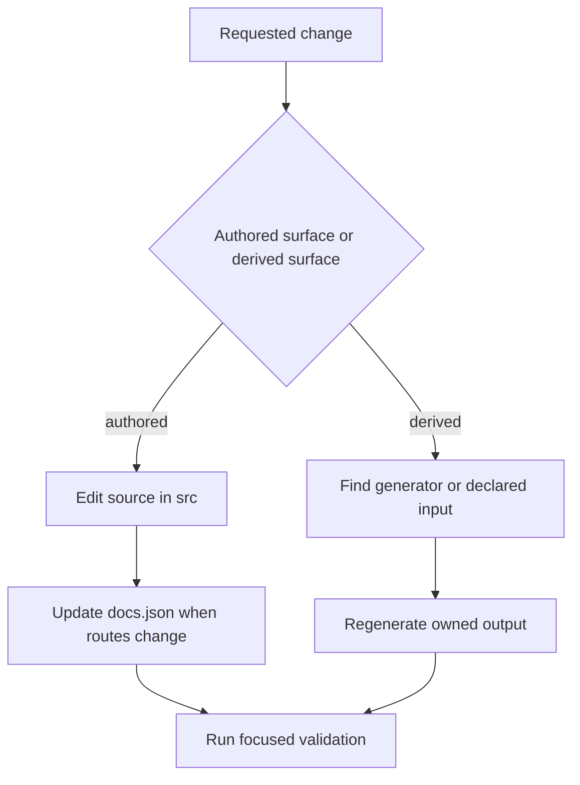

# Repository Wiki Quickstart

This repository builds the Mintlify site at [docs.langchain.com](https://docs.langchain.com) from authored `src/` content. Start with the durable input, not a visible route: `build/`, deployment-generated endpoint pages, extracted snippets, and generated tables are outputs with separate owners. The generated SDK reference at `reference.langchain.com` is built outside this repository.

## Route the task

| Change request | Start with | Follow the owning guide |
| --- | --- | --- |
| Add, move, retire, or revise an authored page, image, frontmatter, navigation item, or redirect | The applicable `src/` file and `src/docs.json` | [Adding and Moving Documentation Pages](/openwiki/operations/adding-pages.md) |
| Decide an OSS, LangSmith, OpenWiki, Deep Agents Code, or Managed Deep Agents route | The source family and matching navigation entry | [Documentation Routes and Language Versioning](/openwiki/concepts/versioning.md) |
| Change build behavior, a preprocessor, generated output, or local watch behavior | `pipeline/` and the invoking Make target | [Repository Source Map](/openwiki/architecture/source-map.md) |
| Change a runnable example, code extract, trace link, or sample CI behavior | `src/code-samples/` and its consumer page | [Runnable Code Samples and Snippet Generation](/openwiki/workflows/code-sample-lifecycle.md) |
| Change a GitHub workflow, scheduled job, preview, publication path, secret-bearing job, or CI check | `.github/workflows/` and the command it invokes | [GitHub Actions and CI Automation](/openwiki/integrations/github-actions.md) |
| State or revise a package version in authored MDX | The page under `src/` and the claimed package's published release | [Published Package Version Claims](/openwiki/operations/version-claims.md) |
| Change OpenAPI input or endpoint reference behavior | The declared `src/docs.json` OpenAPI source and its refresh process | [Reference Documentation Boundaries](/openwiki/integrations/reference-docs.md) |
| Report generated SDK API-reference content | The reference-documentation issue template | This repository routes reports but does not build `reference.langchain.com`. |

`AGENTS.md` is the always-on authoring contract. It requires authors to use manually authored `src/` content, keep frontmatter descriptions free of Markdown, use Tabler icons, add new pages to `src/docs.json`, and test examples. Task-specific procedures belong in `.agents/skills/`; use the matching skill rather than copying its workflow into a general edit. Claude Code users run `make skills` once per worktree to link those skills into `.claude/skills/`. Any change to scripts, workflows, Make targets, PR checks, scheduled jobs, or skills also requires the `docs-tooling-notion` follow-up before PR handoff.

## Choose the owner before changing output

*Every change begins at a durable owner; build and generated files are reviewed as evidence, not patched as source.*

| Surface | Durable owner and safe action |
| --- | --- |
| Page prose, assets, reusable MDX, or site styling | Edit the appropriate location under `src/`. Reader-facing navigation may use different product labels than source directories. |
| Navigation, site settings, redirects, and OpenAPI declarations | Update `src/docs.json`. Adding a page does not make it discoverable until navigation is updated. |
| Shared OSS documentation | Use its source under `src/oss/`; most OSS documentation emits Python and JavaScript route variants. Route selection is coupled to `src/docs.json` navigation. |
| OpenWiki or Deep Agents Code | Use `src/oss/openwiki/` or `src/oss/deepagents/code/`; these are unversioned OSS output exceptions. |
| LangSmith or Managed Deep Agents documentation | Use the owning `src/langsmith/` page. Ordinary LangSmith content is unversioned; Managed Deep Agents has its dedicated language-variant behavior. |
| Build tree | Do not edit `build/`. A full `DocumentationBuilder` build clears and recreates it from source, pipeline transformations, and shared files. |

For shared OSS `@[ref]` references, an unfenced reference must resolve in both Python and JavaScript scopes. Put an API name that exists in only one scope inside `:::python` or `:::js`, then use `make check-cross-refs`.

## Generated and hosted boundaries

When a visible file is derived, change its owner and regenerate it instead.

| Encountered surface | Change instead | Follow-through |
| --- | --- | --- |
| `build/` | Authored source, `src/docs.json`, or `pipeline/` | Run `make build`, a focused preview, or the affected check. |
| `src/code-samples-generated/` | Marked runnable source in `src/code-samples/` | Test the sample, then run `make code-snippets`. |
| `src/snippets/code-samples/` | The marked runnable sample | Regenerate and review the committed MDX output. |
| `src/oss/python/integrations/providers/overview.mdx` | `packages.yml` or `pipeline/tools/partner_pkg_table.py` | Run `uv run python pipeline/tools/partner_pkg_table.py`; CI rejects drift. |
| Agent Server, Control Plane, or LangSmith REST endpoint pages | Their `src/docs.json` declaration and committed or remote OpenAPI source | Mintlify creates endpoint pages at deployment time, so they are absent from local `build/`. |
| `reference.langchain.com` API pages | The external reference-documentation process | File the repository's reference-docs issue when reporting a problem. |

Runnable samples are source, not display-only fixtures. `make test-code-samples` executes programs under `src/code-samples/`; `make code-snippets` extracts marked regions into the ignored intermediate and generates imported MDX under `src/snippets/code-samples/`. Make the program correct first, execute it, then regenerate its display fragments. The scheduled or manually dispatched sample workflow runs all samples with tracing, while same-repository pull requests run changed supported samples; fork PRs are skipped because some samples need secrets. Public trace/snippet refresh is guarded and proposed through its review PR.

## Develop and validate at the changed boundary

Python 3.13 or later is required. Run `make install` to synchronize all Python dependency groups, install project npm dependencies and the global Mintlify CLI, and link Claude Code skills. `make dev` initially builds unless `--skip-build` is supplied, watches `src/`, and starts `mint dev --port 3000` from `build/`; it stops rather than serving stale output when the initial build fails.

| Changed contract | Proportionate first check |
| --- | --- |
| Focused prose | `make lint_prose FILES="src/path/to/page.mdx"` |
| Navigation, redirects, routes, links, or anchors | `make broken-links-with-anchors` |
| Shared or conditional `@[ref]` reference | `make check-cross-refs` |
| Package version stated in changed MDX | `uv run python scripts/check_version_claims.py --files src/path/to/page.mdx` |
| Pipeline, generator, or CLI behavior | Focused `make test TEST_FILE=tests/unit_tests/...`, then `make lint` as applicable |
| Runnable sample or extraction marker | `make test-code-samples FILES="src/code-samples/..."`, then `make code-snippets` |
| Agent Server OpenAPI input | `make check-openapi` |
| Provider overview or external integration URL input | Run its owning generator or URL check from the relevant workflow guide |

`make test` runs pytest against `tests/unit_tests` with network sockets disabled except Unix sockets. Core CI runs on pushes to `main`, pull requests, and manual dispatch. It invokes test, lint, and link gates, and separately checks merge-conflict markers, cross-references, external integration documentation URL schemes, and generated provider-overview drift. The separate pull-request version-claims gate checks changed `src/**/*.mdx` files for package releases that exist on PyPI or npm; it verifies publication, not whether a floor is the right feature requirement. Local focused checks provide fast feedback; run generated-site checks when a change can affect emitted routes, imports, redirects, or anchors, and rely on CI for credentialed sample behavior.

## Continue by domain

- [Repository Source Map](/openwiki/architecture/source-map.md): durable source owners, deployment boundaries, and generated inputs.
- [Adding and Moving Documentation Pages](/openwiki/operations/adding-pages.md): page lifecycle, navigation, redirects, and focused checks.
- [Published Package Version Claims](/openwiki/operations/version-claims.md): package-version ownership, registry checks, and the changed-page pull-request gate.
- [Testing Overview](/openwiki/testing/test-overview.md): what local, generated-site, and CI-only validation proves.
- [Runnable Code Samples and Snippet Generation](/openwiki/workflows/code-sample-lifecycle.md): markers, runners, generated snippets, traces, and CI operations.
- [GitHub Actions and CI Automation](/openwiki/integrations/github-actions.md): workflow authority, secrets boundaries, scheduled writers, previews, and publication.
- [Documentation Routes and Language Versioning](/openwiki/concepts/versioning.md): source-family selection, conditionals, link rewriting, and route variants.
