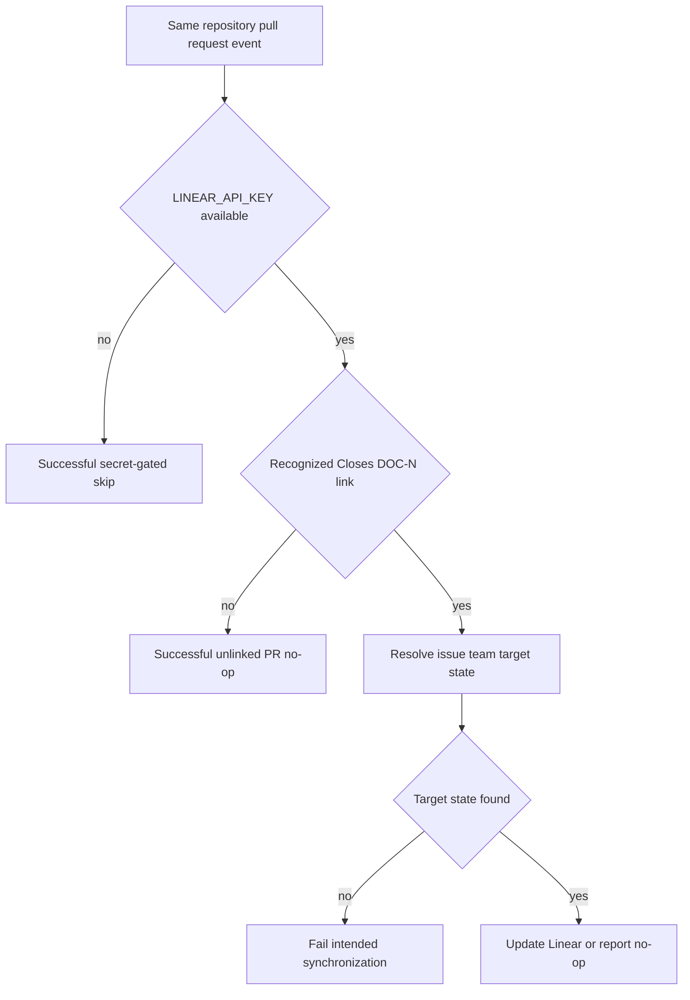

# Repository Wiki Quickstart

This repository builds the Mintlify documentation site at [docs.langchain.com](https://docs.langchain.com). It does **not** build the generated SDK reference at [reference.langchain.com](https://reference.langchain.com/python/). Start with the durable input: a rendered page, sidebar item, endpoint page, provider table, or file in `build/` can be an outcome rather than the file to edit.

## First: identify the owner

Read `AGENTS.md` before changing authored documentation. It applies to manually authored `src/` content: use Markdown-free frontmatter descriptions and Tabler icons, update `src/docs.json` for a new page, test examples, and never edit `build/`. Repository-wide rules live in `AGENTS.md`; task procedures live in `.agents/skills/`. Run `make skills` in each Claude Code worktree to link those procedures into `.claude/skills/`.

| If the request is about... | Edit or operate on... | Do not edit or assume... | Read next |
| --- | --- | --- | --- |
| LangSmith prose, assets, or reusable LangSmith fragments | `src/langsmith/`, `src/snippets/langsmith/`, and, when needed, `src/docs.json` | A sidebar label identifies a source directory | [Repository Source Map](/openwiki/architecture/source-map.md) |
| OSS prose, shared material, integrations, or product pages | The applicable `src/oss/` or `src/snippets/` source subtree | All OSS routes are one language family | [Repository Source Map](/openwiki/architecture/source-map.md) |
| A new, moved, renamed, or retired page | Source MDX, `src/docs.json`, and redirects as applicable | The builder automatically puts a page in navigation | [Adding and Moving Documentation Pages](/openwiki/operations/adding-pages.md) |
| Build behavior, preprocessing, local commands, or a helper | `pipeline/`, `scripts/`, or `Makefile`, with focused tests | The generated site is the implementation | [Local Tooling and Commands](/openwiki/operations/cli-tools.md) |
| A runnable example or displayed code extract | Executable source in `src/code-samples/` | `src/code-samples-generated/` or rendered snippet MDX is authored input | [Code Sample Lifecycle](/openwiki/workflows/code-sample-lifecycle.md) |
| Provider listings, integration downloads, or external rows | `packages.yml`, hosted `integration:` frontmatter, or `scripts/data/integration_external_docs.yaml` | A generated provider overview or download-table row is the owner | [Integration Listing Automation](/openwiki/workflows/integration-listing-automation.md) |
| A LangSmith REST endpoint reference or its input | The platform processor, specification input, and its refresh workflow | Mintlify deployment-generated endpoint MDX exists locally | [LangSmith OpenAPI Refresh](/openwiki/workflows/langsmith-openapi-refresh.md) |
| Agent Server OpenAPI | Its separate committed specification/update path and `src/docs.json` declaration | The daily LangSmith platform refresh updates it | [LangSmith OpenAPI Refresh](/openwiki/workflows/langsmith-openapi-refresh.md) |
| CI, a scheduled job, or PR-to-Linear lifecycle behavior | `.github/workflows/` and the invoked script | A workflow writer is part of the documentation build | [GitHub Actions and CI Automation](/openwiki/integrations/github-actions.md) |
| Release-driven documentation proposals | `docs-release-watch/`, its registry, skills, tools, schedules, and deployment | The Managed Deep Agent publishes or merges docs | [Documentation Release Watch](/openwiki/workflows/release-watch.md) |
| An SDK reference defect | The external reference-documentation process | This repository has a reference-site build directory | [Reference documentation issue template](https://github.com/langchain-ai/docs/issues/new?template=04-reference-docs.yml) |

Changes to scripts, workflows, Make targets, PR checks, scheduled jobs, or skills require the `docs-tooling-notion` follow-up before pull-request handoff.

## Authored documentation versus emitted routes

`src/docs.json` is the Mintlify navigation and site-configuration source of truth, but navigation is not source ownership. The builder clears and recreates `build/`, emits Python and JavaScript OSS variants, keeps OpenWiki and Deep Agents Code unversioned, emits ordinary LangSmith content unversioned, and emits Managed Deep Agents files in language-prefixed variants. In particular, **Build** mixes OSS and LangSmith material, **No-code agents** means Fleet, and **Deep Agents Code** is a Products and setup item. Locate the source by directory, not the menu label.

For a shared OSS `@[ref]`, an unfenced reference must resolve in both Python and JavaScript scopes. Put language-only API names inside `:::python` or `:::js` blocks, then run `make check-cross-refs`.

| Derived or externally controlled surface | Change instead | Required follow-through |
| --- | --- | --- |
| `build/` | Authored `src/`, configuration, or pipeline input | Rebuild; a full build deletes manual output edits. |
| `src/oss/python/integrations/providers/overview.mdx` | `packages.yml` or `pipeline/tools/partner_pkg_table.py` | Run `uv run python pipeline/tools/partner_pkg_table.py`; CI rejects drift. |
| `src/code-samples-generated/` and `src/snippets/code-samples/` | `src/code-samples/` | Test source, run `make code-snippets`, and review MDX. |
| Integration listing/download tables | Hosted frontmatter or `scripts/data/integration_external_docs.yaml` | Validate URLs, regenerate, and review the diff. |
| `src/langsmith/langsmith-platform-openapi.json` | `scripts/process_langsmith_openapi.py`, upstream contract, or refresh policy | Regenerate and review the standing refresh PR; do not patch JSON. |
| Mintlify endpoint pages | Their `src/docs.json` declaration and committed or remote OpenAPI input | Inspect a deployed preview; they are generated during deployment, not local build output. |
| `reference.langchain.com` | Its external build and issue-routing process | Do not look for a local generator or output. |

The daily platform refresh processes the LangSmith service specification, filtering fleet and internal endpoints for public documentation and reusing one `chore/refresh-langsmith-openapi` PR. This is separate from the committed Agent Server specification and from the externally generated SDK reference.

## Set up, preview, and validate

The project requires Python 3.13 or later. From the repository root:

```bash
git clone https://github.com/langchain-ai/docs.git
cd docs
make install
make dev
```

`make install` synchronizes Python dependency groups, installs project npm dependencies and the global Mintlify CLI, and links skills. `make dev` builds unless `--skip-build` is supplied, watches `src/`, and starts `mint dev --port 3000` from `build/`; it stops if the initial build fails. Open <http://localhost:3000> after startup.

The installed `docs` console script is the pipeline entrypoint behind the usual Make wrappers; it provides development, build, move-with-link-update, and migration commands. `mint` is the distinct Mintlify CLI used against generated `build/` content. See [Local Tooling and Commands](/openwiki/operations/cli-tools.md) for operating details.

Choose the narrowest check that proves the changed contract, then add a build or rendered-route check when the change crosses that boundary.

| Change boundary | Start with | What it proves |
| --- | --- | --- |
| Pipeline, generator, preprocessor, helper, or CLI code | `make test TEST_FILE=tests/unit_tests/path_or_test.py` | Focused pytest behavior; sockets are disabled except Unix sockets. |
| General tooling | `make test`; add `make lint` for tooling changes | Unit tests and formatting, lint, type, and spelling checks. |
| Shared or conditional `@[ref]` source | `make check-cross-refs` | Resolution in every applicable source scope. |
| Authored prose | `make lint_prose FILES="src/path/to/page.mdx"` | Selected Vale rules. |
| Route, redirect, link, or anchor | `make broken-links-with-anchors` | Builds first, then validates links, anchors, and redirect destinations. |
| Agent Server OpenAPI input | `make check-openapi` | Mintlify validation of the built Agent Server input. |
| Runnable sample and displayed extract | `make test-code-samples FILES="src/code-samples/..."` then `make code-snippets` | Source execution before snippet refresh. |

Core CI runs on pull requests, pushes to `main`, and manual dispatch. It invokes reusable test, lint, and link checks and separately detects merge-conflict markers, source cross-reference failures, unsafe external integration documentation URLs, and generated provider-overview drift.

## Automation boundaries

Integration discovery merges hosted-guide `integration:` frontmatter with third-party records in `scripts/data/integration_external_docs.yaml`. Use `uv run python scripts/refresh_integration_downloads.py --check-docs-urls` before regeneration. The weekly repository-health workflow scans third-party `packages.yml` GitHub links and opens or appends to one draft PR only when it changes files. It can repair confirmed third-party GitHub renames or permanent external-doc redirects, leaves live GitLab or partner-documentation alternatives for attention, and delists only when no live VCS or partner-docs alternative remains.

`docs-release-watch` is a separately deployed Managed Deep Agent. For the newest eligible release published 7–30 days earlier, it researches product source and current docs, then may create one Linear `DOC` issue and one **draft** documentation PR for each untracked user-facing feature. Its deployment-shared memory is untrusted procedural input and stores tracking URLs rather than credentials; tools hold authority and human review remains the publication boundary.

<!-- openwiki: broken internal link [<issue url>] file "<issue url>" does not exist. Fix the href or restore the target, then delete this comment. -->
A release-watch PR normally includes `Closes [DOC-N](<issue url>)`. That link is a handoff contract, not an agent-side polling loop: the repository's PR workflow observes same-repository PR lifecycle events and may update the linked Linear issue.



*The PR-to-Linear bridge is separate operational automation: only a same-repository PR with the secret and the closing-link convention can cross into Linear.*

The workflow has read-only GitHub permissions and excludes forks so fork runs never receive `LINEAR_API_KEY`. An absent secret, unlinked PR, or already-correct target is a successful no-op. It maps draft, ready-for-review, merged, and unmerged-closed PRs to preferred **In Progress**, **In Review**, **Done**, and **Canceled** states, respectively, with Linear state-type fallbacks. If a linked issue's team has no matching state, or Linear lookup/update fails, the intended synchronization fails rather than silently reporting success. Preserve this gate, parser convention, and failure behavior when changing the workflow or script.

## Continue by domain

- [Repository Source Map](/openwiki/architecture/source-map.md): owners, emitted route families, generated surfaces, and handoff boundaries.
- [GitHub Actions and CI Automation](/openwiki/integrations/github-actions.md): event trust model, writers, schedules, and PR-to-Linear operation.
- [Local Tooling and Commands](/openwiki/operations/cli-tools.md): installation, pipeline versus Mintlify CLI, validation, and migrations.
- [Code Sample Lifecycle](/openwiki/workflows/code-sample-lifecycle.md): executable source, shared dependencies, extraction, rendering, and optional trace publication.
- [Integration Listing Automation](/openwiki/workflows/integration-listing-automation.md): metadata owners, URL safety, generators, and reviewed remediation.
- [LangSmith OpenAPI Refresh](/openwiki/workflows/langsmith-openapi-refresh.md): platform ingestion, public API policy, standing PR, and Agent Server distinction.
- [Documentation Release Watch](/openwiki/workflows/release-watch.md): evidence-gated research, draft handoffs, deployment, and Linear linkage.
