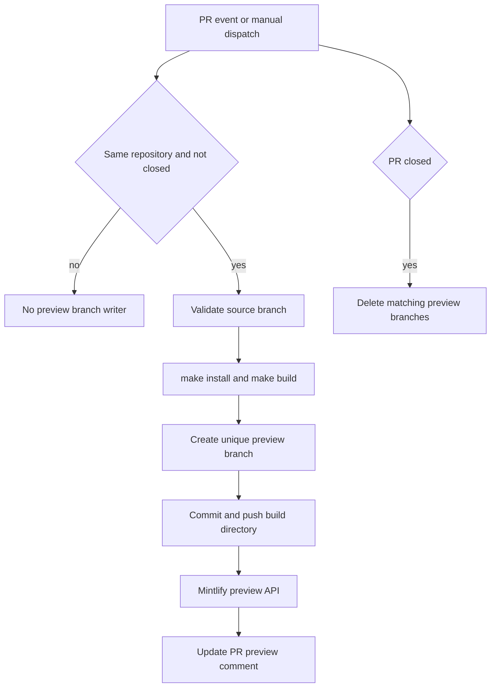

# Repository Wiki Quickstart

This repository owns the authored documentation and build pipeline for [docs.langchain.com](https://docs.langchain.com). Start with the durable input, not a rendered route: a sidebar entry, deployment-generated endpoint, generated table or snippet, preview branch, and file in `build/` may each be produced by another owner. The SDK reference at [reference.langchain.com](https://reference.langchain.com/python/) is generated outside this repository.

## Route the task

`AGENTS.md` is the repository-wide authoring contract. For manually authored `src/` content, keep frontmatter descriptions free of Markdown, use Tabler icons, test examples, update `src/docs.json` for new pages, and never edit `build/`. Task-specific procedures live in `.agents/skills/`; run `make skills` in each Claude Code worktree to link them into `.claude/skills/`. A change to a script, workflow, Make target, PR check, scheduled job, or skill also requires the `docs-tooling-notion` follow-up before PR handoff.

| If the request concerns | Change or inspect first | Then read |
| --- | --- | --- |
| Page prose, source assets, or a shared snippet | The applicable `src/` subtree | [Repository Source Map](/openwiki/architecture/source-map.md) |
| Navigation, redirects, site configuration, or OpenAPI declarations | `src/docs.json` | [Documentation Route and Language Versioning](/openwiki/concepts/versioning.md) |
| Which source family owns a navigation item | The source directory, not its sidebar label | [Repository Source Map](/openwiki/architecture/source-map.md) |
| Build transforms, routes, watcher behavior, or CLI commands | `pipeline/`, `scripts/`, and `Makefile` | [Documentation Build System](/openwiki/architecture/build-system.md) |
| Runnable sample or a displayed extracted fragment | `src/code-samples/` | [Testing and Validation Overview](/openwiki/testing/test-overview.md) |
| Provider overview or package metadata | `packages.yml` or `pipeline/tools/partner_pkg_table.py` | [Repository Source Map](/openwiki/architecture/source-map.md) |
| Hosted or external integration listing data | Hosted-guide `integration:` frontmatter or `scripts/data/integration_external_docs.yaml` | [Integration Listing Automation](/openwiki/workflows/integration-listing-automation.md) |
| CI, preview, or scheduled automation | `.github/workflows/` plus the invoked script or skill | [GitHub Actions and CI Automation](/openwiki/integrations/github-actions.md) |
| Hosted rendering or a Mintlify preview | Generated `build/` handoff and `create-preview-branch.yml` | [Mintlify Integration](/openwiki/integrations/mintlify.md) |
| SDK API-reference defect | The external reference-documentation issue path | [Mintlify Integration](/openwiki/integrations/mintlify.md) |

## Know the authored-source and navigation boundary

`src/docs.json` is the Mintlify navigation and site-configuration contract, but it does not determine who owns a page's source. `DocumentationBuilder` deletes and recreates `build/`, generating ordinary OSS content in Python and JavaScript variants, then emitting unversioned OpenWiki and Deep Agents Code content, unversioned LangSmith content, Managed Deep Agents language variants, and shared files. Do not edit `build/` or use a sidebar label as a source-location rule.

In particular, **Build** contains both OSS and LangSmith material, **No-code agents** is the navigation label for Fleet, and **Deep Agents Code** is a Products and setup item. Managed Deep Agents is authored in `src/langsmith/` even when it appears in language-specific Build navigation. For a safe navigation change, identify the source family and emitted route first, then update the appropriate product, menu, dropdown, tab, group, and any compatibility redirect in `src/docs.json`.

| Surface encountered | Durable owner | Required follow-through |
| --- | --- | --- |
| `build/` | Authored `src/`, configuration, or pipeline code | Rebuild; output is disposable. |
| `src/oss/python/integrations/providers/overview.mdx` | `packages.yml` or `pipeline/tools/partner_pkg_table.py` | Run `uv run python pipeline/tools/partner_pkg_table.py`; CI rejects drift. |
| `src/code-samples-generated/` or `src/snippets/code-samples/` | Executable source in `src/code-samples/` | Test source, then run `make code-snippets`. |
| Integration discovery rows | Hosted `integration:` frontmatter or `scripts/data/integration_external_docs.yaml` | Validate URLs, regenerate, and review the derived tables. |
| Agent Server, Control Plane, or LangSmith REST endpoint pages | `src/docs.json` OpenAPI declaration and its specification input | Mintlify generates these at deployment; they are absent from local build output. |
| `reference.langchain.com` | Its external build and issue-routing process | Do not look for a generator or output in this repository. |

For shared OSS documentation, an unfenced `@[ref]` must resolve in both Python and JavaScript scopes. Put language-only API names in `:::python` or `:::js` blocks and run `make check-cross-refs`.

## Set up, build, and validate

The project requires Python 3.13 or later. Run `make install` to synchronize all Python dependency groups, install project npm dependencies and the global Mintlify CLI, and link skills. Then run `make dev`: it performs an initial build unless `--skip-build` is supplied, watches `src/`, and serves `build/` through `mint dev --port 3000`. It exits instead of continuing when the initial build fails. Open <http://localhost:3000> after startup.

The installed `docs` console script dispatches to the pipeline CLI; it provides development, build, move-with-link-update, and Markdown migration commands. Make's development and build targets invoke the same pipeline. `mint` is the separate Mintlify CLI operating on the generated handoff.

| Change | Proportionate local check |
| --- | --- |
| Pipeline, generator, helper, or CLI behavior | `make test TEST_FILE=tests/unit_tests/path_or_test.py`; add `make lint` for tooling work. |
| Shared or conditional `@[ref]` | `make check-cross-refs` |
| Focused prose edit | `make lint_prose FILES="src/path/to/page.mdx"` |
| Route, redirect, link, or anchor | `make broken-links-with-anchors` |
| Agent Server OpenAPI input | `make check-openapi` |
| Runnable sample and its extract | `make test-code-samples FILES="src/code-samples/..."`, then `make code-snippets` |
| Exported static content and external URLs | `make export-htmltest` when its Mintlify-plan, Node, and `htmltest` prerequisites are available. |

`make test` runs pytest with network sockets disabled except Unix sockets. Core CI runs on pull requests, pushes to `main`, and manual dispatch; it calls reusable test, lint, and link checks and separately checks conflict markers, cross-references, external integration URL schemes, and generated provider-overview drift. The link path builds first, validates links, anchors, and redirect destinations, and runs `make check-openapi`.

## Preview and automation boundary

A Mintlify preview is a generated deployment handoff, not an authoring branch or fork-preview mechanism. `create-preview-branch.yml` defaults to read-only repository permissions and separates its elevated jobs: only the same-repository PR or manual-dispatch creation job receives `contents: write`; the PR-comment job only receives `pull-requests: write`; and cleanup receives `contents: write` only for a closed PR. Fork PRs do not enter the build-and-push path.

*The preview workflow pushes generated documentation only from a trusted same-repository or manually dispatched context, then requests and reports a hosted preview.*

The creation job validates the source branch, builds the checkout, creates a collision-checked branch named `preview-<six-alphanumeric-character-prefix>-<unix-timestamp>-<seven-character-sha>`, force-adds `build/`, and pushes that branch. The comment job submits the branch to the Mintlify preview API and maintains one marker-based PR comment. On close, cleanup only deletes names in the `preview-` namespace matched by the source prefix; this is a namespace safety check, not a unique PR identity. Keep branch validation, job-permission separation, generated-build handoff, and the namespace guard intact when changing preview behavior.

Integration listings also have distinct owners. `packages.yml` is package metadata used to generate package indexes and partner tables. External rows live in `scripts/data/integration_external_docs.yaml`, whose `docs_url` accepts `https://`, `http://`, or a single-slash site-relative path; the refresh script's `--check-docs-urls` mode validates the allowed schemes before regeneration. Hosted-guide metadata and external records together supply discovery listings.

## Continue by domain

- [Repository Source Map](/openwiki/architecture/source-map.md) — durable owners, generated surfaces, and product-source boundaries.
- [Documentation Route and Language Versioning](/openwiki/concepts/versioning.md) — source family, emitted route, navigation, and redirect distinctions.
- [Changing Versioned Content Safely](/openwiki/workflows/versioned-content.md) — a change procedure for language-specific and shared content.
- [Mintlify Integration](/openwiki/integrations/mintlify.md) — local generated-tree behavior, hosted OpenAPI routes, preview, and publication.
- [GitHub Actions and CI Automation](/openwiki/integrations/github-actions.md) — trust boundaries, CI checks, workflow permissions, and scheduled writers.
- [Testing and Validation Overview](/openwiki/testing/test-overview.md) — validation ownership and focused test selection.
