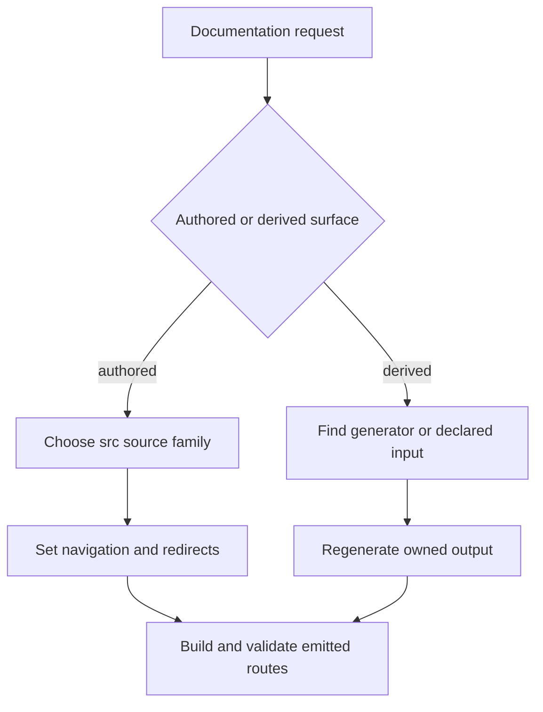

# Repository Wiki Quickstart

This repository authors and builds the Mintlify site at [docs.langchain.com](https://docs.langchain.com). Start from the durable input, not from a rendered route: `build/`, deployment-generated OpenAPI endpoints, extracted snippets, and generated tables are outputs with different owners.

## Route the request

| If the task is about… | Start with | Then use |
| --- | --- | --- |
| An authored page, asset, navigation item, redirect, or source-family choice | The applicable `src/` content and `src/docs.json` | [Adding and Moving Documentation Pages](/openwiki/operations/adding-pages.md) and [Repository Source Map](/openwiki/architecture/source-map.md) |
| Build routing, generated output, preprocessing, watcher behavior, or `docs` CLI behavior | `pipeline/` and the Make target that invokes it | [Documentation Build System](/openwiki/architecture/build-system.md) |
| Python/JavaScript OSS routes, conditional fences, or Managed Deep Agents variants | The source family and its `src/docs.json` navigation entries | [Documentation Routes and Language Versioning](/openwiki/concepts/versioning.md) |
| A runnable example or a displayed code extract | `src/code-samples/`, not a generated fragment | [Runnable Code Samples and Snippet Generation](/openwiki/workflows/code-sample-lifecycle.md) |
| LangSmith agent, environment, tracing, quickstart, Managed Deep Agents, or REST-reference documentation | The owning `src/langsmith/` page, shared snippet, sample, or OpenAPI process | [LangSmith Agent and Observability Documentation Changes](/openwiki/workflows/langsmith-agent-documentation.md) |
| Core CI, a scheduled job, preview, credentials, or a bot pull request | `.github/workflows/` and the invoked command | [GitHub Actions and CI Automation](/openwiki/integrations/github-actions.md) |
| SDK API reference at `reference.langchain.com` | The external reference-documentation process | This repository does not build that site; use its issue template when reporting a problem. |

`AGENTS.md` is the repository-wide authoring contract. It requires manually authored `src/` content, plain-text frontmatter descriptions, Tabler icons, navigation updates for new pages, and tested examples. Procedures that apply only to a class of task live in `.agents/skills/`; run `make skills` in each Claude Code worktree to link them into `.claude/skills/`. Changes to tooling—scripts, workflows, Make targets, checks, scheduled jobs, or skills—also require the `docs-tooling-notion` follow-up before PR handoff.

## Choose the correct source and output family

`src/docs.json` is the Mintlify configuration, navigation, redirect, and OpenAPI-declaration input. It is not the owner of every page it lists. Navigation labels also do not mirror directories: **Build** includes OSS and LangSmith content, while **No-code agents** is sourced from `src/langsmith/fleet/`. Select the source family first, then make the navigation and redirect decisions.



*Route changes begin with ownership; generated output is regenerated from its owner rather than edited directly.*

| Source family or surface | Durable input | Emitted result or safe action |
| --- | --- | --- |
| Ordinary shared OSS content | `src/oss/` plus language navigation | Usually Python and JavaScript output; the builder uses navigation to emit a shared Markdown page only for one language when it appears in only that language's navigation. |
| Language-owned OSS content | `src/oss/python/` or `src/oss/javascript/` | Only the matching language route. |
| OpenWiki and Deep Agents Code | `src/oss/openwiki/` or `src/oss/deepagents/code/` | One unversioned OSS route, rendered with the Python conditional branch. |
| Ordinary LangSmith content | `src/langsmith/` | One unversioned `/langsmith/...` route. |
| Managed Deep Agents | Direct `src/langsmith/managed-deep-agents*.mdx` files | Python and JavaScript routes; configured unversioned aliases redirect to Python. |
| Mintlify configuration | `src/docs.json` | Update deliberately for new pages, route moves, redirects, navigation, and declared OpenAPI groups. |
| Deployment tree | Authored source, configuration, and pipeline | `build/` is erased and recreated by a full build; never patch it. |

A full `DocumentationBuilder` build clears `build/`, builds Python and JavaScript OSS variants, emits the unversioned exceptions and LangSmith content, builds Managed Deep Agents variants, then copies shared files. Inspect output to verify a change, but make corrections in its durable input. For shared OSS content, an unfenced `@[ref]` must resolve for both language scopes; put language-only names in `:::python` or `:::js` blocks and run `make check-cross-refs`.

## Handle generated and deployment-time surfaces correctly

| Surface encountered | Change instead | Follow-through |
| --- | --- | --- |
| `build/` | Authored `src/`, `src/docs.json`, or `pipeline/` | Rebuild or run a preview. |
| `src/code-samples-generated/` | Marked source under `src/code-samples/` | Test source, then run `make code-snippets`. |
| `src/snippets/code-samples/` | Marked runnable sample | Regenerate and review the committed MDX. |
| `src/oss/python/integrations/providers/overview.mdx` | `packages.yml` or `pipeline/tools/partner_pkg_table.py` | Regenerate with `uv run python pipeline/tools/partner_pkg_table.py`; CI rejects drift. |
| LangSmith REST, Agent Server, or Control Plane endpoint pages | Their `src/docs.json` declaration and committed or remote OpenAPI source | Mintlify generates endpoint pages at deployment, not in local `build/`. |
| Integration discovery tables | Hosted-guide `integration:` frontmatter or `scripts/data/integration_external_docs.yaml` | Validate URLs and run the owning refresh process. |

## Runnable samples and LangSmith documentation

A program in `src/code-samples/` is both the executable example and the source of displayed snippets. `make test-code-samples` runs selected samples. `make code-snippets` extracts marked regions into ignored `src/code-samples-generated/` and renders committed MDX in `src/snippets/code-samples/`. Therefore, change and execute the program first, then regenerate; extraction does not execute the sample.

For LangSmith agent and observability changes, follow the connected owner rather than changing one visible page in isolation:

- `src/langsmith/agents.mdx` owns the agent/environment model.
- `src/langsmith/create-an-agent.mdx` owns registration and compatibility-project retrieval; its display fragments derive from `src/code-samples/langsmith/create-an-agent.py`.
- `src/langsmith/log-traces-to-agent.mdx` owns trace-destination configuration.
- Shared LangSmith snippets own rules reused across guides. Reconcile their consumers when a shared prerequisite or routing rule changes.
- The LangSmith REST reference is a deployment-generated surface. Change the refresh/processor policy or service-owned OpenAPI input, not individual endpoint pages.

The registration sample is deliberately deterministic: it directs the SDK at a loopback fixture and asserts the create and retrieval requests rather than creating a live agent. Keep visible calls, hidden fixture assertions, marker IDs, generated fragments, and the importing guide consistent.

```bash
make test-code-samples FILES="src/code-samples/langsmith/create-an-agent.py"
make code-snippets
```

## Develop and validate at the affected boundary

Python 3.13 or later is required. `make install` synchronizes Python dependencies, installs project npm dependencies and the global Mintlify CLI, and links Claude Code skills. `make dev` performs an initial build unless `--skip-build` is supplied, watches `src/`, and serves `build/` through `mint dev --port 3000`; an initial build failure stops development rather than serving stale output.

| Changed contract | Start with |
| --- | --- |
| Focused prose | `make lint_prose FILES="src/path/to/page.mdx"` |
| Page, navigation, redirect, route, link, or heading anchor | `make broken-links-with-anchors` |
| Shared or conditional `@[ref]` | `make check-cross-refs` |
| Pipeline, generator, or CLI | Focused `make test TEST_FILE=tests/unit_tests/...`, then `make lint` as appropriate |
| Runnable sample or extraction markers | `make test-code-samples FILES="src/code-samples/..."`, then `make code-snippets` |
| Agent Server OpenAPI input | `make check-openapi` |
| External integration URL or provider overview input | `uv run python scripts/refresh_integration_downloads.py --check-docs-urls` or `uv run python pipeline/tools/partner_pkg_table.py` |

`make test` runs pytest with Internet sockets disabled except Unix sockets. Core CI runs on pull requests, pushes to `main`, and manual dispatch; it invokes reusable test, lint, and link workflows and separately checks merge-conflict markers, cross-references, external integration URL schemes, and generated provider-overview drift. Built link checking rebuilds first and validates links, anchors, and redirects.

The code-sample workflow is intentionally separate because some samples use repository secrets. It skips fork pull requests, uses independent OSS and LangSmith legs, runs changed supported files on same-repository pull requests, and runs all samples on manual or scheduled invocations. Only a guarded full OSS run can refresh public trace links and generated snippets; inspect its review PR rather than treating it as source.

## Continue by domain

- [Documentation Build System](/openwiki/architecture/build-system.md): generated-tree routing, preprocessing, watcher limits, and build tests.
- [Repository Source Map](/openwiki/architecture/source-map.md): durable owners and deployment boundaries.
- [Adding and Moving Documentation Pages](/openwiki/operations/adding-pages.md): page lifecycle, navigation, redirects, and focused validation.
- [Testing and Validation Overview](/openwiki/testing/test-overview.md): what each local, generated-site, and credentialed check proves.
- [Runnable Code Samples and Snippet Generation](/openwiki/workflows/code-sample-lifecycle.md): markers, runner behavior, rendering, tracing, and CI.
- [LangSmith Agent and Observability Documentation Changes](/openwiki/workflows/langsmith-agent-documentation.md): connected LangSmith pages, samples, snippets, Managed Deep Agents, and REST references.
- [GitHub Actions and CI Automation](/openwiki/integrations/github-actions.md): workflow authority, scheduled automation, previews, and bot PR boundaries.
