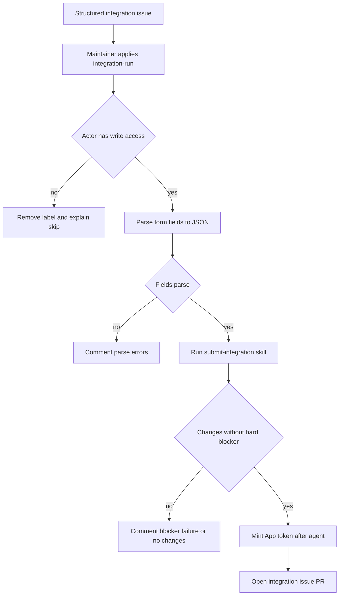

# Repository Wiki Quickstart

This repository owns the authored documentation and build pipeline for [docs.langchain.com](https://docs.langchain.com). Start from the durable input, not from a rendered route: a sidebar item, deployment-generated endpoint, table, snippet, or file in `build/` can be a result of another owner.

## Route the task first

`AGENTS.md` is the repository-wide authoring contract. It applies to manually authored `src/` content: use Markdown-free frontmatter descriptions and Tabler icons, test examples, add new pages to `src/docs.json`, and never edit `build/`. Task-specific procedures live in `.agents/skills/`; run `make skills` in each Claude Code worktree to link them into `.claude/skills/`.

| Request | Durable owner or entrypoint | Read next |
| --- | --- | --- |
| Page prose, assets, navigation, or redirects | The applicable `src/` subtree and `src/docs.json` | [Repository Source Map](/openwiki/architecture/source-map.md) |
| Build behavior, transforms, watcher, or CLI | `pipeline/`, `scripts/`, and `Makefile` | [Documentation Build System](/openwiki/architecture/build-system.md) and [Local Tooling and Commands](/openwiki/operations/cli-tools.md) |
| Source ownership versus sidebar location | Source directory, not the navigation label | [Repository Source Map](/openwiki/architecture/source-map.md) |
| Runnable sample or displayed code extract | `src/code-samples/` | [Testing and Validation Overview](/openwiki/testing/test-overview.md) |
| Integration listing or provider data | Hosted `integration:` frontmatter, `scripts/data/integration_external_docs.yaml`, `packages.yml`, or the structured-submission workflow | [Integration Listing Automation](/openwiki/workflows/integration-listing-automation.md) |
| LangSmith REST API specification | `scripts/process_langsmith_openapi.py` and `src/langsmith/langsmith-platform-openapi.json` | [LangSmith OpenAPI Refresh](/openwiki/workflows/langsmith-openapi-refresh.md) |
| CI, scheduled automation, or workflow permissions | `.github/workflows/` and the invoked script or skill | [GitHub Actions and CI Automation](/openwiki/integrations/github-actions.md) |
| Hosted docs, Agent Server, Control Plane, or SDK reference | The specific source/specification boundary below | [API Reference and OpenAPI Surfaces](/openwiki/integrations/reference-docs.md) |

A tooling change—script, workflow, Make target, PR check, scheduled job, or skill—also requires the `docs-tooling-notion` follow-up before PR handoff.

## Know the build and route boundaries

`src/docs.json` is the Mintlify navigation and site-configuration source of truth; it does not establish source ownership. The builder clears `build/` and generates the Mintlify handoff from authored input: most OSS material is emitted as Python and JavaScript variants, OpenWiki and Deep Agents Code are unversioned, ordinary LangSmith content is unversioned, and Managed Deep Agents emits language-prefixed variants. A menu name can cross those boundaries: **Build** mixes OSS and LangSmith content, **No-code agents** is Fleet, and **Deep Agents Code** is under Products and setup.

For shared OSS content, an unfenced `@[ref]` must resolve for both language scopes. Place language-only API names in `:::python` or `:::js` blocks and run `make check-cross-refs`.

| Surface encountered | Change instead | Follow-through |
| --- | --- | --- |
| `build/` | Authored `src/`, configuration, or pipeline code | Build or preview; rebuilding removes output changes. |
| `src/oss/python/integrations/providers/overview.mdx` | `packages.yml` or `pipeline/tools/partner_pkg_table.py` | Run `uv run python pipeline/tools/partner_pkg_table.py`; CI rejects drift. |
| `src/code-samples-generated/` and `src/snippets/code-samples/` | Executable source in `src/code-samples/` | Test the source, then run `make code-snippets`. |
| Integration download/listing tables | Hosted-guide `integration:` frontmatter or `scripts/data/integration_external_docs.yaml` | Validate URLs and regenerate with `scripts/refresh_integration_downloads.py`. |
| `src/langsmith/langsmith-platform-openapi.json` | `scripts/process_langsmith_openapi.py`, the upstream contract, or refresh policy | Regenerate and review the automated refresh PR; do not patch the JSON. |
| Agent Server and Control Plane endpoint pages | Their `src/docs.json` declaration and committed or remote OpenAPI source | They are Mintlify deployment-generated pages, not local build output. |
| `reference.langchain.com` | Its external build and issue-routing process | Do not look for a generator or output in this repository. |

The daily LangSmith platform refresh fetches and post-processes the public specification, hides fleet and internal endpoints, and reuses one `chore/refresh-langsmith-openapi` PR. It is independent of the committed Agent Server specification, the remote Control Plane specification, and the externally generated SDK reference at [reference.langchain.com](https://reference.langchain.com/python/). Report SDK-reference defects through the [reference documentation issue template](https://github.com/langchain-ai/docs/issues/new?template=04-reference-docs.yml).

## Set up and choose validation

The project requires Python 3.13 or later. `make install` synchronizes all Python dependency groups, installs project npm dependencies and the global Mintlify CLI, and links skills. Then `make dev` performs an initial build unless `--skip-build` is supplied, watches `src/`, and serves `build/` through `mint dev --port 3000`; it exits when the initial build fails. Open <http://localhost:3000> after startup.

The installed `docs` console script dispatches to the pipeline CLI; Make wraps its build and development commands. `mint` is the separate Mintlify CLI that operates on the generated handoff.

| Changed contract | Proportionate local check |
| --- | --- |
| Pipeline, generator, helper, or CLI behavior | `make test TEST_FILE=tests/unit_tests/path_or_test.py`; add `make lint` for tooling changes. |
| Shared or conditional `@[ref]` source | `make check-cross-refs` |
| Prose in a focused page | `make lint_prose FILES="src/path/to/page.mdx"` |
| Route, redirect, link, or anchor | `make broken-links-with-anchors` |
| Agent Server OpenAPI input | `make check-openapi` |
| Runnable sample and its extract | `make test-code-samples FILES="src/code-samples/..."`, then `make code-snippets` |
| Mintlify export or external URLs in a static export | `make export-htmltest` when the environment meets its Mintlify-plan, Node, and `htmltest` prerequisites. |

`make test` runs pytest with network sockets disabled except Unix sockets. Core CI runs for pull requests, pushes to `main`, and manual dispatch; it invokes reusable test, lint, and link checks, then separately checks merge-conflict markers, cross-references, external integration URL schemes, and provider-overview drift. The link job builds first and validates links, anchors, redirect destinations, and the Agent Server OpenAPI input.

## Integration submission automation

A new integration listing begins with a structured GitHub issue but is not automatically privileged. The `integration-submission.yml` workflow runs only when a maintainer applies `integration-run` or manually dispatches it, then verifies that the triggering actor has write-level access. It parses the issue form to JSON before invoking Deep Agents Code with the `submit-integration` skill; form values remain untrusted listing metadata, not instructions.

*The workflow keeps authorization, parsing, untrusted data, agent editing, and PR creation as separate gates.*

The skill applies the hosted-guide eligibility policy: a package with at least 50K monthly downloads, or an explicit maintainer feature override, can receive a hosted guide; otherwise it receives an external listing. It measures rather than invents downloads, leaves agent changes uncommitted, and does not let the agent push, open a PR, or comment on GitHub. Only after a useful diff exists does the workflow mint an App token and create `integration/issue-<number>` for review. Parse errors, hard blockers, agent failures, and no-change outcomes are reported on the issue; a PR is the maintainer-review boundary.

For existing listing work, discovery tables combine hosted `integration:` frontmatter with external YAML records. Run `uv run python scripts/refresh_integration_downloads.py --check-docs-urls` before regeneration; CI uses that mode to reject unsafe URL schemes.

## Continue by domain

- [Documentation Build System](/openwiki/architecture/build-system.md): source collections, preprocessing, route emission, watcher, and Mintlify handoff.
- [Repository Source Map](/openwiki/architecture/source-map.md): authoritative owners, generated surfaces, and navigation boundary.
- [Agent Skills and Automation Procedures](/openwiki/operations/agent-skills.md): selecting and installing task procedures.
- [Local Tooling and Commands](/openwiki/operations/cli-tools.md): install, CLI boundaries, generation, and validation commands.
- [Testing and Validation Overview](/openwiki/testing/test-overview.md): the full validation matrix and CI coverage.
- [Integration Listing Automation](/openwiki/workflows/integration-listing-automation.md): eligibility, generated tables, reviewed remediation, and submission lifecycle.
- [LangSmith OpenAPI Refresh](/openwiki/workflows/langsmith-openapi-refresh.md): allow-listed ingestion, public-spec filtering, and standing-PR behavior.
- [API Reference and OpenAPI Surfaces](/openwiki/integrations/reference-docs.md): SDK reference versus deployment-generated OpenAPI pages.
