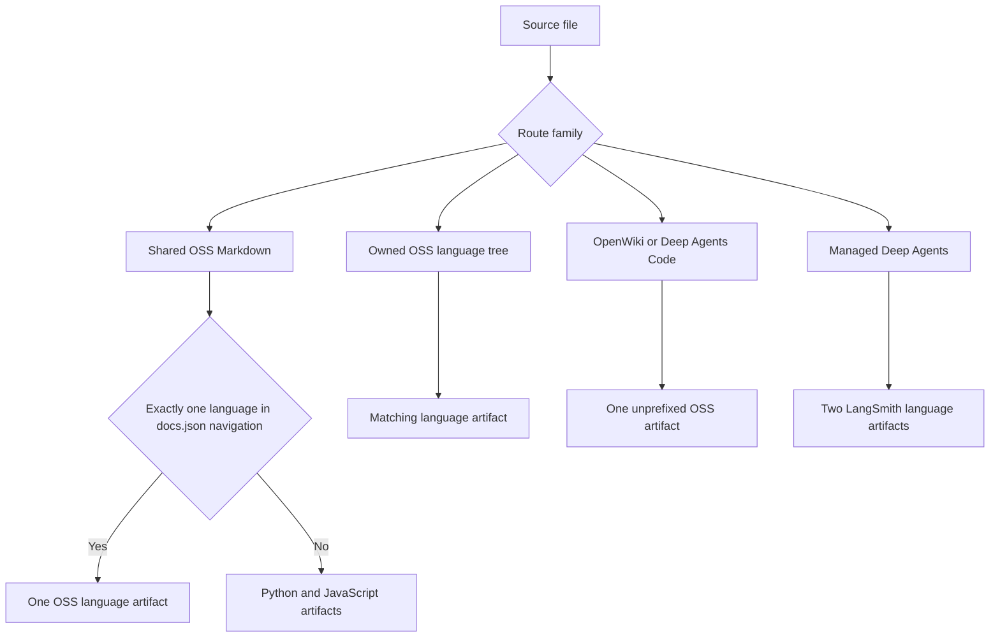

`DocumentationBuilder` is the deterministic boundary from authored `src/` inputs to the disposable `build/` tree. Builder unit tests should prove observable local contracts: routes created and deliberately absent, final transformed text, copied bytes, and raised errors. They do **not** prove that Mintlify accepts the complete tree, that every `docs.json` redirect resolves in the renderer, or that a deployed site serves and navigates the result correctly.

Run the focused suite while changing this boundary:

```bash
make test TEST_FILE=tests/unit_tests/test_builder.py
```

The target runs pytest with Internet sockets disabled (Unix sockets remain allowed), so these tests are intentionally hermetic. Use [Conditional Rendering Tests](/openwiki/testing/conditional-rendering.md) for regex and preprocessing edge cases, [Documentation Build System](/openwiki/architecture/build-system.md) for lifecycle ownership, and [Documentation Routes and Language Versioning](/openwiki/concepts/versioning.md) for the route model.

## Use an isolated artifact fixture

`File` and `file_system()` in `tests/unit_tests/utils.py` create a temporary directory containing `src/` and `build/`, populate source files from UTF-8 `content` or binary `bytes`, and remove the directory at context exit. The yielded object provides `list_build_files()` and `build_file_exists()`. This is the right fixture boundary for a source-to-artifact assertion.

```python
with file_system([
    File(path="oss/guide.mdx", content=":::python\nPython\n:::\n:::js\nJS\n:::\n"),
]) as fs:
    builder = DocumentationBuilder(fs.src_dir, fs.build_dir)
    builder.build_file(fs.src_dir / "oss/guide.mdx")

    assert fs.build_file_exists("oss/python/guide.mdx")
    assert fs.build_file_exists("oss/javascript/guide.mdx")
```

Always assert both sides of a routing rule: required artifacts, prohibited sibling artifacts, and the selected and excluded language text in each relevant output. Read output files instead of testing a private helper alone when the change affects more than a string transformation.

## Route selection: test the decision, not just the path



This is the full-build routing model. `build_file()` uses the same shared-OSS navigation decision, but a whole-tree property—cleanup, discovery, owned-language filtering, shared copying, and final overlay precedence—belongs in a `build_all()` fixture.

### Shared OSS pages and `docs.json`

Ordinary shared Markdown below `oss/` is not necessarily duplicated. The builder recursively collects `oss/python/...` and `oss/javascript/...` strings from `src/docs.json` navigation and caches the result until the file modification time changes. A `.md` or `.mdx` page listed in exactly one language emits only for that language; a page listed in both or neither emits both. Non-Markdown OSS inputs always use both passes. Missing or invalid `docs.json` safely falls back to both variants.

Test the four useful cases in one small fixture: Python-only nav, JavaScript-only nav, both, and neither. Also test targeted `build_file()` for a one-language page so dev-time routing cannot drift from full builds. A navigation entry for `widgets` can stand for `widgets/index`, but must not select that shared index where `src/oss/<language>/widgets.mdx` or `.md` owns the language route. This collision case requires a fixture with the navigation entry, shared index, and language-owned file.

Language-owned source trees are separate from navigation membership. During `build_all()`, a file under `oss/python/` or `oss/javascript/` participates only in its matching pass and its source language segment is removed from the output remainder. Assert the opposite language path is absent.

### Explicit route exceptions

- `oss/deepagents/code/` and `oss/openwiki/` build once at their source-relative, unprefixed paths. Their content is processed with the Python target, so test a conditional fixture as well as absence of both language-prefixed product routes. Links back into either product remain unprefixed; links to ordinary OSS content resolve to Python.
- Direct top-level `langsmith/managed-deep-agents*.md` and `.mdx` sources build to both `langsmith/python/...` and `langsmith/javascript/...`, never to an unversioned artifact. The full-build collector discovers only direct `.mdx` matches; use `.mdx` in a `build_all()` discovery test. Unversioned URLs are a `docs.json` redirect concern, not generated pages.
- `docs.json`; selected root pages; paths containing `snippets`, `images`, `.well-known`, or `fonts`; and `.js`/`.css` files are shared and are copied or processed at source-relative locations. Markdown snippets deliberately take a special multi-copy path described below.

## Transformations: inspect final content

For `.md` and `.mdx`, the builder calls `preprocess_markdown()`, then—when there is a language target—rewrites Markdown snippet imports, rewrites OSS links, and rewrites Managed Deep Agents links. It then appends the source-contribution footer when eligible. `.md` writes an `.mdx` artifact. Processing errors are logged and re-raised; assert the exception for a failing input rather than accepting partial output.

`preprocess_markdown()` resolves autolinks, adds eligible LangSmith CTA UTM parameters, and filters `:::python` and `:::js` branches. With no explicit target, it reads `TARGET_LANGUAGE` and defaults to `python`. Keep syntax-level branch, autolink, and CTA tests in their dedicated preprocessor suites; add a builder fixture when target selection affects an emitted route, import, or link.

Test rewrites through their expected output forms:

- A bare absolute `/oss/...` Markdown destination or quoted HTML `href` gains `python` or `javascript` for the current target. Existing language prefixes, image paths, and the Deep Agents Code and OpenWiki product paths are preserved. Include a pre-prefixed path to catch double insertion.
- A bare `/langsmith/managed-deep-agents...` link gains the current language segment, while an already-prefixed destination stays pinned to its authored language.
- The contribution footer is omitted for root `index.mdx` and every snippet path. It is best-effort: if its source-relative URL cannot be made, the original processed content remains.

`docs.yml` is another output contract, not a byte copy: `yaml.safe_load` produces indented `docs.json`; parse and I/O failures are re-raised. `TEMPLATE.mdx` and unsupported extensions are skipped. For an asset-copy test, supply `bytes` and compare output bytes; do not use a Markdown fixture to prove `copy2` behavior.

## Snippet imports and overlay invariants

A Markdown snippet produces three usable forms: the default `snippets/...` artifact with Python-targeted links for unversioned importers, plus `snippets/python/...` and `snippets/javascript/...` copies. Each language copy receives conditional filtering and OSS and Managed Deep Agents link rewrites. A language-targeted page importing `from '/snippets/example.mdx'` is rewritten to its matching language copy; already scoped imports remain unchanged. The import rule applies to Markdown snippet extensions, not component imports such as `.jsx`.

Use a nested versioned page that imports a snippet containing an `/oss/` link. After `build_all()`, assert both generated pages import their respective snippet copies and that all snippet routes are absolute, language-prefixed routes. This catches the historical failure where a fixed relative snippet link broke for a nested consumer.

Full builds copy shared files before `_copy_npm_snippets()`. The npm overlay is therefore the last writer: package `PatternEmbed.jsx` and `ExampleEmbed.jsx` replace corresponding `build/snippets/` files, and `ChatLangChainEmbed.js` is written at the build root. A missing package directory or mapped package file is a warning, not a build failure. Test changed overlay precedence only with `build_all()` and a controlled package layout.

## Lifecycle, safety, and the right validation level

`build_all()` deletes and recreates `build/`, then builds ordinary OSS language passes, unversioned Deep Agents Code and OpenWiki, ordinary LangSmith, Managed Deep Agents variants, shared files, and finally the npm overlay. `build_file()` routes one existing file and raises `AssertionError` when it is missing. `build_files()` delegates a singleton to `build_file()`; multiple paths use a progress bar disabled in CI. The command wrapper returns 1 before construction if the source directory is absent, otherwise creates the build directory, invokes `build_all()`, and returns 0.

Source collection is a security invariant: `_safe_source_files()` rejects every symlink, including one to a regular file, and rejects a resolved path outside its requested root. A unit test should make an external target and a symlink under an eligible directory, then assert collection and output exclude it.

| Question | Required evidence |
| --- | --- |
| Did routing, branch selection, rewrite order, copying, rejection, or an exception path behave as intended for a small input? | **Unit test** using `file_system()` and `test_builder.py`. |
| Does a clean generated tree have working internal links, anchors, and redirect destinations? | **Real Mintlify build/check**: run `make broken-links-with-anchors`. It depends on a fresh build, runs Mint from `build/`, checks anchors and redirects, filters known standalone-snippet reports, and fails on remaining reports. |
| Does Mintlify render, host redirects, and client navigation correctly in the actual published environment? | **Deployment review**. Inspect the deployed site; neither an isolated builder test nor the local Mint check proves this. |

For a routing or output-graph change, first run the focused unit suite, then run:

```bash
make broken-links-with-anchors
```

A local Mint check validates the generated tree, not deployment behavior. In particular, redirects in `docs.json` must point at emitted artifacts and be checked by Mint, while final hosting behavior still needs deployment review.
