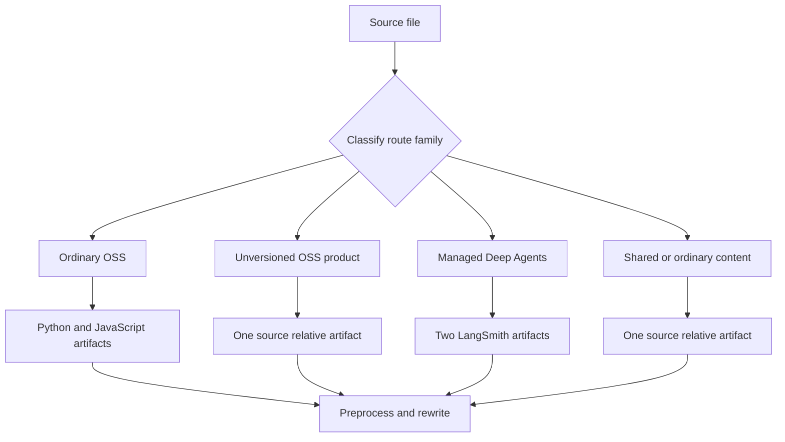

## Scope and test boundary

`DocumentationBuilder` turns authored `src/` inputs into disposable `build/` artifacts. Builder tests should assert observable results: emitted and forbidden routes, transformed Markdown, copied bytes, and propagated failures. A fixture passing at this boundary proves local routing and transformation behavior; it does **not** establish that Mintlify accepts the whole generated graph, redirects resolve in a deployed site, or the watcher receives real filesystem events.

Run the focused suite while changing this boundary:

```bash
make test TEST_FILE=tests/unit_tests/test_builder.py
```

`make test` runs pytest with Internet sockets disabled, except for Unix sockets. This keeps builder tests intentionally local. Use fixtures and mocks for filesystem and transformation contracts, then use the rendered-tree link check for changes that affect links, anchors, redirects, or snippet imports.

For the build lifecycle, see [Build System](/openwiki/architecture/build-system.md). For route ownership, see [Language Variants and Route Ownership](/openwiki/concepts/versioning.md). For conditional syntax assertions, see [Conditional Rendering Tests](/openwiki/testing/conditional-rendering.md), and for repository-wide validation choices, see [Testing Overview](/openwiki/testing/test-overview.md).

## Fixture discipline

Use `File` and `file_system()` from `tests/unit_tests/utils.py`. The context manager creates an isolated temporary directory containing `src/` and `build/`, writes each fixture as UTF-8 `content` or binary `bytes`, exposes `list_build_files()` and `build_file_exists()`, and removes the tree on exit. Read an artifact for a transformation contract, use binary fixture data for copy behavior, and assert both required artifacts and routes that must not be emitted.

```python
with file_system([
    File(path="oss/guide.mdx", content=":::python\nPython\n:::\n:::js\nJS\n:::\n"),
]) as fs:
    builder = DocumentationBuilder(fs.src_dir, fs.build_dir)
    builder.build_file(fs.src_dir / "oss/guide.mdx")

    assert fs.build_file_exists("oss/python/guide.mdx")
    assert fs.build_file_exists("oss/javascript/guide.mdx")
    assert not fs.build_file_exists("oss/guide.mdx")
```

The central assertion pattern is positive and negative: test the output that must exist, sibling routes that must not exist, and, for each language artifact, the content selected for that language.

## Route-family coverage



This is the route selection that small fixtures should protect.

- Ordinary `oss/` files build twice, to `oss/python/...` and `oss/javascript/...`, with target-specific conditional filtering and link rewriting. In a full build, files already below `oss/python/` or `oss/javascript/` are considered only by their matching target pass, and the source-language segment is removed from the generated remainder.
- `oss/deepagents/code/` and `oss/openwiki/` are unversioned products. They build once at their source-relative path with Python conditional selection. Links within those product roots remain unprefixed, while links to ordinary OSS routes are rewritten to Python.
- Direct `langsmith/managed-deep-agents*.md` and `.mdx` sources emit only `langsmith/python/...` and `langsmith/javascript/...`; the builder does not create an unversioned page. The full-build discovery pass selects `.mdx` files, so use `.mdx` for a test of that discovery path.
- Shared inputs build once at source-relative locations: `docs.json`; selected root pages; all paths containing `snippets`, `images`, `.well-known`, or `fonts`; and `.js`/`.css` files. Markdown snippets are a deliberate exception to the simple one-copy rule: their special processing produces language-specific MDX copies as well as the default copy.

`build_file()` is the focused routing entry point and raises `AssertionError` for a missing source file. `build_files()` delegates a one-item list to it; for several paths it uses a progress bar that is disabled in CI. Use `build_all()` for collection, clean-output, language-owned-source filtering, shared discovery, or overlay-order behavior rather than trying to infer those whole-tree properties from an incremental build.

## Copying and transformation tests

The supported copy set has 21 extensions: `.mdx`, `.md`, `.json`, `.svg`, `.png`, `.jpg`, `.jpeg`, `.gif`, `.mp4`, `.webm`, `.yml`, `.yaml`, `.css`, `.js`, `.jsx`, `.tsx`, `.txt`, `.woff2`, `.woff`, `.ttf`, and `.html`. Unsupported extensions and `TEMPLATE.mdx` are skipped without an emitted artifact. Test a newly supported asset format both where it is routed and where shared classification changes its destination.

`docs.yml` is a special supported input: the builder parses it with `yaml.safe_load` and writes indented `docs.json`. YAML parse and I/O errors are logged and re-raised. This deserves a direct failure fixture rather than an assertion that only inspects a successful output.

For `.md` and `.mdx`, the builder reads source, calls `preprocess_markdown()`, rewrites snippet imports and route links, appends the output-only contribution footer when eligible, and writes `.md` with an `.mdx` suffix. Processing errors are logged and re-raised. The footer is omitted for root `index.mdx` and any path containing `snippets`; footer generation itself is best-effort and preserves content if it cannot construct the link.

Important content assertions include:

- `_rewrite_oss_links()` inserts `python` or `javascript` into bare absolute `/oss/` Markdown and HTML links. It must preserve existing prefixes, image paths, and unversioned Deep Agents Code/OpenWiki paths to avoid double-prefixing or breaking product routes.
- `_rewrite_managed_deep_agents_links()` inserts the target-language segment into bare Managed Deep Agents links and leaves an already-prefixed link intact.
- `preprocess_markdown()` resolves scoped autolinks, adds UTM parameters to eligible LangSmith CTA links, and filters conditional branches. With no explicit target it uses `TARGET_LANGUAGE`, defaulting to `python`. Pair a syntax-focused preprocessor test with a builder output assertion when the behavior affects a route.

Source collection is also a security boundary. `_safe_source_files()` excludes all symlinks, including links to ordinary files, and excludes resolved paths outside the requested root. A regression fixture can create an external secret and a symlink beneath an eligible source directory, then assert that neither the linked file nor its contents reaches `build/`.

## Shared snippets and component overlay

A Markdown snippet is emitted three times: its default source-relative path with Python-prefixed absolute links for unversioned importers, plus `/snippets/python/...` and `/snippets/javascript/...` copies. A language-versioned MDX page importing a default Markdown snippet has its import rewritten to the matching copy; imports already under `python/` or `javascript/` stay unchanged. Component imports such as `.jsx` are not rewritten by this Markdown-snippet rule.

Protect this with a nested versioned-page fixture, not merely a helper-string assertion. The test should show that the generated page imports its language-specific snippet and that every snippet copy contains absolute language-prefixed OSS links rather than a fixed relative path that would fail for nested consumers.

The full build processes source shared files before applying the `@langchain/docs-sandbox` overlay. The overlay overwrites same-destination source copies so `PatternEmbed.jsx` and `ExampleEmbed.jsx` are taken from the package into `build/snippets/`, and `ChatLangChainEmbed.js` is copied to the build root. A missing package directory or expected mapped file logs a warning rather than failing the build. This precedence requires a full-build fixture with a controlled package layout if it changes.

## Lifecycle and failure boundaries

`build_all()` deletes and recreates `build/`, then builds ordinary OSS Python and JavaScript content, unversioned Deep Agents Code and OpenWiki, ordinary LangSmith, Managed Deep Agents variants, shared files, and finally the npm overlay. The overlay is therefore the last writer for its destinations. The lifecycle does not generate `llms.txt` or `llms-full.txt`.

At the command boundary, `build_command()` returns 1 if the source directory is absent. Otherwise it creates the build directory, calls `DocumentationBuilder.build_all()`, and returns 0. Treat command exit behavior and builder routing as separate contracts: a command test can mock the builder, while route tests should use actual filesystem artifacts.

The incremental watcher is useful context, but it is not equivalent to full reconstruction. It ignores editor backup names ending in `~`, `.bak`, or `.orig` and hidden temporary names ending in `.tmp`, `.temp`, or `.swp`. It de-duplicates queued changes, waits 0.2 seconds after the latest event, rebuilds one file or a batch of up to four worker threads, and touches expected outputs for hot reload.

Deletion and touch routing have known boundaries: deletion removes only the source-relative output, while generated language variants can remain; `langsmith` touch routing is unversioned, so Managed Deep Agents variants are not reliably touched. A clean `build_all()` is the recovery mechanism for stale derived artifacts. Test watcher changes with controlled queues and mocked build/touch work instead of wall-clock timing or a real observer.

## Validation ladder

After focused builder tests, run the generated-site check when a change affects emitted links, redirects, anchors, navigation, snippet imports, or the output graph:

```bash
make broken-links-with-anchors
```

The target depends on a fresh build, runs Mint from `build/`, checks anchors and redirects, filters known standalone-snippet reports, and fails if remaining broken-link records exist. It validates the generated tree, not deployment behavior.

1. Use the smallest isolated fixture that proves the changed builder contract.
2. Assert required and forbidden artifacts, then inspect final generated content for every relevant language target.
3. Use `build_all()` for ordering, discovery, cleanup, source-language ownership, shared assets, and npm-overlay behavior.
4. Add `make broken-links-with-anchors` after an output-graph or renderer-facing change.
5. Do not treat temporary filesystems, mocked watcher workers, or a local Mint check as proof of deployed rendering.
