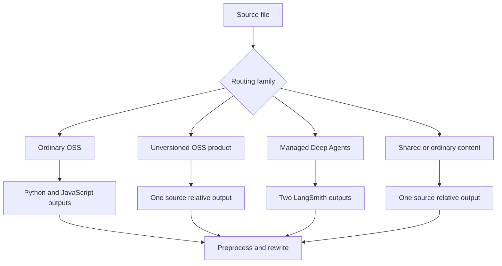
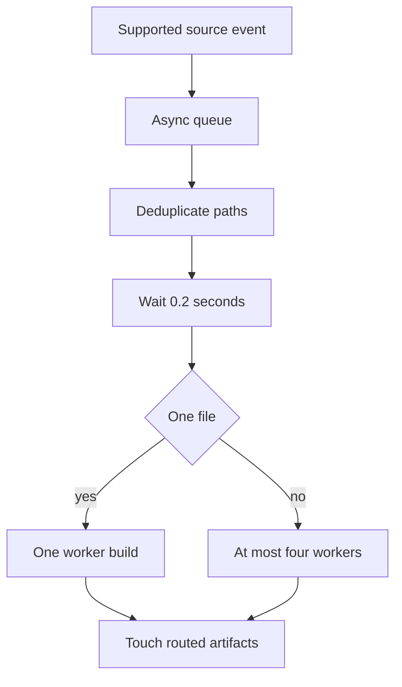

## Scope and validation boundary

`DocumentationBuilder` turns authored `src/` inputs into disposable `build/` artifacts. Its most useful tests assert observable output: emitted and forbidden routes, transformed Markdown, copied bytes, and error propagation. A passing unit fixture establishes local builder or helper behavior; it does **not** prove that Mintlify accepts the complete output graph, redirects resolve, or the deployed site renders it.

Start with the narrowest relevant module:

```bash
make test TEST_FILE=tests/unit_tests/test_builder.py
make test TEST_FILE=tests/unit_tests/test_handle_auto_links.py
make test TEST_FILE=tests/unit_tests/test_utm_links.py
make test TEST_FILE=tests/unit_tests/test_lexer.py
make test TEST_FILE=tests/unit_tests/test_parser.py
make test TEST_FILE=tests/unit_tests/test_watcher.py
```

`make test` runs pytest with Internet sockets disabled while allowing Unix sockets. This makes these tests deliberately local: fixtures, mocks, and filesystem artifacts are appropriate evidence for transformations and routing, but not for the Mint runtime, npm publication availability, or a live filesystem observer.

For build-system architecture and operations, see [Build System](/openwiki/architecture/build-system.md), [Preprocessing](/openwiki/concepts/preprocessing.md), [CLI Tools](/openwiki/operations/cli-tools.md), and [Testing Overview](/openwiki/testing/test-overview.md).

## Fixture discipline and route families

Use `File` and `file_system()` from `tests/unit_tests/utils.py` for builder fixtures. The context manager creates isolated `src/` and `build/` directories, writes either UTF-8 `content` or binary `bytes`, provides `list_build_files()` and `build_file_exists()`, and removes the tree at exit. Read an emitted artifact when the contract is a transformation; use bytes for copy behavior; assert both the required artifact and routes that must not exist.

```python
with file_system([
    File(path="oss/guide.mdx", content=":::python\nPython\n:::\n:::js\nJS\n:::\n"),
]) as fs:
    builder = DocumentationBuilder(fs.src_dir, fs.build_dir)
    builder.build_file(fs.src_dir / "oss/guide.mdx")

    assert fs.build_file_exists("oss/python/guide.mdx")
    assert fs.build_file_exists("oss/javascript/guide.mdx")
    assert not fs.build_file_exists("oss/guide.mdx")
```



This is the route selection that a small builder fixture should protect.

- Most `oss/` content emits a Python and a JavaScript artifact. Source files already below `oss/python/` or `oss/javascript/` are included only in the matching full-build pass and have that source-language segment removed from the emitted path.
- `oss/deepagents/code/` and `oss/openwiki/` are intentional single-output products. They use the Python conditional target, retain links within their own roots, and still rewrite links to ordinary OSS pages to Python routes.
- A direct `langsmith/managed-deep-agents*.md` or `.mdx` page emits only `langsmith/python/...` and `langsmith/javascript/...`; there is no unversioned emitted page. The full-build discovery pass selects `.mdx` files, so use `.mdx` when exercising full discovery.
- `docs.json`; selected root pages; every path under `snippets`, `images`, `.well-known`, or `fonts`; and `.js` or `.css` files are shared and emitted once. JSX and TSX snippet components remain shared.

The supported input set has 22 extensions, including Markdown, JSON/YAML, common image/video/font formats, CSS/JS, JSX/TSX, text, and HTML. Unsupported extensions and `TEMPLATE.mdx` are silently skipped. `docs.yml` is exceptional: it is loaded with `yaml.safe_load` and written as indented `docs.json`; parse and I/O failures are logged and re-raised.

## Builder lifecycle and extension boundaries

`build_all()` deletes and recreates `build/`, then builds ordinary OSS language trees, unversioned Deep Agents Code and OpenWiki, ordinary LangSmith, Managed Deep Agents variants, shared files, and finally the npm component overlay. The overlay copies published `@langchain/docs-sandbox` files after source shared files, so it wins at the same destination: `PatternEmbed.jsx` and `ExampleEmbed.jsx` map to `build/snippets/pattern-embed.jsx` and `build/snippets/example-embed.jsx`, while `ChatLangChainEmbed.js` maps to the build root. Missing package directories or mapped files warn rather than fail. This lifecycle does not generate `llms.txt` or `llms-full.txt`.

Use `build_file()` for a fast route regression: it requires an existing file and raises `AssertionError` when missing. `build_files()` delegates a singleton to `build_file()`; with multiple paths it uses a CI-disabled progress bar. Use `build_all()` whenever collection, source-language filtering, stale-output cleanup, shared-file discovery, or npm-overlay precedence matters.

Whole-tree collection is security-sensitive. `_safe_source_files()` excludes every symlink—even one to a regular file—and rejects resolved paths outside the collection root. A regression fixture should create an outside secret and a symlink under an eligible source subtree, then assert neither collection nor output contains the link or secret.

## Markdown and preprocessing contracts

For normal Markdown and MDX, `_process_markdown_file()` reads content, calls `preprocess_markdown()`, performs snippet-import and route rewrites, adds the source footer when eligible, and writes `.md` as `.mdx`. Errors are logged and re-raised. The footer is omitted for root `index.mdx` and every path containing `snippets`; footer construction itself is best-effort and leaves content unchanged if it fails.

`preprocess_markdown()` resolves scoped autolinks, adds UTM parameters to eligible LangSmith CTA links, and filters conditional blocks. An omitted target comes from `TARGET_LANGUAGE`, defaulting to `python`. Protect changes at two layers: a narrow unit test for syntax and a builder artifact test that proves the consuming route received the correct result.

- `_rewrite_oss_links()` rewrites Markdown links and HTML `href` values from bare `/oss/...` to `/oss/python/...` or `/oss/javascript/...`. It preserves existing prefixes, paths containing `images`, and Deep Agents Code/OpenWiki routes to avoid broken double-prefixes and preserve unversioned products.
- `_rewrite_managed_deep_agents_links()` inserts the target language for bare `/langsmith/managed-deep-agents...` links while preserving already-prefixed paths.
- `_rewrite_snippet_imports_for_language()` rewrites default imports of `/snippets/*.md` or `.mdx` to language-specific copies, but leaves named component imports and already-prefixed imports unchanged.
- A Markdown snippet produces three copies: the default source-relative copy with Python-resolved absolute links for unversioned consumers, plus Python and JavaScript copies. Snippets get no source footer.

### Focused preprocessing modules

`test_handle_auto_links.py` patches `SCOPE_LINK_MAPS` with a small map and verifies that `@[Name]` is rewritten outside code fences but preserved inside backtick or tilde fences, including extended and indented fences. It also protects scope handling around conditional fences, escaped references, whitespace preservation, and the conservative behavior of an unclosed code fence: subsequent text remains unprocessed.

`test_utm_links.py` covers the CTA classification boundary. Only the root and `/agents` paths on `https://smith.langchain.com` receive the documentation UTM parameters and a path-derived `utm_content`; functional routes, API-domain URLs, unrelated domains, and fenced-code links remain unchanged. Existing query parameters and optional Markdown link titles must survive.

## Lexer, parser, and CLI helper tests

The migration parser is a separate tool path from the builder. The lexer emits typed, line-numbered tokens with tab-expanded indentation and always ends with EOF. `test_lexer.py` protects recognition of headings, code fences, list markers, blockquotes, tabs, admonitions, and conditional delimiters, especially indentation in tabs and whitespace before a conditional close.

`test_parser.py` exercises lexer-to-AST-to-Mintlify conversion. Keep end-to-end `to_mint()` examples for syntax conversions such as admonitions to accordions, tab blocks, list markers, and preserved code/HTML. Keep structural parser assertions for conditional-block content and source ranges. Malformed structural tokens in nested contexts are expected to raise `ParseError` with source-line context; test the error rather than allowing a hang or silently accepting an orphaned close or fence.

The `pipeline` CLI selects synchronous or coroutine handlers and propagates integer return values as process status. Its `build` subcommand calls `build_command()`, which returns 1 when `src/` is absent and otherwise runs `DocumentationBuilder.build_all()` and returns 0. Test a CLI or command change at this dispatch/exit boundary separately from builder routing; a parser-level migration test does not validate a generated site.

## Watcher seams and limits

`DocsFileHandler` ignores backup names ending in `~`, `.bak`, or `.orig`, and hidden temporary names ending in `.tmp`, `.temp`, or `.swp`. For supported extensions, modification events enqueue paths through the event loop; creation delegates to the same handling. `test_watcher.py` currently focuses on this pure filter, using a fresh event loop and no real observer.



This is the incremental preview flow after a supported create or modification event.

`FileWatcher` cancels and reschedules its debounce task, rebuilds pending files in workers, then touches expected outputs for hot reload. Test that seam with a controlled queue and mocked build/touch work rather than wall-clock timing or a live watchdog observer. The incremental path has known routing gaps: deletion removes only the source-relative build path rather than every language-derived path, and LangSmith touch routing is unversioned, so Managed Deep Agents variants are not reliably removed or touched. A full build clears stale derived output and is the recovery path.

## Rendered-site check and change checklist

Run the focused module first. Add a generated-site check when changing `docs.json`, redirects, cross-family links, route classification, snippets/overlays, anchors, or any renderer-facing output:

```bash
make broken-links-with-anchors
```

This target first rebuilds, runs Mint from `build/`, checks anchors and redirects, filters known standalone-snippet reports, and fails on remaining broken-link entries. It validates the generated tree—not deployment behavior—and the filtering does not replace a focused consumer fixture for language-specific snippet imports.

1. Choose the smallest fixture or mocked boundary that proves the local contract.
2. Assert expected artifacts, forbidden sibling routes, and transformed final content for each relevant target language.
3. Use `build_all()` for full-lifecycle behavior and `build_file()` for a focused routing regression.
4. Keep autolink, UTM, lexer, parser, and watcher tests syntax-specific and offline.
5. Do not treat mocked workers, temporary filesystems, or Mint's local check as proof of deployed rendering.
6. Follow a change that alters the output graph with `make broken-links-with-anchors`.
