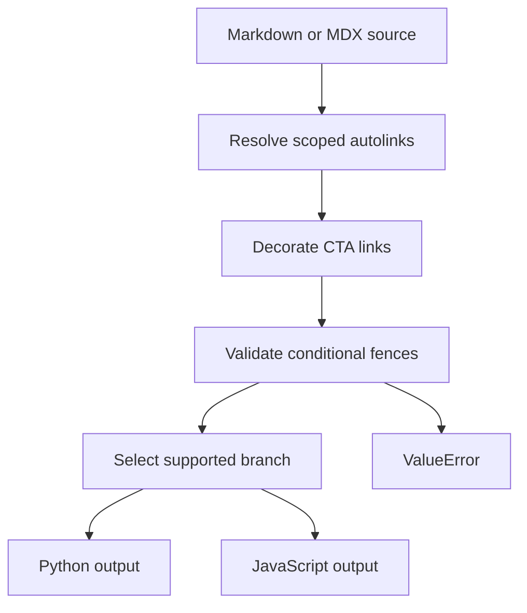

# Conditional Rendering Tests

Conditional rendering lets one Markdown or MDX source produce Python and JavaScript variants. The test contract has two levels: the preprocessor validates conditional-fence structure and selects branch content; the builder applies that preprocessor while producing language-specific artifacts. Test both targets and assert both inclusion and exclusion—finding the selected text alone does not detect leakage from the other branch.

## Core selection invariant

Use complete, sibling blocks for the two supported target keys:

```markdown
Shared introduction.

:::python
Python only.
:::

:::js
JavaScript only.
:::
```

For target `python`, shared text and `Python only.` remain, while both markers and `JavaScript only.` are absent. For `js`, the inverse applies. `_apply_conditional_rendering()` accepts only these target values; another target raises `ValueError`.



This shows the preprocessor order: validation and selection are the final stages, and invalid conditional structure stops rendering.

`preprocess_markdown()` derives an omitted target from `TARGET_LANGUAGE`, defaulting to `python`; its default autolink scope is the chosen target. Autolink resolution and CTA decoration run before fence validation and branch selection. Consequently, a branch-local reference or eligible CTA is transformed before the nonmatching branch is discarded. The ordinary backtick/tilde fence protection in those line-oriented earlier stages does **not** protect the final validator or renderer.

## Structural validation is part of the contract

Before applying its whole-document substitution, `_apply_conditional_rendering()` calls `_validate_conditional_fences()`. The validator scans lines, tracking one open conditional block. It raises `ValueError` beginning `Broken conditional fences:` for each of these conditions:

- an opening marker occurs while a block is open; the diagnostic names its line and the original opening line;
- a `:::` closer occurs without an open block; or
- the input ends with a block still open.

The focused `tests/unit_tests/test_conditional_fences.py` suite pins a successful pair of Python and JavaScript blocks and each of those failures. Match the relevant diagnostic fragment and line number, not just the exception type, when extending the structural contract.

### Compact closers and adjacency

A closer need not be a line containing only `:::`. Validation accepts text after the closer, and it treats a compact sequence such as `::::::js` as a close followed immediately by a new `:::js` opening. `test_compact_closers_pass()` verifies both forms: a table row can follow `::: | shared |`, and the compact sequence can end a Python branch and begin a JavaScript branch. The JavaScript render retains the shared row and JavaScript text but not the Python text.

This permissiveness is intentional because the renderer's close expression also accepts text after its marker. Keep compact-closer coverage if changing either the validation patterns or rendering pattern; otherwise valid source can fail validation or validation can approve source that renders differently.

### Escaped syntax examples

Escape both markers when documentation must show conditional syntax literally:

```markdown
\:::python
Literal conditional syntax.
\:::
```

Escaped markers do not match the validator's unescaped line patterns and are not eligible for conditional substitution. After rendering, the final unescape pass removes the backslash before every `:::` marker, so the output displays literal `:::python` and `:::`. `test_escaped_fences_are_ignored()` establishes that validation does not reject an escaped pair; a full-preprocessor assertion should additionally verify the unescaped literal output.

### Rendering boundaries

The renderer is not a structural Markdown parser. Its substitution matches a complete, non-escaped `:::<word>` opening plus a later eligible non-escaped close, preserves only matching `python` or `js` content, and removes a nonmatching supported block without normalizing blank lines. A complete block with a different word label is returned unchanged by the rendering replacement, but it must still satisfy the structural validator.

Do not rely on regular Markdown code fences to shield conditional-looking text: fence state exists in the autolink and CTA scanners, whereas validation and conditional selection scan the whole input without that state. Escape markers in a code sample if they must remain inert. Nested conditional blocks are invalid input, rather than a first-close rendering convention; validation rejects the second opening before regex rendering begins.

## Prove generated artifacts when the change crosses the builder boundary

`DocumentationBuilder.build_all()` clears the build directory, then builds `oss/python` with target `python` and `oss/javascript` with target `js`. `_process_markdown_content()` runs `preprocess_markdown()` first, then rewrites targeted snippet imports, OSS routes, and Managed Deep Agents routes in that order. Use a direct conditional-fence test for parser/validator behavior; add a builder fixture when the change also affects generated paths, imports, or the placement of target output.

`test_build_all_creates_managed_deep_agents_language_routes()` is the relevant artifact-level model. It creates a shared snippet containing both branch types, calls `build_all()`, and reads the generated Python and JavaScript snippet copies. The test asserts each copy retains its matching branch and excludes the other, while also checking language-specific snippet imports and rewritten Managed Deep Agents and OSS routes in the pages.

Shared Markdown snippets have an independent output path: the builder preprocesses each for both targets and writes `build/snippets/python/` and `build/snippets/javascript/`; it also writes a Python-targeted unprefixed copy for unversioned consumers. When a page imports a conditional snippet, inspect both the scoped import and both generated snippet artifacts.

## Focused commands and regression checklist

Run the validator-focused suite after changes to conditional syntax, diagnostics, escaping, or compact closers:

```bash
make test TEST_FILE=tests/unit_tests/test_conditional_fences.py
```

Run the builder suite when output selection interacts with snippets, routes, or imports:

```bash
make test TEST_FILE=tests/unit_tests/test_builder.py
```

`make test` uses pytest with network sockets disabled except Unix sockets. For an end-to-end documentation artifact check, `make build` installs Node dependencies and invokes `pipeline build` through `PYTHONPATH=$(CURDIR) uv run pipeline build`.

1. Render the same balanced fixture for `python` and `js`; assert shared content, retained matching content, absent nonmatching content, and removed fences.
2. Pin every malformed case introduced by a syntax change: nested open, stray close, and never-closed block. Assert the diagnostic's relevant line information.
3. Retain escaped-marker coverage and assert literal, unescaped output at the full-preprocessor boundary.
4. Retain compact closer coverage for a closer with trailing text and for close-plus-open adjacency.
5. If the change reaches build output, call `build_all()` and inspect both language-specific artifacts, including rewritten imports or routes when relevant.

## See also

- [Markdown preprocessing pipeline](/openwiki/concepts/preprocessing.md)
- [Language versioning strategy](/openwiki/concepts/versioning.md)
- [Builder tests](/openwiki/testing/builder-tests.md)
- [Testing overview](/openwiki/testing/test-overview.md)
