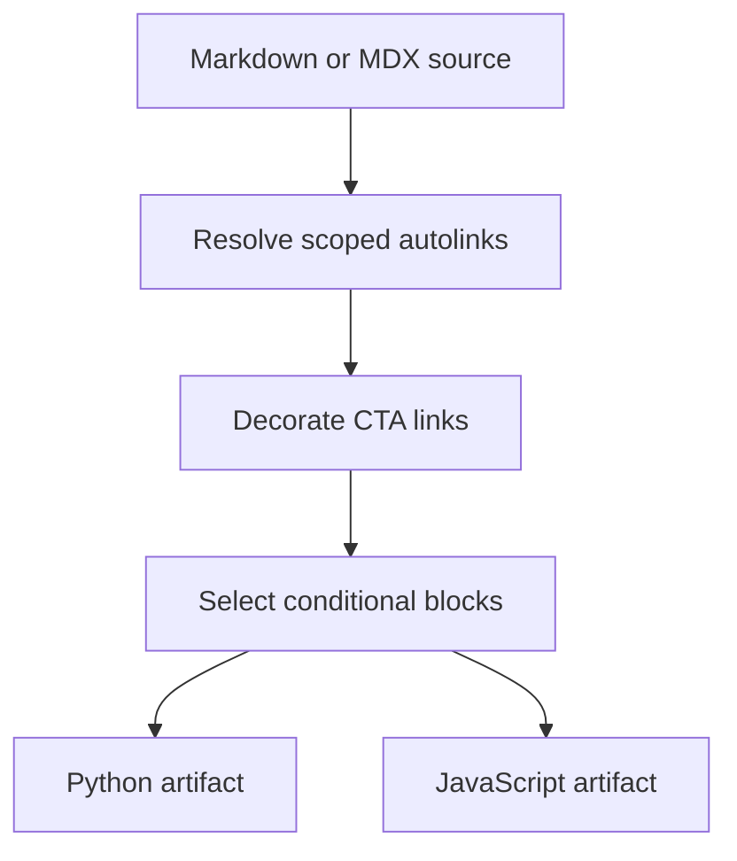

# Conditional Rendering Tests

Conditional rendering makes one Markdown or MDX source produce target-specific documentation. The contract is observable only after preprocessing and, for a route or snippet change, after the builder writes its artifacts. Test both targets rather than inferring behavior from a source directory name.

## Core output invariant

Use shared text and a closed branch for each supported target:

```markdown
Shared introduction.

:::python
Python only.
:::

:::js
TypeScript only.
:::
```

For the `python` target, shared text and `Python only.` remain, both fences disappear, and `TypeScript only.` is absent. For `js`, the symmetric result applies. This positive-and-negative pair is the fundamental rendering assertion: checking only that the selected string exists does not catch leakage of the other branch.

Only `python` and `js` are valid renderer targets. At the `preprocess_markdown()` boundary, an omitted target is read from `TARGET_LANGUAGE` and falls back to `python`; the target also becomes the default autolink scope unless the caller supplies `default_scope`. An invalid target fails with `ValueError`.



This shows the preprocessor order and the two possible rendered artifacts.

Autolinks and CTA decoration therefore see the original branches before final branch selection. Test an `@[reference]` in a branch at this boundary when a failure might be caused by scope rather than by rendering.

## Scoped references and ordinary code fences

`replace_autolinks()` scans one line at a time with one current scope. An unescaped line containing `:::language` selects that scope; a bare `:::` restores `default_scope`. Therefore, a reference in a JavaScript branch is resolved against the JavaScript map even when a later Python render removes that branch. A missing mapping is left as authored, so a removed branch does not prove that its source reference was valid.

Backtick and tilde code fences protect the autolink and CTA line scanners. A line beginning with at least three backticks or tildes toggles their code-fence state; while active, neither replacements nor conditional-scope changes occur. `test_mixed_conditional_and_code_fences()` proves that `:::js` inside a normal code block cannot change an enclosing Python scope and that its autolink remains literal. `test_unclosed_code_block_suppresses_remaining()` establishes the corresponding failure boundary: an unclosed normal code fence suppresses autolink replacement for the rest of the input.

Run the focused scanner suite with:

```bash
make test TEST_FILE=tests/unit_tests/test_handle_auto_links.py
```

### CTA link transformations

The CTA stage targets Markdown links to `https://smith.langchain.com` only when their path is the root or `/agents` (with or without a trailing slash). It appends the docs CTA UTM fields while preserving an existing query and an optional Markdown title; functional paths such as `/settings`, other domains, and fenced code remain untouched. Its `utm_content` is derived from the source path. When a conditional-content change includes one of these links, run the dedicated suite as well:

```bash
make test TEST_FILE=tests/unit_tests/test_utm_links.py
```

This isolates CTA classification and code-fence behavior from conditional selection. Add a builder-level fixture only if the change also depends on the generated artifact or a route rewrite.

### Code fences do not protect the final renderer

Do not transfer the scanner guarantee to conditional rendering. `_apply_conditional_rendering()` is a whole-document regular-expression substitution with no normal-code-fence state. A complete `:::python ... :::` or `:::js ... :::` sequence inside a triple-backtick example can still be selected or removed by the last preprocessing step. Add a full-preprocessor case when changing this behavior.

Syntax examples that must survive preprocessing must escape both markers:

```markdown
\:::python
Literal conditional syntax.
\:::
```

The matcher excludes an opening or closing marker immediately preceded by `\`. After it completes substitutions, the renderer removes the backslash from every `\:::` sequence. Assert that escaped opening and closing markers remain literal and that their output no longer contains the escape backslashes.

## Regex boundaries worth pinning

The renderer recognizes a complete block whose opening label is a word-character sequence, then decides whether the label is one of the two supported targets. It is not a structural Markdown parser. Keep narrow unit-level expectations for these behaviors when modifying the pattern:

- A complete block with an unsupported label remains unchanged.
- An opening marker without an eligible close remains unchanged because it does not match the substitution.
- Conditional blocks cannot nest: the first eligible non-escaped closing marker ends the current regex match.
- Indentation is not a safe rejection or nesting invariant. The pattern captures opening indentation and references it before the close, but it is not line-start anchored and permits whitespace at the close.
- Removing a nonmatching branch substitutes an empty string; do not expect blank-line normalization.

Place a regular fenced code sample *inside* the selected conditional branch when the sample differs by target:

````markdown
:::python
```python
print("Python only")
```
:::

:::js
```typescript
console.log("TypeScript only");
```
:::
````

### Lexer tests are a separate contract

`tests/unit_tests/test_lexer.py` verifies the parser pipeline's tokenization: `:::python` and `:::js` become conditional-open tokens, bare `:::` becomes a close token, and indentation and whitespace before a close are retained in token metadata. The lexer is consumed by `pipeline.tools.parser`, not by `preprocess_markdown()` or `DocumentationBuilder`. These tests protect recognition for the parser/converter path; they do **not** establish language-specific build output. Use rendering and builder tests for the latter.

## Prove emitted artifacts at the builder boundary

`DocumentationBuilder.build_all()` clears `build/`, builds ordinary OSS documentation once for `python` and once for `js`, and writes them under `build/oss/python/` and `build/oss/javascript/`. `_process_markdown_content()` preprocesses content first, then rewrites targeted snippet imports, OSS routes, and Managed Deep Agents routes in that order. A branch test at this boundary should read both files and assert matching content, absent opposite content, and any language-specific rewritten paths.

Shared Markdown snippets take their own two-target path. `_process_snippet_markdown_file()` preprocesses every shared snippet for Python and JavaScript, writes the copies below `build/snippets/python/` and `build/snippets/javascript/`, and also writes a Python-targeted default copy at the unprefixed snippet path for unversioned consumers. A page that imports such a snippet needs both the scoped import assertion and assertions on the selected contents of the imported artifact.

`test_build_all_creates_managed_deep_agents_language_routes()` is the artifact-level model. It creates a snippet with both branches, calls `build_all()`, then verifies each emitted language-specific snippet contains only its branch. It also checks the target-specific Managed Deep Agents route, OSS route, and snippet import rewrites. Run the builder suite with:

```bash
make test TEST_FILE=tests/unit_tests/test_builder.py
```

Use a direct preprocessor test for a regex edge case, then add the smallest `build_all()` fixture that reads both outputs for a change affecting snippets, imports, routes, or build placement. `make test` runs pytest with network sockets disabled except Unix sockets.

For a clean end-to-end artifact check:

```bash
make build
```

The build target installs Node dependencies and runs `pipeline build` through `PYTHONPATH=$(CURDIR) uv run pipeline build`.

## Regression checklist

1. Render the same fixture for `python` and `js`; assert shared content, retained matching content, and absent nonmatching content in each result.
2. If a branch contains `@[references]`, assert the branch scope is used before selection. Include a conditional-looking line in a normal code fence when changing the autolink scanner.
3. If a branch contains a LangSmith CTA, run `test_utm_links.py` and assert only an eligible non-code link receives UTM parameters.
4. Exercise escaped opening and closing markers through the full preprocessor and assert literal unescaped markers in output.
5. When changing the conditional regex, pin unsupported labels, missing closes, first-close behavior, whitespace behavior, and a complete marker pair inside a normal code fence.
6. For a page or snippet consumer, call `build_all()` and inspect both generated language artifacts plus the target-specific imports and routes.

## See also

- [Markdown preprocessing pipeline](/openwiki/concepts/preprocessing.md)
- [Language versioning strategy](/openwiki/concepts/versioning.md)
- [Builder tests](/openwiki/testing/builder-tests.md)
- [Changing versioned content](/openwiki/workflows/versioned-content.md)
