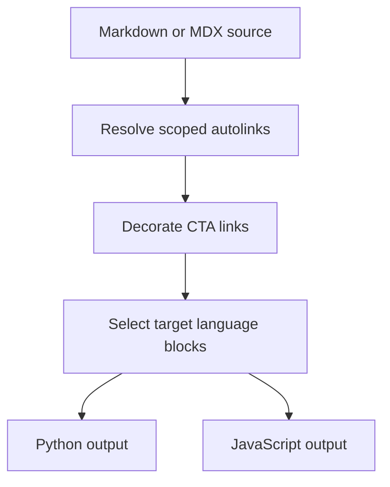

# Conditional Rendering Tests

Conditional rendering lets one Markdown or MDX source supply Python- and JavaScript-specific content. `_apply_conditional_rendering()` is a build-time text transformation, not a Markdown parser: it selects supported `:::python` and `:::js` blocks after autolinks and CTA decoration have run.

## Test the two target outputs

A rendering regression test should use shared text and both supported branches, then assert positive and negative results for each target:

```markdown
Shared introduction.

:::python
Python only.
:::

:::js
TypeScript only.
:::
```

- The `python` target retains `Python only.`, removes the `:::python` fences, and removes `TypeScript only.`.
- The `js` target retains `TypeScript only.`, removes the `:::js` fences, and removes `Python only.`.
- Shared text remains in both artifacts.

Only `python` and `js` are valid renderer targets. `_apply_conditional_rendering()` raises `ValueError` for another value. At the public preprocessor boundary, an omitted target comes from `TARGET_LANGUAGE`, with `python` as the fallback; the same target is also the default autolink scope unless a caller supplies `default_scope`.



This flow shows the ordering under `preprocess_markdown()`. A test involving references must account for resolution before a nonmatching conditional branch disappears.

## Cover preprocessing and fence boundaries

### Verify scoped autolinks before selection

`replace_autolinks()` is a line scanner with one active scope. An unescaped `:::language` line changes scope, and a bare `:::` restores `default_scope`. Thus a reference in a JavaScript branch resolves using the JavaScript map even while producing a Python artifact, before that branch is removed.

Regular backtick and tilde fences are different from conditional fences. The autolink scanner toggles an in-code state for a line beginning with at least three backticks or tildes and preserves both the code and any conditional-looking markers within it. The focused test `test_mixed_conditional_and_code_fences()` establishes that a `:::js` line inside a regular code fence does not change the surrounding Python scope, and that its `@[StateGraph]` remains literal. Its companion unclosed-fence test establishes that an unclosed regular fence suppresses replacement for the rest of the document.

Use that module when changing scoped-reference behavior:

```bash
make test TEST_FILE=tests/unit_tests/test_handle_auto_links.py
```

### Do not assume code fences protect conditional rendering

The conditional renderer uses one whole-document regular-expression substitution and has no regular-code-fence state. Consequently, a complete `:::python ... :::` or `:::js ... :::` sequence inside a triple-backtick example can still be selected or removed later. Test this explicitly if changing the renderer, and escape syntax examples that must survive complete preprocessing:

```markdown
\:::python
Literal conditional syntax.
\:::
```

The conditional matcher excludes markers immediately preceded by `\`; after block substitution, the renderer removes the backslash from every `\:::` sequence. Assert both escaped opening and closing markers, and assert literal `:::` without the backslash in output.

### Preserve regex behavior at its limits

The renderer matches an opening marker with a word-character label, content ending at the first eligible non-escaped closing marker, and then decides whether the label is supported. Add narrow direct tests for these contracts when changing the pattern:

- A complete block with a label other than `python` or `js` remains unchanged.
- An eligible opening without a closing marker remains unchanged because it does not match.
- Conditional blocks cannot nest. The non-greedy content match ends at the first eligible close, so an inner opening has no structural meaning.
- Do not use indentation as a rejection or nesting mechanism. The pattern captures opening whitespace and references it for the closing marker, but it is not anchored at the beginning of a line and the closing expression permits whitespace. Mismatched indentation is not a reliable no-match invariant.
- Do not rely on the renderer to normalize blank lines around a removed block. It substitutes the selected content or an empty string.

Put regular code fences *inside* a selected branch when code differs by language, rather than wrapping a conditional-looking example in a code fence:

````markdown
:::python
```python
print("Python only")
```
:::

:::js
```typescript
console.log("TypeScript only");
```
:::
````

## Test the build boundary

`DocumentationBuilder._process_markdown_content()` calls `preprocess_markdown()`, rewrites Markdown snippet imports for a supplied target, then rewrites OSS and Managed Deep Agents routes. `build_all()` first clears `build/`, then emits the ordinary OSS Python and JavaScript variants at `build/oss/python/` and `build/oss/javascript/`.

Shared Markdown snippets are a separate two-target path. `_process_snippet_markdown_file()` preprocesses each snippet for `python` and `js`, writes `build/snippets/python/` and `build/snippets/javascript/` copies, and writes a Python-targeted default copy at the unprefixed snippet path for unversioned importers. A page test that imports a conditional snippet can therefore prove both branch selection and correct consumer wiring.

`test_build_all_creates_managed_deep_agents_language_routes()` is the current artifact-level model. It creates a snippet with both conditional branches, invokes `build_all()`, reads both emitted copies, and checks that each contains its matching text and excludes the other branch. It also asserts language-specific route and snippet-import rewrites. Run it with the builder module:

```bash
make test TEST_FILE=tests/unit_tests/test_builder.py
```

Use an artifact-level fixture when a change might affect emitted location, snippet imports, or route rewriting. Keep a direct unit test for a regex edge case, then add the smallest `build_all()` fixture that reads both output files. `make test` runs pytest with network sockets disabled except Unix sockets.

For an end-to-end artifact check, run the complete build and inspect both variants:

```bash
make build
```

The target installs Node dependencies and invokes `pipeline build` through `PYTHONPATH=$(CURDIR) uv run pipeline build`.

## Debug a variant-specific failure

Use this order to isolate the owner of a failure:

1. **Confirm the target key and source family.** Shared OSS content normally builds twice. OpenWiki, Deep Agents Code, and ordinary LangSmith content use Python selection for their single unversioned artifact; Managed Deep Agents has separate Python and JavaScript routes.
2. **Reduce to `preprocess_markdown()`.** If the two strings are wrong before builder rewrites, inspect branch fences, escaping, and the target passed to preprocessing. Remember that an unsupported label or unclosed block is intentionally retained, not reported as a renderer error.
3. **Check an `@[reference]` in the branch before checking the artifact.** Autolinks are resolved while the branch is still present and with its conditional scope. A missing map entry is logged and left literal during preprocessing, even if the branch is later removed from one output.
4. **Check code-fence expectations.** Regular fences suppress autolink and CTA scanning but do not protect conditional syntax from the final renderer.
5. **Inspect both final files.** For snippets, inspect the two language-prefixed copies and the Python-default copy. For pages, also check rewritten import and route paths, since a correct branch can still be consumed from the wrong artifact.

Run `make check-cross-refs` separately when changing symbolic references. It validates authored references in their applicable scopes, while a rendered artifact can omit the nonmatching branch that contained the bad reference.

## Regression checklist

1. Assert retained matching content, absent nonmatching content, and shared content for both `python` and `js`.
2. When a branch has autolinks, assert its scope is applied before rendering. Include a conditional-looking line in a regular code fence when changing the scanner.
3. Test escaped opening and closing markers through the full preprocessor and assert that output has no escape backslashes.
4. Add direct cases for unsupported labels, missing closes, nesting, whitespace behavior, and conditional-looking markers in a code fence whenever modifying the renderer regex.
5. Use `build_all()` and inspect both artifacts when snippets, imports, routes, or source-family selection are involved.

## See also

- [Markdown preprocessing pipeline](/openwiki/concepts/preprocessing.md)
- [Language versioning strategy](/openwiki/concepts/versioning.md)
- [Cross-reference validation](/openwiki/operations/cross-references.md)
- [Builder tests](/openwiki/testing/builder-tests.md)
- [Changing versioned content](/openwiki/workflows/versioned-content.md)
