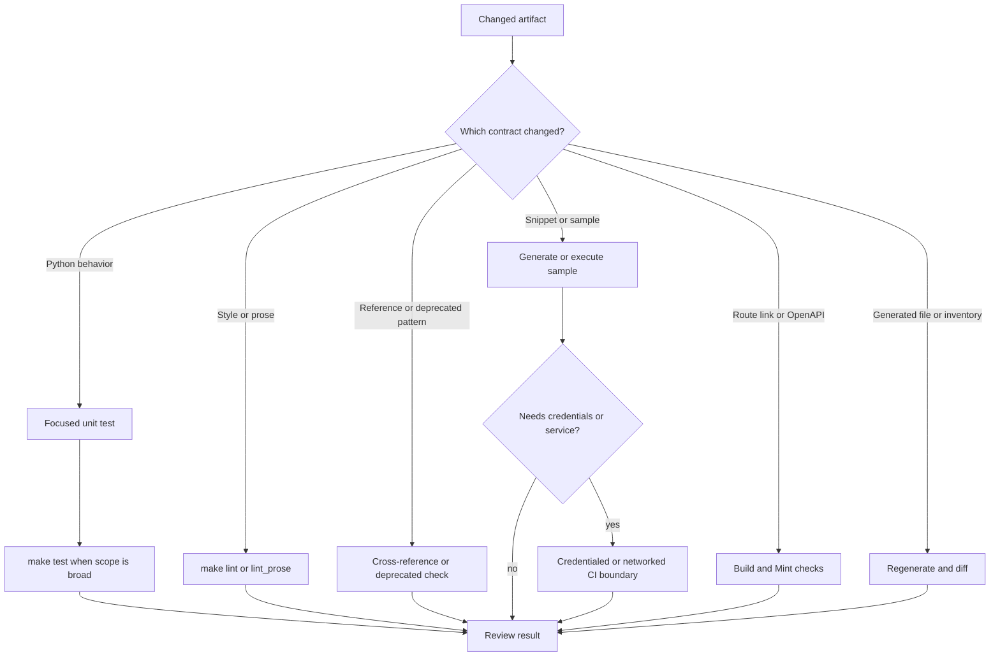

## Choose the smallest meaningful boundary

Each validation layer proves a different contract. Start with the focused test or static check that owns the changed behavior; widen to `make test` or generated-site checks when the change crosses a boundary. Use credentialed or networked checks only when an example or integration actually crosses a provider or service boundary. A passing unit test does not prove a rendered site, a reachable URL, or a live provider integration; a live run does not replace deterministic assertions about a transformation.

| Change | Deterministic local check | CI-only or network-dependent check | Boundary proved |
| --- | --- | --- | --- |
| Python pipeline, parser, builder, or generator | Owning `tests/unit_tests/test_*.py`, then `make test` for a wider change | None normally | Fixture-controlled behavior, not remote services. |
| Formatting, types, spelling, or prose style | `make lint`; `make lint_prose FILES="src/..."` | None | Static quality or Vale style, not rendering or factual correctness. |
| Authored `@[Name]` cross-reference | `make check-cross-refs` | CI repeats it | Source references resolve in applicable language scopes, not final route reachability. |
| Route, redirect, navigation, anchor, or OpenAPI input | `make broken-links-with-anchors`; `make check-openapi` | Hosted preview when deployment behavior matters | A fresh generated Mint tree, including redirects and anchors; not a deployed site. |
| Generated provider overview | `uv run python pipeline/tools/partner_pkg_table.py`, then inspect the diff | `check-generated-files` regenerates and diffs the owned file | The generated file agrees with its generator and metadata; manual edits are rejected. |
| Version claim in authored MDX | `uv run python scripts/check_version_claims.py --files src/path/to/page.mdx` | Changed-document version-claim workflow | The named version exists on its resolved registry, not that it is the right feature floor. |
| Deprecated example pattern | Inspect added lines for `create_react_agent` | `check-deprecated.yml` on eligible pull requests | New eligible additions do not reintroduce the blocked pattern. |
| Egress inventory or rendered tables | `uv run python scripts/generate_egress_ip_tables.py --check` | None required | Canonical JSON, content-derived version, and both marked tables agree. |
| Snippet markers or generated snippet MDX | Focused generator test, then `make code-snippets` and review the diff | None | Extraction and generation consistency; samples are not executed. |
| Runnable sample | `make test-code-samples FILES="src/code-samples/..."` | Same-repository PR or scheduled/manual sample workflow when credentials are needed | Local execution with available services and credentials. |
| Exported static-site URLs | `make export-htmltest` where Mint and network access are available | Repeatable environment or hosted preview | External destinations in the exported subset only; not internal routes or fragments. |

*The flow routes a change to its owning deterministic check, then expands to generated output or a remote boundary only when required.*

## Core local gates and CI ownership

`make test` runs pytest with Internet sockets disabled while allowing Unix sockets. Pytest discovers `test_*.py` under `tests`, uses automatic asyncio mode, and defaults the asyncio fixture loop scope to a function. HTTP-facing tests therefore use mocks or local doubles rather than the public network. `make lint` runs Ruff format and lint checks, `ty check`, and Codespell over `src`; `make lint_prose` installs the configured Vale binary and checks specified files or `src`, excluding `node_modules` and `src/code-samples`. `make lint_md` is separate and fails when `markdownlint` is unavailable; it is not part of `make lint`.

The main CI workflow runs reusable test, lint, and documentation-link workflows for pull requests, pushes to `main`, and manual dispatch. Its matrix currently uses Python 3.13 for each of those jobs. Separate five-minute checks detect merge markers, unresolved source cross-references, unsafe integration `docs_url` schemes, and drift in the generated provider overview. The workflow cancels an older run for the same workflow/ref when a newer push arrives; reusable jobs have 20-minute timeouts and focused jobs have five-minute timeouts.

`check-deprecated.yml` is a read-only pull-request gate. It fetches the merge diff and checks only added lines in eligible Python, Markdown, MDX, or notebook changes for `create_react_agent`; it does not claim that existing occurrences elsewhere were removed. The version-claim workflow similarly examines only changed authored MDX and treats registry lookup failures as unresolved evidence rather than proof of an unpublished version.

## Generated documentation, references, and links

`DocumentationBuilder.build_all()` reconstructs language-specific OSS trees, unversioned Deep Agents Code and OpenWiki content, Managed Deep Agents variants, shared assets, and npm snippet components. Markdown processing rewrites language-sensitive links and snippet imports before output is written. Focused builder tests protect language-prefix rewriting, the single unversioned OpenWiki output, language-scoped snippet imports, and rejection of source symlinks that could copy content outside the source tree.

`src/docs.json` owns Mintlify navigation. The builder uses routes under `oss/python/` and `oss/javascript/` to decide which shared-page copies to emit; a route in neither language, or an absent or invalid configuration, falls back to both. Navigation changes therefore need the focused builder suite and generated-site validation, not only source-level tests.

`make check-cross-refs` scans Markdown and MDX under `src` for `@[ref]` markers, skipping code fences, escaped references, generated code-sample snippets, and `node_modules`. Unfenced shared OSS references must resolve in every applicable language scope. `make broken-links-with-anchors` rebuilds the site and runs Mint's checker from `build/` with anchor and redirect checks. `make check-openapi` rebuilds and checks `langsmith/agent-server-openapi.json`; the reusable documentation workflow runs these checks plus `make check-mdx` on Node 22 with Mint 4.2.1181. `test_url_stub_noindex.py` requires MDX pages with `url:` frontmatter to set `noindex: true`, keeping redirect-only sidebar stubs out of discovery outputs such as `llms.txt` and the sitemap.

CI regenerates `src/oss/python/integrations/providers/overview.mdx` with `pipeline/tools/partner_pkg_table.py` and fails on a diff, except for the named automated package-download update or `bypass-auto-check` label. Change the generator or package metadata, then regenerate; do not hand-edit the generated page.

## Inventory and endpoint correctness

The egress inventory is a generated-publication contract. `scripts/generate_egress_ip_tables.py` accepts schema version 1 with a nonempty version and address list. Each entry must contain exactly `service`, `cloud`, `region`, and `cidr`; services are limited to the two owning pages, clouds to GCP, AWS, or Azure, regions to US, EU, or APAC, and each address must be a globally routable IPv4 `/32` with no duplicate full identity. The version is `sha256:` plus a digest of canonical sorted address data.

Without `--check`, the generator updates the inventory version and the single delimited generated table block in each owning page. With `--check`, it reports version or table drift and fails without writing. Focused tests cover invalid entries, duplicate addresses, convergence after regeneration, Azure rendering, and a full builder build that copies the JSON bytes exactly once to the unversioned `build/langsmith/egress-ip-addresses.json` artifact. Edit the JSON and regenerate tables; do not hand-edit a rendered table.

OpenTelemetry endpoint tests scan authored MDX for two configuration mistakes: a generic `OTEL_EXPORTER_OTLP_ENDPOINT` must not include a signal suffix, and collector YAML must use `traces_endpoint` rather than `endpoint` when the value ends in `/v1/traces`. A mocked Python exporter test verifies that a signal-specific traces endpoint is unchanged and a generic base endpoint receives exactly one `/v1/traces` suffix. These are deterministic documentation and endpoint-construction checks, not live trace-ingestion tests.

## Generated snippets and runnable samples

`make code-snippets` extracts marked snippets and generates MDX without executing them. The extractor line-parses supported markers, strips `:remove:` regions, and limits processing to supported files below `src/code-samples`; `make test-code-samples` executes selected or eligible samples. The snippet-MDX generator expands routable Python or TypeScript agent model strings into provider CodeGroups while preserving embeddings and provider-specific chat identifiers. Focused tests ensure provider-specific chat classes and embedding-only samples are not expanded, Python and TypeScript use different Google provider keys, TypeScript uses camelCase Google search configuration, and the resolved `@langchain/google` version is at least 0.2.6.

The runner accepts Python, TypeScript, Go, shell, Java, and Kotlin files below `src/code-samples`, with a per-sample `CODE_SAMPLE_TIMEOUT_SECONDS` default of 1,200 seconds. `CODE_SAMPLE_PATHS` narrows both discovery and explicit `FILES`; out-of-tree filters and files are ignored, and focused tests verify product-matrix filtering. Runs default to four workers, while known shared-fixture groups run as ordered chains. Recognized rate-limit responses are retried using configurable attempts and increasing capped delays; an exhausted rate limit is reported as a skip, whereas other nonzero sample results fail the command. This distinction is operationally important: a skip is not a successful execution.

Tracing is opt-in through `CODE_SAMPLE_TRACING=1`. The runner stamps `LANGSMITH_DOCS_SNIPPET` for a source file with exactly one valid snippet ID, and trace collection serializes access to the shared manifest while matching that metadata on a root run. A trace-collection failure warns after an already successful sample and does not turn the sample into a suite failure.

## Credentialed CI and export boundaries

The code-sample workflow skips fork pull requests because samples may require secrets. Same-repository pull requests run changed executable samples; scheduled and manual runs run the full eligible set. The workflow partitions samples into OSS and LangSmith matrix legs, fails when a top-level sample directory has no assigned leg, provisions toolchains and provider credentials, and waits for its pgvector PostgreSQL service before execution. Tracing and trace-refresh publication are limited to the OSS leg on scheduled or manual runs. Pull-request runs have a 60-minute timeout; scheduled/manual full runs have a 150-minute timeout and cancel older runs for the same workflow/ref.

On scheduled or manual runs, the workflow refreshes snippet MDX only when the run was not cancelled, fewer than 20 samples failed, and trace links changed; it then opens or updates a dedicated trace-refresh pull request containing the manifest and generated snippet artifacts. Local users should not assume the workflow's provider keys, gateway endpoints, or PostgreSQL service exist.

`make export-htmltest` runs Mint export and then htmltest. Export requires a Mint CLI with `mint export`, Node 20 or 22, and an Enterprise plan. Because the export omits many pages, `htmltest-mint-export.yml` disables internal paths and hashes and checks external URLs only; use Mint's generated-tree checks for internal navigation, redirects, and anchors.

The changelog pipeline's focused tests use deterministic dates, synthetic PRs, fake API/model streams, and local files to verify week windows, flag parsing and rollout state, strict structured-output schemas, MDX escaping, rendering, and held-state persistence. They do not prove live GitHub, Datadog, or model-service behavior. The release-watch `test_evidence.py` suite likewise uses synthetic payloads plus source/page text to test evidence parsing, surgical edit validation, and source-claim matching; it does not exercise remote release, GitHub, or Linear integrations.

## Failure triage

- **Unit or builder failure:** reproduce the owning focused test, inspect fixtures and generated output, then widen to `make test` only when the change crosses components.
- **Version-claim failure:** correct the package version or routing/context; treat an unresolved registry lookup as missing evidence.
- **Cross-reference, Mint, or MDX failure:** inspect language scope, generated `build/`, route ownership, redirects, components, and fragments. These checks prove different invariants.
- **Generated-file or egress failure:** change the owning generator or canonical inventory, regenerate, and commit the resulting output.
- **Sample failure or skip:** distinguish a nonzero program failure from an exhausted rate-limit skip; inspect credentials, service readiness, timeout, and toolchain.
- **Export htmltest failure:** treat it as external-destination evidence only; use generated-tree checks for internal paths and anchors.

## Related guides

- [GitHub Actions](/openwiki/integrations/github-actions.md) explains reusable workflow boundaries.
- [CLI Tools](/openwiki/operations/cli-tools.md) lists repository command-line tooling.
- [Builder Tests](/openwiki/testing/builder-tests.md) and [Conditional Rendering](/openwiki/testing/conditional-rendering.md) cover focused deterministic boundaries.
- [Code Sample Lifecycle](/openwiki/workflows/code-sample-lifecycle.md) explains extraction, execution, tracing, and generated artifacts.
- [Egress IP Inventory](/openwiki/workflows/egress-ip-inventory.md) covers inventory publication and regeneration.
