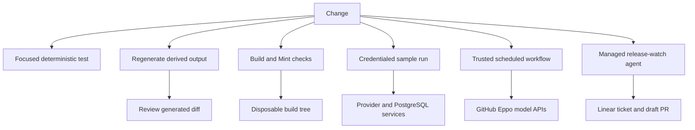
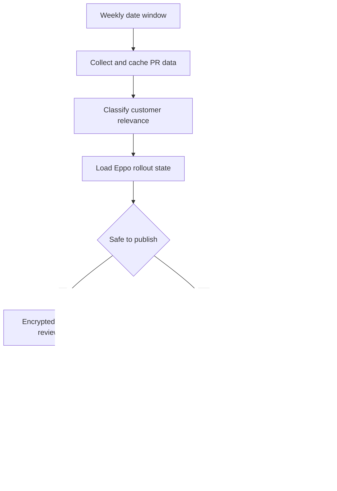
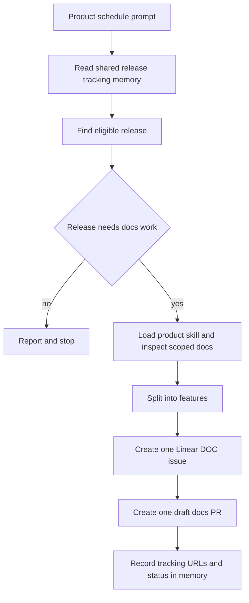

## Choose the validation boundary

Start with the smallest deterministic check that proves the changed contract. Add regeneration, documentation build, live sample, or trusted workflow evidence only when the change crosses that boundary. A unit-test pass does not establish that a rendered site, provider-backed example, secret-bearing job, GitHub API integration, or managed release-watch agent works.

| Change | Focused validation | Establishes | Does not establish |
| --- | --- | --- | --- |
| Changelog helper or held-state logic | `make test TEST_FILE=tests/unit_tests/test_changelog_pipeline.py` | Date windows, parsing, state, rollout decisions, rendering, and model-client behavior using doubles | GitHub, Anthropic, Eppo, or a review PR |
| Onboarding registry or detector | `make test TEST_FILE=tests/unit_tests/test_check_onboarding_models.py` | Registry safety, model detection, suggestions, and local-checkout behavior | Access to the remote `langchainplus` checkout |
| Snippet generator or sample dependency invariant | `make test TEST_FILE=tests/unit_tests/test_generate_code_snippet_mdx.py`, then `make code-snippets` | Language/provider and dependency-floor invariants plus derived MDX | Provider-backed execution |
| Redirect-only documentation page | `make test TEST_FILE=tests/unit_tests/test_url_stub_noindex.py` | Redirect stubs are excluded from discovery surfaces | Rendered links and deployment behavior |
| General Python change | `make test` | Socket-isolated pytest suite | Network-backed behavior |
| Authored docs, anchors, redirects, or Agent Server OpenAPI | `make broken-links-with-anchors` and `make check-openapi` | Mint checks against the disposable `build/` tree | Hosted-site state |
| Runnable code sample | `make test-code-samples FILES="src/code-samples/..."` | Selected sample ran with local toolchains and supplied services/credentials | Generated documentation correctness or a rate-limited skipped sample |
| Release-watch product, prompt, tool, or credential change | Run the affected schedule prompt with `uv run mda dev`; inspect the agent response and any created draft artifact in an authorized non-production context | The managed-agent control path, release selection, and connected GitHub/Linear boundary | A merged documentation change or an unattended deployment schedule |



This flow separates local contract evidence from generated-output, rendered-site, live-service, secret-bearing automation, and managed-agent evidence.

## Deterministic suite, generated docs, and ordinary CI

The project requires Python `>=3.13.0,<4.0.0`. Pytest discovers `tests`, uses automatic asyncio mode with function-scoped event-loop fixtures, and `make test` disables network sockets other than Unix sockets. HTTP-facing tests therefore need mocks or another local test double.

The main CI workflow runs on pull requests, pushes to `main`, and manual dispatch. It invokes reusable test, lint, and documentation-link workflows, then separately checks unresolved merge markers, source cross-references, integration `docs_url` values, and drift in the generated provider overview. Update its generator or `packages.yml`, regenerate `src/oss/python/integrations/providers/overview.mdx`, and review the result rather than editing that output by hand.

The reusable documentation-link workflow syncs the frozen test dependency group, installs Node 22 and Mint, then runs the anchor/redirect link check and the OpenAPI check. Both Make targets rebuild the disposable `build/` tree first. They validate generated documentation rather than the deployed site.

`test_url_stub_noindex.py` protects a separate discovery invariant: every MDX page with `url:` frontmatter must set `noindex: true`, preventing redirect-only sidebar stubs from entering Mintlify discovery outputs such as `llms.txt` and the sitemap.

## Weekly changelog: deterministic core and encrypted state

`scripts/changelog_pipeline.py weekly` defaults to the most recently completed Monday-to-Monday window and refuses a partial explicit range. It collects and classifies merged work, obtains rollout state, writes cached artifacts under `--out`, and changes the Cloud/Fleet targets and held ledger only under `--write`. A duplicate week label is a write-mode no-op rather than a second insertion.



This is the weekly control flow. GitHub collection, Anthropic classification/writing, and Eppo state are remote boundaries even though the helper tests are deterministic.

The held list is `scripts/.changelog_held.json.enc`. It is Fernet-encrypted because it can contain private PR and unreleased-work context; `CHANGELOG_STATE_KEY` is required to read or write it, and missing, invalid, or wrong keys fail closed. A legacy plaintext sibling is folded into the encrypted write and removed. Only an Eppo flag determined to be fully rolled out releases held work; pending flags remain held, while conflicting, missing, or archived-but-not-fully-rolled-out flags are excluded and reported rather than assumed shipped.

Run the focused suite after changing this pipeline:

```bash
make test TEST_FILE=tests/unit_tests/test_changelog_pipeline.py
```

The focused tests cover date labels/windows, schema closure, `Flag:` parsing, held-entry release and ordering, insertion, merge-window filtering, encrypted-state failures, and mocked Anthropic/GitHub behavior. They do not call remote services or open a changelog PR.

The weekly workflow runs every Monday or by manual dispatch, validates optional date inputs, serializes runs, supplies GitHub, Anthropic, Eppo, and state-key secrets, and uses dry-run output for review instead of opening a PR. In non-dry-run mode it opens a review PR only when state or changelog files changed; the public summary excludes the full report because it can identify private PRs or unreleased work. Treat this as trusted scheduled automation and review the wording, links, held reasons, and encrypted-ledger change before merging.

## Onboarding-model registry: local seam and remote monitor

The onboarding checker is detect-only: its registry identifies a remote repository/ref, scoped paths, provider model sets, and ignores. It validates those values before interpolating them into GitHub requests, recognizes the supported provider model forms, accepts configured current IDs and their dated snapshots, and reports outdated occurrences with a line number and preferred replacement. Its `--repo-dir` option is the deterministic seam for a local checkout; status 0 means clean, 1 means findings, and 2 means the registry or source could not be read.

The scheduled/manual workflow uses a read-only `LANGCHAINPLUS_READ_TOKEN` to read the remote snippets and treats status 2 as an operational failure. A finding instead creates or updates one standing issue; a clean result closes it. The workflow never writes to `langchainplus`, so a reported model change remains a frontend-reviewed action.

## Generated snippets and trace links

`make code-snippets` extracts snippets and generates MDX, but does not execute samples. The extractor understands line-based snippet/removal markers in Python, TypeScript, Java, Kotlin, Go, and shell files; `CODE_SNIPPET_SOURCES` is a validated partial source list that replaces generated outputs for only the selected stems. Generated-snippet validation and live-example execution are deliberately separate boundaries.

The generator tests protect runnable language distinctions: Google provider and search-tool spellings differ between Python and TypeScript; provider-specific chat classes and embedding models must not be expanded into incompatible multi-provider CodeGroups; and both declared and lockfile-resolved `@langchain/google` versions must meet the built-in-tool configuration floor. When changing that dependency, update `src/code-samples/package.json` and `package-lock.json` together, run the focused test, regenerate, and review the diff.

With tracing enabled, a successful sample can be followed by LangSmith collection. A trace manifest entry is created only for a single-snippet source and a qualifying recent stamped root run; multi-snippet files are recorded as skipped, and absent qualifying runs clear stale links. Generated snippet MDX appends a **View example trace** card only when the manifest provides a URL. That presentation link is not proof that the sample was validated in the current change.

## Credentialed code samples

```bash
make test-code-samples
make test-code-samples FILES="src/code-samples/langchain/return-a-string.py"
```

The runner executes Python, TypeScript, Java, Kotlin, Go, and shell files under `src/code-samples`; `FILES` selects an explicit subset, while an unset `FILES` scans all eligible files excluding `__pycache__` and `node_modules`. Each executable sample has a 1,200-second default timeout, configurable through `CODE_SAMPLE_TIMEOUT_SECONDS`, and runs with language-specific commands and working directories: uv Python, npx tsx, Go, bash, or JBang using Java 21 for Java and Kotlin.

`CODE_SAMPLE_JOBS` controls concurrent sample execution with a default of four workers; samples in configured serial groups are mutually exclusive within their group, while trace collection is serialized to protect the shared manifest and prevent parallel samples from claiming the same LangSmith run. A sample that remains LangSmith-rate-limited after a configurable retry budget—five total attempts by default—with linear backoff from a configurable base delay capped at 120 seconds is recorded as skipped and does not fail the runner; other unsuccessful samples cause a nonzero exit. A skip is an unexecuted live validation gap and should be rerun.

When `CODE_SAMPLE_TRACING` is enabled, successful samples are followed by LangSmith trace collection; a trace collection failure is a warning and does not itself make the runner exit nonzero. The workflow skips fork PRs because samples can need secrets. Pull requests run only changed eligible samples; scheduled monthly and manual runs execute all samples, enable tracing, and use a 150-minute limit rather than the PR limit of 60 minutes. CI supplies language toolchains, provider credentials, and a pgvector PostgreSQL service through `POSTGRES_URI`.

On a scheduled or manual full run, snippet regeneration occurs only when the sample step was not cancelled, fewer than 20 samples failed, and at least one trace entry changed. The workflow can open or update the trace-refresh PR, but a final step still fails the job if sample execution failed.

## Release watch: managed, credentialed change proposal

`docs-release-watch` is a Managed Deep Agent, not a GitHub Actions job. Its tool surface is deliberately narrow: it can list watched products, obtain an eligible release and full release notes, create a Linear issue, and create a draft documentation PR. The release tool skips draft and prerelease releases, filters shared release feeds by each product's tag prefix, and selects the newest matching release published at least seven days ago.



This is the release-watch control flow. The age gate and tag filter constrain what is considered; the feature split and tracking memory constrain duplication. A draft PR is a proposal, not evidence that a documentation change is correct or merged.

The product registry is the extension boundary. A product config names its release repository, documentation paths, optional excluded prefixes, tag prefix, skill, and a separate memory file. Adding coverage requires the registry entry, a matching product skill, and a schedule prompt, followed by redeployment. Current schedules run OpenWiki and the three Deep Agents variants Monday, Wednesday, and Friday in `America/Los_Angeles` at staggered morning times.

For a safe local validation, run `uv sync` and then `uv run mda dev` from `docs-release-watch`; schedules do not fire in development, so send the relevant schedule prompt manually. Local development resolves agent-owned connections from `MDA_DEV_DOCS_GITHUB` and `MDA_DEV_DOCS_LINEAR`, with `GITHUB_TOKEN`/`LINEAR_API_KEY` as tool fallbacks. Deployment instead requires the `docs-github` and `docs-linear` agent-owned connections. Never put either token in a prompt, memory, ticket, or PR body.

The durable `/memories/agent/` store is deployment-shared and its hot `AGENTS.md` is injected into later runs, so treat all memory as untrusted input rather than authority. Keep only product/release/feature tracking and Linear/PR URLs there. The agent instructions require verification against source and release notes, one feature per DOC issue and draft PR, and memory-based deduplication; humans still review every draft before merge.

The PR-writing tool always targets `langchain-ai/docs`, creates blobs, a tree, commit, branch, and then a draft PR against `main`. It rejects attempts to modify `docs-release-watch/` through a docs PR and normalizes a branch to the `docs/` namespace. Validate changes to this writer against an authorized test repository or carefully controlled development credential because its successful path has real write effects.

## Triage

- **Socket-isolated pytest failure:** repair the test, fixture, or mock rather than probing a remote service.
- **Registry checker status 2:** investigate registry validation, credentials, GitHub availability, or an empty source scope; it is not a model-drift finding.
- **Generated drift:** run the owning generator, review and commit its output; do not make derived output the source of truth.
- **Mint failure:** reproduce with build-oriented commands and inspect `build/`, redirects, anchors, and source generation.
- **Live sample failure:** inspect credentials, provider behavior, PostgreSQL readiness, and language toolchains. Treat rate-limit skips as coverage gaps.
- **Weekly workflow issue:** distinguish deterministic pipeline behavior from GitHub access, model behavior, Eppo state, encryption-key availability, and human publication review.
- **Release-watch failure:** distinguish release eligibility or product-scoping logic from unavailable GitHub/Linear connections, shared-memory content, or draft-PR write permissions. Do not retry a write operation blindly; first determine whether an issue, branch, commit, or PR was already created.

See [Builder Tests](/openwiki/testing/builder-tests.md), [Changelog Publication](/openwiki/workflows/changelog-publication.md), [Code Sample Lifecycle](/openwiki/workflows/code-sample-lifecycle.md), [Local Development](/openwiki/workflows/local-development.md), [Release Watch](/openwiki/workflows/release-watch.md), and [GitHub Actions and CI/CD](/openwiki/integrations/github-actions.md).
