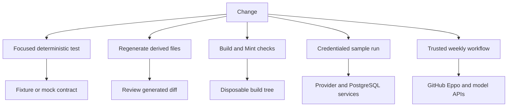
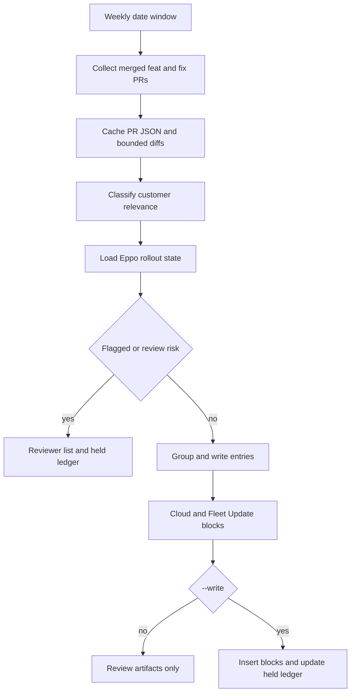

## Choose the validation boundary

Use the narrowest check that proves the changed contract, then add a check when the change crosses into generated output, a rendered documentation tree, credentials, a provider, or GitHub-hosted automation. A passing deterministic test does not establish that a remote API, a credentialed example, or a Mint-rendered site works.

| Change | Focused validation | What it establishes | Boundary it does not cross |
| --- | --- | --- | --- |
| Weekly changelog pipeline logic | `make test TEST_FILE=tests/unit_tests/test_changelog_pipeline.py` | Pure helper behavior with fixtures and mocks | GitHub, Anthropic, Eppo, or a real changelog PR |
| General Python change | `make test` | The socket-isolated pytest suite | Network-backed behavior |
| Authored documentation, redirects, anchors, or Agent Server OpenAPI | `make broken-links-with-anchors` and `make check-openapi` | Mint checks against the disposable `build/` tree | Hosted deployment state |
| Generated provider overview | `uv run python pipeline/tools/partner_pkg_table.py` and inspect the diff | The checked-in generated surface matches its generator and metadata | Rendered-site validity |
| TypeScript sample dependency or snippet generation rule | `make test TEST_FILE=tests/unit_tests/test_generate_code_snippet_mdx.py`, then `make code-snippets` | Generator/dependency invariants and generated MDX diff | A provider-backed sample execution |
| Runnable code sample | `make test-code-samples FILES="src/code-samples/..."` | The selected example ran with installed toolchains, services, and supplied credentials | That a rate-limited skip executed or all generated docs are valid |



This flow distinguishes local evidence from generated-output, rendered-site, live-service, and trusted automation evidence.

## Deterministic tests and CI coverage

The project requires Python `>=3.13.0,<4.0.0`. `make test` runs pytest with network sockets disabled except for Unix sockets, so tests that need an HTTP response must mock it. Pytest discovers tests below `tests` and uses automatic asyncio mode with function-scoped event loops.

The primary CI workflow runs on pull requests, pushes to `main`, and manual dispatch. It calls reusable test, lint, and link-check workflows, and separately checks merge markers, source cross-references, integration `docs_url` values, and the generated provider overview. The reusable test job runs only `make test`; it does not run Node-only tests or credentialed sample execution. Test and link workflows synchronize the test dependency group with `UV_FROZEN=true`, preventing an unnoticed lockfile update in CI.

The reusable link workflow installs Node 22 and Mint, then runs `make broken-links-with-anchors` and `make check-openapi`. Both targets build first. The link target checks anchors and redirects, filters known generated OpenAPI and standalone-snippet reporting noise, and fails only on remaining reported broken links. The OpenAPI target validates `build/langsmith/agent-server-openapi.json`. These are build-tree checks, not a proof of the deployed site.

`check-generated-files` regenerates `src/oss/python/integrations/providers/overview.mdx` and rejects a diff (subject to its documented bot/label exceptions). Change `packages.yml` or `pipeline/tools/partner_pkg_table.py`, regenerate, and commit the result rather than hand-editing that overview.

## Weekly changelog pipeline: focused contract

The active weekly path is `scripts/changelog_pipeline.py`, not the older fragment assembler. Its `weekly` command selects a Monday-to-Monday window (or requires both `--since` and `--until`), collects merged `feat`/`fix` PRs from `langchain-ai/langchainplus`, classifies them, loads rollout state, produces cached review material under `--out`, and—only with `--write`—updates the Cloud and Fleet changelog targets plus `scripts/.changelog_held.json`.



This is the pipeline’s control flow; API calls and model output make the full weekly operation non-deterministic even though its helper tests are deterministic.

Run the focused contract after changing the script:

```bash
make test TEST_FILE=tests/unit_tests/test_changelog_pipeline.py
```

The current unit test deliberately covers helpers that need no network or model: week labels and default windows, strict structured-output schema transformation, `Flag:` parsing (including ignored fenced, comment, quote, and indented-code text), release/retention of held entries, stable held-ledger order, insertion before existing updates, and PR-window filtering. It also uses a fake Anthropic stream to verify structured-output construction, caching metadata, and refusal/truncation failures. It does **not** run `gh`, call Anthropic or Eppo, classify actual PRs, write a production changelog, or open a GitHub PR.

Operationally, `gh` needs read access to the sibling repository; the model path uses `ANTHROPIC_API_KEY` when configured or a logged-in `claude` CLI otherwise; rollout evaluation uses `EPPO_API_KEY`. PR text is treated as untrusted user content, the CLI model invocation disables tools, and API/CLI responses are parsed as schema-constrained JSON. Keep secrets in environment or Actions secrets, never in fixtures or committed command lines.

The scheduled/manual `changelog-weekly.yml` job validates optional dates before it runs. It has a 90-minute limit, serializes runs under the `changelog-weekly` concurrency group, and receives repository write and pull-request write permissions. A dry run writes entries and the reviewer material to the job summary; a normal run can create or force-update a review branch only when the pipeline changed files. Vale is explicitly non-blocking, so review the generated changelog and reviewer list rather than treating a green workflow as autonomous publication.

### Change and failure guidance

- **Helper test failure:** repair a deterministic behavior or test double. Do not diagnose it as an Eppo, GitHub, or model outage.
- **Fewer than 90% classified:** the command stops before continuing to writing; inspect classification/API errors and rerun rather than publishing a partial week.
- **Flag ambiguity or missing rollout state:** keep the item held for human review. A fully rolled-out flag releases it; an archived flag is released with a prompt to confirm it shipped; missing or conflicting flags stay held.
- **Duplicate week:** with `--write`, an already-present label makes a rerun a no-op rather than inserting a second week.
- **Generated review branch:** inspect Cloud and Fleet wording, links, hold reasons, and `scripts/.changelog_held.json` before merge.

See [Changelog Publication](/openwiki/workflows/changelog-publication.md) for the publication process and [GitHub Actions and CI/CD](/openwiki/integrations/github-actions.md) for workflow trust boundaries.

## Generated documentation and sample dependencies

`make code-snippets` runs extraction and MDX generation but does not execute samples. The extractor recognizes line-based snippet/removal markers in Python, TypeScript, Java, Kotlin, Go, and shell files; it writes normalized Bluehawk-compatible output. `CODE_SNIPPET_SOURCES` accepts a validated subset under `src/code-samples` and replaces generated outputs only for those source stems. The MDX generator consumes extracted files and optional trace-manifest URLs, so a generated trace card is presentation metadata rather than proof that a sample ran.

For TypeScript examples, `src/code-samples/package.json` and `src/code-samples/package-lock.json` are the shared dependency owner and must change together. The lockfile declares the root sample dependencies, including `@langchain/google` and `tsx`. Use the focused generator test for model-expansion and dependency-floor rules, regenerate snippets, review the diff, then run the affected live sample when behavior or a dependency actually changes.

## Credentialed code samples

```bash
make test-code-samples
make test-code-samples FILES="src/code-samples/langchain/return-a-string.py"
```

The runner executes Python, TypeScript, Java, Kotlin, Go, and shell files under `src/code-samples`; `FILES` selects an explicit subset, while an unset `FILES` scans all eligible files excluding `__pycache__` and `node_modules`. Each executable sample has a 1,200-second default timeout, configurable through `CODE_SAMPLE_TIMEOUT_SECONDS`, and runs with language-specific commands and working directories: uv Python, npx tsx, Go, bash, or JBang using Java 21 for Java and Kotlin.

`CODE_SAMPLE_JOBS` controls concurrent sample execution with a default of four workers; samples in configured serial groups are mutually exclusive within their group, while trace collection is serialized to protect the shared manifest and prevent parallel samples from claiming the same LangSmith run. A sample that remains LangSmith-rate-limited after a configurable retry budget—five total attempts by default—with linear backoff from a configurable base delay capped at 120 seconds is recorded as skipped and does not fail the runner; other unsuccessful samples cause a nonzero exit. A skip is not successful live validation and should be rerun later.

When `CODE_SAMPLE_TRACING` is enabled, successful samples are followed by LangSmith trace collection; a trace collection failure is recorded as a warning and does not itself make the runner exit nonzero. Trace collection only creates a public manifest entry for a single-snippet source file with a qualifying recent agent root run; generated snippet MDX appends a View example trace card only for a manifest URL.

The code-sample workflow skips fork PRs because samples can require secrets. Pull requests run only changed eligible sample files. Scheduled monthly and manually dispatched runs execute all samples, enable tracing, and have a 150-minute limit; PR runs have a 60-minute limit. CI installs Node 20, Java 21/JBang, and the Go version declared by the sample module, exposes provider credentials, and starts a pgvector PostgreSQL service through `POSTGRES_URI`.

On a scheduled or manual full run, snippet regeneration follows only when the sample step was not cancelled, fewer than 20 samples failed, and at least one trace entry changed. The workflow may then update the trace-refresh PR, but an explicit final step still fails the job if sample execution failed. See [Code Sample Lifecycle](/openwiki/workflows/code-sample-lifecycle.md).

## Practical triage

- **Socket-isolated pytest failure:** fix the test, fixture, or mock rather than probing a remote service.
- **Mint link or OpenAPI failure:** reproduce with the build-oriented commands; inspect `build/`, redirects, anchors, and source generation.
- **Generated overview or snippet drift:** regenerate with the owning command and review/commit the result; do not edit derived output as the source of truth.
- **Live sample failure:** inspect credentials, provider behavior, PostgreSQL readiness, language toolchains, and the sample. Treat rate-limit skips as unexecuted cases.
- **Changelog workflow failure:** distinguish a deterministic helper regression from GitHub access, model credentials/response, Eppo state, or review/publication concerns.

For local setup, see [Quickstart](/openwiki/quickstart.md). For command behavior, see [CLI Tools](/openwiki/operations/cli-tools.md). For generated integration listings, see [Integration Listing Automation](/openwiki/workflows/integration-listing-automation.md).
