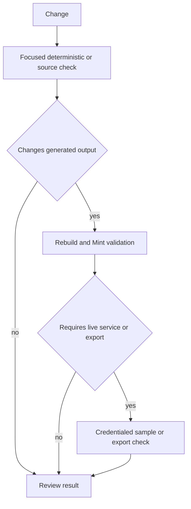

## Select the smallest meaningful boundary

Validation layers establish different contracts. Start with a focused deterministic test or source check; add regeneration and rendered-output validation when a change can alter generated routes, imports, redirects, anchors, or OpenAPI input. A successful local unit test does not demonstrate a complete Mintlify build, a remote URL, or a credentialed provider integration.

| Change | First check | Add when needed | What it proves |
| --- | --- | --- | --- |
| Python pipeline, parser, or builder behavior | `make test TEST_FILE=tests/unit_tests/test_builder.py` or the owning test file | `make broken-links-with-anchors` if output topology changes | Isolated behavior with network sockets disabled except Unix sockets |
| General Python change | `make test` | `make lint` for static quality | The repository pytest suite, not remote services |
| Formatting, lint, type, or spelling concern | `make lint` | Focused tests for behavior | Ruff format/lint diffs, `ty check`, and Codespell over `src` |
| Narrative prose | `make lint_prose FILES="src/..."` | Link/build checks if the edit changes links or structure | Vale style and terminology, not factual accuracy or rendering |
| `@[Name]` cross-reference or language scope | `make check-cross-refs` | Mint check for actual routes, redirects, or fragments | Source markers resolve in all applicable scopes |
| Authored ordinary link, route, redirect, navigation, or anchor | `make broken-links-with-anchors` | Hosted preview for deployment-only output | Mint validation of a fresh generated `build/` tree |
| Agent Server OpenAPI input | `make check-openapi` | Hosted preview for deployment-created endpoint routes | Mint OpenAPI validation of `langsmith/agent-server-openapi.json` |
| Partner integration `docs_url` metadata | `uv run python scripts/refresh_integration_downloads.py --check-docs-urls` | Regenerate the owning output when metadata changes | URLs use approved HTTP(S) or site-relative forms |
| Provider overview generator or `packages.yml` | `uv run python pipeline/tools/partner_pkg_table.py` and inspect the diff | CI generated-file check | The committed provider overview matches its generator |
| Runnable example | `make test-code-samples FILES="src/code-samples/..."` | `make code-snippets` after marker/content changes | The selected sample runs with available local tools and credentials |
| Exported static site external URLs | `make export-htmltest` | Mint link check for internal routes and anchors | Exported external destinations only |
| Changelog chapter navigation | `node --test tests/changelog-navigation.test.js` | Browser/manual verification for actual publication | In-memory DOM behavior of the navigation script |

*Validation expands from the changed contract to generated output and then to remote boundaries only when required.*

## Deterministic Python and static checks

The project requires Python `>=3.13.0,<4.0.0`; pytest discovers tests under `tests`, enables automatic asyncio mode, and uses a function-scoped default fixture loop. `make test` runs pytest with Internet sockets disabled while allowing Unix sockets. Tests that normally call HTTP services must therefore use a mock or local test double.

`make lint` is separate from test execution: it runs `ruff format --diff`, `ruff check --diff`, `ty check`, and `codespell src`. Ruff and `ty` have configured exclusions, including scripts and code samples, so a passing lint gate is neither sample execution nor a generated-documentation check. `make lint_prose` installs the configured Vale binary and checks either specified files or `src`, excluding `node_modules` and `src/code-samples`; it is a prose style gate rather than a rendering or factual-correctness check.

The reusable test and lint workflows install the `test` dependency group and run `make test` or `make lint`; the top-level CI invokes them for Python 3.13 on pull requests, pushes to `main`, and manual dispatch. CI also separately checks merge-conflict markers, source cross-references, integration URLs, and generated-file drift. These are independent gates, so repair the failing layer rather than substituting a broad build for a focused check.

## Documentation source and generated-tree checks

`make check-cross-refs` invokes `scripts/check_cross_refs.py`. It scans source `.md` and `.mdx` files, ignores code fences, escaped references, generated code-sample snippets, and `node_modules`, then requires every `@[ref]` to be present in its applicable scoped map. Shared un-fenced OSS content must resolve in both Python and JavaScript scopes; a `:::python` or `:::js` fence narrows the required scope. This validates semantic source references, not whether a generated route, redirect, fragment, or external destination can be reached.

For source links to retired documentation sites, `make check-legacy-links` is a separate policy guard. The pull-request workflow runs it for Markdown/MDX changes against `main`; it does not replace Mint's generated-site validation.

`make broken-links-with-anchors` and `make check-openapi` both depend on `build`, so they reconstruct the disposable `build/` tree before running Mint from that directory. The anchor target runs `mint broken-links --check-anchors --check-redirects`, filters documented false-positive classes, and fails when remaining indented link reports exist. `make check-openapi` runs `mint openapi-check langsmith/agent-server-openapi.json`; it is specifically an Agent Server input check, not validation of deployment-generated endpoints or remote OpenAPI sources. The reusable links workflow uses Node 22 and runs both checks.

`test_url_stub_noindex.py` protects a source invariant that Mint cannot infer: every MDX page with `url:` frontmatter must also set `noindex: true`, keeping redirect-only sidebar stubs out of `llms.txt`, `llms-full.txt`, and the sitemap. Run its focused test after changing redirect stubs.

## Metadata and generated-file drift

The top-level CI validates `docs_url` values in `scripts/data/integration_external_docs.yaml` through `scripts/refresh_integration_downloads.py --check-docs-urls`. The generator accepts `http://`, `https://`, or a single-leading-slash site-relative URL; it rejects protocol-relative and executable schemes. The corresponding unit tests cover safe and unsafe normalization, so run `make test TEST_FILE=tests/unit_tests/test_refresh_integration_downloads.py` when changing that policy or renderer.

The generated-file job regenerates `src/oss/python/integrations/providers/overview.mdx` with `pipeline/tools/partner_pkg_table.py` and fails if the result differs from the committed file. It can skip automated package-download updates and pull requests carrying the `bypass-auto-check` label. Do not edit the overview directly: change its generator or `packages.yml`, regenerate it, and review the diff.

## Samples, snippets, and static exports

`make test-code-samples` runs eligible Python, TypeScript, Java, Kotlin, Go, and shell files below `src/code-samples`; `FILES` narrows that set. This is a live integration boundary: samples may need provider credentials and services, unlike socket-isolated pytest. The dedicated workflow skips fork pull requests because secrets are unavailable, runs changed samples for same-repository pull requests, and runs all samples on monthly scheduled or manual jobs. It supplies language toolchains, provider secrets, and a pgvector PostgreSQL service; full runs enable tracing and can regenerate trace-linked snippet MDX under controlled conditions.

Snippet generation is separate: `make code-snippets` extracts marked source regions and generates MDX but does not execute examples. After changing a sample's markers or prose-facing generated output, run the focused sample first, then regenerate and review the derived files.

`make export-htmltest` sequentially runs Mint export and htmltest. Export requires a global Mint CLI that supports `mint export`, Node 20 or 22, and an Enterprise Mintlify plan. The htmltest configuration enables external URL checking while disabling internal paths and hashes because a Mint export omits many pages. Use `make broken-links-with-anchors` for internal route, redirect, and fragment coverage; use the export check only for its external-destination boundary.

## Focused JavaScript and release-watch tests

The changelog-navigation Node tests use an in-memory DOM to verify that the self-hosted changelog indexes only visible stable minor releases, preserves excluded headings, coalesces mutation updates, cleans up on page changes, and falls back to an inline index without a sidebar. They do not load a browser or prove Mint-rendered publication behavior.

The release-watch `test_evidence.py` suite uses synthetic payloads and source/page text to test evidence parsing, surgical edit validation, and source-claim matching; it does not exercise remote release, GitHub, or Linear integrations.

## Failure triage

- **Focused pytest fails:** fix the changed contract, fixture, or mock first. Do not use a remote request to bypass socket isolation.
- **Cross-reference failure:** correct the exact name or its scoped map entry; a Mint pass is not evidence that `@[...]` resolves correctly.
- **Mint link failure:** inspect the regenerated `build/` tree, route ownership, redirect destination, and fragment. The local check is not a hosted deployment check.
- **OpenAPI failure:** repair the Agent Server specification/input; inspect a preview separately for deployment-created endpoint pages.
- **Integration URL or generated drift:** change the metadata/generator source, regenerate, and commit the reviewed output rather than hand-editing derived files.
- **Sample failure or fork skip:** inspect credentials, provider behavior, PostgreSQL readiness, and language toolchains. A skipped or unrun live sample is a coverage gap.
- **Export htmltest failure:** treat it as external-destination evidence only; use Mint checks for internal navigation.

See [Builder Tests](/openwiki/testing/builder-tests.md), [Conditional Rendering](/openwiki/testing/conditional-rendering.md), [Cross-References](/openwiki/operations/cross-references.md), [Local Tooling and Commands](/openwiki/operations/cli-tools.md), and [Mintlify Integration](/openwiki/integrations/mintlify.md).
