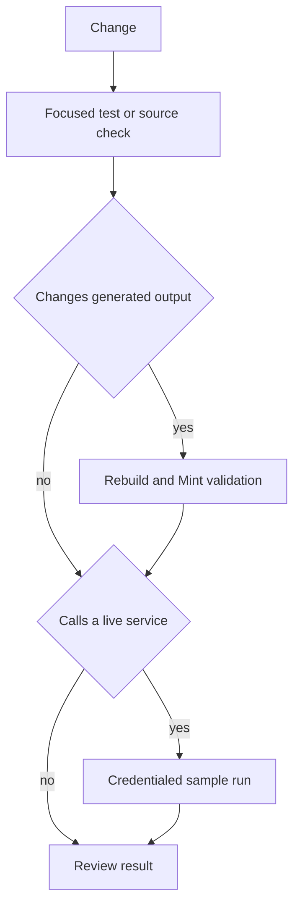
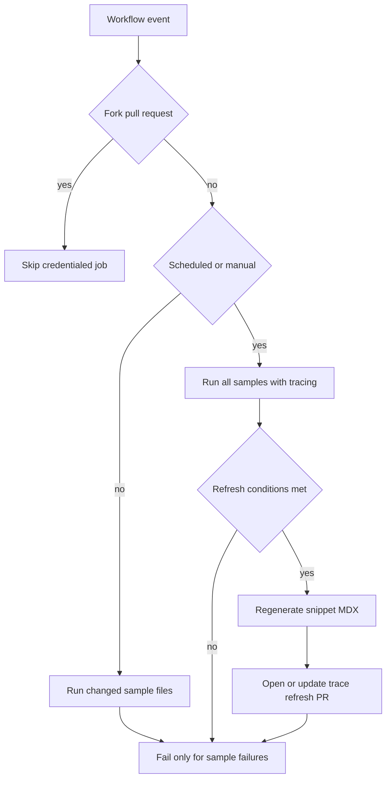

## Select the smallest meaningful boundary

Validation layers establish different contracts. Start with the focused test or source check for the behavior changed. Add a build and Mint validation when a change can alter generated routes, imports, redirects, anchors, or OpenAPI input. Add a live sample run only when an example actually crosses a provider or service boundary. A unit-test pass does not prove a complete build, a reachable external URL, or a credentialed integration; conversely, a credentialed run is not a substitute for deterministic assertions about a transformation.

| Change | First check | Add when needed | What it proves — and does not prove |
| --- | --- | --- | --- |
| LangSmith agent request/response example using the local fixture | `make test-code-samples FILES="src/code-samples/langsmith/create-an-agent.py"` | `make code-snippets` after changing snippet markers or extracted content | The real SDK sends the expected request and consumes the fixture schema on loopback. It does **not** create an agent in LangSmith or validate credentials. |
| Python pipeline, parser, or generator behavior | Owning `tests/unit_tests/test_*.py` file | `make test` before merging a wider change | Deterministic behavior with Internet sockets disabled, not remote services. |
| Formatting, lint, type, or spelling concern | `make lint` | Focused behavioral tests | Ruff formatting/lint diffs, `ty check`, and Codespell; not rendered output or runtime behavior. |
| Narrative prose | `make lint_prose FILES="src/..."` | Link/build checks when links or structure change | Vale terminology and style, not factual accuracy or rendering. |
| `@[Name]` cross-reference or language scope | `make check-cross-refs` | Mint check for final routes, redirects, or fragments | Source markers resolve in applicable language scopes, not route reachability. |
| Authored link, route, redirect, navigation, or anchor | `make broken-links-with-anchors` | Hosted preview for deployment-only behavior | Mint validation of a freshly generated `build/` tree, not a hosted deployment. |
| Agent Server OpenAPI input | `make check-openapi` | Hosted preview for deployment-created routes | Mint validation of local `langsmith/agent-server-openapi.json`, not a deployed endpoint. |
| Snippet extraction or provider-tab rendering | `make test TEST_FILE=tests/unit_tests/test_generate_code_snippet_mdx.py` | `make code-snippets` to inspect derived MDX | Generator semantics and generated-file consistency, without executing examples. |
| Runnable provider-backed example | `make test-code-samples FILES="src/code-samples/..."` | Full scheduled/manual CI when trace refresh is intended | A selected program runs with available tools, credentials, and services; rate-limit skips remain coverage gaps. |
| `docs_url` integration metadata or provider overview | `uv run python scripts/refresh_integration_downloads.py --check-docs-urls` or regenerate with `uv run python pipeline/tools/partner_pkg_table.py` | CI generated-file diff | Safe URL forms or generated-file consistency, respectively. |
| Exported static-site external URLs | `make export-htmltest` | Mint link check for internal routes and anchors | External destinations in the incomplete export only. |

*Validation expands from the changed contract to generated output and then to remote boundaries only when necessary.*

## Deterministic tests and static checks

`make test` runs pytest with Internet sockets disabled while allowing Unix sockets. Pytest discovers `tests`, enables automatic asyncio mode, and uses a function-scoped default fixture loop. Tests that normally call HTTP services therefore need a mock or a local test double.

The LangSmith `create-an-agent.py` sample is a useful, intentionally different boundary. It starts a `ThreadingHTTPServer` on `127.0.0.1`, patches the LangSmith environment to direct a real `Client` to that endpoint, and returns a fixture shaped like the public agent API. The sample invokes `agents.create` and `agents.retrieve`, then asserts the observed POST and GET paths/payload and returned environment values. Its `:remove-start:` regions keep fixture setup and assertions out of the extracted documentation snippets. Running this particular executable sample validates local request construction and response handling without a real agent, workspace, or API key.

`make lint` is separate from runtime testing: it runs `ruff format --diff`, `ruff check --diff`, `ty check`, and `codespell src`. `make lint_prose` installs the Vale version configured through `.mise.toml` and checks specified `FILES` or `src`, excluding `node_modules` and `src/code-samples`. These are style and static-quality gates, not evidence of rendered output or live sample correctness.

The main CI workflow runs reusable test, lint, and documentation-link workflows on pull requests, pushes to `main`, and manual dispatch. Separate jobs check merge markers, source cross-references, integration URLs, and generated provider overview drift. Repair the failed boundary rather than replacing it with a broader but less relevant check.

## Generated documentation and navigation

The documentation builder is the boundary between authored source and the tree Mint checks. `DocumentationBuilder.build_all()` reconstructs versioned Python and JavaScript OSS variants, unversioned Deep Agents Code and OpenWiki content, Managed Deep Agents language variants, shared assets, and npm snippet components. Markdown preprocessing rewrites language-sensitive links and snippet imports before output is written. Focused builder tests protect prefix rewriting, the single unversioned OpenWiki output, language-scoped snippet imports, and source-tree containment. Follow a topology change with Mint validation.

`make check-cross-refs` is narrower than a site build. It scans Markdown and MDX under `src`, skips code fences, escaped references, generated code-sample snippets, and `node_modules`, and requires `@[ref]` markers to resolve in their applicable language scopes. Shared unfenced OSS references must resolve for each applicable language. It cannot establish that a final route, redirect, fragment, or external destination works.

`make broken-links-with-anchors` and `make check-openapi` rebuild first, so they inspect regenerated rather than stale output. The link target runs Mint in `build/` with anchor and redirect checks; the OpenAPI target runs `mint openapi-check langsmith/agent-server-openapi.json`. The documentation-link workflow uses Node 22 for both. Separately, `test_url_stub_noindex.py` requires an MDX page with `url:` frontmatter to set `noindex: true`, keeping redirect-only sidebar stubs out of Mint discovery outputs such as `llms.txt` and the sitemap.

`src/docs.json` is the Mint configuration and navigation input consumed by the generated documentation site. Changes to its routes, redirects, or navigation require a generated-site check; source-level unit tests alone do not validate the resulting navigation.

## Snippet generation is not execution

`make code-snippets` runs `scripts/extract_code_snippets.py` and then `scripts/generate_code_snippet_mdx.py`; it does not execute sample programs. The extractor line-parses Python, TypeScript, Java, Kotlin, Go, and shell snippet markers, removes marked private regions, normalizes output newlines, and writes Bluehawk-compatible extracted files. `CODE_SNIPPET_SOURCES` can limit extraction to existing supported files below `src/code-samples`; in that mode, only output files for selected source stems are replaced.

The MDX generator reads those extracted snippets and produces documentation components. For Python and TypeScript it expands only routable agent `provider:model` strings into seven-provider CodeGroups. It leaves embedding IDs and provider-specific chat-client IDs unchanged because substituting them would make code invalid. `# KEEP MODEL` and `// KEEP MODEL` preserve the next model occurrence while removing the marker. Focused tests also keep Python and TypeScript Google provider syntax distinct, reject legacy TypeScript search-tool spelling, and require a sufficiently new resolved `@langchain/google` version for mixed built-in and function tools.

Treat a passing generator test and a clean generated diff as consistency evidence only. Neither proves that an extracted program compiles, reaches a provider, or produces a LangSmith trace.

## Credentialed code-sample and tracing boundary

`make test-code-samples` delegates to `scripts/test_code_samples.py`. With `FILES`, it accepts existing supported files under `src/code-samples`; without it, it discovers all supported files while excluding `__pycache__` and `node_modules`. It invokes Python through `uv`, TypeScript through `tsx`, Go through `go run`, shell through `bash`, and Java/Kotlin through JBang pinned to Java 21. Thus most samples are live integration tests whose result can depend on provider credentials, service availability, PostgreSQL, and language toolchains. The local `create-an-agent.py` fixture is an exception: it runs under the same launcher but deliberately remains local.

The runner defaults to four workers and serializes known groups that share LangSmith datasets or experiment fixtures. It retries recognized rate limits with capped growing delays and reports an exhausted rate limit as a skip; other failures produce a nonzero result. A skip therefore does not demonstrate correctness. With `CODE_SAMPLE_TRACING` enabled, a single-snippet sample stamps its snippet identity, trace collection is serialized and rate-limit-aware, and a trace-collection failure warns without turning an already successful sample into a suite failure.

The dedicated workflow skips fork pull requests because provider secrets are unavailable. Same-repository pull requests run changed executable sample files; scheduled and manually dispatched runs test all samples with tracing enabled. The workflow installs Python 3.13, Node 20, Java 21/JBang, Go from the code-samples module, provider credentials, and a healthy pgvector PostgreSQL service. The sample step may continue after failures so trace refresh can proceed, but a final step fails the job for sample failures.

*Credentialed CI scopes sample execution by event; only eligible full runs can publish trace-linked artifacts.*

On scheduled or manual runs, the workflow regenerates snippet MDX only if the test step was not cancelled, fewer than 20 samples failed, and trace links changed. It then opens or updates `chore/refresh-code-sample-traces` with `src/code-samples/trace-links.json` and `src/snippets/code-samples` only when those paths differ. Multi-snippet source files remain excluded from trace-link updates until split into one snippet per file.

## Other specialized checks

Integration URL validation accepts HTTP(S) and single-leading-slash site-relative `docs_url` values and rejects unsafe schemes. A separate CI job regenerates `src/oss/python/integrations/providers/overview.mdx` and fails on a diff; update its generator or `packages.yml`, regenerate, and review the output rather than hand-editing the derived file.

`make export-htmltest` runs Mint export before htmltest. Export requires a Mint CLI supporting `mint export`, Node 20 or 22, and an Enterprise plan. Because Mint export omits many pages, htmltest checks external URLs but disables internal-path and hash checks. Use the Mint generated-tree checks for internal navigation.

The changelog-navigation Node tests use an in-memory DOM to test stable-release indexing, excluded headings, mutation coalescing, cleanup on page changes, and inline fallback. The release-watch `test_evidence.py` suite uses synthetic payloads and source/page text for evidence parsing and edit validation. Neither is a browser-publication or remote-integration test.

## Failure triage

- **Local fixture sample fails:** inspect the fixture schema, patched endpoint configuration, request assertion, and SDK API usage. Do not diagnose it as a credential or production-service failure.
- **Generator test or generated diff fails:** repair marker syntax, extractor behavior, generator logic, or source model/tool conventions; rerun `make code-snippets` to review derived MDX.
- **Credentialed sample fails or is skipped:** distinguish a nonzero program result from a persistent rate-limit skip, then inspect credentials, provider behavior, PostgreSQL readiness, and the selected toolchain. A skip leaves untested behavior.
- **Cross-reference or Mint failure:** correct the relevant source map or inspect regenerated `build/`, route ownership, redirect, snippet import, and fragment. The checks prove different invariants.
- **Trace refresh does not occur:** verify a scheduled/manual event, no cancellation, fewer than 20 failures, and at least one changed trace link.
- **Export htmltest failure:** treat it as external-destination evidence only; use Mint checks for internal paths and anchors.

See [Versioning](/openwiki/concepts/versioning.md), [GitHub Actions](/openwiki/integrations/github-actions.md), [CLI Tools](/openwiki/operations/cli-tools.md), [Code Sample Lifecycle](/openwiki/workflows/code-sample-lifecycle.md), and [LangSmith Agent Documentation](/openwiki/workflows/langsmith-agent-documentation.md).
