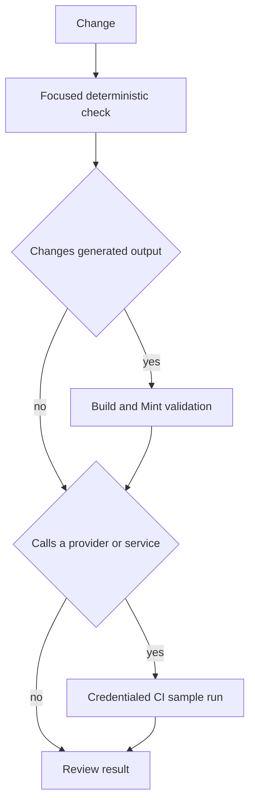
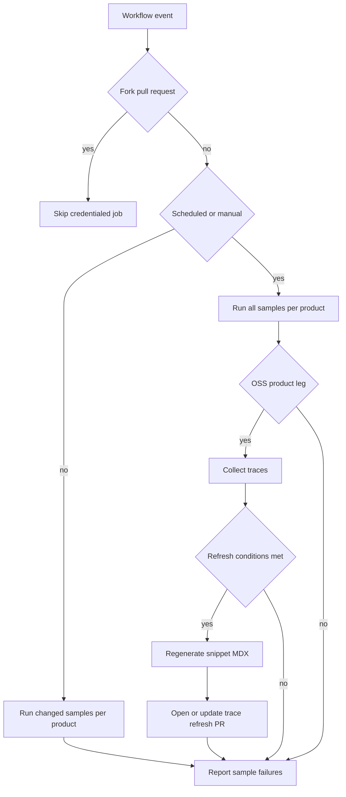

## Choose the smallest meaningful boundary

Each layer proves a different contract. Start with the focused unit test or static check for the code or source convention changed. Add generated-site validation when a change can affect routes, imports, redirects, anchors, navigation, or OpenAPI input. Run credentialed samples only when an example crosses a provider or service boundary. A unit-test pass does not prove a rendered site, a reachable external URL, or a provider integration; a live run does not replace deterministic assertions about a transformation.

### Validation matrix

| Change | Deterministic local check | Secret- or service-dependent CI check | Boundary proved |
| --- | --- | --- | --- |
| Python pipeline, parser, builder, or generator | The owning `tests/unit_tests/test_*.py`, then `make test` for a wider change | None normally | Fixture-controlled transformation behavior, not remote services. |
| Formatting, types, spelling, or prose style | `make lint`; `make lint_prose FILES="src/..."` | None | Static quality or Vale style, not rendering, factual correctness, or runtime behavior. |
| `@[Name]` cross-reference and language scope | `make check-cross-refs` | None | Source references resolve in applicable scopes, not final route reachability. |
| Authored route, redirect, navigation, anchor, or Agent Server OpenAPI input | `make broken-links-with-anchors`; `make check-openapi` | Hosted-preview checks only when deployment behavior matters | Freshly generated Mint tree, including routes, redirects, and anchors; not a deployed site. |
| Snippet markers, extraction, model-tab expansion, or generated snippet MDX | Focused generator test, then `make code-snippets` and review the diff | None | Extractor/generator consistency; samples are not executed. |
| Integration `docs_url` or provider overview | `uv run python scripts/refresh_integration_downloads.py --check-docs-urls`; regenerate the overview | CI generated-file diff | Safe URL shapes or that generated output is committed, not remote URL availability. |
| Local fixture example | `make test-code-samples FILES="src/code-samples/langsmith/create-an-agent.py"` | None | SDK request/response compatibility against loopback, not a LangSmith workspace. |
| Provider-backed executable example | Select it with `make test-code-samples FILES="src/code-samples/..."` when credentials and tools are available | Same-repository PR or scheduled/manual code-sample workflow | Program execution against available credentials and services; rate-limit skips leave a coverage gap. |
| Exported static-site external URLs | `make export-htmltest` where Mint export and network access are available | CI is the suitable repeatable environment | External destinations in the exported subset only, not internal routes or fragments. |

*Validation expands from the changed deterministic contract to generated output and then to remote boundaries only when the change requires it.*

## Deterministic checks

`make test` invokes pytest with Internet sockets disabled and Unix sockets allowed. Pytest discovers `tests`, uses automatic asyncio mode, and defaults the asyncio fixture loop to function scope. Tests that ordinarily make HTTP calls therefore need mocks or local test doubles.

The LangSmith `create-an-agent.py` sample deliberately provides such a boundary. It directs a real LangSmith `Client` to a loopback HTTP fixture, asserts the create and retrieve requests plus returned environment values, and removes fixture-only setup and assertions from extracted snippets. It validates SDK request/response compatibility, not a live LangSmith agent integration.

`make lint` runs `ruff format --diff` and `ruff check --diff` over the configured Python-file scope, `ty check`, and Codespell over `src`; it is a static-quality gate distinct from runtime tests and documentation generation. `make lint_prose` installs the configured Vale binary and checks specified files or `src`, excluding `node_modules` and `src/code-samples`; it is a prose style gate rather than a rendering or factual-correctness check.

The main CI workflow runs reusable test, lint, and documentation-link workflows on pull requests, pushes to `main`, and manual dispatch. It also separately checks merge markers, source cross-references, integration `docs_url` values, and generated provider-overview drift. Repair the failed boundary instead of substituting a broader but less relevant check.

### Generated documentation and navigation

`DocumentationBuilder.build_all()` reconstructs the generated tree with Python and JavaScript OSS variants, unversioned Deep Agents Code and OpenWiki content, Managed Deep Agents language variants, shared assets, and npm snippet components. Its Markdown processing rewrites language-sensitive links and snippet imports before output is written. Focused builder tests protect generated navigation topology: language-prefix rewriting, a single unversioned OpenWiki output, language-scoped snippet imports, and rejection of source symlinks so collection cannot copy content outside the source tree.

`make check-cross-refs` validates source `@[ref]` markers by scanning Markdown and MDX under `src`, skipping code fences, escaped references, generated code-sample snippets, and `node_modules`; unfenced shared OSS references must resolve in every applicable language scope. It is narrower than a site build and cannot prove a final route, redirect, fragment, or external destination.

`make broken-links-with-anchors` rebuilds documentation and runs Mint's broken-link checker from `build/` with anchor and redirect checking. `make check-openapi` similarly rebuilds and checks `langsmith/agent-server-openapi.json`; the reusable documentation workflow runs both on Node 22. `src/docs.json` is the Mintlify site configuration, including navigation, so route or navigation changes need generated-site validation rather than only source-level tests.

Navigation is also a builder input, not merely presentation metadata. For shared OSS pages, the builder reads `navigation` routes under `oss/python/` and `oss/javascript/` and emits a language copy only for a language that lists that route; pages listed in both—or in neither—are emitted for both languages. It caches this route map until `docs.json` changes so development rebuilds see navigation edits, and falls back to both language copies if `docs.json` is absent or invalid. Therefore, test a navigation edit with the focused builder suite as well as the generated-site link check.

`test_url_stub_noindex.py` requires every MDX page with `url:` frontmatter to set `noindex: true`, so redirect-only sidebar stubs stay out of Mintlify discovery outputs including `llms.txt` and the sitemap.

## Generated snippets are not execution

`make code-snippets` extracts marked snippets and generates MDX without executing them, whereas `make test-code-samples` executes selected or eligible samples; trace-enabled full runs may regenerate snippet MDX after sample execution. The extractor line-parses supported language markers, strips `:remove:` regions, and writes normalized Bluehawk-compatible extracted files. `CODE_SNIPPET_SOURCES` limits processing to supported files below `src/code-samples` and replaces output only for those selected source stems.

The snippet-MDX generator expands only routable Python or TypeScript agent model strings into provider CodeGroups, preserving embedding and provider-specific chat model identifiers. Focused tests enforce those exclusions, language-specific Google provider syntax, and a compatible resolved `@langchain/google` version. A clean generator test or generated diff is consistency evidence only: it does not show that the example compiles, reaches a provider, or produces a trace.

The generated provider overview follows the same ownership rule: CI validates integration `docs_url` metadata with `scripts/refresh_integration_downloads.py --check-docs-urls`; the generator permits HTTP(S) and single-leading-slash site-relative URLs and rejects unsafe schemes, while the generated-file job regenerates and diffs the provider overview rather than accepting manual edits.

## Executable samples: local runner and credentialed CI

The code-sample runner accepts supported executable files beneath `src/code-samples`, runs each language with its corresponding toolchain, retries recognized rate limits and reports exhausted rate limits as skips, while non-rate-limit failures make the command fail. Its `FILES` input can select a narrow sample; `CODE_SAMPLE_PATHS` restricts both discovery and an explicit file list to directories under `src/code-samples`, which permits a CI matrix leg to receive the same modified-file list and retain only its product's paths.

Code-sample runs default to four workers but serialize known shared-fixture groups. When tracing is enabled, trace collection is locked and failures collecting a trace warn without converting an already successful sample into a suite failure. Trace collection stamps and matches a single snippet identity, so multi-snippet sources do not receive trace-link updates.

The workflow skips fork pull requests because samples can require secrets, runs changed executable samples on same-repository pull requests, and runs all samples on scheduled/manual runs. It separates OSS and LangSmith product legs: the OSS leg owns LangChain, LangGraph, and Deep Agents samples, and the LangSmith leg owns LangSmith samples; an uncovered sample directory fails the workflow. It provisions provider credentials, Python, Node, Java/JBang, Go, and a pgvector PostgreSQL service. Tracing and trace-refresh publication are enabled only for the OSS leg on scheduled/manual runs.

*Credentialed CI partitions sample ownership by product; only eligible full OSS runs collect and publish trace-linked artifacts.*

On scheduled or manual code-sample runs, the OSS workflow regenerates snippet MDX only when the run was not cancelled, fewer than 20 samples failed, and trace links changed. It then opens or updates a dedicated trace-refresh pull request containing the trace manifest and generated snippet artifacts. The test step continues after errors to allow this decision, while a final step makes sample failures fail the job.

## Export checks and focused suites

`make export-htmltest` runs Mint export before htmltest; the export requires a Mint CLI with `mint export`, Node 20 or 22, and an Enterprise plan. The export htmltest configuration checks external URLs but disables internal paths and hashes because the Mint export is incomplete, so it cannot establish internal navigation or anchor correctness. Use the Mint generated-tree check for those contracts.

The changelog-navigation Node tests use an in-memory DOM to verify that the self-hosted changelog indexes only visible stable minor releases, preserves excluded headings, coalesces mutation updates, cleans up on page changes, and falls back to an inline index without a sidebar. The release-watch `test_evidence.py` suite uses synthetic payloads and source/page text to test evidence parsing, surgical edit validation, and source-claim matching; it does not exercise remote release, GitHub, or Linear integrations.

## Failure triage

- **Focused unit or fixture failure:** correct the transformation, fixture schema, request assertion, or SDK usage. Do not diagnose a loopback fixture as a production credential failure.
- **Generator test or generated diff:** repair marker syntax, extractor/generator logic, source conventions, or the owning metadata, then regenerate and review derived files.
- **Mint or cross-reference failure:** inspect regenerated `build/`, route ownership, redirects, snippet imports, and fragments. Source-map and generated-site checks prove different invariants.
- **Credentialed sample failure or skip:** distinguish a nonzero program failure from an exhausted rate-limit skip, then inspect credentials, provider behavior, PostgreSQL readiness, and the selected toolchain. A skip is not a pass.
- **Missing trace refresh:** confirm an OSS scheduled/manual event, no cancellation, fewer than 20 failures, and changed trace links.
- **Export htmltest failure:** treat it as external-destination evidence only; use Mint checks for internal paths and anchors.

See [GitHub Actions](/openwiki/integrations/github-actions.md), [CLI Tools](/openwiki/operations/cli-tools.md), [Builder Tests](/openwiki/testing/builder-tests.md), [Conditional Rendering](/openwiki/testing/conditional-rendering.md), and [Code Sample Lifecycle](/openwiki/workflows/code-sample-lifecycle.md).
