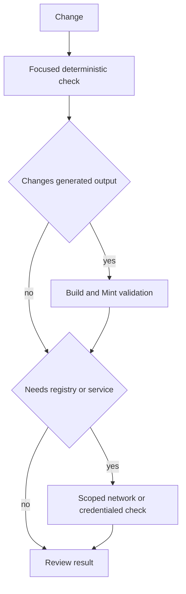

## Choose the smallest meaningful boundary

Each layer proves a different contract. Start with the focused unit test or static check for the code or source convention changed. Add generated-site validation when a change can affect routes, imports, redirects, anchors, navigation, or OpenAPI input. Run credentialed samples only when an example crosses a provider or service boundary. A unit-test pass does not prove a rendered site, a reachable external URL, or a provider integration; a live run does not replace deterministic assertions about a transformation.

| Change | Deterministic local check | CI-only or network-dependent check | Boundary proved |
| --- | --- | --- | --- |
| Python pipeline, parser, builder, or generator | Owning `tests/unit_tests/test_*.py`, then `make test` for a wider change | None normally | Fixture-controlled transformation behavior, not remote services. |
| Authored MDX package floor or pin | `uv run python scripts/check_version_claims.py --files src/path/to/page.mdx` | Changed-document version-claim workflow | The literal `>=` or `==` version was published on its routed registry, not that it is the correct feature floor. |
| Formatting, types, spelling, or prose style | `make lint`; `make lint_prose FILES="src/..."` | None | Static quality or Vale style, not rendering, factual correctness, or runtime behavior. |
| `@[Name]` cross-reference and language scope | `make check-cross-refs` | CI repeats it | Source references resolve in applicable scopes, not final route reachability. |
| Authored route, redirect, navigation, anchor, or Agent Server OpenAPI input | `make broken-links-with-anchors`; `make check-openapi` | Hosted preview when deployment behavior matters | Freshly generated Mint tree, including routes, redirects, and anchors; not a deployed site. |
| Egress IP inventory or its rendered tables | `uv run python scripts/generate_egress_ip_tables.py --check` | None required | The canonical JSON, its content-derived version, and both marked table blocks agree; a full build additionally proves publication. |
| OTLP setup prose | `make test TEST_FILE=tests/unit_tests/test_otel_endpoints.py` | None | Documentation syntax and Python exporter endpoint resolution, not trace ingestion by a live workspace. |
| Snippet markers or generated snippet MDX | Focused generator test, then `make code-snippets` and review the diff | None | Extractor/generator consistency; samples are not executed. |
| Runnable LangSmith sample | `make test-code-samples FILES="src/code-samples/langsmith/..."` | Same-repository PR or scheduled/manual sample workflow when it needs credentials | Local fixture compatibility or execution against available credentials and services. |
| Exported static-site external URLs | `make export-htmltest` where Mint export and network access are available | A suitable repeatable environment | External destinations in the exported subset only, not internal routes or fragments. |

*Validation expands from the changed deterministic contract to generated output and then to remote boundaries only when the change requires it.*

## Core local gates

`make test` runs pytest with Internet sockets disabled while allowing Unix sockets; pytest discovers tests under `tests`, uses automatic asyncio mode, and defaults its asyncio fixture loop scope to a function. Tests that ordinarily make HTTP calls therefore need mocks or local test doubles.

`make lint` runs Ruff formatting and lint checks in diff mode over the configured Python-file scope, `ty check`, and Codespell over `src`, making it a static-quality gate separate from runtime tests and documentation generation. `make lint_prose` installs the configured Vale binary and checks either specified files or `src`, excluding `node_modules` and `src/code-samples`; it is a prose style gate rather than a rendering or factual-correctness check.

The main CI workflow runs reusable test, lint, and documentation-link workflows on pull requests, pushes to `main`, and manual dispatch, and separately runs merge-marker, source cross-reference, integration `docs_url`, and generated-provider-overview checks. The reusable test and lint jobs synchronize the test dependency group; the link job also installs Node 22 and Mint before running the generated-tree checks.

### Version claims are publication checks, not upgrade advice

The changed-document workflow is a read-only pull-request gate for changes to authored `src/**/*.mdx`, the checker, its ignore file, or its workflow. It finds the merge base, passes changed MDX files to `scripts/check_version_claims.py --files`, and skips Python setup and registry requests if that set is empty. It fails only when a successfully resolved PyPI or npm package does not contain a named version; registry outages and unavailable lookups are unresolved notes rather than false failures.

The checker routes scoped names to npm and extras to PyPI, then uses the nearest inline language label, `:::python`/`:::js` fences, and language path before defaulting to PyPI. It checks exact pins and truncated series floors, groups duplicate locations, and ignores exact configured exceptions before lookups. Focused tests protect this precedence, safe package-name handling, lookup failure semantics, and PyPI/npm payload parsing. Do not use a successful check as evidence that a feature was introduced at the stated floor.

## Generated documentation and navigation

`DocumentationBuilder.build_all()` reconstructs the generated tree with Python and JavaScript OSS variants, unversioned Deep Agents Code and OpenWiki content, Managed Deep Agents language variants, shared assets, and npm snippet components; its Markdown processing rewrites language-sensitive links and snippet imports before output is written. Focused builder tests protect generated navigation topology by checking language-prefix rewriting, single unversioned OpenWiki output, language-scoped snippet imports, and rejection of source symlinks so build collection cannot copy content outside the source tree.

`src/docs.json` is the Mintlify site configuration, including navigation, so changes to its navigation or route configuration require generated-site validation rather than only source-level tests. The builder uses `src/docs.json` navigation routes beneath `oss/python/` and `oss/javascript/` to decide which language copies of shared OSS pages to emit; a route listed in neither language falls back to both copies, and an absent or invalid configuration also falls back to both. Test a navigation edit with the focused builder suite as well as `make broken-links-with-anchors`.

`make check-cross-refs` validates source `@[ref]` markers by scanning Markdown and MDX under `src`, skipping code fences, escaped references, generated code-sample snippets, and `node_modules`; unfenced shared OSS references must resolve in every applicable language scope. It is narrower than a site build and cannot prove a final route, redirect, fragment, or external destination.

`make broken-links-with-anchors` rebuilds documentation and runs Mint's broken-link checker from `build/` with anchor and redirect checking, while `make check-openapi` rebuilds then checks `langsmith/agent-server-openapi.json`; the reusable documentation workflow runs both on Node 22. `test_url_stub_noindex.py` requires every MDX page with `url:` frontmatter to set `noindex: true` so redirect-only sidebar stubs stay out of Mintlify discovery outputs including `llms.txt` and the sitemap.

## Inventory and endpoint correctness

The egress IP inventory is a generated-publication contract. `scripts/generate_egress_ip_tables.py` accepts only schema version 1 with a nonempty version and address list; each entry must contain exactly service, cloud, region, and a globally routable IPv4 `/32`. It limits services to the two owning pages, clouds to GCP or AWS, regions to US, EU, or APAC, and rejects duplicate entries. The canonical inventory version is a SHA-256 digest of sorted address data.

Running the generator normally updates the inventory version and the one delimited generated block in each owning page. `--check` instead reports inventory-version or table drift and fails without writing. The focused suite mutates fixtures to prove invalid entries and duplicate addresses fail, stale JSON or table output is detected, regeneration converges, and a full `DocumentationBuilder` build copies the JSON bytes exactly once to the unversioned `build/langsmith/egress-ip-addresses.json` artifact. Edit the JSON and regenerate tables; do not hand-edit a rendered table.

OpenTelemetry endpoint tests scan every authored MDX file for two configuration errors: a generic `OTEL_EXPORTER_OTLP_ENDPOINT` must not already include `/v1/traces`, `/v1/metrics`, or `/v1/logs`, and collector exporter YAML must use `traces_endpoint` rather than `endpoint` when its value ends in `/v1/traces`. They also create a real Python OTLP HTTP exporter with a mocked session: `OTEL_EXPORTER_OTLP_TRACES_ENDPOINT` is used unchanged, while a generic base endpoint gains exactly one `/v1/traces` suffix. This protects endpoint construction and documentation conventions without contacting LangSmith.

## Generated snippets and runnable samples

`make code-snippets` extracts marked snippets and generates MDX without executing them, whereas `make test-code-samples` executes selected or eligible samples; trace-enabled full runs may regenerate snippet MDX after sample execution. The extractor line-parses supported language markers, strips `:remove:` regions, and writes normalized Bluehawk-compatible extracted files; `CODE_SNIPPET_SOURCES` limits processing to supported files below `src/code-samples` and replaces output only for those selected source stems.

The snippet-MDX generator expands only routable Python or TypeScript agent model strings into provider CodeGroups, preserving embedding and provider-specific chat model identifiers; focused tests enforce those exclusions, language-specific Google provider syntax, and a compatible resolved `@langchain/google` version. The generated provider overview follows the same ownership rule: CI validates integration `docs_url` metadata with `scripts/refresh_integration_downloads.py --check-docs-urls`; the generator permits HTTP(S) and single-leading-slash site-relative URLs and rejects unsafe schemes, while the generated-file job regenerates and diffs the provider overview rather than accepting manual edits.

The code-sample runner accepts supported executable files beneath `src/code-samples`, runs each language with its corresponding toolchain, retries recognized rate limits and reports exhausted rate limits as skips, while non-rate-limit failures make the command fail. `CODE_SAMPLE_PATHS` restricts both discovered samples and explicit `FILES` to directories below `src/code-samples`; focused tests verify that a CI product leg can receive all modified paths while retaining only its own files and that out-of-tree filters cannot widen execution. Runs default to four workers but serialize known shared-fixture groups. When tracing is enabled, trace collection is locked and failures collecting a trace warn without converting an already successful sample into a suite failure.

The `create-an-agent.py` executable sample directs a real LangSmith `Client` to a loopback HTTP fixture, asserts the create and retrieve requests and returned environment values, and removes fixture-only setup and assertions from extracted snippets; it validates local SDK request/response compatibility rather than a live LangSmith agent integration.

## CI-only sample boundary and exports

The code-sample workflow skips fork pull requests because samples can require secrets, runs changed executable samples on same-repository pull requests and all samples on scheduled/manual runs, and provisions provider credentials, language toolchains, and a pgvector PostgreSQL service. It partitions samples into OSS and LangSmith matrix legs, fails when a top-level sample directory has no assigned leg, and limits tracing plus trace-refresh publication to the OSS leg on scheduled or manually dispatched runs.

Trace-link collection is limited to source files with exactly one valid snippet ID: the runner stamps that ID in `LANGSMITH_DOCS_SNIPPET`, and the collector requires the same metadata on a root run rather than selecting an arbitrary run from the time window. On scheduled or manual code-sample runs, the workflow regenerates snippet MDX only when the run was not cancelled, fewer than 20 samples failed, and trace links changed; it then opens or updates a dedicated trace-refresh pull request containing the trace manifest and generated snippet artifacts.

`make export-htmltest` runs Mint export before htmltest; the export requires a Mint CLI with `mint export`, Node 20 or 22, and an Enterprise plan, while htmltest intentionally checks external URLs only because the export omits many pages. The export htmltest configuration checks external URLs but disables internal paths and hashes because the Mint export is incomplete, so it cannot establish internal navigation or anchor correctness.

The changelog-navigation Node tests use an in-memory DOM to verify that the self-hosted changelog indexes only visible stable minor releases, preserves excluded headings, coalesces mutation updates, cleans up on page changes, and falls back to an inline index without a sidebar. The release-watch `test_evidence.py` suite uses synthetic payloads and source/page text to test evidence parsing, surgical edit validation, and source-claim matching; it does not exercise remote release, GitHub, or Linear integrations.

## Failure triage

- **Version-claim failure:** correct the literal package version or a routing/context error. Treat an unresolved-registry note as missing evidence, not proof that an unpublished version is valid.
- **Builder, navigation, or Mint failure:** inspect regenerated `build/`, route ownership, redirects, snippet imports, and fragments. Source-map and generated-site checks prove different invariants.
- **Egress failure:** fix the canonical JSON or its allowed values, run `python scripts/generate_egress_ip_tables.py`, and commit the resulting inventory/table changes.
- **OTLP endpoint failure:** use a base URL with `OTEL_EXPORTER_OTLP_ENDPOINT`, or use the signal-specific traces variable or `traces_endpoint` when supplying `/v1/traces`.
- **Sample failure or skip:** distinguish a nonzero program failure from an exhausted rate-limit skip, then inspect credentials, provider behavior, PostgreSQL readiness, and the selected toolchain. A skip is not a pass.
- **Export htmltest failure:** treat it as external-destination evidence only; use Mint checks for internal paths and anchors.

See [GitHub Actions](/openwiki/integrations/github-actions.md), [Mintlify Integration](/openwiki/integrations/mintlify.md), [Validate Package Version Claims](/openwiki/operations/version-claims.md), [Repository Wiki Quickstart](/openwiki/quickstart.md), and [LangSmith Agent and Observability Documentation Changes](/openwiki/workflows/langsmith-agent-documentation.md).
