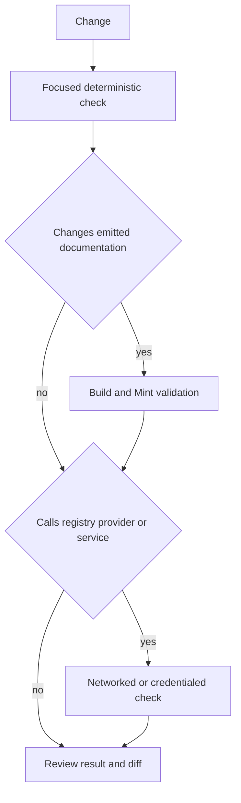
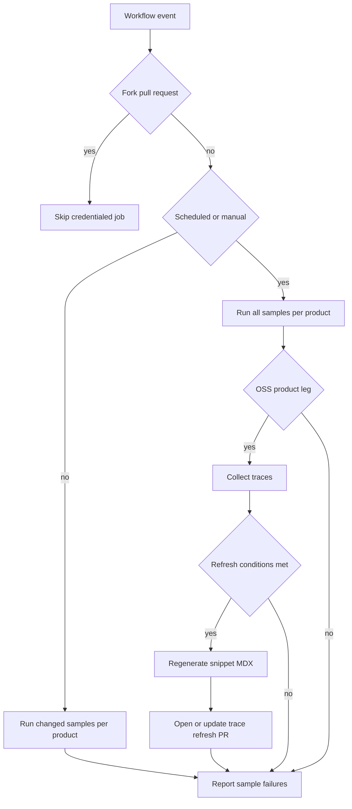

## Choose the smallest meaningful boundary

Start with the focused test or check for the contract that changed, then expand only when the change crosses another boundary. A unit-test pass does not prove emitted routes, redirects, anchors, remote registries, or provider integration. Conversely, a credentialed execution does not replace deterministic assertions about parsing or generated output.

| Change | First focused check | Expand when needed | What it proves—and does not prove |
| --- | --- | --- | --- |
| Python pipeline, parser, builder, or generator | Owning `tests/unit_tests/test_*.py` | `make test` for a wider change | Fixture-controlled behavior, not remote services. |
| Style, types, spelling, or prose | `make lint`; `make lint_prose FILES="src/..."` | None normally | Static quality or Vale style, not rendering or factual correctness. |
| `@[Name]` cross-reference | `make check-cross-refs` | Generated-site link validation for routes | Source reference resolution, not final route or fragment reachability. |
| Authored route, redirect, navigation, anchor, or Agent Server OpenAPI input | Builder test where relevant, then `make broken-links-with-anchors` or `make check-openapi` | Hosted behavior only if deployment-specific | The freshly generated Mint tree, including redirects and anchors. |
| Package version stated in changed MDX | `uv run python scripts/check_version_claims.py --files src/...` | The pull-request workflow runs the changed-page form | The named release exists in its registry, not that it is the correct feature floor. |
| Egress-IP inventory or generated table | `uv run python scripts/generate_egress_ip_tables.py --check` | Rebuild if public-artifact placement changes | Schema, public-address safety, content-derived version, and generated-table consistency. |
| OpenTelemetry endpoint documentation | `pytest tests/unit_tests/test_otel_endpoints.py` | `make test` | Documentation conventions plus mocked OTLP exporter URL construction, not a live collector. |
| Snippet markers or generated snippet MDX | Focused generator test, then `make code-snippets` and review the diff | Execute the source sample separately | Extractor/generator consistency; it does not run samples. |
| Integration `docs_url` or provider overview | `uv run python scripts/refresh_integration_downloads.py --check-docs-urls`; regenerate overview | CI generated-file diff | Accepted URL shape and derived-file drift, not remote URL availability. |
| Agent skill instructions | `pytest tests/unit_tests/test_skills.py` | `make test` | Parseable skill metadata and live repository references, not that the procedure is semantically sufficient. |
| Provider-backed executable example | Select it with `make test-code-samples FILES="src/code-samples/..."` | Same-repository PR or scheduled/manual sample workflow | Execution against supplied credentials and services; a rate-limit skip is a coverage gap. |
| Exported-site external URLs | `make export-htmltest` when its prerequisites are available | CI or a networked environment | External destinations in the export subset only, not internal routes or fragments. |

*Validation expands from the changed deterministic contract to generated output and remote boundaries only when the change requires it.*

## Baseline deterministic gates

`make test` invokes pytest with Internet sockets disabled while allowing Unix sockets. Pytest discovers `tests`, uses automatic asyncio mode, and defaults its asyncio fixture loop scope to a function. Tests that would ordinarily make HTTP calls need mocks or local test doubles.

`make lint` runs Ruff formatting and lint checks in diff mode over the configured Python-file scope, `ty check`, and Codespell over `src`, making it a static-quality gate separate from runtime tests and documentation generation. `make lint_prose` installs the configured Vale binary and checks either specified files or `src`, excluding `node_modules` and `src/code-samples`; it is a prose style gate rather than a rendering or factual-correctness check.

The main CI workflow runs reusable test, lint, and documentation-link workflows on pull requests, pushes to `main`, and manual dispatch, and separately runs merge-marker, source cross-reference, integration `docs_url`, and generated-provider-overview checks. Repair the failed boundary instead of substituting a broader but less relevant check.

### Version claims are registry-existence checks

The pull-request-only **Check version claims** workflow runs when MDX, the checker, its ignore list, or the workflow changes. It calculates changed `src/**/*.mdx` files relative to the PR merge base and passes them to `scripts/check_version_claims.py --files`; no changed MDX means the job does not set up Python or query registries.

The checker recognizes `>=` and `==` package specifiers and resolves their ecosystem using package syntax first, then nearby language labels, `:::python`/`:::js` fences, page path, and finally a Python default. It checks PyPI or npm publication, accepting a truncated version series when any release in that series exists. An unavailable registry or disallowed package name is reported as unresolved rather than a nonexistent release; only a version that was successfully looked up and is absent fails the normal check. It deliberately cannot decide whether a published minimum version is semantically correct.

### Documentation output and navigation

`DocumentationBuilder.build_all()` reconstructs the generated tree with Python and JavaScript OSS variants, unversioned Deep Agents Code and OpenWiki content, Managed Deep Agents language variants, shared assets, and npm snippet components; its Markdown processing rewrites language-sensitive links and snippet imports before output is written. Focused builder tests protect generated navigation topology by checking language-prefix rewriting, single unversioned OpenWiki output, language-scoped snippet imports, and rejection of source symlinks so build collection cannot copy content outside the source tree.

`src/docs.json` is the Mintlify site configuration, including navigation, so changes to its navigation or route configuration require generated-site validation rather than only source-level tests. The builder uses `src/docs.json` navigation routes beneath `oss/python/` and `oss/javascript/` to decide which language copies of shared OSS pages to emit; a route listed in neither language falls back to both copies, and an absent or invalid configuration also falls back to both. Its route map is cached until `docs.json` changes, allowing development rebuilds to observe navigation edits.

`make check-cross-refs` validates source `@[ref]` markers by scanning Markdown and MDX under `src`, skipping code fences, escaped references, generated code-sample snippets, and `node_modules`; unfenced shared OSS references must resolve in every applicable language scope.

`make broken-links-with-anchors` rebuilds documentation and runs Mint's broken-link checker from `build/` with anchor and redirect checking, while `make check-openapi` rebuilds then checks `langsmith/agent-server-openapi.json`; the reusable documentation workflow runs both on Node 22. `test_url_stub_noindex.py` requires every MDX page with `url:` frontmatter to set `noindex: true` so redirect-only sidebar stubs stay out of Mintlify discovery outputs including `llms.txt` and the sitemap.

### Generated inventories have one source of truth

The egress-IP generator treats `src/langsmith/egress-ip-addresses.json` as the inventory and renders bounded generated regions in the two customer-facing cloud pages. It accepts only schema version 1, a nonempty version, and nonempty entries with exactly service, cloud, region, and CIDR fields. Each entry must be a public IPv4 `/32`, use a supported service/cloud/region combination, and be unique in its full scope.

`--check` recomputes the inventory's SHA-256-derived version and compares both marked tables without writing. It fails on stale inventory version or table text and tells the maintainer to run the generator without `--check`; the updating mode writes the version and only the generated blocks. A full builder run also copies the inventory unchanged to the single unversioned `build/langsmith/egress-ip-addresses.json` artifact. Thus, edit the JSON and regenerate—do not hand-edit the tables or emitted artifact.

### OpenTelemetry endpoint documentation

The OpenTelemetry suite scans every source MDX file: a generic `OTEL_EXPORTER_OTLP_ENDPOINT` must be a base endpoint rather than include `/v1/traces`, `/v1/metrics`, or `/v1/logs`; collector configurations that target `/v1/traces` must use `traces_endpoint` rather than generic `endpoint`. It also configures the Python OTLP HTTP exporter with mocked sessions to ensure a signal-specific `OTEL_EXPORTER_OTLP_TRACES_ENDPOINT` remains unchanged and a base endpoint receives exactly one `/v1/traces` suffix. This protects documentation against a duplicated trace path without sending data to the LangSmith endpoint.

## Generated snippets and executable samples

`make code-snippets` extracts marked snippets and generates MDX without executing them, whereas `make test-code-samples` executes selected or eligible samples; trace-enabled full runs may regenerate snippet MDX after sample execution. The snippet extractor line-parses supported language markers, strips `:remove:` regions, and writes normalized Bluehawk-compatible extracted files; `CODE_SNIPPET_SOURCES` limits processing to supported files below `src/code-samples` and replaces output only for those selected source stems.

The snippet-MDX generator expands only routable Python or TypeScript agent model strings into provider CodeGroups, preserving embedding and provider-specific chat model identifiers; focused tests enforce those exclusions, language-specific Google provider syntax, and a compatible resolved `@langchain/google` version. The generated provider overview follows the same ownership rule: CI validates integration `docs_url` metadata with `scripts/refresh_integration_downloads.py --check-docs-urls`; the generator permits HTTP(S) and single-leading-slash site-relative URLs and rejects unsafe schemes, while the generated-file job regenerates and diffs the provider overview rather than accepting manual edits.

The code-sample runner accepts supported executable files beneath `src/code-samples`, runs each language with its corresponding toolchain, retries recognized rate limits and reports exhausted rate limits as skips, while non-rate-limit failures make the command fail. `CODE_SAMPLE_PATHS` restricts both discovered samples and explicit `FILES` to directories below `src/code-samples`; focused tests verify that a CI product leg can receive all modified paths while retaining only its own files and that out-of-tree filters cannot widen execution. Runs default to four workers but serialize known shared-fixture groups; with tracing enabled, trace collection is locked and a collection failure warns without turning an already successful sample into a suite failure. Trace-link collection is limited to source files with exactly one valid snippet ID: the runner stamps that ID in `LANGSMITH_DOCS_SNIPPET`, and the collector requires the same metadata on a root run rather than selecting an arbitrary run from the time window.

The `create-an-agent.py` executable sample directs a real LangSmith `Client` to a loopback HTTP fixture, asserts the create and retrieve requests and returned environment values, and removes fixture-only setup and assertions from extracted snippets. It validates local SDK request/response compatibility rather than a live LangSmith agent integration.

*Credentialed CI partitions sample ownership by product; only eligible full OSS runs collect and publish trace-linked artifacts.*

The code-sample workflow skips fork pull requests because samples can require secrets, runs changed executable samples on same-repository pull requests and all samples on scheduled/manual runs, and provisions provider credentials, language toolchains, and a pgvector PostgreSQL service. It partitions samples into OSS and LangSmith matrix legs, fails when a top-level sample directory has no assigned leg, and limits tracing plus trace-refresh publication to the OSS leg on scheduled or manually dispatched runs. On such a run it regenerates snippet MDX only when the run was not cancelled, fewer than 20 samples failed, and trace links changed; it then opens or updates a dedicated trace-refresh pull request containing the trace manifest and generated snippet artifacts. The test step continues after errors to allow this decision, while a final step makes sample failures fail the job.

## Export, structural checks, and triage

`make export-htmltest` runs Mint export before htmltest; the export requires a Mint CLI with `mint export`, Node 20 or 22, and an Enterprise plan. The export htmltest configuration checks external URLs but disables internal paths and hashes because the Mint export is incomplete, so it cannot establish internal navigation or anchor correctness. Use the Mint generated-tree check for those contracts.

The skills suite is deliberately structural: every `.agents/skills/*/SKILL.md` must have parsable, recognized frontmatter whose `name` matches its kebab-case directory; referenced repository paths and Make targets must exist; and the skills README and `AGENTS.md` inventories must match the actual skill directories. This makes a renamed command or nonexistent path a deterministic failure before an agent can follow stale instructions.

The changelog-navigation Node tests use an in-memory DOM to verify that the self-hosted changelog indexes only visible stable minor releases, preserves excluded headings, coalesces mutation updates, cleans up on page changes, and falls back to an inline index without a sidebar. The release-watch `test_evidence.py` suite uses synthetic payloads and source/page text to test evidence parsing, surgical edit validation, and source-claim matching; it does not exercise remote release, GitHub, or Linear integrations.

- **Focused unit, fixture, or structural failure:** correct the transformation, fixture schema, request assertion, path, or Make target. Do not diagnose a mock or loopback fixture as a production credential failure.
- **Version-claim failure:** correct an unpublished version or add a justified ignored specifier. Treat an unresolved registry lookup as a note, not evidence that the version is bad.
- **Generated inventory or snippet drift:** change the canonical inventory, marker/source convention, or generator and regenerate; do not patch derived output.
- **Mint or cross-reference failure:** inspect regenerated `build/`, route ownership, redirects, imports, and fragments. Source-map and generated-site checks prove different invariants.
- **Credentialed sample failure or skip:** distinguish a nonzero program failure from an exhausted rate-limit skip, then inspect credentials, provider behavior, PostgreSQL readiness, and the selected toolchain. A skip is not a pass.
- **Export htmltest failure:** treat it as external-destination evidence only; use Mint checks for internal paths and anchors.

See [GitHub Actions](/openwiki/integrations/github-actions.md), [Mintlify](/openwiki/integrations/mintlify.md), [Version Claims](/openwiki/operations/version-claims.md), [Builder Tests](/openwiki/testing/builder-tests.md), [Conditional Rendering](/openwiki/testing/conditional-rendering.md), and [Egress IP Inventory](/openwiki/workflows/egress-ip-inventory.md).
