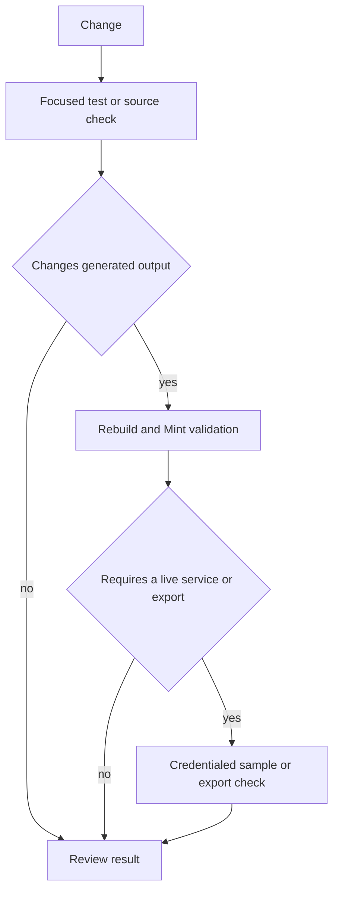
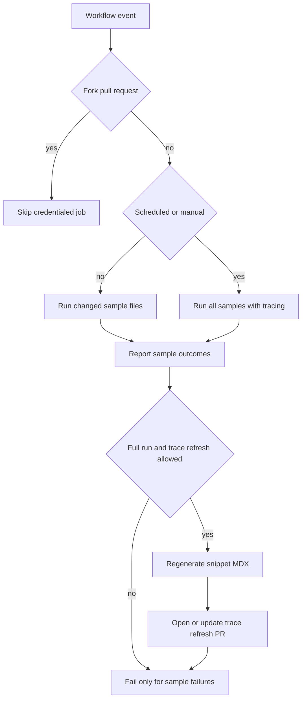

## Select the smallest meaningful boundary

Validation layers establish different contracts. Begin with the focused test or source check for the behavior changed. Add a build and Mint validation when the change can alter generated routes, imports, redirects, anchors, or OpenAPI input; add a live sample run only when the example crosses a provider or service boundary. A unit-test pass does not prove a complete build, a reachable external URL, or a credentialed integration.

| Change | First check | Add when needed | What it proves |
| --- | --- | --- | --- |
| Builder routing, rewriting, or copy behavior | `make test TEST_FILE=tests/unit_tests/test_builder.py` | `make broken-links-with-anchors` when output navigation changes | Generated-tree rules in an isolated filesystem |
| Python pipeline or parser behavior | Owning `tests/unit_tests/test_*.py` file | `make test` before merging a wider change | Deterministic behavior with Internet sockets disabled |
| General Python change | `make test` | `make lint` for static quality | The repository pytest suite, not remote services |
| Formatting, lint, type, or spelling concern | `make lint` | Focused tests for behavior | Ruff format/lint diffs, `ty check`, and Codespell |
| Narrative prose | `make lint_prose FILES="src/..."` | Link/build checks when links or structure change | Vale terminology and style, not factual accuracy or rendering |
| `@[Name]` cross-reference or language scope | `make check-cross-refs` | Mint check for actual routes, redirects, or fragments | Source markers resolve in their applicable language scopes |
| Authored link, route, redirect, navigation, or anchor | `make broken-links-with-anchors` | Hosted preview for deployment-only output | Mint validation of a fresh generated `build/` tree |
| Agent Server OpenAPI input | `make check-openapi` | Hosted preview for deployment-created endpoint routes | Mint validation of `langsmith/agent-server-openapi.json` |
| Partner integration `docs_url` metadata | `uv run python scripts/refresh_integration_downloads.py --check-docs-urls` | Regenerate its owning output when metadata changes | URL schemes and site-relative forms are safe |
| Provider overview generator or `packages.yml` | `uv run python pipeline/tools/partner_pkg_table.py` and inspect the diff | CI generated-file check | The committed overview matches its generator |
| Snippet rendering or provider-tab logic | `make test TEST_FILE=tests/unit_tests/test_generate_code_snippet_mdx.py` | `make code-snippets` when extracted output changes | Generated MDX preserves runnable language/provider semantics |
| Runnable example | `make test-code-samples FILES="src/code-samples/..."` | `make code-snippets` after marker/content changes | The selected executable sample runs with available tools and credentials |
| Exported static-site external URLs | `make export-htmltest` | Mint link check for internal routes and anchors | Exported external destinations only |
| Changelog chapter navigation | `node --test tests/changelog-navigation.test.js` | Browser/manual verification for publication | In-memory DOM behavior of the navigation script |

*Validation expands from the changed contract to generated output and then remote boundaries only when necessary.*

## Deterministic Python and static checks

`make test` runs pytest with Internet sockets disabled while allowing Unix sockets. Pytest discovers `tests`, enables automatic asyncio mode, and uses a function-scoped default fixture loop. Tests that normally call HTTP services therefore need a mock or local test double.

`make lint` is separate from runtime testing: it runs `ruff format --diff`, `ruff check --diff`, `ty check`, and `codespell src`. `make lint_prose` installs the configured Vale binary and checks specified `FILES` or `src`, excluding `node_modules` and `src/code-samples`. These are style and static-quality gates, not evidence of rendered output or live sample correctness.

The top-level CI invokes reusable test, lint, and documentation-link workflows on pull requests, pushes to `main`, and manual dispatch. It also has independent merge-marker, source cross-reference, integration-URL, and generated-provider-overview jobs. Repair the failed boundary rather than substituting a broad build for the check that expresses the actual invariant.

## Generated routes and navigation

The builder is the boundary between authored source and the tree that Mint checks. `DocumentationBuilder.build_all()` clears and recreates `build/`, emits versioned OSS trees for Python and JavaScript, emits language-agnostic Deep Agents Code and OpenWiki pages once, produces language variants for Managed Deep Agents, copies shared assets, and copies npm snippet components. Markdown preprocessing then rewrites language-sensitive OSS links, managed Deep Agents routes, and MDX snippet imports before the output is written.

The focused builder suite protects route topology that source-level link review can miss. It checks that already-prefixed links are not double-prefixed, language-agnostic OpenWiki and Deep Agents Code routes are not duplicated under language paths, and nested pages import language-scoped snippet copies. It also verifies that source collection excludes symlinks, preventing a build from copying content outside the source tree. Follow builder test changes with Mint validation when a route or anchor visible in the generated documentation changes.

`make check-cross-refs` is narrower. It scans Markdown and MDX under `src`, skipping code fences, escaped references, generated code-sample snippets, and `node_modules`, then requires each `@[ref]` to resolve in its applicable scope. Shared unfenced OSS references must resolve in both Python and JavaScript maps; `:::python` and `:::js` fences narrow that obligation. This does not establish that a final route, redirect, fragment, or external destination is reachable.

`make broken-links-with-anchors` and `make check-openapi` both depend on `build`, so they validate regenerated rather than stale output. The link target runs Mint from `build/` with anchor and redirect checking and filters documented false-positive report classes before failing on remaining link records. The OpenAPI target runs `mint openapi-check langsmith/agent-server-openapi.json`; it checks that local Agent Server input, not deployment-generated endpoints or a remote specification. The reusable workflow installs dependencies, uses Node 22, and runs both checks.

`test_url_stub_noindex.py` enforces a source invariant outside Mint's route reachability check: an MDX page declaring `url:` must set `noindex: true`. This prevents redirect-only sidebar stubs from entering Mint discovery artifacts such as `llms.txt` and the sitemap.

## Integration metadata and generated-file drift

Integration tables combine frontmatter-derived rows with third-party rows from `scripts/data/integration_external_docs.yaml`. CI invokes `scripts/refresh_integration_downloads.py --check-docs-urls` to validate their `docs_url` values. Safe destinations are HTTP(S) URLs or a single-leading-slash site-relative path; protocol-relative and executable schemes are rejected. The focused refresh tests cover safe/unsafe normalization and ensure an unsafe URL cannot become a rendered `href`.

A distinct CI job regenerates `src/oss/python/integrations/providers/overview.mdx` with `pipeline/tools/partner_pkg_table.py`, then fails if the committed file differs. It can skip automated package-download updates and pull requests labeled `bypass-auto-check`. Do not hand-edit that overview: change its generator or `packages.yml`, regenerate, and review the resulting diff.

## Snippet generation and runnable samples

`make code-snippets` is a generation operation, not an execution operation: it extracts marked regions and emits MDX. The generator may turn a Python or TypeScript agent model string into a seven-provider `<CodeGroup>`, but deliberately does not substitute embedding models or provider-specific chat-client models, which would make an otherwise runnable snippet invalid. `# KEEP MODEL` and `// KEEP MODEL` suppress expansion for the next model line and are removed from output. Its focused tests additionally guard language-specific Google provider keys, the TypeScript built-in-search spelling, and the minimum resolved `@langchain/google` version needed for mixed built-in/function tools.

`make test-code-samples` delegates to `scripts/test_code_samples.py`. With `FILES` it accepts only existing `.py`, `.ts`, `.java`, `.kt`, `.go`, and `.sh` files below `src/code-samples`; without it, it discovers all such files while excluding `__pycache__` and `node_modules`. It runs Python through `uv`, TypeScript with `tsx`, Go with `go run`, shell with `bash`, and Java/Kotlin through JBang on Java 21. This is intentionally a live boundary and may require provider API keys and PostgreSQL.

The runner defaults to four workers, supports `CODE_SAMPLE_JOBS`, and serializes known samples that share a LangSmith dataset or experiment fixture. It retries recognized rate limits with capped growing delays; after retries, a rate-limited sample is reported as skipped rather than failed. Other failures produce a nonzero result. When `CODE_SAMPLE_TRACING` is enabled, successful single-snippet samples stamp their snippet identity for trace matching; trace collection is locked, retries rate limits, and warns rather than failing a sample suite that already passed.

The dedicated workflow is deliberately trust-sensitive: fork pull requests are skipped because secrets are unavailable. Same-repository pull requests run only changed executable code-sample files, while scheduled and manual runs test all samples. It supplies provider credentials, Python/Node/Java/JBang/Go toolchains, and a healthy pgvector PostgreSQL service. The test step continues long enough to refresh traces but the final step fails the job if samples failed.

*Credentialed sample CI selects its scope by event, and only full runs can publish refreshed trace-linked snippet artifacts.*

Scheduled and manual runs enable `CODE_SAMPLE_TRACING=1`. If the test step was not cancelled, fewer than 20 samples failed, and at least one trace link changed, the workflow regenerates snippet MDX. It preserves the refreshed `src/code-samples/trace-links.json` and `src/snippets/code-samples` artifacts while switching to `chore/refresh-code-sample-traces`, then opens or appends to that pull request only when those paths differ. Multi-snippet source files remain excluded from trace-link updates until split into one snippet per file.

## Static exports and focused JavaScript tests

`make export-htmltest` sequentially runs Mint export and htmltest. Export requires a Mint CLI with `mint export`, Node 20 or 22, and an Enterprise plan. The htmltest configuration checks external URLs but disables internal paths and hashes because Mint export omits many pages. Use `make broken-links-with-anchors` for internal routes, redirects, and fragments; use the export check only for its external-destination boundary.

The changelog-navigation Node tests use an in-memory DOM to verify that the self-hosted changelog indexes only visible stable minor releases, preserves excluded headings, coalesces mutation updates, cleans up on page changes, and falls back to an inline index without a sidebar. They do not load a browser or prove Mint-rendered publication behavior.

The release-watch `test_evidence.py` suite uses synthetic payloads and source/page text to test evidence parsing, surgical edit validation, and source-claim matching; it does not exercise remote release, GitHub, or Linear integrations.

## Failure triage

- **Focused pytest or generator test fails:** repair the changed transformation or its fixture first; do not use a remote request to bypass socket isolation.
- **Cross-reference failure:** correct the exact name or scoped map entry. A Mint pass is not evidence that `@[...]` resolves correctly.
- **Mint link failure:** inspect regenerated `build/`, route ownership, redirect destination, snippet import, and fragment. The local check is not a hosted deployment check.
- **Integration URL or generated drift:** change metadata or generator source, regenerate, and commit the reviewed output rather than editing a derived file.
- **Sample failure or fork skip:** distinguish an actual failed process from a persistent rate-limit skip, then inspect credentials, provider behavior, PostgreSQL readiness, and toolchain setup. A skip is a coverage gap even though the runner does not fail it.
- **Trace refresh does not occur:** check that the run was manual/scheduled, was not cancelled, has fewer than 20 failures, and reported updated traces.
- **Export htmltest failure:** treat it as external-destination evidence only; use Mint checks for internal navigation.

See [Builder Tests](/openwiki/testing/builder-tests.md), [Conditional Rendering](/openwiki/testing/conditional-rendering.md), [GitHub Actions](/openwiki/integrations/github-actions.md), [Code Sample Lifecycle](/openwiki/workflows/code-sample-lifecycle.md), and [Integration Listing Automation](/openwiki/workflows/integration-listing-automation.md).
