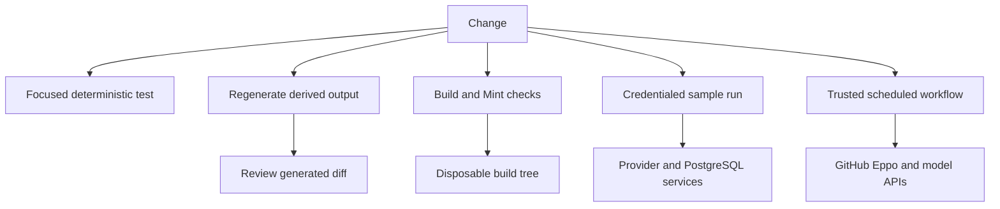
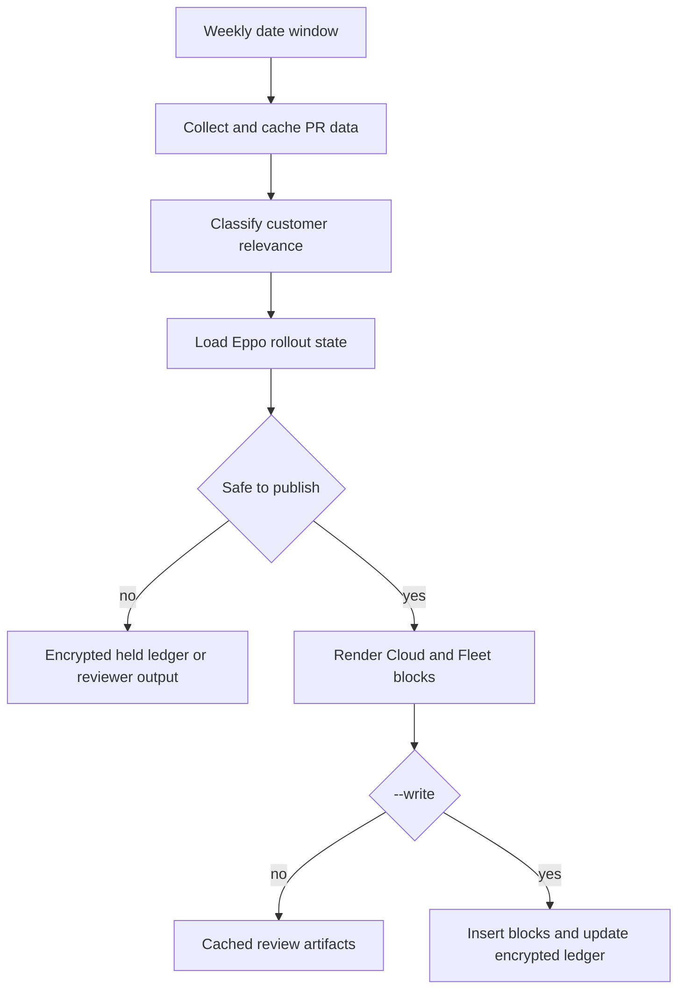

## Choose the validation boundary

Start with the smallest deterministic test that proves a changed contract. Add regeneration, documentation build, live sample, or trusted workflow validation only when the change crosses that boundary. A unit-test pass does not establish that a rendered site, a provider-backed example, a secret-bearing job, or a GitHub API integration works.

| Change | Focused validation | Establishes | Does not establish |
| --- | --- | --- | --- |
| Changelog helper or state logic | `make test TEST_FILE=tests/unit_tests/test_changelog_pipeline.py` | Windows, parsing, state, rollout, rendering, and model-client behavior with doubles | GitHub, Anthropic, Eppo, or a review PR |
| Onboarding model registry/checker | `make test TEST_FILE=tests/unit_tests/test_check_onboarding_models.py` | Registry validation, model detection, suggestion, local-checkout behavior | Access to the remote `langchainplus` checkout |
| Snippet generator or sample dependency invariant | `make test TEST_FILE=tests/unit_tests/test_generate_code_snippet_mdx.py`, then `make code-snippets` | Language/provider and dependency-floor invariants plus derived MDX output | Provider-backed execution |
| Redirect-only documentation page | `make test TEST_FILE=tests/unit_tests/test_url_stub_noindex.py` | Every `url:` stub is excluded from discovery surfaces | Rendered links and deployment behavior |
| General Python change | `make test` | Socket-isolated pytest suite | Network-backed behavior |
| Authored docs, anchors, redirects, or Agent Server OpenAPI | `make broken-links-with-anchors` and `make check-openapi` | Mint checks against the disposable `build/` tree | Hosted-site state |
| Runnable code sample | `make test-code-samples FILES="src/code-samples/..."` | Selected sample ran with local toolchains and supplied services/credentials | A rate-limited skip or generated docs correctness |



This flow separates local contract evidence from generated-output, rendered-site, live-service, and secret-bearing automation evidence.

## Deterministic suite and ordinary CI

The project requires Python `>=3.13.0,<4.0.0`. `make test` invokes pytest with network sockets disabled except Unix sockets; HTTP-facing tests must use a mock or other local test double. Pytest discovers `tests`, uses automatic asyncio mode, and creates its event loop fixture at function scope.

The main CI workflow runs on pull requests, pushes to `main`, and manual dispatch. It invokes reusable test, lint, and documentation-link workflows, then separately checks merge-conflict markers, source cross-references, integration `docs_url` values, and drift in the generated provider overview. The provider overview is generated from `packages.yml` and `pipeline/tools/partner_pkg_table.py`; regenerate it rather than hand-editing `src/oss/python/integrations/providers/overview.mdx`.

The reusable link workflow uses frozen uv dependency resolution, Node 22, and Mint. `make broken-links-with-anchors` and `make check-openapi` each depend on a fresh `build/`; the former checks redirects and anchors after filtering known standalone-snippet and generated-OpenAPI noise, while the latter checks `build/langsmith/agent-server-openapi.json`. These validate the generated tree, not the deployed site.

`test_url_stub_noindex.py` protects a distinct discovery invariant: an MDX page that uses `url:` only as a sidebar redirect must also set `noindex: true`, so it does not appear in `llms.txt`, `llms-full.txt`, or the sitemap.

## Weekly changelog: deterministic core and encrypted state

`scripts/changelog_pipeline.py weekly` is the active weekly path. It chooses the most recently completed Monday-to-Monday window unless both dates are supplied, collects and classifies merged `feat`/`fix` PRs, loads Eppo rollout state, renders cached review artifacts under `--out`, and only mutates changelog targets and the held ledger with `--write`. A duplicate update label is a write-mode no-op rather than a second insertion.



This is the weekly control flow. GitHub collection, Anthropic classification/writing, and Eppo state make a full run non-deterministic even where the helper tests are deterministic.

The held list is `scripts/.changelog_held.json.enc`. It contains private PR and unreleased-work context, so Fernet encryption requires `CHANGELOG_STATE_KEY`; missing, invalid, or wrong keys fail closed. A plaintext sibling is folded into an encrypted write and removed. For held entries, only a flag Eppo reports fully rolled out is released. Conflicting declarations, missing flags, and archived-but-not-fully-rolled-out flags are excluded from publication and reported for review rather than assumed shipped.

Run the focused suite after changing this pipeline:

```bash
make test TEST_FILE=tests/unit_tests/test_changelog_pipeline.py
```

The tests cover date labels and default windows; strict schema closure; `Flag:` parsing that ignores examples/comments/quoted text; insertion and merge-window filtering; deterministic held-ledger ordering; encrypted state failure behavior; Eppo rollout semantics; and mocked Anthropic streaming behavior, including refusal/truncation errors. They do not invoke `gh`, call remote services, classify actual PRs, or create a changelog PR.

The weekly workflow runs every Monday or manually, validates optional date pairs, serializes jobs, and uses a 90-minute job limit. It passes GitHub-read, Anthropic, Eppo, and `CHANGELOG_STATE_KEY` secrets to the pipeline. A dry run writes only publishable entries to the public job summary: the full report remains private because it can name private PRs and unreleased work. A non-dry run opens or force-updates a review branch only when state or changelog files changed; Vale is non-blocking. Review wording, links, held reasons, and the encrypted-ledger change before merging.

## Onboarding-model registry check

The onboarding checker is a detect-only remote boundary. `scripts/data/onboarding_models.yaml` declares the `langchain-ai/langchainplus` ref, in-scope onboarding paths, each provider's preferred model and accepted current IDs, plus explicit ignores. The checker validates repository/ref/path safety and requires each preferred ID to be among its provider's current IDs before it interpolates registry values into GitHub requests.

It recognizes OpenAI, Anthropic, Google, and constrained quoted o-series model IDs, accepts listed model IDs and their dated snapshots, and reports each outdated occurrence with a line number and the provider's preferred replacement. It returns 0 when clean, 1 for findings, and 2 when the registry or source cannot be read; `--repo-dir` is the deterministic local-checkout seam.

The scheduled/manual workflow uses a read-only `LANGCHAINPLUS_READ_TOKEN` to read snippets and treats status 2 as an operational failure. Findings do not fail that job: it creates or updates one standing GitHub issue; a clean status closes it. The workflow never edits `langchainplus`, so model changes remain a frontend-reviewed action.

## Generated snippets and sample invariants

`make code-snippets` extracts snippets and generates MDX, but does not execute samples. The extractor handles line-based snippet/removal markers across Python, TypeScript, Java, Kotlin, Go, and shell files. `CODE_SNIPPET_SOURCES` is a validated source subset and replaces outputs only for selected stems. Thus generated snippet validation and live example execution are intentionally separate boundaries.

The generator tests enforce runnable language distinctions that are easy to break in generated code: TypeScript samples must use the `google:` provider key and camel-case `googleSearch`, while Python uses `google_genai:`; provider-specific chat classes and embeddings are not incorrectly expanded into a multi-provider CodeGroup. They also require both the declared and lockfile-resolved `@langchain/google` version to meet the tool-configuration floor. Update `src/code-samples/package.json` and `package-lock.json` together, regenerate, and review the diff.

With tracing enabled, a successful sample can produce a public LangSmith link. Trace collection only creates a manifest entry for a single-snippet source with a qualifying recent root run carrying the `LANGSMITH_DOCS_SNIPPET` stamp. Multi-snippet sources are recorded as skipped and any stale single-snippet links are removed. MDX appends a View example trace card only when the manifest supplies a URL; that card is presentation metadata, not proof of a current successful run.

## Credentialed code samples

```bash
make test-code-samples
make test-code-samples FILES="src/code-samples/langchain/return-a-string.py"
```

The runner executes Python, TypeScript, Java, Kotlin, Go, and shell files under `src/code-samples`; `FILES` selects an explicit subset, while an unset `FILES` scans all eligible files excluding `__pycache__` and `node_modules`. Each executable sample has a 1,200-second default timeout, configurable through `CODE_SAMPLE_TIMEOUT_SECONDS`, and runs with language-specific commands and working directories: uv Python, npx tsx, Go, bash, or JBang using Java 21 for Java and Kotlin.

`CODE_SAMPLE_JOBS` controls concurrent sample execution with a default of four workers; samples in configured serial groups are mutually exclusive within their group, while trace collection is serialized to protect the shared manifest and prevent parallel samples from claiming the same LangSmith run. A sample that remains LangSmith-rate-limited after a configurable retry budget—five total attempts by default—with linear backoff from a configurable base delay capped at 120 seconds is recorded as skipped and does not fail the runner; other unsuccessful samples cause a nonzero exit. A skip is unexecuted live validation and should be rerun.

When `CODE_SAMPLE_TRACING` is enabled, successful samples are followed by LangSmith trace collection; a trace collection failure is a warning and does not itself make the runner exit nonzero. The workflow skips fork PRs because sample execution can need secrets. Pull requests run only changed eligible samples; scheduled monthly and manual runs execute all samples, enable tracing, and use a 150-minute limit rather than the PR limit of 60 minutes. CI provisions Node 20, Java 21/JBang, Go from the sample module, provider credentials, and a pgvector PostgreSQL service through `POSTGRES_URI`.

On a scheduled or manual full run, snippet regeneration occurs only when the sample step was not cancelled, fewer than 20 samples failed, and at least one trace entry changed. The workflow can then open or update the trace-refresh PR, but an explicit final step still fails the workflow when sample execution failed.

## Triage and related guidance

- **Socket-isolated pytest failure:** repair the test, fixture, or mock rather than probing a remote service.
- **Registry checker status 2:** investigate credentials, GitHub availability, registry validation, or an empty source scope; it is not a model-drift finding.
- **Generated drift:** run the owning generator, review and commit its output; do not make derived output the source of truth.
- **Mint failure:** reproduce with build-oriented commands and inspect `build/`, redirects, anchors, and source generation.
- **Live sample failure:** inspect credentials, provider behavior, PostgreSQL readiness, and language toolchains. Treat rate-limit skips as coverage gaps.
- **Weekly workflow issue:** distinguish deterministic pipeline behavior from GitHub access, model behavior, Eppo state, encryption-key availability, and human publication review.

See [Changelog Publication](/openwiki/workflows/changelog-publication.md), [Code Sample Lifecycle](/openwiki/workflows/code-sample-lifecycle.md), [GitHub Actions and CI/CD](/openwiki/integrations/github-actions.md), [CLI Tools](/openwiki/operations/cli-tools.md), and [Quickstart](/openwiki/quickstart.md).
