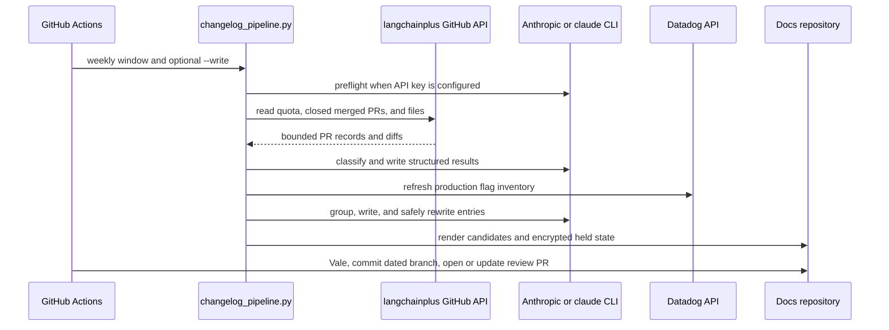
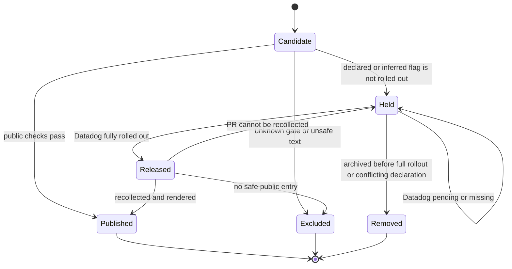

# Automated Changelog Publication

The weekly pipeline proposes—not directly publishes—updates to `src/langsmith/changelog.mdx` and `src/snippets/langsmith/fleet-changelog.mdx`. A human reviews the generated branch and pull request; merging it is the publication gate. Cloud and Fleet receive separate RSS-enabled `<Update>` blocks. The pipeline also has a separate `selfhosted` mode for preparing one Helm release's notes; that mode does not insert into the self-hosted changelog.

## Scheduled entry point and review boundary

`.github/workflows/changelog-weekly.yml` runs at 13:00 UTC on Monday, or by manual dispatch. The default window is Monday-to-Monday for the week that ended on the most recent Monday. The end is exclusive, so a PR merged on the boundary Monday belongs to the next week. Manual `since` and `until` values must both be present and use `YYYY-MM-DD`.

The job runs:

```bash
uv run python scripts/changelog_pipeline.py weekly --out "$RUNNER_TEMP/changelog"
```

It adds `--since` and `--until` for an explicit window and `--write` unless `dry_run` is selected. Write mode returns successfully without changes when either target already contains the computed week label, preventing duplicate insertion.



*This sequence shows the workflow's read, model, rollout, rendering, and review-PR boundaries; it does not merge the PR.*

Before a non-dry run, the workflow checks that the dated review branch can be pushed and skips it if the branch contains commits not authored by `github-actions[bot]`. Runs are serialized in the `changelog-weekly` concurrency group without cancelling an in-progress run, and the job has a 90-minute timeout. A GitHub App token is used for checkout, branch pushes, and PR creation because a PR opened with `GITHUB_TOKEN` would not trigger pull-request workflows. PR creation is therefore the handoff to human review, not publication.

## Collection and cached processing

The collector pages closed PRs in `langchain-ai/langchainplus` through the pulls API, selecting merged `feat` and `fix` titles in the half-open interval. Cherry-picks and backports are excluded before model processing. Under `--out`, each PR is cached with a 6,000-character body limit, a 30,000-character diff budget, source files before tests, and omitted low-signal files such as lockfiles, snapshots, minified assets, and `.changelog` fragments. Cached records and model results are reused on reruns.

Collection checks the GitHub core quota before fetching PRs and accounts for two minimum requests per uncached PR. Hourly quota exhaustion fails immediately; a temporary secondary rate limit can retry. If any PR fetch fails, the run refuses to generate a partial changelog. These boundaries are important operationally: a successful-looking week must not silently omit collected work.

If `ANTHROPIC_API_KEY` is set, `weekly` performs a model preflight before collection and exits on failure. After classification it requires at least 90% coverage; otherwise it stops instead of producing an incomplete week. The workflow supplies read-only GitHub, Anthropic gateway, Datadog, and encrypted-state credentials through secrets and variables.

## Model and trust boundary

PR titles, descriptions, changed paths, diffs, and model results are processing inputs—not public changelog material. Prompts explicitly say that PR content is untrusted and embedded instructions must be ignored. The API path uses Anthropic structured JSON output with closed object schemas; `_strict` closes nested objects and converts nullable type lists to `anyOf`. The CLI path disables setting sources, MCP tools, and session persistence, and runs in an empty temporary directory. Refusal, truncation, malformed output, and per-item failures do not become publishable entries.

Haiku classifies customer relevance as `announce`, `minor`, or `internal`, requiring customer-visible evidence and optionally identifying a feature flag. Sonnet groups related candidate PRs and assigns `highlight`, `change`, `fix`, or `drop`, while accounting for PR numbers. Sonnet writes highlights and Haiku writes other entries. A retry grouping call handles omitted PRs; invented or out-of-window numbers are discarded, and retry highlights are downgraded to changes. Released held PRs can override a stale model `drop` unless the same change was already announced.

The renderer creates independent Cloud and Fleet blocks, ranks sections, caps highlights at six per product, and caps fixes at 20 per product inside a `Show all fixes` accordion. Highlights may link only to discovered documentation routes. New blocks are inserted before the first existing `<Update>` block, preserving newest-first order.

## Held-entry lifecycle and Datadog rollout

The encrypted held ledger is keyed by PR number and carries the flag and metadata needed to defer unreleased work. New author-declared holds come from a standalone `Flag: <key>` line; `Flag: none` means no declared gate. Parsing ignores comments, quotations, indented code, and fenced code. A declaration takes precedence over a legacy `.changelog` fragment. Conflicting declarations and unverifiable gates are fail-closed rather than published.



*The ledger lifecycle distinguishes publishable candidates, deferred work, released work, and fail-closed outcomes.*

The workflow refreshes Datadog flag state each run; it does not fall back to an old snapshot after an inventory failure. Read access requires `DD_API_KEY` and `DD_APP_KEY`; `DD_SITE` defaults to `datadoghq.com` and is restricted to an allowlisted HTTPS Datadog site. Redirects are rejected, pagination detects duplicate resources, and rate-limit retries honor server hints but are bounded.

A held PR is released only when its flag is fully rolled out in every Datadog production environment. Every reachable path must serve one known variant at 100%; targeted exceptions, weighted experiments, progressive schedules, inactive or incomplete environments, missing production environments, and archived flags do not qualify. Boolean flags must serve the string value `true`; non-Boolean flags must resolve to one known variant. A missing or not-yet-rolled-out flag stays held for a later run. If released work cannot be recollected, it remains held. An archived-before-rollout flag or conflicting declaration is dropped without publishing.

## Public-content gates

Before rendering, names are normalized and MDX-sensitive characters are escaped outside code spans. Generated titles and entries are checked for internal services, repositories, files, components, hosting terms, ticket-like IDs, and flag keys. Flagged text is sent to a rewrite model and checked again; a failed rewrite, remaining leak, model `drop`, or uncertain gate is excluded. Explicit “limited rollout” or “off by default” wording is excluded rather than rewritten to imply general availability.

The classifier's unrolled flag hint and overlap of code area plus topic with an already-held PR can hold an otherwise eligible group. These checks are deliberately conservative. Do not copy PR text, diffs, rollout details, ledger contents, secrets, or the detailed report into public documentation or review prose. The detailed `report.md` can identify private PRs and unreleased work, so it remains in the temporary output directory. Dry runs place only candidate `mock.mdx` entries in the job summary; normal review PR bodies contain aggregate counts and the Vale output.

## Encrypted state, Vale, and the review PR

`scripts/.changelog_held.json.enc` is durable encrypted state for a public repository. `CHANGELOG_STATE_KEY` is required to read or write it; invalid or unavailable keys fail closed, and `.enc` content is never written plaintext. A legacy plaintext sibling is folded into the encrypted ledger and removed only after a successful encrypted write. PR numbers and fields are sorted for deterministic state changes.

For a normal run, the workflow stages only the two changelog targets and held-state paths. It opens or updates one same-day PR against `main`; it does not publish or merge it. Vale runs against the proposed changelog files with `continue-on-error: true`, so Vale is non-blocking, but its final output is included in the PR body. If neither changelog content nor state changes, the job reports a successful no-op and opens no PR.

## Separate self-hosted command

`selfhosted` accepts a whitespace-separated PR list, reuses cached records and classifications when available, filters eligible `feat`/`fix` work, and writes `release.mdx` plus `review.md` under `--out`. It groups entries as upgrade, change, fix, or drop; upgrade notes are rendered under “Before you upgrade”; and generated text containing internal names or ticket IDs is moved to review rather than published in the artifact. It does not insert into the self-hosted changelog.

## Focused validation and safe changes

Run the deterministic focused suite after changing the workflow or pipeline:

```bash
make test TEST_FILE=tests/unit_tests/test_changelog_pipeline.py
```

The tests cover week windows and labels, closed structured-output schemas, refusal and truncation handling, `Flag:` parsing, collection filtering and quota budgeting, partial-collection refusal, grouping and insertion order, MDX escaping, public-text rewrites, encrypted-state failure and migration, Datadog rollout semantics and pagination, bounded HTTP retries and endpoint allowlisting, model preflight, and no-network helpers and mocks. They do not validate live GitHub, Anthropic, Datadog, Actions credentials, branch/PR creation, Vale installation, or rendered-site publication. For adjacent practices, see [GitHub Actions and CI/CD](/openwiki/integrations/github-actions.md), [Testing Overview](/openwiki/testing/test-overview.md), and [Local development](/openwiki/workflows/local-development.md).
