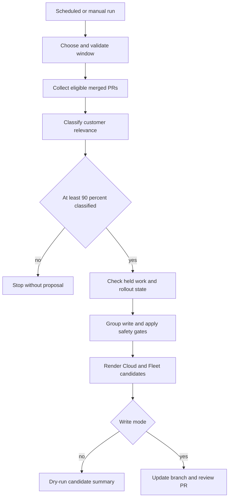

# Weekly Changelog Publication

The weekly workflow **proposes**, but does not automatically publish, updates to the Cloud changelog at `src/langsmith/changelog.mdx` and the Fleet changelog snippet at `src/snippets/langsmith/fleet-changelog.mdx`. A human reviews the generated PR, edits public wording when necessary, and uses the ordinary merge and documentation-publication process as the actual publication gate. Cloud links readers to Fleet's separate changelog, and both outputs use RSS-enabled `<Update>` blocks.

## Entry point and lifecycle

`.github/workflows/changelog-weekly.yml` runs at 13:00 UTC on Monday or by manual dispatch. Dispatch dates must be supplied as a `since`/`until` pair in `YYYY-MM-DD` form. Otherwise, `weekly` selects the Monday-to-Monday week ending on the most recent Monday; the end is exclusive, so an item merged on that Monday belongs to the next period.



*The workflow creates a candidate proposal only after coverage, rollout, and public-content checks; it never merges or publishes the proposal itself.*

The workflow runs `uv run python scripts/changelog_pipeline.py weekly --out "$RUNNER_TEMP/changelog"`; it adds `--since` and `--until` when supplied and adds `--write` only outside a dry run. The CLI rejects one-sided overrides. In write mode, if either changelog already has the computed week label, it exits successfully without changes, preventing a merged week from being inserted twice.

`weekly` first preflights the model when `ANTHROPIC_API_KEY` is set, then collects and classifies. A bad API credential therefore stops once before collection instead of producing a failure for every PR. It stops if fewer than 90% of collected PR records classified, rather than creating an incomplete weekly proposal.

## Inputs, cached work, and model boundary

Collection queries closed PRs in `langchain-ai/langchainplus`, retains merged `feat` and `fix` titles in the half-open interval, and filters cherry-picks and backports before model processing. It stores PR records beneath `--out`: body length is bounded, diffs have a character budget, `.changelog` fragments, lockfiles, snapshots, and similar low-signal files are omitted, and source diffs are preferred ahead of tests. Existing cached records and model result files are reused on reruns.

PR titles, descriptions, paths, diffs, and model output are sensitive processing inputs, not public summary material. They are untrusted model input: system prompts say to ignore embedded instructions. The API path requests JSON matching a closed schema; the CLI fallback disables setting sources, MCP tools, and session persistence, and runs in an empty temporary directory. Refusal, truncation, malformed output, and per-item model failures do not produce a publishable entry.

Haiku assigns each PR `announce`, `minor`, or `internal` based on concrete customer-visible evidence. For candidate work, Sonnet groups related PRs and ranks groups as `highlight`, `change`, `fix`, or `drop`; it must account for every PR. Sonnet writes highlights and Haiku writes other entries. The renderer emits independent Cloud and Fleet blocks, preserves ranked sections, caps highlights at six per product and fixes at 20 per product, and places fixes in an accordion.

## Conservative public-output gates

The pipeline normalizes approved names and escapes MDX-sensitive characters. It then checks generated titles and entries for internal service, repository, file, component, hosting, ticket, and flag-key leakage. A flagged entry is rewritten and checked again; a rewrite that fails, still leaks, or is dropped is excluded. Explicit partial-rollout wording is excluded rather than rewritten into an implication of general availability.

The pipeline also holds a candidate when the classifier identifies an Eppo flag that is not fully rolled out, or when the candidate shares both a relevant code area and topic with held work. A gate that cannot be checked is excluded. These are intentionally conservative eligibility decisions, not a substitute for review.

> **Public-output boundary:** Do not copy PR text, diffs, rollout details, ledger contents, secrets, or detailed reports into public documentation, Actions summaries, or review-PR prose. Review the proposed public changelog wording in context; do not turn sensitive workflow artifacts into summaries.

## Held state and rollout lifecycle

`scripts/.changelog_held.json.enc` is an encrypted durable ledger keyed by PR number. It records metadata needed to defer unreleased work. `CHANGELOG_STATE_KEY` is required to read or write an encrypted ledger; invalid or unavailable keys fail closed, and `.enc` data is never written in plaintext. A legacy plaintext sibling is incorporated into encrypted state and deleted only after the encrypted write succeeds. PR numbers and entry fields are sorted so state changes are deterministic.

For announce-tier PRs, an author-supplied standalone `Flag: <key>` declaration wins over a legacy `.changelog` fragment; `Flag: none` means no declared gate. Parsing ignores declarations inside comments, quotations, indented code, and fenced code. Conflicting declarations and flags missing from Eppo do not publish. Held work is released only when the recorded Eppo flag is fully rolled out; pending flags stay held, while conflicting, missing, or archived-before-rollout flags are removed without publication. If released work cannot be recollected, it stays held for a later retry.

A flag is fully rolled out only when an active production environment has a catch-all allocation with full exposure and a single served variation. For Boolean flags, that variation must be `true`; targeted-only, partial, split, inactive, archived-allocation, and false-serving states do not qualify. The Eppo client has a hardcoded HTTPS `eppo.cloud` base and rejects any other endpoint.

## Review PR behavior and operations

The job has a 90-minute timeout and uses a serialized `changelog-weekly` concurrency group without cancelling the run already in progress. It supplies the GitHub read token, Anthropic gateway key and URL, Eppo key, and state key through secrets. A GitHub App token is used for checkout, branch pushes, and PR creation because a PR opened with `GITHUB_TOKEN` would not trigger pull-request workflows.

Before a non-dry run, the job verifies it can force-push the dated `changelog/weekly-<UTC-date>` branch. If that branch has commits whose author email is not `github-actions[bot]`, it skips the run instead of overwriting human work. It creates or updates one same-day PR against `main`, staging only the two changelog targets and held-state paths. No changed target or state is a successful no-op. Vale runs on the proposed changelog files but is non-blocking; its final output is included in the review PR body.

The detailed `report.md` can name private PRs and unreleased work, so it stays in the output directory and is never published by the workflow. A dry run writes candidate entries from `mock.mdx` to the job summary, whereas the normal PR body contains aggregate counts and Vale output. These are review aids, not a record suitable for exposing sensitive inputs or state.

## Separate self-hosted command

`selfhosted` is separate from the weekly Cloud/Fleet publication path. It accepts a whitespace-separated release PR list, can reuse cached records and classifications, filters to eligible `feat`/`fix` work, and generates `release.mdx` plus `review.md` under `--out`. It groups self-hosted changes as upgrade, change, fix, or drop and screens generated text for internal names and ticket IDs. It does not insert a self-hosted changelog file.

## Focused validation and safe changes

Run the deterministic focused suite after changing this workflow or its helper behavior:

```bash
make test TEST_FILE=tests/unit_tests/test_changelog_pipeline.py
```

The suite uses no-network helpers and mocks for week labels and windows, closed structured-output schemas, `Flag:` parsing, collection filtering, rendering and insertion order, public-text rewrites, encrypted-state failure and migration, Eppo rollout semantics, model preflight, and endpoint allowlisting. It does not validate live GitHub, Anthropic, Eppo, Actions credentials, branch/PR creation, or rendered-site publication. Treat those as operational boundaries and verify them through the human review flow. See [GitHub Actions and CI/CD](/openwiki/integrations/github-actions.md), [Agent Skills](/openwiki/operations/agent-skills.md), [Testing Overview](/openwiki/testing/test-overview.md), and [Release Watch](/openwiki/workflows/release-watch.md) for adjacent practices.
