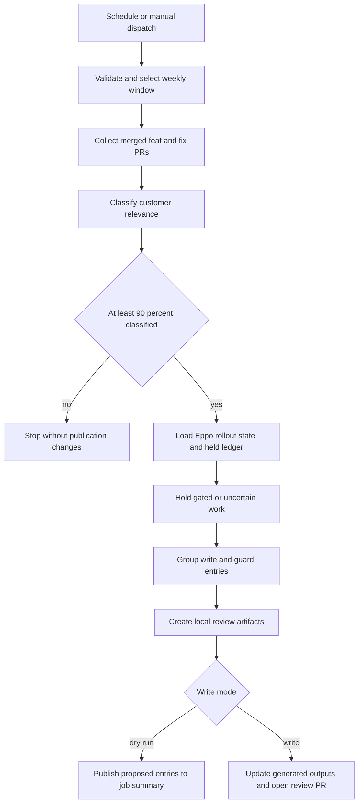

# LangSmith Changelog Publication

The Cloud and Fleet changelogs are generated publication outputs, not ordinary documentation pages. The weekly workflow owns `src/langsmith/changelog.mdx` and `src/snippets/langsmith/fleet-changelog.mdx`; the latter is imported by the Fleet changelog page. `src/langsmith/self-hosted-changelog.mdx` belongs to a separate Helm changelog bot. Do not hand-edit any of these outputs, including in a generated review PR: correct the generator, upstream PR information, rollout state, or release process instead. A manual edit can be overwritten and may already have been distributed through RSS.

The active Cloud/Fleet path is `.github/workflows/changelog-weekly.yml`, not an assembler or fragment workflow. It runs `scripts/changelog_pipeline.py weekly` against merged `langchain-ai/langchainplus` PRs and creates a review PR; it never merges its own proposal.

## Weekly lifecycle

The workflow runs at 13:00 UTC every Monday and can also be dispatched manually. A dispatch must provide both `since` and `until` in `YYYY-MM-DD` form or neither. Without dates, the command selects the Monday-to-Monday week ending on the most recent Monday. The collection range is half-open: a PR merged on the ending Monday belongs to the next week.



This shows the weekly generation and review path. Only entries safe to publish appear in the dry-run summary or generated changelog blocks.

Collection fetches merged PRs whose titles match `feat` or `fix`, excludes recognized cherry-picks and backports before model processing, and caches each PR record under `--out`. Cached records contain bounded PR bodies and diffs; the diff builder excludes fragments, lockfiles, snapshots, and similar low-signal files, prioritizes source over test files, and records omitted paths. A rerun can therefore resume from the cache.

The initial model pass uses Haiku to classify customer relevance as `announce`, `minor`, or `internal`. It must ground the decision in customer-visible diff evidence. A weekly run refuses to proceed if fewer than 90% of collected records were classified, preventing partial publication after a model or API failure. In write mode, finding the week label in either target makes a rerun a no-op, avoiding a duplicate block.

For announce-tier candidates, Sonnet groups related PRs and assigns highlight, change, fix, or drop layers; highlights are capped per product. Sonnet writes highlights, while Haiku writes other entries. Rendering produces independent Cloud and Fleet `<Update>` blocks with highlights, ranked sections, and at most 20 fixes per product inside an accordion. New blocks are inserted ahead of the existing newest block.

## Model and publication safeguards

Upstream PR descriptions, titles, paths, and diffs are untrusted model input. The system prompts direct every model pass to ignore embedded instructions. The API path requests JSON-schema output; the CLI alternative disables tools, disables session persistence, uses no setting sources, and runs in an empty temporary directory so project context cannot enter the call. A model refusal, truncation, invalid structured CLI result, or other per-item failure leaves that item unavailable rather than turning it into a publishable entry.

Generated prose receives additional guarded processing:

- MDX-sensitive characters outside code spans are escaped, and known product-name replacements are applied.
- An entry that contains an internal identifier, ticket-like ID, or a flag key is sent to a rewrite pass. The rewrite is checked again; failed, still-leaking, or dropped rewrites are excluded.
- A classifier-detected Eppo flag that is not fully rolled out, or an entry that overlaps a held PR in both code area and topic, moves the affected PRs to held state instead of publication.
- A gating signal that cannot be validated is excluded. The local run report has detailed withheld material and private PR context, so it remains under `--out` and is never placed in public workflow output.

The public artifacts are deliberately narrower. A dry run omits `--write` and writes only `mock.mdx`—the entries that would publish—to the job summary. A normal review-PR body contains aggregate counts and recent Vale output, not the detailed run report. Vale is non-blocking; passing it is not publication approval.

## Held state and Eppo gate

The durable ledger is `scripts/.changelog_held.json.enc`. It contains private PR and unreleased-work context, so it is Fernet-encrypted with `CHANGELOG_STATE_KEY`; missing, invalid, or wrong keys fail closed. The pipeline writes encrypted state without a plaintext intermediate. For migration only, it folds a legacy plaintext sibling into encrypted state and deletes that sibling after a successful write. Ledger writes order PR numbers and entry fields deterministically to keep generated diffs stable.

For announce-tier PRs, a standalone `Flag: <key>` declaration in the description is authoritative. Parser rules ignore examples in fenced code, HTML comments, block quotes, and indented code; `Flag: none` means no flag. A legacy `.changelog` fragment flag is a fallback only if no usable declaration exists. Conflicting declarations, unknown flags, and flags not fully rolled out are not published.

Eppo considers a feature fully rolled out only when an active production catch-all allocation exposes all traffic to one variation; for Boolean flags, that variation must be the enabled one. Targeted-only, partial, split, inactive, or false-serving allocations do not qualify. On a later run, only a held entry whose flag is fully rolled out is released into the candidate set. Entries with a pending flag remain held; entries with conflicting declarations, a missing Eppo flag, or an archived flag that was not fully rolled out are removed from the ledger without publication and recorded only in the private review report. If a released PR cannot be recollected, it remains held for rerun rather than disappearing.

Only `--write` persists the recalculated encrypted ledger and inserts generated blocks. This makes a normal review PR include the state transition together with the public output; a change to held state alone is also sufficient to create a PR.

## Workflow dispatch and review PR behavior

The job has a 90-minute timeout and serializes executions in the `changelog-weekly` concurrency group without cancelling a run in progress. It receives separate secrets for upstream GitHub read access, Anthropic access including gateway configuration, Eppo access, and encrypted-state access. Do not expose their values in logs, artifacts, fixtures, commands, PR text, or documentation.

For a non-dry run, the workflow runs Vale with `continue-on-error`, then checks whether either generated changelog target or held-state file changed. No changed state or output exits successfully without a branch or PR. Otherwise it force-pushes `changelog/weekly-<UTC-date>` and opens a PR against `main`. Review the proposed public wording, links, counts, encrypted-state diff, and Vale output, then address defects through the generator or upstream sources rather than editing generated outputs by hand.

## Entrypoints and scope

The normal entrypoint is:

```bash
uv run python scripts/changelog_pipeline.py weekly --out /tmp/changelog
uv run python scripts/changelog_pipeline.py weekly --out /tmp/changelog --since 2026-10-05 --until 2026-10-12 --write
```

The first command renders cached review artifacts but does not mutate changelog targets or the ledger. The second is a trusted write operation requiring the relevant credentials and review workflow.

`selfhosted` is separate from weekly Cloud/Fleet publication. It accepts a whitespace-separated list of release PR numbers, prepares a `release.mdx` artifact under `--out`, and screens generated lines for internal names and ticket IDs. It does not insert into `src/langsmith/self-hosted-changelog.mdx` or replace the Helm bot.

## Validation and safe changes

Run the deterministic pipeline tests after changing the generator:

```bash
make test TEST_FILE=tests/unit_tests/test_changelog_pipeline.py
```

The focused suite covers weekly labels and windows, strict structured schemas, `Flag:` parsing, insertion ordering, collection filtering, guarded text rewrite behavior, encrypted-state failures and plaintext migration, Eppo rollout semantics, and mocked model-client failure behavior. It does not exercise live GitHub, Anthropic, Eppo, Actions secrets, a generated PR, or rendered site behavior.

For workflow-wide credential and review boundaries, see [GitHub Actions and CI/CD](/openwiki/integrations/github-actions.md). For generated-output ownership, see [Agent Skills](/openwiki/operations/agent-skills.md) and [Repository Wiki Quickstart](/openwiki/quickstart.md). For the test boundary, see [Testing Overview](/openwiki/testing/test-overview.md).
