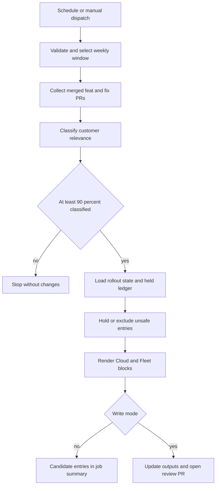

# Weekly Changelog Publication

The Cloud and Fleet changelogs are pipeline-owned publication outputs. The weekly proposal workflow writes `src/langsmith/changelog.mdx` and `src/snippets/langsmith/fleet-changelog.mdx`; the Fleet changelog page imports that snippet. Treat both files and `scripts/.changelog_held.json.enc` as generated outputs: do not manually edit them as a way to alter a proposal or release held work. Correct the generator, the underlying PR information, or rollout state, then rerun and review the generated change. This matters especially because the Cloud and Fleet pages are RSS-enabled.

`.github/workflows/changelog-weekly.yml` is the Cloud/Fleet entrypoint. It invokes `scripts/changelog_pipeline.py weekly`, creates a review branch and pull request when tracked outputs change, and never merges that proposal itself. The separate `selfhosted` CLI subcommand only prepares a release artifact; it is not the Cloud/Fleet workflow.

## Lifecycle and entrypoints

The workflow is scheduled for 13:00 UTC on Monday and can also be manually dispatched. Dispatch dates must be supplied as a `since`/`until` pair in `YYYY-MM-DD` form, or omitted together. With no dates, `weekly` chooses the Monday-to-Monday period ending on the most recent Monday. The end is exclusive, so a PR merged on the ending Monday belongs to the next window.



*The weekly command separates proposal generation from the write-mode state transition and review pull request.*

The normal command is:

```bash
uv run python scripts/changelog_pipeline.py weekly --out /tmp/changelog
uv run python scripts/changelog_pipeline.py weekly --out /tmp/changelog --since 2026-10-05 --until 2026-10-12 --write
```

The first form produces local cache and review artifacts without changing repository targets or the ledger. `--write` is the mutation boundary: it persists the recalculated encrypted ledger and inserts non-empty blocks before the existing newest `<Update>` blocks. Before it does any work, write mode returns successfully if either target already contains the week label; this prevents a merged week from being inserted twice.

Collection lists merged `feat` and `fix` PRs from `langchain-ai/langchainplus` in the half-open window. Cherry-picks and backports are discarded before model processing. Per-PR records cached under `--out` bound body and diff sizes; diffs exclude changelog fragments, lockfiles, snapshots, and similar low-signal files, prefer source before tests, and record files omitted by the budget. Cached PRs, classifications, grouping, and writing results let a stopped run resume rather than repeat successful calls.

A model-key preflight runs before collection when the API path is configured, so an invalid key fails once instead of causing a per-PR failure. Haiku classifies PRs as `announce`, `minor`, or `internal` from concrete customer-visible diff evidence. The run fails rather than silently producing a partial proposal if fewer than 90% of collected records classify.

## Curation, rendering, and model boundary

For announce-tier work, Sonnet groups PRs that ship the same change and assigns `highlight`, `change`, `fix`, or `drop`; every PR is expected to be in one group. Highlights are written with Sonnet, while other entries are written with Haiku. The renderer emits independent Cloud and Fleet `<Update>` blocks, puts ranked highlights and change sections first, and caps each product's fixes at 20 inside an accordion. The grouping policy also drops cosmetic, limited-rollout, operational, and otherwise non-public changes.

PR titles, bodies, paths, and diffs are untrusted model input. The prompts say to ignore instructions embedded in those materials. The API uses a closed JSON schema; the fallback CLI disables tools and setting sources, disables session persistence, and runs in an empty temporary directory so repository context is not implicitly available. Refusal, truncation, malformed structured output, or a per-item model error cannot become a publishable entry.

Before rendering, the pipeline applies approved product-name replacements and escapes MDX-sensitive characters outside code spans. Entries that expose internal identifiers, ticket-like IDs, or flag keys go through a rewrite pass and are checked again; failed, still-leaking, or dropped rewrites are excluded. A classifier-detected unrolled Eppo flag, or overlap in both code area and topic with a held PR, moves the affected group to held state. Partial-rollout language and uncheckable gate signals are excluded rather than softened into a general-availability claim.

## Held-state lifecycle and rollout gate

`scripts/.changelog_held.json.enc` is a durable PR-number-to-metadata ledger for unreleased work. It is sensitive pipeline state, not a changelog input for manual editing. Fernet encryption requires `CHANGELOG_STATE_KEY`; missing, invalid, or incorrect keys fail closed, and the encrypted file is never written in plaintext. A legacy plaintext sibling is read during migration, merged into the encrypted ledger, and deleted only after a successful encrypted write. Deterministic PR-number and field ordering keeps state diffs stable.

For announce-tier PRs, a standalone `Flag: <key>` declaration in the PR description wins over a legacy `.changelog` fragment; `Flag: none` declares no gate. Parsing ignores examples in fenced code, comments, quotations, and indented code. A declared unknown or conflicting flag is not published. Held work is released only after Eppo reports its flag fully rolled out; missing flags, conflicting declarations, and flags archived before full rollout are removed without publication, while pending flags remain held. If a now-released PR cannot be recollected, it stays held for a later retry.

An Eppo flag is fully rolled out only when an active production environment has a catch-all allocation with full traffic exposure and one served variation. For Boolean flags, that variation must be the enabled (`true`) variation. Targeted-only, partial, split, inactive, or false-serving allocations therefore do not authorize publication.

## Privacy, operations, and review

The detailed run report can name private PRs and unreleased work, so it remains under `--out` and is never posted by the public-repository workflow. A dry run deliberately omits `--write` and publishes only the generated candidate entries from `mock.mdx` to the Actions job summary. A normal PR body contains aggregate counts and the final Vale output, not the detailed report. Vale is non-blocking; it is review input, not publication approval.

The Actions job has a 90-minute timeout and serializes the `changelog-weekly` concurrency group without cancelling an active run. It uses a GitHub App token for branch/PR writes and passes read access to upstream PRs, Anthropic gateway configuration, Eppo access, and the state key through secrets. Keep credential values and private PR/report content out of logs, fixtures, commands, documentation, and review text.

Before running a non-dry proposal, the workflow checks that its date-based `changelog/weekly-<UTC-date>` branch can be pushed. If an existing branch includes commits not authored by `github-actions[bot]`, it skips rather than force-overwriting human work. Otherwise it runs Vale and checks only the two generated targets plus held-state paths. No output or state diff is a successful no-op. A change force-pushes the dated branch and creates or updates its PR against `main`; a same-day rerun updates the existing PR body.

Reviewers should assess public wording and links, aggregate counts, encrypted-state diff, and Vale results. The review PR is the human publication gate. For general CI trust boundaries and trusted-writer guidance, see [GitHub Actions and CI/CD](/openwiki/integrations/github-actions.md).

## Separate self-hosted artifact

`selfhosted` accepts a whitespace-separated file of Helm-release PR numbers, reuses cached PR/classification data when requested, collects and classifies eligible `feat`/`fix` work, then groups it into upgrade, change, fix, or dropped material. It writes `release.mdx` and a review file under `--out`, filtering generated lines with internal names or ticket IDs. It does not insert content into a self-hosted changelog target.

## Validation and safe changes

Run the deterministic focused suite after changing this pipeline:

```bash
make test TEST_FILE=tests/unit_tests/test_changelog_pipeline.py
```

The suite uses no-network helpers and doubles to cover weekly labels and windows, strict structured-output schemas, API response failures, `Flag:` parsing, collection filtering, rendering and insertion order, guarded rewrites, encrypted-state failure and migration, and Eppo rollout semantics. It does not exercise live GitHub, Anthropic, Eppo, Actions secrets, branch/PR creation, or rendered-site behavior; those boundaries need operational review. See [Testing Overview](/openwiki/testing/test-overview.md) for the test boundary and [Local Development Workflow](/openwiki/workflows/local-development.md) for the repository toolchain.
