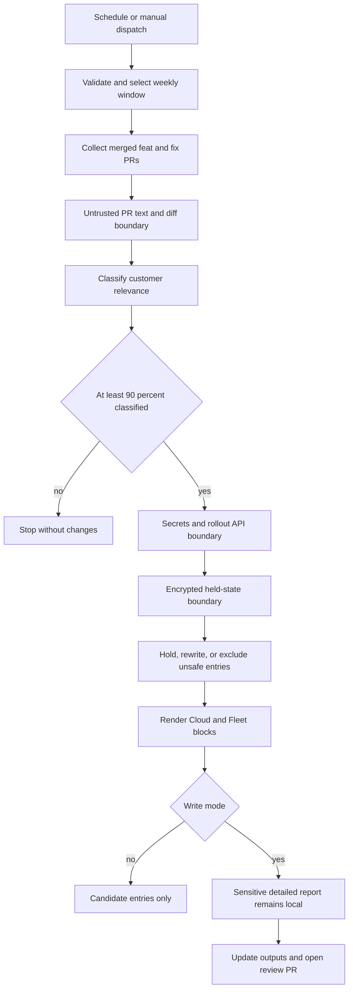

# Weekly Changelog Publication

The weekly pipeline proposes updates to `src/langsmith/changelog.mdx` (Cloud) and `src/snippets/langsmith/fleet-changelog.mdx` (Fleet). Cloud links to Fleet's separate page, and both targets contain RSS-enabled `<Update>` blocks. The pipeline produces a review pull request rather than merging or publishing it, so reviewers can correct generated wording directly in that PR before the normal merge and documentation publication process.

`.github/workflows/changelog-weekly.yml` is the Cloud/Fleet entrypoint. It invokes `scripts/changelog_pipeline.py weekly`; the separate `selfhosted` subcommand creates a release-note artifact and is not part of this weekly publication path.

## Lifecycle and entrypoints

The workflow runs at 13:00 UTC each Monday and also supports manual dispatch. A dispatch must supply `since` and `until` together in `YYYY-MM-DD` form, or omit both. Without dates, `weekly` selects the Monday-to-Monday period ending on the most recent Monday. The end is exclusive: a PR merged on that Monday belongs to the following period.



*The lifecycle isolates untrusted PR content, credentials, encrypted state, and the detailed report before a human-reviewed public proposal is created.*

The normal command is:

```bash
uv run python scripts/changelog_pipeline.py weekly --out /tmp/changelog
uv run python scripts/changelog_pipeline.py weekly --out /tmp/changelog --since 2026-10-05 --until 2026-10-12 --write
```

The first form creates cache and review artifacts without changing repository targets or the ledger. `--write` is the mutation boundary: it persists the recalculated encrypted ledger and inserts each non-empty block before the newest existing `<Update>` block. In write mode, finding the week label in either target is a successful no-op, which prevents duplicate insertion after a week has merged.

Collection lists merged `feat` and `fix` PRs in `langchain-ai/langchainplus` in the half-open interval. It excludes cherry-picks and backports before model processing. Per-PR records cached under `--out` bound body and diff sizes; diffs omit fragments, lockfiles, snapshots, and other low-signal files, prefer source before tests, and record files omitted by the budget. Cached PRs and model results allow a rerun to resume rather than repeat successful work.

When `ANTHROPIC_API_KEY` selects the API path, a model preflight runs before collection. An invalid key therefore fails once rather than once per PR. Haiku classifies customer relevance as `announce`, `minor`, or `internal` from concrete, customer-visible diff evidence. The weekly run stops rather than silently proposing an incomplete week if fewer than 90% of collected records classify.

## Curation, rendering, and the untrusted-input boundary

For announce-tier work, Sonnet groups PRs that ship the same change and ranks each as `highlight`, `change`, `fix`, or `drop`; the grouping prompt expects every PR to appear in one group. Sonnet writes highlights, while Haiku writes other entries. The renderer creates independent Cloud and Fleet `<Update>` blocks, orders highlights and ranked sections before fixes, and caps each product's fixes at 20 in an accordion. Grouping also drops cosmetic, limited-rollout, operational, duplicated, or otherwise non-public material.

> **Sensitive boundary — untrusted PR content:** PR titles, bodies, paths, and diffs are data, not instructions. Prompts explicitly tell models to ignore embedded instructions. API calls request closed-schema JSON; the CLI fallback disables tools and setting sources, disables session persistence, and runs from an empty temporary directory so repository context is unavailable. Refused, truncated, malformed, or per-item failed model output does not become a publishable entry.

Before rendering, the pipeline applies approved product-name replacements and escapes MDX-sensitive characters outside code spans. Entries that expose internal identifiers, ticket-like IDs, flag keys, component or hosting internals go through a rewrite pass and are checked again. A failed, still-leaking, or dropped rewrite is excluded. Entries that mention partial rollout are also excluded rather than reworded as general availability.

A classifier-detected unrolled Eppo flag, or an entry sharing both code area and topic with held work, moves the group to held state. A missing or otherwise uncheckable gate is excluded. These are conservative publication decisions: a plausible entry is less important than not claiming that unreleased or internal work is public.

## Held-state lifecycle and rollout gate

> **Sensitive boundary — encrypted state:** `scripts/.changelog_held.json.enc` is a durable PR-number-to-metadata ledger for unreleased work. It can identify private PRs and planned features, so it is committed encrypted rather than as plaintext.

Fernet encryption requires `CHANGELOG_STATE_KEY`; an absent, invalid, or incorrect key fails closed, and an `.enc` state file is never written in the clear. A legacy plaintext sibling is folded into the encrypted ledger and removed only after the encrypted write succeeds. PR-number and field ordering make ledger diffs deterministic.

For announce-tier PRs, a standalone `Flag: <key>` declaration in the PR description takes precedence over a legacy `.changelog` fragment; `Flag: none` declares no gate. Parsing ignores declarations in fenced code, comments, quotations, and indented code. Unknown or conflicting declarations do not publish. Held work releases only when Eppo reports the flag fully rolled out; missing flags, conflicting declarations, and flags archived before full rollout are removed without publication, while pending flags remain held. If a released PR cannot be recollected, it remains held for a later retry.

An Eppo flag is fully rolled out only if an active production environment has a first catch-all allocation that serves all traffic to exactly one variation. For Boolean flags, that variation must be the enabled `true` variation. Targeted-only, partial, split, inactive, archived-allocation, or false-serving states do not authorize publication. The Eppo client uses a hardcoded HTTPS `eppo.cloud` base URL rather than a user-supplied endpoint.

## Public-repository safety, operations, and review

> **Sensitive boundary — reports and secrets:** The workflow receives GitHub read access, Anthropic gateway configuration, Eppo access, and the state key through secrets. Do not put values, private PR details, or unreleased-work details in logs, commands, fixtures, documentation, job summaries, or PR text.

The detailed `report.md` names private PRs and unreleased work, so it stays under `--out` and is never published by this public-repository workflow. A dry run deliberately omits `--write` and posts only generated candidate entries from `mock.mdx` to the Actions summary. A normal review PR contains counts and final Vale output, not the detailed report. Vale is non-blocking review input rather than an approval gate.

The job has a 90-minute timeout and serializes the `changelog-weekly` concurrency group without canceling an active run. A GitHub App token is used for checkout, branch pushes, and PR creation because PRs opened with `GITHUB_TOKEN` would not trigger pull-request workflows. Before a non-dry run, the workflow verifies that its dated `changelog/weekly-<UTC-date>` branch can be pushed. If that branch contains commits whose author is not `github-actions[bot]`, it skips rather than force-overwriting human work.

After a normal run, the workflow checks only the two changelog targets and held-state paths. No output or ledger diff is a successful no-op. Otherwise, it runs Vale, force-pushes the dated branch, and creates or updates the PR against `main`; a same-day rerun updates the existing PR body. Reviewers should assess public wording and links, the aggregate counts, encrypted-state diff, and Vale results. The review PR is the human publication gate. For general CI trust boundaries and trusted-writer guidance, see [GitHub Actions and CI/CD](/openwiki/integrations/github-actions.md).

## Separate self-hosted artifact

`selfhosted` accepts a whitespace-separated file of Helm-release PR numbers and can reuse cached PR and classification data. It collects and classifies eligible `feat`/`fix` work, groups announce-tier items into upgrade, change, fix, or dropped material, and writes `release.mdx` plus a review file under `--out`. It filters generated entries that expose internal names or ticket IDs, but does not insert a self-hosted changelog target.

## Validation and safe changes

Run the deterministic focused suite after changing this pipeline:

```bash
make test TEST_FILE=tests/unit_tests/test_changelog_pipeline.py
```

The suite uses no-network helpers and mocks to cover weekly labels and windows, strict structured-output schemas and failures, `Flag:` parsing, collection-window filtering, rendering and insertion order, guarded rewrites, encrypted-state failure and migration, and Eppo rollout semantics. It does not exercise live GitHub, Anthropic, Eppo, Actions secrets, branch/PR creation, or rendered-site behavior; those boundaries require operational review. See [Testing Overview](/openwiki/testing/test-overview.md) for the test boundary and [Local Development Workflow](/openwiki/workflows/local-development.md) for repository tooling.
