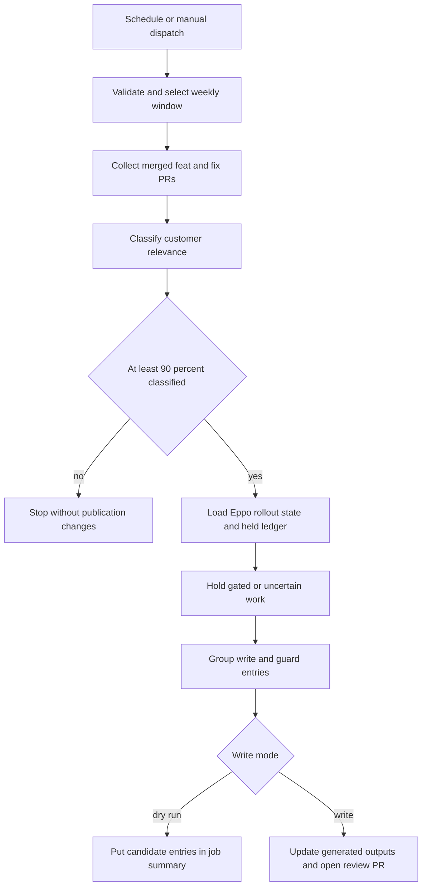

# LangSmith Changelog Publication

The Cloud and Fleet changelogs are generator-owned publication outputs, not ordinary documentation pages. The weekly workflow owns `src/langsmith/changelog.mdx` and `src/snippets/langsmith/fleet-changelog.mdx`; the Fleet page imports the latter. `src/langsmith/self-hosted-changelog.mdx` belongs to a separate Helm changelog bot. Do not manually edit the Cloud/Fleet targets or `scripts/.changelog_held.json.enc`, including on a generated review branch. Correct the pipeline, the upstream PR facts, or the rollout state instead. Manual output changes can be overwritten, and changelog content may already have been distributed through RSS.

The active Cloud/Fleet path is `.github/workflows/changelog-weekly.yml`, which runs `scripts/changelog_pipeline.py weekly` against merged `langchain-ai/langchainplus` PRs. It produces a proposal in a review PR; it does not merge or independently publish the proposal.

## Weekly lifecycle

The workflow runs at 13:00 UTC each Monday and also supports manual dispatch. A dispatch supplies both `since` and `until` in `YYYY-MM-DD` format, or neither. Without explicit dates, `weekly` selects the Monday-to-Monday period ending on the most recent Monday. The collection interval is half-open, so a PR merged on the ending Monday belongs to the next week.



This is the proposal and review path. Only entries that clear the publication checks appear in the dry-run summary or generated changelog blocks.

Collection finds merged PRs with `feat` or `fix` titles in the selected interval. It excludes recognized cherry-picks and backports before model processing and caches records under `--out`. Each record uses bounded PR-body and diff content; the diff builder omits fragments, lockfiles, snapshots, and similar low-signal files, prioritizes source files over test files, and records omissions. Cached collection and model artifacts allow a rerun to resume work.

Haiku first classifies customer relevance as `announce`, `minor`, or `internal`. The decision must have customer-visible diff evidence. A weekly run stops when fewer than 90% of collected records receive a classification, rather than publishing a partial result. In write mode, a matching week label in either target makes a rerun a no-op, which prevents duplicate blocks.

For announce-tier candidates, Sonnet groups related PRs and assigns the `highlight`, `change`, `fix`, or `drop` layer; a group can contain several PRs for the same shipped change. Sonnet writes highlights and Haiku writes other entries. Rendering produces separate Cloud and Fleet `<Update>` blocks with highlights, ranked sections, and no more than 20 fixes per product in an accordion. New blocks are inserted before the existing newest block.

## Model and publication safeguards

PR descriptions, titles, paths, and diffs are untrusted model input. System prompts direct every model pass to ignore embedded instructions. The API path requests JSON-schema output. The CLI path disables tools and session persistence, accepts no setting sources, and runs from an empty temporary directory so repository context does not enter the call. Refusal, truncation, invalid structured output, or another per-item failure does not become a publishable entry.

Generated prose then passes guarded processing:

- MDX-sensitive characters outside code spans are escaped and known product-name replacements are applied.
- Text containing an internal identifier, ticket-like ID, or flag key goes to a rewrite pass and is checked again. A failed, still-leaking, or dropped rewrite is excluded.
- A classifier-detected flag that is not fully rolled out, or an entry that overlaps a held PR in both code area and topic, moves affected PRs to held state rather than publication.
- A signal that cannot be validated is excluded. The detailed local run report contains private PR and unreleased-work context, so it remains under `--out` and never becomes public workflow output.

Public artifacts are intentionally narrower. A dry run omits `--write` and copies only generated candidate entries from `mock.mdx` to the job summary. A normal review-PR body contains aggregate counts and recent Vale output, not the detailed report. Vale is non-blocking and is not publication approval.

## Held state and rollout gate

The durable ledger is `scripts/.changelog_held.json.enc`. It holds private PR and unreleased-work context, so it is Fernet-encrypted with `CHANGELOG_STATE_KEY`; missing, invalid, or incorrect keys fail closed. The pipeline writes an `.enc` ledger without a plaintext intermediate. During migration, it folds a legacy plaintext sibling into encrypted state and removes that sibling only after a successful write. Ledger writes sort PR numbers and entry fields to keep generated diffs stable.

For an announce-tier PR, a standalone `Flag: <key>` declaration in the description is authoritative. Parsing ignores examples in fenced code, HTML comments, block quotes, and indented code; `Flag: none` means no flag. A legacy `.changelog` fragment is only a fallback when there is no usable declaration. Conflicting declarations, unknown flags, and flags that are not fully rolled out do not publish.

Eppo treats a feature as fully rolled out only when an active production catch-all allocation serves all traffic to one variation. For Boolean flags, that variation must be the enabled one. Targeted-only, partial, split, inactive, or false-serving allocations do not qualify. On a subsequent run, only a held entry whose flag is fully rolled out can return to the candidate set. Pending flags remain held. Conflicting declarations, missing Eppo flags, and flags archived before full rollout are removed from the ledger without publication and are recorded only in the private report. If a released PR cannot be recollected, it remains held for a rerun rather than disappearing.

Only `--write` persists the recalculated encrypted ledger and inserts generated blocks. Consequently, a normal review PR captures the state transition with the public proposal, and a held-state-only change can still create a PR.

## Dispatch, dry runs, and review PRs

The Actions job has a 90-minute timeout and serializes the `changelog-weekly` concurrency group without cancelling an in-progress run. It receives read access to upstream GitHub PRs, model and gateway configuration, Eppo access, and the state key through secrets. Do not expose credential values in logs, artifacts, fixtures, commands, PR text, or documentation.

For a non-dry run, the workflow runs Vale with `continue-on-error`, then checks whether either generated changelog target or the held-state file changed. With no state or output change, it exits successfully without a branch or PR. Otherwise, it force-pushes `changelog/weekly-<UTC-date>` and opens a PR against `main`. Human review is the publication gate: review the proposed public wording, links, aggregate counts, encrypted-state diff, and Vale output, then route corrections to the generator, upstream PR facts, or rollout state rather than manually changing generated output or state.

## Entrypoints and scope

The normal entrypoint is:

```bash
uv run python scripts/changelog_pipeline.py weekly --out /tmp/changelog
uv run python scripts/changelog_pipeline.py weekly --out /tmp/changelog --since 2026-10-05 --until 2026-10-12 --write
```

The first command renders local review artifacts without mutating changelog targets or the ledger. The second is the write path and requires the configured integration credentials and review process.

`selfhosted` is separate from weekly Cloud/Fleet publication. It accepts a whitespace-separated list of release PR numbers, prepares a `release.mdx` artifact under `--out`, and screens generated lines for internal names and ticket IDs. It does not insert into `src/langsmith/self-hosted-changelog.mdx` or replace the Helm bot.

## Validation and safe changes

After changing the generator, run the deterministic focused suite:

```bash
make test TEST_FILE=tests/unit_tests/test_changelog_pipeline.py
```

The suite covers weekly labels and windows, structured-output schema closure, `Flag:` parsing, insertion ordering, collection filtering, guarded text rewriting, encrypted-state failure and plaintext migration, and Eppo rollout semantics. It uses no-network helpers and mocks. It does not exercise live GitHub, Anthropic, Eppo, Actions secrets, generated PR creation, or rendered-site behavior; those integration boundaries require separate operational review.

For workflow-wide credential and review boundaries, see [GitHub Actions and CI/CD](/openwiki/integrations/github-actions.md). For generated-output ownership, see [Agent Skills](/openwiki/operations/agent-skills.md) and [Repository Wiki Quickstart](/openwiki/quickstart.md). For the test boundary, see [Testing Overview](/openwiki/testing/test-overview.md).
