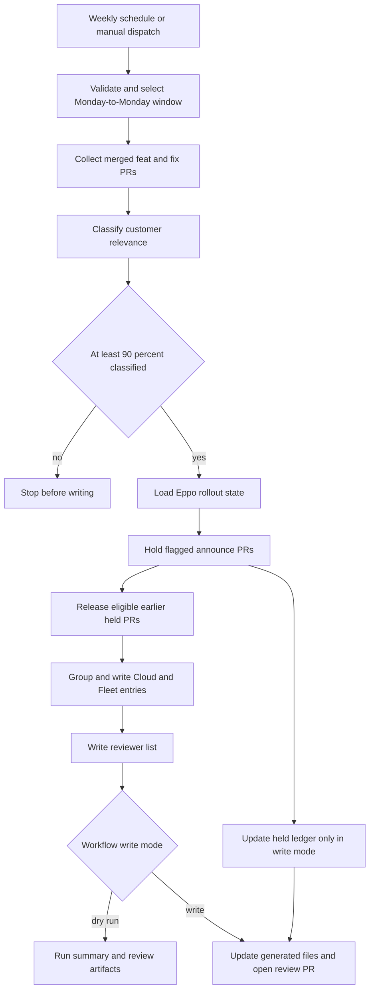

# LangSmith Changelog Publication

LangSmith has separate publication streams with separate owners:

- **Cloud and Fleet:** the scheduled `changelog-weekly.yml` workflow runs `scripts/changelog_pipeline.py weekly` against merged `langchain-ai/langchainplus` PRs. It may update `src/langsmith/changelog.mdx`, `src/snippets/langsmith/fleet-changelog.mdx`, and `scripts/.changelog_held.json` only on its generated review branch.
- **Self-hosted:** `src/langsmith/self-hosted-changelog.mdx` is the Helm-release stream, generated by the helm changelog bot. The pipeline's `selfhosted` command can prepare a release-note artifact from a supplied release PR list, but it does not replace that bot or the weekly Cloud/Fleet workflow.

Do **not** hand-edit either changelog MDX file. They are generated publication outputs: a later generator run can overwrite a manual change, and changelog publication has RSS consequences. Fix the owning generator, upstream PR information, or release process instead.

> **Deprecated compatibility support:** `scripts/assemble_changelog.py` is not the active publication path. It remains because `changelog_pipeline.py` imports its Eppo helpers, and should not be removed until those helpers move. Its fragment/ledger workflow is compatibility support for the former process; `changelog_pipeline.py weekly` replaced it with merged-PR collection.

## Active weekly lifecycle

The workflow runs every Monday at 13:00 UTC, or by manual dispatch. With no date inputs, the command uses the Monday-to-Monday week that ended on the most recent Monday; manual dates must be supplied as a pair in `YYYY-MM-DD` form. The workflow serializes runs in the `changelog-weekly` concurrency group rather than cancelling one already in progress.



This is the active classify-hold-group-write-review lifecycle. The workflow opens a review PR; it does not bypass review or merge its own output.

### Collection and classification

The pipeline fetches merged `feat` and `fix` PRs from `langchain-ai/langchainplus` whose merge time falls in the half-open weekly window. It excludes recognized cherry-picks and backports before model processing, stores PR metadata and bounded diffs under `--out`, and can reuse those caches on rerun.

Haiku first classifies each PR as `announce`, `minor`, or `internal` using customer-visible evidence from the diff. For announce-tier work, Sonnet groups related PRs and selects highlights, then Sonnet writes highlights and Haiku writes the remaining entries. The rendered weekly format separates highlights, sectioned changes, and a capped collapsed list of fixes; Cloud and Fleet are rendered into their respective output files.

A run stops before rollout evaluation and writing if fewer than 90% of collected PRs have classification results. With `--write`, a week label already present in either target turns a rerun into a no-op rather than creating a duplicate update.

## Trust boundaries and required review

Treat every boundary below as an input to evaluate, not a basis for automatic publication.

| Boundary | What enters the pipeline | Safeguard and review implication |
| --- | --- | --- |
| GitHub credentials and PR API | `GH_TOKEN` reads private upstream PR data. | The scheduled workflow supplies a read-only upstream token. PR titles, descriptions, changed-file names, and diffs are untrusted content, even when fetched with valid credentials. |
| Model credentials and output | `ANTHROPIC_API_KEY`, or a logged-in `claude` CLI outside the workflow, enables model calls. | Prompts explicitly treat PR content as untrusted; CLI model calls disable tools and use an empty temporary work directory. Responses must parse as schema-shaped JSON, but schema validity is not editorial correctness. |
| Eppo credentials and flag state | `EPPO_API_KEY` provides rollout state. | It governs eligibility for a held PR, not publication. Missing, conflicting, or unconfirmed state stays visible for human disposition rather than becoming a release decision. |
| Generated prose and file edits | Model-generated entries and generated MDX/JSON diffs. | Inspect wording, links, internal-name leakage, flag reasons, and held-state changes in the review PR before merge. Vale is non-blocking, so a successful workflow is not approval. |

The workflow passes `GH_TOKEN`, `ANTHROPIC_API_KEY`, and `EPPO_API_KEY` from GitHub Actions secrets; never put their values in PR text, cached artifacts, command lines, fixtures, or documentation. In normal mode it has repository-content and pull-request write permissions to create a constrained review branch. In dry-run mode, it omits `--write` and places proposed entries plus reviewer material in the GitHub job summary instead of opening a PR.

The reviewer list withholds entries that may expose internal names, include a detected unrolled flag, or share both code location and topic with a held PR. This is a safeguard against both prompt/model mistakes and incomplete rollout attribution. Read the list alongside the changelog diff; edit generated changelog files directly **in the generated review PR** only as part of review, rather than treating generated prose as self-publishing.

## Held PR state

`scripts/.changelog_held.json` is the durable hold ledger for the active weekly path. It maps PR numbers to the declared flag, title, merge date, and the weekly window in which the PR was held. Writes order PR numbers numerically and each entry's fields deterministically, keeping review diffs small.

For an announce-tier PR, a standalone `Flag: <key>` line in the PR description is authoritative; fenced code, HTML comments, block quotes, and indented code do not count. `Flag: none` means no declared flag. If no usable line exists, an older `.changelog` fragment flag is fallback compatibility input. Multiple declarations become a conflicting hold rather than an automatic release.

At the start of a later weekly run, the pipeline reevaluates held PRs against Eppo state:

- A fully rolled-out flag releases its PR into that week's candidate entries.
- An archived flag also releases it, but the reviewer material says to confirm that it shipped.
- A missing flag, a not-fully-rolled-out flag, or conflicting declarations remains held for human resolution.
- If a previously released PR cannot be collected, it is kept held and reported rather than silently dropped.

Only `--write` persists the newly calculated ledger. The generated review PR stages that ledger with both weekly changelog targets, so the state transition and proposed public text are reviewed together.

## Operations and failure handling

The scheduled job has a 90-minute timeout. It validates dispatch inputs before running, and a normal run opens a PR only when there is a diff. It uses the GitHub token for that PR after the pipeline completes. A no-entry week therefore exits successfully without a branch or PR.

Useful local entrypoints for pipeline work are:

```bash
uv run python scripts/changelog_pipeline.py weekly --out /tmp/changelog
uv run python scripts/changelog_pipeline.py weekly --out /tmp/changelog --since 2026-10-05 --until 2026-10-12 --write
uv run python scripts/changelog_pipeline.py selfhosted --out /tmp/changelog --prs-file release-prs.txt --name langsmith-0.18.0-rc.19
```

The first command prepares cached artifacts and prints the path to the reviewer list; it does not edit changelogs without `--write`. Use the second only in an appropriately credentialed, trusted context and inspect all resulting changes. The self-hosted command accepts whitespace-separated release PR numbers, filters and groups eligible release changes, screens written notes for internal-name and ticket patterns, and writes a `release.mdx` artifact beneath `--out`; release publication remains separate.

When triaging a run:

- **Date validation or credentials fail:** correct the dispatch inputs or trusted secret configuration. Do not work around missing access by copying secrets into flags, PR text, or files.
- **Classification coverage is below 90%:** investigate API/model failures and rerun. Do not publish the partial candidate.
- **A PR is held or appears on the reviewer list:** verify rollout and customer wording, then resolve it through the upstream flag/PR state or review disposition.
- **The write run is a duplicate:** the existing update label makes it a deliberate no-op; do not force another block.
- **Vale reports an issue:** it is advisory in this workflow. Correct material prose problems during review, but also review issues Vale cannot establish, especially rollout state and confidential implementation names.

## Focused validation and related guidance

Run the deterministic helper contract after changing the active pipeline:

```bash
make test TEST_FILE=tests/unit_tests/test_changelog_pipeline.py
```

The test covers weekly labels and windows, strict structured-output schemas, declared-flag parsing, held release/retention and stable ledger ordering, insertion before existing updates, and PR-window filtering. It uses mocks and does not prove live GitHub, Anthropic, Eppo, Actions-secret, generated-PR, or Mint-rendered behavior.

For generated documentation boundaries and rendered-site checks, see [Testing Overview](/openwiki/testing/test-overview.md). For trusted-writer workflow boundaries, see [GitHub Actions and CI/CD](/openwiki/integrations/github-actions.md). For local setup and the general rule to route a change to its durable owner, see [Repository Wiki Quickstart](/openwiki/quickstart.md) and [Adding and Maintaining Documentation Pages](/openwiki/operations/adding-pages.md).
