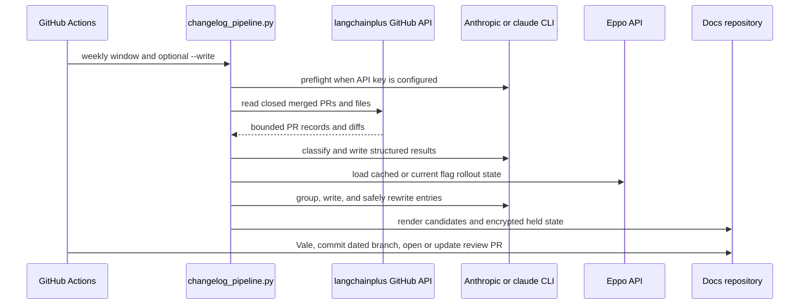
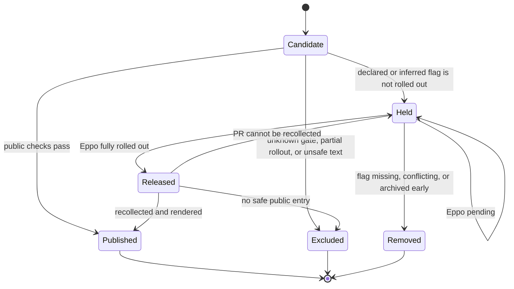

# Automated Changelog Publication

The weekly pipeline proposes—not directly publishes—updates to `src/langsmith/changelog.mdx` and `src/snippets/langsmith/fleet-changelog.mdx`. A human reviews the generated branch and pull request; merging it is the publication gate. Cloud and Fleet receive separate RSS-enabled `<Update>` blocks, and Cloud links readers to Fleet’s separate changelog where appropriate.

## Scheduled entry point

`.github/workflows/changelog-weekly.yml` runs at 13:00 UTC on Monday, or by manual dispatch. The default window is Monday-to-Monday for the week that ended on the most recent Monday. The end is exclusive, so a PR merged on the boundary Monday belongs to the next week. Manual `since` and `until` values must both be present and use `YYYY-MM-DD`.

The job runs:

```bash
uv run python scripts/changelog_pipeline.py weekly --out "$RUNNER_TEMP/changelog"
```

It adds `--since` and `--until` for an explicit window and `--write` unless `dry_run` is selected. Write mode returns successfully without changes when either target already contains the computed week label, preventing duplicate insertion.



*This sequence shows the scheduled workflow’s read, model, rollout, rendering, and review-PR boundaries; the workflow does not merge the PR.*

Before a non-dry run, the workflow checks that the dated review branch can be force-pushed and skips it if the branch contains commits not authored by `github-actions[bot]`. Runs are serialized in the `changelog-weekly` concurrency group without cancelling an in-progress run. The job has a 90-minute timeout. A GitHub App token is used for checkout, branch pushes, and PR creation because a PR opened with `GITHUB_TOKEN` would not trigger pull-request workflows.

## Collection and cached processing

The collector pages closed PRs in `langchain-ai/langchainplus` through the pulls API using read access, selecting merged `feat` and `fix` titles in the half-open interval. Cherry-picks and backports are excluded before model processing. Under `--out`, each PR is cached with a body limit, a diff character budget, selected source files before tests, and omitted low-signal files such as lockfiles, snapshots, and `.changelog` fragments. Cached records and model results are reused on reruns.

If `ANTHROPIC_API_KEY` is set, `weekly` performs a model preflight before collection and exits on failure. After classification it requires at least 90% coverage; otherwise it stops instead of producing an incomplete week. The workflow supplies GitHub read, Anthropic gateway, Eppo, and state-key credentials through secrets.

## Model and trust boundary

PR titles, descriptions, changed paths, diffs, and model results are processing inputs—not public changelog material. The prompts explicitly say that PR content is untrusted and that embedded instructions must be ignored. The API path uses Anthropic structured JSON output with closed object schemas; `_strict` closes nested objects and converts nullable type lists to `anyOf`. The CLI path disables setting sources, MCP tools, and session persistence, and runs in an empty temporary directory. Refusal, truncation, malformed output, and per-item failures do not become publishable entries.

Haiku classifies customer relevance as `announce`, `minor`, or `internal`, using customer-visible evidence. Sonnet groups related candidate PRs and assigns `highlight`, `change`, `fix`, or `drop`, while accounting for PR numbers. Sonnet writes highlights and Haiku writes other entries. A second grouping call handles omitted PRs; unknown PR numbers are discarded. Released held PRs can override a stale model `drop` unless the same change was already announced. The renderer creates independent Cloud and Fleet blocks, ranks sections, caps highlights at six per product, and caps fixes at 20 per product inside a `Show all fixes` accordion.

## Held-entry lifecycle

The held ledger is keyed by PR number and carries the flag and metadata needed to defer unreleased work. New author-declared holds come from a standalone `Flag: <key>` line; `Flag: none` means no declared gate. Parsing ignores comments, quotations, indented code, and fenced code. A declaration takes precedence over a legacy `.changelog` fragment, while conflicting declarations, unknown flags, and unverifiable gates are excluded rather than published.



*The ledger lifecycle distinguishes publishable candidates, deferred work, released work, and fail-closed outcomes.*

A held PR is released only when its Eppo flag is fully rolled out. A qualifying flag has an active production environment, a non-targeted catch-all allocation covering all traffic, and exactly one served variation; Boolean flags must serve `true`. Targeted-only, partial, split, inactive, archived-allocation, and false-serving states do not qualify. Missing, conflicting, pending, and archived-before-rollout states do not publish. If released work cannot be recollected, it remains held for a later retry. Eppo access is HTTPS-only to the hardcoded `eppo.cloud` base; user-supplied endpoints are rejected.

## Public-content gates

Before rendering, names are normalized and MDX-sensitive characters are escaped. Generated titles and entries are checked for internal services, repositories, files, components, hosting terms, ticket-like IDs, and flag keys. Flagged text is sent to a rewrite model and checked again; a failed rewrite, remaining leak, model `drop`, or uncertain gate is excluded. Explicit “limited rollout” or “off by default” wording is excluded rather than rewritten to imply general availability.

The classifier’s unrolled flag hint and overlap of code area plus topic with an already-held PR can hold an otherwise eligible group. These checks are deliberately conservative. Do not copy PR text, diffs, rollout details, ledger contents, secrets, or the detailed report into public documentation or review prose. The detailed `report.md` can identify private PRs and unreleased work, so it remains in the temporary output directory. Dry runs place only candidate `mock.mdx` entries in the job summary; normal review PR bodies contain aggregate counts and the Vale output.

## Encrypted state and review PR

`scripts/.changelog_held.json.enc` is durable encrypted state for a public repository. `CHANGELOG_STATE_KEY` is required to read or write it; invalid or unavailable keys fail closed, and `.enc` content is never written plaintext. A legacy plaintext sibling is folded into the encrypted ledger and removed only after a successful encrypted write. PR numbers and fields are sorted for deterministic state changes.

For a normal run, the workflow stages only the two changelog targets and held-state paths. It opens or updates one same-day PR against `main`; it does not publish or merge it. Vale runs against the proposed changelog files with `continue-on-error: true`, so Vale is non-blocking, but its final output is included in the PR body. If neither changelog content nor state changes, the job reports a successful no-op and opens no PR.

## Separate self-hosted command

`selfhosted` is not the Cloud/Fleet weekly publication path. It accepts a whitespace-separated PR list, reuses cached records and classifications when available, filters eligible `feat`/`fix` work, and writes `release.mdx` plus `review.md` under `--out`. It groups entries as upgrade, change, fix, or drop and removes generated text containing internal names or ticket IDs. It does not insert into the self-hosted changelog.

## Focused validation and safe changes

Run the deterministic focused suite after changing the workflow or pipeline:

```bash
make test TEST_FILE=tests/unit_tests/test_changelog_pipeline.py
```

The tests cover week windows and labels, closed structured-output schemas, refusal and truncation handling, `Flag:` parsing, collection filtering, grouping and insertion order, MDX escaping, public-text rewrites, encrypted-state failure and migration, Eppo rollout semantics, model preflight, and endpoint allowlisting with no-network helpers and mocks. They do not validate live GitHub, Anthropic, Eppo, Actions credentials, branch/PR creation, Vale installation, or rendered-site publication. For adjacent practices, see [GitHub Actions and CI/CD](/openwiki/integrations/github-actions.md), [Testing Overview](/openwiki/testing/test-overview.md), and [Local development](/openwiki/workflows/local-development.md).
